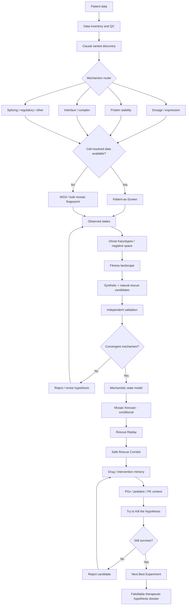
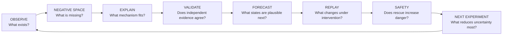
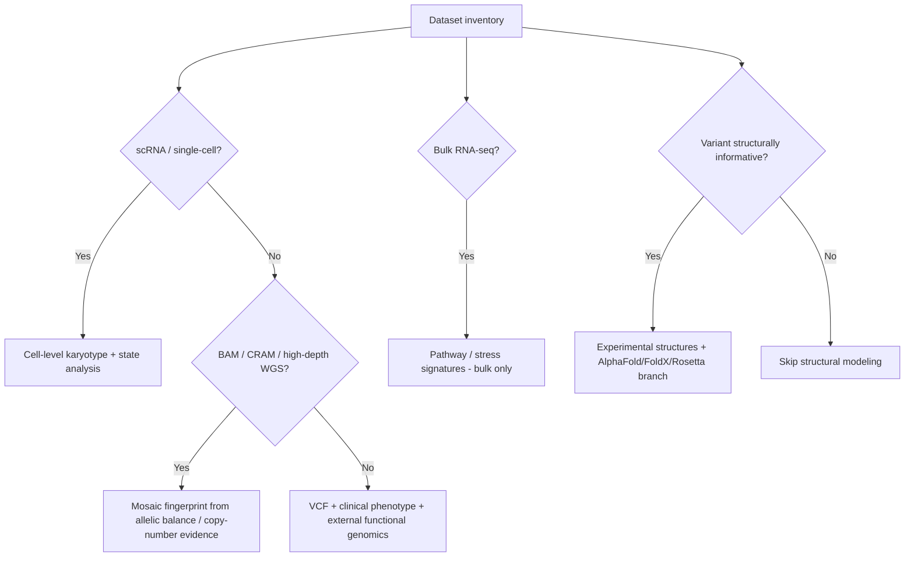
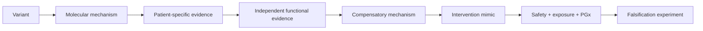

# MOSAIC RESCUE

### *The disease is running an evolutionary experiment. We decode it.*

MOSAIC RESCUE is a research-first, Jupyter/Python project for the **Rare Disease, Real Kid: MVA Hackathon 2026**. The goal is not to claim a cure or recommend treatment. The goal is to generate **patient-specific, traceable, falsifiable therapeutic hypotheses** from real genomic and clinical data.

> **The patient is not only the case. The patient may also contain the experiment.**

## Core idea

Mosaic Variegated Aneuploidy (MVA) generates chromosomally distinct cellular states. Instead of treating that mosaicism only as a consequence of disease, we ask whether the states that **persist, disappear, or become more likely under an inferred fitness landscape** reveal endogenous rules of cellular fitness and compensation.

Those rules must then survive independent functional validation before they are allowed to inform intervention hypotheses.

## Visual architecture

## Closed-loop research logic

## The eight research hypotheses we will test

1. **Patient-as-Screen** — MVA may create a natural perturbation screen inside one patient.
2. **Ghost Karyotypes** — depleted or missing chromosomal states may be as informative as surviving ones.
3. **Evolutionary Fitness Landscape** — the distribution of states may reveal selection rules rather than simple generation frequencies.
4. **Natural / Synthetic Rescue** — compensatory mechanisms may be discoverable by combining patient evidence with independent perturbation screens.
5. **Mosaic Forecast** — with suitable data and calibration, the inferred landscape may support probabilistic forecasting of plausible cellular states.
6. **Rescue Replay** — interventions should be evaluated against the patient-specific tolerated state, not only a generic healthy signature.
7. **Safe Rescue Corridor** — rescue is not equal to survival; benefit must not increase CIN, abnormal clonal fitness, apoptosis escape, or tumor-like adaptation.
8. **Next Best Experiment** — the system should identify the experiment that best distinguishes surviving hypotheses.

## Data gates

We will **not invent modalities**.

## Evidence standard

Every claim must be tagged by evidence level:

- **L0 — speculation**: plausible idea, no direct evidence.
- **L1 — associative**: observational or correlational support.
- **L2 — orthogonal support**: independent dataset or method supports the claim.
- **L3 — functional evidence**: perturbation supports the mechanism.
- **L4 — replicated functional evidence**: convergent functional evidence across systems.
- **L5 — clinically established**: established human evidence; use rarely and only when truly justified.

A drug/intervention hypothesis does **not** advance because it is exciting. It advances only when the chain is traceable:

## Mandatory adversarial rule

**No rescue without a do-no-harm test.**

MVA may involve tumor predisposition. A mechanism that helps aneuploid cells survive can also be biologically dangerous. Safety is part of the hypothesis itself, not a disclaimer added later.

## Research operating system

This repository is designed for multiple research agents working in parallel. Before contributing, read:

- [`AGENTS.md`](AGENTS.md) — agent behavior and quality bar
- [`CONTRIBUTING_RESEARCH.md`](CONTRIBUTING_RESEARCH.md) — how to submit findings
- [`docs/research_protocol.md`](docs/research_protocol.md) — evidence requirements and hypothesis gates
- [`docs/agent_workplan.md`](docs/agent_workplan.md) — parallel research streams
- [`docs/roadmap.md`](docs/roadmap.md) — execution phases and decision gates
- [`docs/visualization_plan.md`](docs/visualization_plan.md) — scientific visualizations and notebook outputs
- [`docs/diagrams.md`](docs/diagrams.md) — rendered project diagrams
- [`research/evidence_registry.md`](research/evidence_registry.md) — accepted evidence log
- [`research/contradictions.md`](research/contradictions.md) — evidence against our favorite ideas
- [`research/crazy_ideas.md`](research/crazy_ideas.md) — high-risk transfer ideas worth testing

## Notebook sequence

The planned analysis sequence is:

1. `00_data_inventory.ipynb`
2. `01_variant_discovery.ipynb`
3. `02_mechanism_router.ipynb`
4. `03_mosaic_landscape.ipynb`
5. `04_ghost_karyotypes.ipynb`
6. `05_fitness_landscape.ipynb`
7. `06_synthetic_rescue.ipynb`
8. `07_cell_competition.ipynb`
9. `08_mosaic_forecast.ipynb`
10. `09_rescue_replay.ipynb`
11. `10_safe_rescue_corridor.ipynb`
12. `11_drug_mimicry.ipynb`
13. `12_structural_mechanism.ipynb`
14. `13_pgx_safety.ipynb`
15. `14_try_to_kill_hypothesis.ipynb`
16. `15_next_best_experiment.ipynb`

Not every notebook will necessarily activate. The dataset and causal mechanism decide which branches are scientifically justified.

## Every notebook must answer

- What biological question are we asking?
- Which data support the analysis?
- Which assumptions are required?
- What would support the hypothesis?
- What would falsify it?
- What is the strongest alternative explanation?
- What uncertainty remains?
- What scientific visualization best exposes the phenomenon?
- What experiment should be run next?

## North-star output

We do **not** want a list of 50 drugs.

We want at most a few dossiers with this structure:

**causal variant → molecular mechanism → patient evidence → compensatory mechanism → independent validation → intervention mimic → safety / PGx / PK context → uncertainty → exact falsification experiment**

## Scientific boundary

This project produces **computational and preclinical research hypotheses**. It does not diagnose, prescribe, recommend administration, or claim a cure.

---

New ideas are welcome, but every idea must earn its place through evidence, explicit assumptions, contradiction search, and falsifiability.
