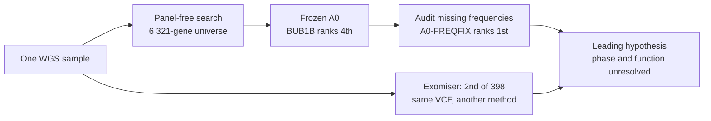
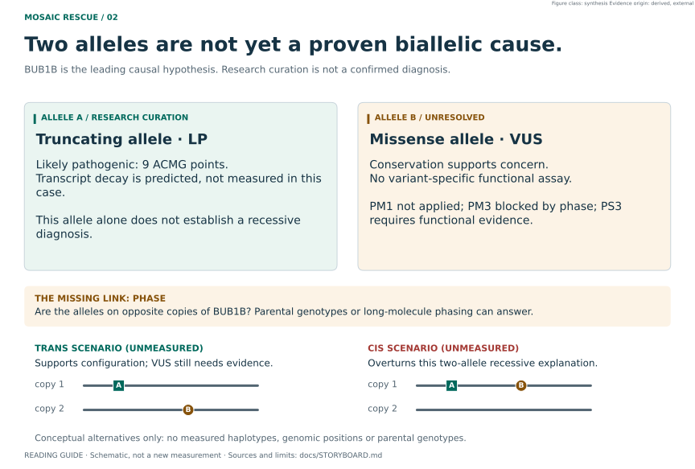
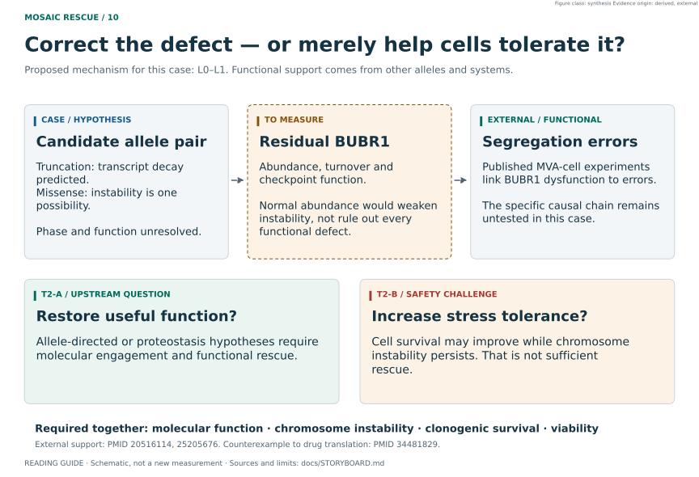
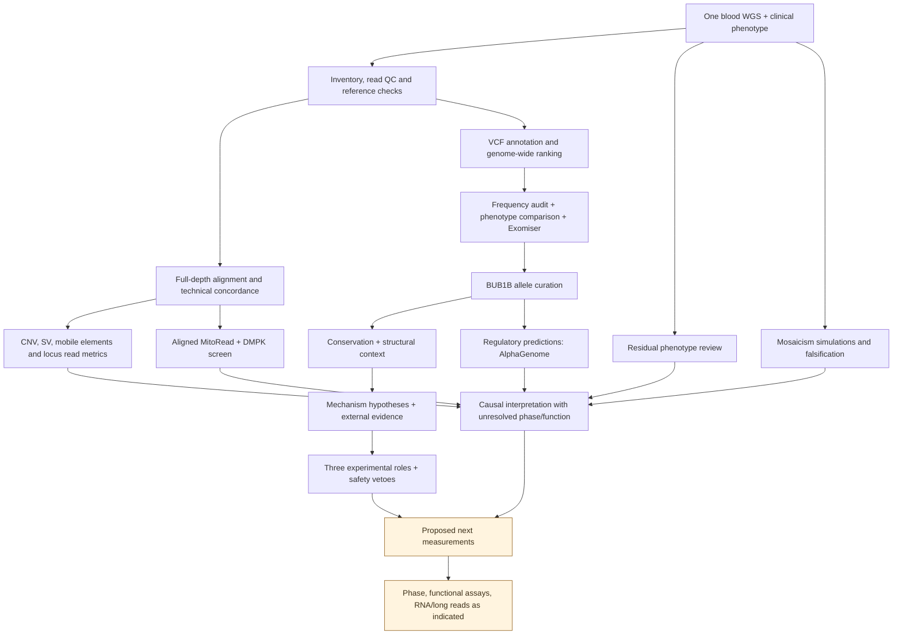

# MOSAIC RESCUE

<p align="center"><strong>ONE GENOME. A MECHANISM TO TEST. A SAFER QUESTION.</strong></p>


<p align="center"><em>A variant is only the beginning.</em></p>

A child with a suspected chromosome-segregation disorder brings two difficult questions:
**what is causing the disease, and what could we responsibly test next?**
Finding a plausible variant starts that investigation. It does not finish it.

MOSAIC RESCUE follows one blood genome through a chain of decisions. We search broadly,
challenge the leading gene, investigate what standard variant analysis might miss,
and ask how a proposed intervention could fail. The crucial twist comes at the end:
**helping a cell survive is not necessarily the same as correcting its defect.**

Built for the **Rare Disease, Real Kid: MVA Hackathon 2026**.
The story below connects the evidence to the decisions; the notebooks expose the work.

| 01 · Discover | 02 · Challenge | 03 · Test responsibly |
|---|---|---|
| Which gene best explains the case? | What would overturn that explanation? | What separates functional rescue from tolerance of instability? |
| Genome-wide ranking + phenotype | Allele curation + hidden-allele search | Mechanism + counter-evidence + safety vetoes |

*Cover and crossroads artwork: AI-generated conceptual illustrations, not experimental images or molecular models.*

**Current answer:** `BUB1B` is the leading causal hypothesis. Its two candidate alleles
are not yet a proven recessive pair. Short-read structural analysis is complete within
the frozen GO 2B scope; a complex insertion remains possible. Track 2 proposes three
experimental roles with explicit failure rules. **No treatment or therapeutic winner
has been established.**

[Track 1: causal evidence](reports/TRACK1_REPORT.md) ·
[Track 2: experimental portfolio](reports/TRACK2_REPORT.md) ·
[All 13 visual questions and remaining work](docs/STORYBOARD.md) ·
[Three-minute presentation](docs/JUDGE_PATH.md)

## See the science

**Start with the [Track 1 report](reports/TRACK1_REPORT.md)** for the causal argument and
its conclusions, then open the [executed notebooks](#reproduce-or-inspect-the-work), which render
directly on GitHub. [Research gaps and priorities](docs/RESEARCH_READINESS.md).

These are deterministic plots from frozen model outputs, measured/derived data or
explicit simulations. Open any image for the full-size SVG. The
[scientific atlas](docs/SCIENTIFIC_ATLAS.md) includes the gene browser, protein pocket,
phenotype matrix, mosaicism simulation and a reconciliation of the original visual plan.

### Which bases change the model's response?

[](figures/pub/fig04I_alphagenome_ism.svg)

**MODEL OUTPUT · PREDICTED.** This is the local mutagenesis view requested in the
original concept: 768 alternative substitutions across 256 positions. The candidate
is marked; the complete window remains visible. Sensitivity belongs to the model,
not to a measured patient assay. [Generator](src/figures/fig04_ism.py).

### Does the predicted contact landscape change?

[](figures/pub/fig04C_alphagenome_contact_maps.svg)

**MODEL OUTPUT · PREDICTED.** REF and ALT share a colour scale. Their difference has
its own zero-centred linear scale. These are predicted contacts, not patient Hi-C.
The result remains weak under the frozen decision rule; the colour scale does not
turn it into a positive finding. [Generator](src/figures/fig04_contacts.py).

### Where would a transcript-level effect appear?

[](figures/pub/fig04_alphagenome_rna_splicing.svg)

**MODEL OUTPUT · PREDICTED.** Aligned genomic tracks expose where the model predicts
signal and whether ALT changes it. They are not RNA-seq from the child.
[Accessibility and TF tracks](figures/pub/fig04S_alphagenome_accessibility_tf.svg) ·
[Generator](src/figures/fig04_tracks.py).

### What is actually visible across the chromosomes?

[](figures/pub/fig09_cnvpytor_chromosome_rd_baf.svg)

**DATA · MEASURED / DERIVED.** This is the available patient chromosome-level view.
It describes aggregate RD/BAF. A cell-by-chromosome mosaic heatmap would require
cell-resolved observations that are not available here; it cannot be reconstructed
by relabelling these averages as cells. [Simulation and its falsification](docs/SCIENTIFIC_ATLAS.md#5--mosaicism-what-was-observed-and-what-was-simulated).

### Where does the rescue argument have evidence—and where does it break?

[](figures/pub/fig07_track2_evidence_matrix.svg)

**CURATED EVIDENCE · EXTERNAL / DERIVED.** This is the defensible rescue map:
each cell represents a defined evidence category with provenance. Empty cells remain
visible; no invented efficacy, safety or patient-resilience scores position the drugs.
[Source table](research/track2_evidence.tsv) · [Generator](src/figures/fig07_evidence.py).

## 1. The story starts with one child’s genome

The first task was to establish what the dataset could actually answer. Four sequencing
lanes can look like four datasets; here they belong to the same biological sample.
That distinction determines how much confidence any agreement between analyses can add.

| Available | What it means |
|---|---|
| **One biological sample**, blood WGS | Four sequencing lanes, eight paired-end FASTQ files; these are technical partitions, not four people |
| Provider VCF + reconstructed full-depth BAM | Two representations of the same sample; technical concordance is not independent biological replication |
| Clinical phenotype terms | Guide interpretation; unmentioned traits remain unknown |
| Human reference **GRCh38 / hg38** | The coordinate system; not another participant's genome |

Parental genotypes, patient RNA-seq, protein assays, and single-cell or longitudinal
measurements are **not available**. VEP annotates variants, Exomiser supplies a second
ranking method, and AlphaGenome predicts molecular effects. None creates those missing
measurements.

## 2. A gene emerged. Then we challenged the ranking.

We searched broadly before choosing a mechanism. `BUB1B` competed in a **6 321-gene**
universe carrying HIGH or MODERATE consequence alleles; 151 genes scored under an
inheritance model.



The frozen **A0 #4** and later **A0-FREQFIX #1** are always reported together. The three
genes above `BUB1B` in A0 carried common alleles whose frequency annotation was missing.
Repairing that annotation was a later sensitivity analysis, not a rewrite of A0.
`BUB1B` ranks first in 14 of 15 analyses. Exomiser's agreement is methodological
convergence on the same data, not a second patient's validation.



The result supports **candidate compound heterozygosity with phase unresolved**.
If both alleles are on the same copy of the gene, this pair cannot explain the proposed
recessive mechanism. If they are on opposite copies, the missense still needs evidence.

## 3. The strongest candidate still had a missing link

Two candidate alleles made a recessive explanation plausible, but neither their phase
nor the missense mechanism was established. We therefore asked a harder question:
**could a coding-focused search be telling only part of the story?**

The full-depth alignment enabled GO 2B: copy-number analysis, structural-variant and
mobile-element callers, and descriptive inspection of short-read breakpoint signals.
**GO 2B is closed**, with frozen artifacts and source hashes in
[the decision record](docs/DECISIONS.md) and [artifact manifest](docs/go2b_final_artifacts.sha256.json).


The conclusion is specific: **CNVpytor emitted no RD+BAF CNV overlapping the BUB1B gene
body; xTea and SCRAMble emitted no overlapping MEI call.** The breakpoint assay had no
inferential excess/no-excess threshold. These findings do not exclude a complex insertion.
Other genome-wide caller records are raw inventory, not adjudicated alternative diagnoses.
AE2 population lookup remains **NOT EXECUTED (data policy)**, not a negative population result.

**The missing second allele has a history in this disease.** Our candidate pair, one
truncating allele plus one missense, is the canonical MVA1 configuration ([Hanks et al. 2004](https://doi.org/10.1038/ng1449)). Yet in the
early PCS families only one mutation per family was found in coding sequence ([Matsuura et al. 2006](https://doi.org/10.1002/ajmg.a.31069)), and the
hidden alleles later turned up outside the exons ([Kato et al. 2017](https://doi.org/10.1038/hgv.2017.21); [Kawakami et al. 2024](https://doi.org/10.1038/s10038-023-01211-8)). Our case sits at that frontier.

This limit has an external precedent: Kawakami and colleagues used RNA-seq and targeted
long reads to resolve an intronic insertion in a different `BUB1B` case after short-read
GS had not identified it. That motivates an experiment; it does not establish the same
lesion here. [PubMed](https://pubmed.ncbi.nlm.nih.gov/38102195/) ·
[DOI](https://doi.org/10.1038/s10038-023-01211-8).

<details>
<summary>Open the technical evidence behind this summary</summary>

- [Chromosome RD/BAF](figures/pub/fig09_cnvpytor_chromosome_rd_baf.svg): aggregated blood
  WGS, descriptive only. No cellular mosaic fraction or cytogenetic conclusion.
- [BUB1B read-level assay](figures/pub/fig10_bub1b_readlevel_assay.svg): body and matched
  flanks, frozen metrics and denominators, no significance threshold added after inspection.
- [MEI/SV adjudication map](figures/pub/fig11_mei_sv_adjudication_map.svg): local calls and
  partner context. This detailed internal figure contains case-specific positions and is
  not a public presentation asset.
- [Evidence context diagram](figures/pub/story04_evidence_context.svg): keeps patient
  data, simulation and published evidence separate.
- [AlphaGenome ISM](figures/pub/fig04I_alphagenome_ism.svg) and
  [predicted contacts](figures/pub/fig04C_alphagenome_contact_maps.svg): existing model
  outputs, not measured RNA or Hi-C. The separate EXP-024 calibration is not executed.

CNVpytor combines depth and allele imbalance; its method paper supports those readouts,
not a claim that these summaries count mosaic cells.
[PubMed](https://pubmed.ncbi.nlm.nih.gov/34817058/) ·
[DOI](https://doi.org/10.1093/gigascience/giab074).

</details>

## 4. From a candidate gene to a testable mechanism

The next step is not simply choosing a drug. A proposed intervention needs a specific
defect to act on, and a measurement that could show the idea was wrong.

Finding a plausible gene does not establish the defect caused by this particular allele
pair. The working hypothesis is reduced useful BUBR1 function. Patient-specific protein
abundance, turnover and checkpoint function remain unmeasured.



External MVA-cell experiments support distinct abundance and functional defects in other
alleles. A normal abundance assay would weaken the instability hypothesis, not exclude
every functional mechanism. [PubMed](https://pubmed.ncbi.nlm.nih.gov/20516114/) ·
[DOI](https://doi.org/10.1158/0008-5472.CAN-09-4319).

The literature also gives a reason to challenge drug translation: genetic HSP70
overexpression improved a readout in NPC1 fibroblasts while arimoclomol did not under
the tested conditions. This is a counterexample in another disease, not a result in
this patient. [PubMed](https://pubmed.ncbi.nlm.nih.gov/34481829/) ·
[DOI](https://doi.org/10.1016/j.jlr.2021.100114).

## 5. The turning point: survival can be the wrong success


Suppose an intervention makes more cells survive. That could reflect useful restoration
of function. It could also allow unstable cells to persist. Those outcomes lead to very
different decisions. **MOSAIC RESCUE makes the safety question part of the experiment.**

The deliverable is a **preclinical experimental portfolio**. These arms have different
roles; the order below is not a ranking or an administration recommendation.

| Arm | Question | Crucial gap / rejection condition |
|---|---|---|
| **Azithromycin — allele-directed hypothesis** | Could readthrough restore useful full-length protein? | No direct BUB1B evidence in the curated dossier; no functional product would reject this route under the tested conditions |
| **Arimoclomol — falsification sentinel** | Does pharmacological co-induction actually engage the intended stress-response mechanism? | External counter-evidence; no engagement despite an informative positive control would reject the proposed pharmacological bridge in that system |
| **Sirolimus — adversarial comparator** | Could apparent benefit reflect tolerance of instability? | Improved clonogenic survival of unstable cells is a veto; this arm is not a therapeutic nominee |

The [evidence matrix](figures/pub/fig07_track2_evidence_matrix.svg) retains **8 bridges ×
10 evidence dimensions**. **61 of 80 cells are empty in the bounded search**. An empty
cell is a gap in that search, not proof that no study exists. Bridge 7 is the translation
gap; bridge 8 is the joint safety-outcome gap. No overall evidence score is calculated.

The [portfolio figure](figures/pub/fig08_track2_portfolio.svg) includes three controls;
the [safety gates](figures/pub/story12_safety_gates.svg) show why molecular engagement,
chromosome segregation, clonogenic survival and viability must be read together.
Greater tolerance of aneuploidy is not sufficient evidence of safe rescue; experimental
HSF1 work makes that distinction particularly relevant.
[PubMed](https://pubmed.ncbi.nlm.nih.gov/25205676/) ·
[DOI](https://doi.org/10.15252/embj.201488648).

## 6. The next chapter needs a different kind of evidence


**The highest-value immediate genetic question is phase.** More ranking refinement cannot
replace that datum. RNA/long-read work addresses a hidden allele; the functional assay
addresses the missense; the safety experiment addresses an intervention. They are not
interchangeable confirmations.

Remaining analytical questions include the residual nephrocalcinosis, MitoRead's blood
composition and matched-control confounders, and validation of a mosaicism detector
against a phased baseline. A complete BAM now exists; those biological uncertainties
remain. [Detailed status and decision-changing results](docs/STORYBOARD.md#what-is-genuinely-missing).

## 7. What we conclude, and what only new data can prove

**Established, from most to least certain**

1. The data are fit for the question, and both candidate alleles are recovered in the
   reconstructed reads.
2. `BUB1B` is the best-supported explanation among 6 321 genes: #4 in the frozen ranking,
   #1 once three missing frequency annotations were repaired, #1 in 14 of 15 analyses, and
   #2 of 398 in an independent method on the same VCF. Every close competitor was rejected
   for a stated reason.
3. The candidate genotype, truncating plus missense, is the canonical MVA1 configuration.
4. The structural search found no copy-number or mobile-element call in the gene. A complex
   intronic insertion, the kind that has hidden second alleles before, is not excluded.
5. Our first explanation of the BAF signal was wrong, and we show how we found out.

**Not established:** a diagnosis, a biallelic configuration, the missense effect, a mosaic
cell fraction, a working rescue, or that the method generalises beyond this child.

| Open question | Why no further computation on this genome can answer it | Decisive observation | If the result goes one way | If it goes the other way |
|---|---|---|---|---|
| **1 · Phase** | One sample, no parents; the two alleles lie 13.8× the fragment length apart, beyond read-backed phasing | Parental genotyping at both sites, or targeted long-read phasing of the child | **Trans:** the canonical biallelic MVA1 configuration is present; the missense still needs functional evidence | **Cis:** this pair cannot be the recessive explanation; the hidden-allele search becomes the primary question |
| **2 · Missense function** | The missense is a VUS; 95.3 % of ClinVar missense in the gene are VUS and there is no hotspot; conservation and structure are predictions | Variant expressed in isogenic cells: BUBR1 abundance and turnover, kinetochore localisation, checkpoint arrest, segregation errors, with wild-type and known MVA-allele controls | Reduced abundance or checkpoint failure: functional support for pathogenicity; published work links a >50 % loss of BUBR1 expression or activity to PCS ([Matsuura et al. 2006](https://doi.org/10.1002/ajmg.a.31069)) | Normal on every readout: the pair is weakened; a hidden allele or another gene becomes more likely |
| **3 · Safe rescue** | No compound has been tested in any system relevant to this allele; all rescue evidence is external | Isogenic assay measuring target engagement, chromosome segregation errors and clonogenic survival **together**, with a genetic positive control | Fewer segregation errors without extra survival of unstable cells: the arm advances to further preclinical work | More survival of unstable cells: **veto**, even if another readout improves |
| **4 · Generality of the method** | Only one patient was analysed; rules were built on this case | Run the frozen pipeline, unchanged, on previously solved cases with known causal genes, blinded to the answer | The known genes rank at the top: evidence that the procedure transfers | They do not: the contribution is the audit trail, not the ranking |

Phase comes first: it is the cheapest observation and it decides whether this pair can be the
explanation at all. The full argument is in [Track 1 §7b](reports/TRACK1_REPORT.md).

## What makes this useful beyond a single ranking

| Decision we exposed | Why it matters |
|---|---|
| A0 #4 → A0-FREQFIX #1 | Shows exactly how missing frequency provenance changed the ranking |
| Published negative regulatory and structural results | Narrows the claim while preserving the limits of each assay |
| Our original absolute-BAF explanation was falsified | A post-hoc ablation identified depth confounding; no detector superiority is claimed |
| Evidence gaps and counter-evidence stay visible | A proposed drug mechanism cannot borrow certainty from genetic rescue in another system |
| Safety can veto an apparently positive result | Correcting instability and helping unstable cells survive require different decisions |

The transferable contribution is the **decision procedure**, not a proven general therapy.
Only one patient has been analysed. [Scalability and its limits](docs/SCALABILITY.md).

## Behind the story: the complete research route

The project has parallel branches. They meet at a decision, not at a single score.
This map separates work already performed from the measurements still needed.



### What each branch contributes

| Process | What we learned / produced | What it does not settle | Inspect |
|---|---|---|---|
| **Data and alignment** | Initial read QC, full-depth BAM, reference and technical-concordance checks | Additional biological replication | [Data notebook](notebooks/00_DATA_REALITY.ipynb), [current report](reports/TRACK1_REPORT.md) |
| **Broad search and ranking audit** | Frozen A0 #4 → later A0-FREQFIX #1; independent ranking method on the same VCF | Causality from a rank alone | [Genome-wide notebook](notebooks/01_TRACK1_GENOME_WIDE.ipynb) |
| **Phenotype comparison** | Disease-model comparison uses clinical terms; missing traits stay unknown | A missing annotation is not evidence that a trait is absent | [Residual phenotype notebook](notebooks/05_RESIDUAL_PHENOTYPE.ipynb) |
| **Allele curation** | Truncating allele: research LP; missense: VUS; phase unresolved | A confirmed recessive diagnosis | [Curation notebook](notebooks/02_BUB1B_ALLELE_CURATION.ipynb) |
| **Conservation and structure** | Evolutionary support for concern and structural hypotheses that can be challenged | A prediction is not a functional assay | [Mechanism notebook](notebooks/03_BUBR1_MECHANISM.ipynb) |
| **Regulatory modelling** | Frozen AlphaGenome tracks, ISM and contact predictions | Patient RNA/protein; separate EXP-024 calibration remains unexecuted | [Hidden-allele notebook](notebooks/04_HIDDEN_SECOND_ALLELE.ipynb) |
| **GO 2B structural search** | Frozen CNV/SV/MEI outputs and descriptive locus read metrics | A complex insertion is not excluded by these short-read results | [Track 1 §7](reports/TRACK1_REPORT.md) |
| **Technical allele recovery** | Both prioritized alleles recovered in reconstructed reads | Phase or independent biological confirmation | [Track 1 report](reports/TRACK1_REPORT.md) |
| **Residual DMPK screen** | Negative screen within the assessed short-read scope | Every repeat disorder or every possible second diagnosis | [Experiment registry](research/EXPERIMENT_REGISTRY.md) |
| **MitoRead** | Aligned blood mtDNA:nuclear ratio, descriptive and composition-unadjusted | Mitochondrial dysfunction without matched controls and confounder assessment | [Current registry](research/EXPERIMENT_REGISTRY.md), [prototype notebook](notebooks/06_MOSAIC_AND_MITOREAD.ipynb) |
| **Mosaicism methods** | Simulation and ablation challenged our initial absolute-BAF explanation | A measured patient mosaic fraction or validated superior detector | [Mosaicism notebook](notebooks/06_MOSAIC_AND_MITOREAD.ipynb) |
| **Rescue evidence and contradictions** | Eight biological bridges, sourced evidence gaps, three intervention roles and controls | A therapy selected for administration | [Safe-rescue notebook](notebooks/07_TRACK2_SAFE_RESCUE.ipynb) |
| **Falsification and delivery** | Explicit rejection conditions, source hashes, executable checks, two reports | Completion of proposed assays or submission | [Decision record](docs/DECISIONS.md), [judge path](docs/JUDGE_PATH.md) |

<details>
<summary><strong>One-page scientific overview</strong> — the same route with explicit evidence limits</summary>


</details>

## Reproduce or inspect the work

Eight executed notebooks retain **30 embedded output figures, 25 scientific**.
They now also include **10 self-contained image attachments**: nine narrative/synthesis
panels and the frozen GO 2B chromosome RD/BAF figure. These reviewed additions are
labelled separately from the original executed analysis; they do not imply a new run.
Start with the visual introduction in each notebook, then inspect its original evidence.

| Notebook | Question |
|---|---|
| [00 · Data reality](notebooks/00_DATA_REALITY.ipynb) | What could the initial data answer? |
| [01 · Genome-wide search](notebooks/01_TRACK1_GENOME_WIDE.ipynb) | Why did BUB1B survive? |
| [02 · Allele curation](notebooks/02_BUB1B_ALLELE_CURATION.ipynb) | Which criteria apply and which are blocked? |
| [03 · Mechanism](notebooks/03_BUBR1_MECHANISM.ipynb) | Which missense hypothesis deserves an assay? |
| [04 · Hidden allele](notebooks/04_HIDDEN_SECOND_ALLELE.ipynb) | What did the regulatory search predict? |
| [05 · Residual phenotype](notebooks/05_RESIDUAL_PHENOTYPE.ipynb) | What remains unexplained? |
| [06 · Mosaicism / MitoRead](notebooks/06_MOSAIC_AND_MITOREAD.ipynb) | What can simulation and prototypes establish? |
| [07 · Safe rescue](notebooks/07_TRACK2_SAFE_RESCUE.ipynb) | Which experiments discriminate the hypotheses? |

```bash
python src/verify.py             # tests, evidence, provenance and consistency
python src/figures/story.py      # rebuild the seven synthesis diagrams
python src/figures/render_all.py # technical figures + synthesis, local data required
python src/nb/build_all.py       # rebuild the eight notebooks, local data required
python src/nb/story_integration.py # refresh reviewed attachments, without rerunning analyses
```

Every new diagram declares `NARRATIVE` or `SYNTHESIS`. Technical figures separately
declare `DATA`, `MODEL_OUTPUT`, `SIMULATION` or `CURATED_EVIDENCE` and their evidence
origin. Source hashes are checked before rendering; [QA](PUBLICATION_FIGURE_QA.md) and
[the story manifest](docs/story_figure_manifest.json) record provenance. Diagrams are
reading aids, not additional experimental evidence.

## Delivery and boundaries

The master outputs are [Track 1](reports/TRACK1_REPORT.md),
[Track 2](reports/TRACK2_REPORT.md), the [visual guide](docs/STORYBOARD.md) and the
[presentation script](docs/JUDGE_PATH.md). The coordinate-bearing Track 1 CSV stays in
ignored local storage and is generated by [this script](src/submission/track1_csv.py).
Maintainer account fields, the formal dataset citation and submission review remain
pending. A passing verifier does not mean the submission has been sent.

This is a private research repository. Raw sequencing files and genotype tables stay
outside version control. Some internal technical figures contain case-specific locus
details; sharing requires a separate privacy review. The new README synthesis figures
omit variant coordinates, genotypes and sample identifiers. The privacy scanner is a
partial check, not publication permission.

No diagnosis, dose, administration advice or demonstrated rescue is claimed.
Editorial artwork uses the built-in image generation tool; [prompts and provenance](docs/assets/ART_DIRECTION.md).
Research rules: [AGENTS.md](AGENTS.md) · [CLAUDE.md](CLAUDE.md).
Counter-evidence: [contradictions](research/contradictions.md).
