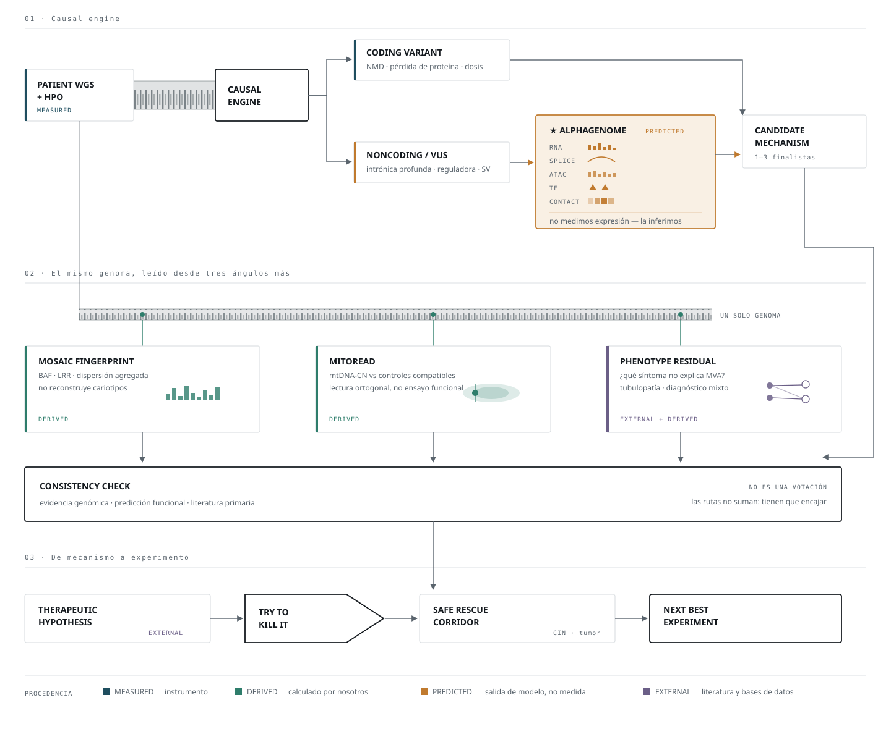

# Arquitectura maestra y jerarquía científica

> **Autoridad.** Este documento manda sobre cualquier módulo, notebook o idea previa.
> Si algo en el repositorio lo contradice, gana este documento. Ver
> `docs/00_ESTADO_Y_OBSOLESCENCIA.md` para el mapa de lo retirado y
> `docs/05_CONTRATO_VISUAL.md` para qué figura debe cada hipótesis.

Existe por una razón concreta: ahora mismo hay varias hipótesis atractivas a la vez, y
ese es exactamente el momento de mayor riesgo. El peligro no es quedarse sin ideas — es
enamorarse de una antes de correr el VCF.

---

## El flujo




```
                       PATIENT
                  WGS + CLINICAL HPO
                         │
                         ▼
                ┌─────────────────┐
                │  CAUSAL ENGINE  │
                └────────┬────────┘
                         │
          ┌──────────────┼──────────────┐
          ▼              ▼              ▼
      Coding hit     Hidden hit     Phenotype
     SNV / indel     noncoding/SV    residual
          │              │              │
          │       ★ ALPHAGENOME ★      Bartter?
          │        + SV calling          other?
          │              │              │
          └──────────────┼──────────────┘
                         ▼
                  CAUSAL MECHANISM
                         │
           ┌─────────────┼─────────────┐
           ▼             ▼             ▼
       MOSAIC WGS      MITOREAD     FUNCTIONAL
       fingerprint      mtDNA-CN      DOSAGE
       BAF/LRR                       if justified
           │             │             │
           └─────────────┼─────────────┘
                         ▼
                MECHANISM CONVERGENCE
                         │
                         ▼
                 THERAPEUTIC ROUTER
                         │
           ┌─────────────┴────────────┐
           ▼                          ▼
     mechanism rescue           drug repurposing
     genetic evidence           approved compound
           │                          │
           └─────────────┬────────────┘
                         ▼
                   TRY TO KILL IT
                         │
                         ▼
                SAFE RESCUE CORRIDOR
                         │
                         ▼
                NEXT BEST EXPERIMENT
```

---

## Jerarquía vigente

Los dos bloques siguientes se copian **literalmente** en el contexto de cualquier agente
que trabaje sobre este repositorio. Se mantienen en inglés a propósito: son normativos y
se pegan tal cual.

```
## Current scientific hierarchy

1. Causal mechanism / Track 1
2. Hidden second allele
3. Phenotype residual audit
4. Structural-variant search when indicated
5. AlphaGenome functional interpretation
6. MitoRead orthogonal readout
7. Bulk mosaic fingerprint
8. Therapeutic hypothesis
9. Try to Kill It
10. Safe Rescue Corridor

No therapeutic candidate is considered primary until the causal mechanism is established.
```

```
## Competing-hypothesis rule

BUB1B, Bartter/tubulopathy, mitochondrial stress, mosaic signal,
and any drug candidate remain hypotheses until patient data support them.

Do not design the project backward from a favorite gene or drug.
```

**Qué significa en la práctica.** Hoy no está elegido `BUB1B`. No está elegido Bartter.
No está elegido arimoclomol. Son ramas competidoras, y los datos las van matando. Si un
análisis se diseña partiendo de la respuesta deseada, ese análisis no cuenta — da igual
lo elegante que sea.

---

## Correcciones que este documento fija

Se registran porque revierten decisiones escritas antes en este mismo repositorio.

### 1. AlphaGenome

| Antes | Ahora |
|---|---|
| Dosis residual = prioridad #1 absoluta | **Condicional**: solo si Track 1 resuelve a `BUB1B` |
| Segundo alelo oculto = #2 | **Prioridad general #1** — no depende de conocer el gen |
| "no usar en SV complejas" | **SV → Manta / DELLY / GRIDSS.** Nunca AlphaGenome |
| Palanca reguladora = PARK | **Exploratorio**, techo alto, no columna vertebral |

Dos prohibiciones nuevas: **ningún porcentaje de proteína residual** (la salida es una
clase, no una cifra), y **AlphaGenome no resuelve fase** — el soporte multi-variante en
1 Mb evalúa una hipótesis de haplotipo que le suministramos, no la infiere.

Motivo de fondo del cambio de orden: el umbral del ~50 % es **evidencia BubR1-específica**.
No hay gradiente publicado equivalente para `TRIP13` ni `CEP57`. Si el causal es otro gen,
la rama pierde su ancla externa. Detalle en `docs/03_ALPHAGENOME_ASSESSMENT.md` §4.1.

### 2. Mosaicismo — cambia el lenguaje, y con él la promesa

Queda **prohibido** en el repositorio y en la presentación:

> ~~"reconstruct karyotype landscape"~~ · ~~"reconstrucción de cariotipos"~~ ·
> ~~"cariotipos fantasma"~~

Se sustituye por:

> **bulk genomic mosaic fingerprint**

Composición: `BAF` + `LRR / profundidad` + **método estándar de mCA** + índice de
dispersión agregado, este último marcado como **experimental**.

**El índice de dispersión no se presenta como superior hasta ganar una simulación.**
Preregistro:

- Simular fracciones celulares al `1 %, 2 %, 5 %, 10 %, 20 %`, repartidas entre distintos
  cromosomas.
- Comparar *calls* por cromosoma (método estándar) contra el estadístico agregado.
- Si el estadístico gana, hay contribución metodológica propia. Si pierde, se reporta que
  perdió (Regla Dura 6) y se usa el método estándar.

Sin esa simulación, el índice es una idea, no un resultado.

### 3. MitoRead

Se mantiene, con el nombre corregido:

> **orthogonal WGS-derived mitochondrial readout**

Nunca *"functional assay"*, nunca *"ensayo funcional"*. Es una medida derivada de
cobertura, y la Regla Dura 4 es explícita en este punto exacto.

Posición: **aguas abajo** del mecanismo causal. No es diagnóstica de MVA.

```
mecanismo MVA → estrés aneuploide → disrupción de proteostasis
              → ¿disfunción mitocondrial? → mtDNA-CN del paciente
```

Requisito de controles: mtDNA-CN exige controles compatibles en **tejido, librería y
pipeline**. Sin eso el número no significa nada. Y el confusor hematológico sigue vivo:
las plaquetas tienen mitocondrias y carecen de núcleo, así que distorsionan el cociente
directamente — de ahí que el hemograma contemporáneo sea una de las tres preguntas.

Arimoclomol permanece como **hipótesis de reposicionamiento**. No es rescate demostrado
en MVA, y el brief §10.3 ya documenta la colisión oncológica en un niño con antecedente
de rabdomiosarcoma.

### 4. HPO Residual / Bartter

Se mantiene como **rama competitiva**, no como curiosidad. Tres correcciones de lectura:

1. **`Present since birth` sube mucho el interés** de una tubulopatía, pero **no demuestra
   etiología antenatal**. Son cosas distintas.
2. **El líquido amniótico pondera, no decide.** Polihidramnios severo precoz apoya con
   fuerza una tubulopatía perdedora de sal; no es un test binario que cierre la etiología.
3. **La ausencia de microcefalia o discapacidad intelectual en el documento no es un
   negativo clínico.** El documento no declara ser exhaustivo, y ausencia de mención no es
   ausencia del rasgo. Contarla como evidencia en contra sería fabricar un dato.

**Corrección de prioridad dentro del panel.** El Bartter antenatal por `MAGED2` es
**transitorio** por definición: remite por completo en los primeros meses de vida
(Laghmani et al., *N Engl J Med* 2016;374(19):1853-63, PMID 27120771 ✔ verificado).
Por tanto, si la nefrocalcinosis es **persistente hoy**, `MAGED2` baja y suben las
tubulopatías que no remiten: `SLC12A1`, `KCNJ1`, `CLCNKB`, `BSND`.

**El marco correcto no es "Bartter en vez de MVA".** Es una hipótesis de fenotipo mixto,
que solo se sostiene si aparece algo en el panel:

```
MVA                          +?    trastorno de transporte renal
→ CIN                              → nefrocalcinosis congénita
→ CIR severo                       → prematuridad
→ predisposición tumoral
```

### 5. Los FASTQ tienen ahora una razón concreta

No se alinean 86 GB para impresionar. Se alinean porque hay preguntas que el VCF no
responde: SV con evidencia de reads, CNV, pares discordantes, *split reads*, cobertura,
cobertura de chrM, balance alélico, *phasing* parcial, señal de mosaicismo.

### 6. PCR-free: importante, pero no un punto único de fallo

**Corrección a una afirmación previa mía**, que estaba sobredimensionada. Escribí que sin
librería PCR-free *"§6 y §7 se tambalean"*. Es demasiado.

La amplificación por PCR aumenta el sesgo de cobertura y la duplicación, y eso perjudica
sobre todo el análisis fino de profundidad. Lo que pierde fuerza es **usar cambios
pequeños de profundidad como evidencia de mosaicismo**.

Sobreviven intactos: Track 1, búsqueda de SV, AlphaGenome, la rama renal, splicing y no
codificante. BAF sigue siendo utilizable.

La pregunta sigue mereciendo el email —cambia cuánto peso soporta la rama de
mosaicismo—, pero no bloquea el proyecto.

---

## Secuencia de ejecución congelada

El siguiente paso no es otro documento conceptual. Son datos.

| # | Paso | Entrega |
|---|---|---|
| 1 | **L001 R1/R2** — caracterización real | reads, bp, longitud, calidad, proxy de duplicación, pistas de instrumento y librería, cobertura bruta |
| 2 | **VCF — búsqueda causal** | genes MVA + universo renal/tubulopatía + candidatos raros genome-wide |
| 3 | **Auditoría de heterocigosis compuesta** | alelo A + posible alelo B |
| 4 | **AlphaGenome sobre la shortlist** | solo priorizadas: intrónicas profundas, reguladoras, splicing |
| 5 | **Si falta segundo hit → caza de SV en FASTQ** | Manta / DELLY / GRIDSS |
| 6 | **MitoRead** | mtDNA-CN con controles compatibles |
| 7 | **Mosaic fingerprint + simulación del índice** | BAF/LRR, mCA estándar, validación del estadístico |
| 8 | **Solo entonces, Track 2** | hipótesis terapéutica |

El paso 1 empieza con **un solo carril**. Caracterizar antes de alinear los 86 GB.

---

## El cementerio de hipótesis

Consecuencia directa de la Regla Dura 6, y probablemente la mejor figura de la
presentación: no la idea que sobrevivió, sino todas las que matamos y por qué.

```
8 hipótesis
     ↓ DATOS
5 sobreviven
     ↓ LITERATURA
3 sobreviven
     ↓ MECANISMO
2 sobreviven
     ↓ SEGURIDAD
1 sobrevive
```

Cada muerte se registra en `docs/DECISIONS.md` con la evidencia que la causó. Un jurado
distingue perfectamente entre un equipo que encontró una respuesta y un equipo que además
supo descartar las alternativas — y solo el segundo es defendible.

---

## Regla de entrega

Ningún análisis importante termina solo en CSV o Markdown. Cada hipótesis acaba en **una
figura interpretable, una conclusión, una incertidumbre y un falsificador**.

El contrato figura por figura, la estructura narrativa obligatoria y las reglas de diseño
están en `docs/05_CONTRATO_VISUAL.md`. Es condicional: la mayoría de estas ramas va a
morir, y nadie construye una figura para una rama muerta — la muerte alimenta el
cementerio de hipótesis.
