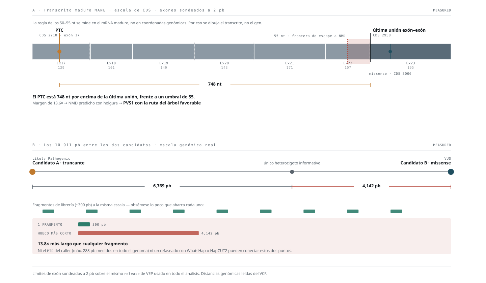

# Curación de evidencia estilo ACMG/AMP — investigación, no clínica

> **Esto no es una clasificación clínica.** Es una curación de evidencia en formato
> ACMG/AMP para uso en investigación. Ninguna afirmación de este documento constituye un
> informe diagnóstico ni sustituye la interpretación de un laboratorio acreditado.
>
> **Saneado:** sin coordenadas, rsID ni cambios proteicos. Detalle en `work/acmg/`.

## Relación gen-enfermedad

`BUB1B` – MVA1: **Definitive**, herencia **autosómica recesiva** (ClinGen). Ese es el marco
que hace aplicable el criterio `PVS1` y el que obliga a exigir **dos alelos** — de ahí que
la fase sea el bloqueo central.

---

## `PVS1` para el alelo truncante — árbol recorrido, no asumido

El criterio no se aplica por ser `stop_gained`. Hay que pasar el árbol de decisión.

| Paso del árbol | Estado |
|---|---|
| ¿Es LoF un mecanismo de enfermedad establecido para el gen? | **Sí** — MVA1 por `BUB1B` es recesiva por pérdida de función |
| ¿Está en el transcrito clínicamente relevante? | **Sí** — MANE Select y canónico |
| ¿Se espera degradación por NMD? | **Sí — medido, ver abajo** |
| ¿Afecta a una región crítica? | No es necesario dirimirlo si NMD aplica |

### La medición que exige el árbol



*Panel A: el PTC medido contra la última unión exón-exón, en escala de mRNA maduro.
Panel B: los 10 911 pb entre candidatos con fragmentos de librería a la misma escala.*


«Exón 17 de 23» **no es suficiente**: la regla de los 50–55 nt se define respecto a la
**última unión exón-exón**, no respecto al número de exón.

Se reconstruyó la estructura del transcrito MANE sondeando la región con variantes
sintéticas sobre la secuencia de referencia del propio caché — **a resolución de una base**,
y usando el mismo *release* de VEP que se empleará en todo el análisis, así que las
coordenadas salen de los metadatos del propio transcrito y no de una fuente paralela:

```
exón 17  ← aquí está el codón de parada prematuro
exón 18
exón 19
exón 20
exón 21
exón 22
─────────  ÚLTIMA UNIÓN EXÓN-EXÓN
exón 23  ← aquí está la missense
```

| | |
|---|---|
| Última base del exón 22 | CDS **2957** |
| Primera base del exón 23 | CDS **2958** |
| Posición del PTC | CDS **2210** |
| **Distancia del PTC a la última unión exón-exón** | **748 nt aguas arriba** |
| Umbral de la regla | 50–55 nt |
| Margen | **13,6×** |

**NMD predicho con holgura.** Ahora es un número, no un «exón interno, seguro que sí».

> Sigue siendo **predicción**. El NMD puede ser incompleto, y no se ha medido transcrito en
> este paciente. Salida permitida: `NMD predicho`. **Nunca** `expresión cero`.

**Veredicto:** `PVS1` **CANDIDATO**, con la ruta del árbol favorable. Fuerza final pendiente
de confirmar que no hay transcritos alternativos relevantes que rescaten el exón.

---

## `PM2` — no automático por «AF ~10⁻⁴»

ClinGen rebajó `PM2` a **Supporting**, y la frecuencia se evalúa contra lo plausible para
la enfermedad, no contra un umbral fijo.

**Alelo truncante:**

| Población | Frecuencia |
|---|---|
| Máxima poblacional | **≈ 1,0 × 10⁻⁴** (europea no finlandesa) |
| Africana, americana, este-asiática, sur-asiática | **0** |
| Genomas (global) | ≈ 3,3 × 10⁻⁵ |

Compatible con un alelo recesivo raro. **Pero hay un pendiente que no se puede resolver
offline:** la propia entrada de ClinVar advierte que los datos de frecuencia de gnomAD en
esa posición pueden tener problemas de calidad. La distribución —presente solo en una
población, cero en las demás— es compatible tanto con un alelo raro de origen europeo como
con un artefacto concentrado en un dataset. **No se puede distinguir sin revisar cobertura y
métricas de calidad de gnomAD en esa posición.**

**Veredicto:** `PM2_Supporting` **CANDIDATO**, pendiente de auditar cobertura y calidad, no
solo el AF.

**Alelo missense:** ausente de **todas** las poblaciones, exomas y genomas. `PM2_Supporting`
**CANDIDATO**, más limpio que el del truncante.

---

## `PP3` — no se construye sumando SIFT y PolyPhen

Esto es un error frecuente y hay que evitarlo explícitamente: **SIFT y PolyPhen no son dos
evidencias independientes**. ClinGen recomienda **una sola aplicación** de `PP3`/`BP4`,
usando un **predictor calibrado** y asignando la fuerza por umbrales publicados, no por
mayoría de herramientas.

Lo que tenemos hoy (`deleterious` 0,01 y `probably_damaging` 0,997) es **una señal
direccional**, no un `PP3` asignable.

**Veredicto:** `PP3` **NO SE APLICA.** Ver el resultado abajo.

### Umbrales de REVEL — **preregistrados antes de ver el score**

Congelados aquí para que la asignación de fuerza no se elija después de conocer el
resultado. Umbrales calibrados de ClinGen:

| Rango de REVEL | Criterio | Puntos |
|---|---|---|
| **≥ 0,932** | `PP3_Strong` | **4** |
| 0,773 – 0,931 | `PP3_Moderate` | 2 |
| 0,644 – 0,772 | `PP3_Supporting` | 1 |
| < 0,644 | **Ningún `PP3`** | 0 |

`BP4` tiene sus propios umbrales calibrados en el extremo bajo, en la misma publicación.

**Reglas de uso, también congeladas:**

1. **Una sola aplicación.** REVEL sustituye a SIFT y PolyPhen; **no se suman**.
2. La fuerza sale del umbral, no de que «tres herramientas coincidan».
3. Si REVEL cae por debajo de 0,644, `PP3` **no se aplica** — y se registra como tal en
   lugar de buscar otro predictor que dé el resultado deseado.

### Resultado — `REVEL = 0,472`

REVEL v1.3 completo, descargado y consultado **en local**. La variante está presente en la
tabla, sobre el transcrito MANE.

| | |
|---|---|
| REVEL | **0,472** |
| Umbral mínimo para `PP3_Supporting` | 0,644 |
| **Veredicto** | **`PP3` NO SE APLICA** |

**Tampoco alcanza `BP4`:** los umbrales de evidencia benigna están en el extremo bajo
(≈ ≤0,29 para Supporting), y 0,472 queda por encima. **REVEL es, sencillamente, no
informativo para esta variante.**

### Por qué esto valida la regla de ClinGen

SIFT dio `deleterious` (0,01) y PolyPhen-2 `probably_damaging` (0,997). Las dos apuntaban
con fuerza a patogenicidad. **El predictor calibrado dice que no hay evidencia asignable en
ninguna dirección.**

Si hubiéramos sumado SIFT y PolyPhen como dos evidencias, habríamos asignado un `PP3`
—probablemente fuerte— que **no está justificado**. Es exactamente el error que la
recomendación de ClinGen previene, y aquí se ve el tamaño del error evitado.

El preregistro también hizo su trabajo: los umbrales estaban congelados y firmados antes de
ver el número, así que no hubo margen para reinterpretarlos ni para salir a buscar otro
predictor más complaciente.

---

## `PM1` — no por intuición

Que la missense caiga en el dominio C-terminal **no basta**. `PM1` exige demostrar una
región funcional crítica con **enriquecimiento de variantes patogénicas y escasez de
benignas**.

Se puede demostrar, y produce además una figura útil:

> **Mapa de BUBR1 a lo largo de la proteína** con las variantes de ClinVar `P`/`LP` frente a
> las `B`/`LB`/`VUS`, y el candidato marcado. Si el dominio C-terminal concentra
> efectivamente la enfermedad, `PM1` pasa a ser defendible **con el dato delante**.

### Resultado — `PM1` **NO SE APLICA**, pero no por lo que parecía


*Cada una de las 1 497 variantes missense de ClinVar en su residuo. Las 35 benignas se ven
dónde caen, no como un número.*


ClinVar completo (2026-08-22), 2 470 variantes de la región anotadas sobre el transcrito
MANE.

> **Corrección metodológica importante.** Un primer conteo dio «0 P/LP frente a 35 B/LB» en
> la ventana del candidato y se leyó como que **el dato iba en contra**. Ese conteo mezclaba
> todas las consecuencias: **31 de esos 35 «benignos» eran variantes sinónimas**, que no son
> comparables con una missense. `PM1` se evalúa sobre la clase relevante de variante, no
> contando cualquier entrada de ClinVar.

Rehecho **solo con missense** (n = 1 497 en el gen):

| Ventana | P/LP | B/LB | VUS | en conflicto | sin clasificar |
|---|---:|---:|---:|---:|---:|
| 400–499 | **1** | 4 | 141 | — | — |
| 900–999 | 0 | 2 | 124 | — | — |
| **1000–1099** | **0** | **4** | 78 | — | — |
| **Todo el gen** | **1** | **35** | **1 426** | **28** | **7** |

> **La fila del gen suma 1 497, y antes no.** Publicaba tres clases que sumaban 1 462 bajo un
> encabezado que decía 1 497: desaparecían sin dejar rastro los 28 registros en conflicto y los
> 7 sin clasificar. La clase silenciada era además la única que puede contener missense con
> submisiones `P`/`LP` **en disputa**, así que el paisaje se presentaba como una dicotomía
> limpia VUS/benigno que no existe. Decir en voz alta que hay 28 missense en conflicto **refuerza**
> el argumento de que el gen está sin resolver, no lo debilita.

**En todo `BUB1B` hay exactamente UNA missense clasificada `P`/`LP`, y el 95,3 % de los 1 497
registros missense del gen son VUS.**

Eso cambia la conclusión. No es que la región del candidato esté empobrecida de patogénicas
**respecto a otras regiones**: es que **ninguna región de este gen tiene un hotspot de
missense patogénicas demostrable**. El panorama es uniforme y esencialmente vacío en todas
partes.

**Veredicto:** `PM1` **NO SE APLICA** — por ausencia de hotspot demostrable en cualquier
punto del gen, no porque el dato señale específicamente en contra de este candidato.

---

## `PS1` y `PM5` — evaluados, ninguno aplica

En el residuo candidato, ClinVar tiene **dos** entradas, ninguna de ellas nuestra variante:

| Cambio nucleotídico | Efecto | Clasificación |
|---|---|---|
| Otro cambio, **mismo aminoácido** que el nuestro | missense | **VUS** |
| Un tercero | sinónimo | Likely benign |

- **`PS1`: no aplica.** Exige que el mismo cambio aminoacídico esté ya establecido como
  patogénico. Está, pero como **VUS**.
- **`PM5`: no aplica.** No hay ninguna `P`/`LP` en el residuo, de ninguna consecuencia.

> **Corrección de la definición, posterior a la primera redacción.** Este documento decía
> *«otra variante `P`/`LP` en el mismo residuo»* y la implementación hacía exactamente eso,
> sin filtrar por consecuencia. **Es incorrecto:** `PS1` y `PM5` comparan cambios de
> **aminoácido** entre variantes **missense**. Un `stop_gained` o un `frameshift` patogénico
> en el mismo residuo **no** es soporte de `PM5` — no es una sustitución, es la pérdida del
> resto de la proteína, y no dice nada sobre la tolerancia de ese residuo a un cambio de
> aminoácido. No era un riesgo teórico: **de las 84 `P`/`LP` de ClinVar en `BUB1B`, 83 no son
> missense**, así que el defecto habría disparado en cuanto el residuo hubiera tenido una.
>
> Segunda corrección: la implementación fundía `Pathogenic` con `Likely pathogenic` en un
> único cubo. La formulación clásica de `PM5` exige que la otra variante esté **establecida
> como patogénica**. Aceptar `Likely pathogenic` con la misma fuerza es una decisión de
> **especificación**, no un valor por defecto, y para `BUB1B` **no existe hoy ninguna
> especificación VCEP** que la autorice. Los candidatos `LP` se reportan aparte y no otorgan
> el criterio.
>
> **El veredicto del caso no cambia**, ni antes ni después: en el residuo candidato ClinVar
> no tiene ninguna `P`/`LP` de ninguna consecuencia. Lo que cambia es que la implementación
> ya coincide con lo que este documento afirma. La lógica vive aislada en
> `src/annotation/ps1_pm5.py` y la cubren 17 tests, incluidos los casos que antes pasaban:
> truncante patogénico en el mismo residuo → `PM5` falso.

> **Dato relevante aunque no dé criterio:** un *submitter* independiente, con criterios,
> evaluó **el mismo cambio de aminoácido** llegando por otra ruta nucleotídica y lo dejó en
> **VUS**. Coincide con nuestra propia conclusión, por un camino distinto.

### Corrección — nuestra variante y ClinVar

La pasada 2 dijo que la missense estaba «ausente de ClinVar». **Con matiz:** nuestra
variante exacta sigue sin estar, pero eso se afirmó contra el caché de VEP 116, que lleva
**ClinVar de 2025-09**. El ClinVar descargado hoy es de **2026-08-22**, once meses más
nuevo, e incluye dos entradas en ese residuo que el caché no tenía.

**Lección:** el ClinVar del caché de VEP tiene fecha. Para una decisión de curación hay que
consultar la versión vigente.

---

## El contexto que más pesa: qué es patogénico en `BUB1B`

De las **84** variantes `P`/`LP` del gen en ClinVar:

| Consecuencia | n | % |
|---|---:|---:|
| Frameshift | 38 | 45 |
| Stop gained | 34 | 40 |
| Splice acceptor | 6 | 7 |
| Splice donor | 4 | 5 |
| Splice region | 1 | 1 |
| **Missense** | **1** | **1** |

**El 97 % de lo clasificado como patogénico en `BUB1B` es pérdida de función.** Una sola
missense en todo el gen ha alcanzado `P`/`LP`.

> **Cuidado con sobreleer esto.** La composición de ClinVar refleja también **sesgo de
> constatación**: las missense en genes recesivos se quedan en VUS precisamente por falta de
> fase y de datos funcionales — el mismo problema que tenemos nosotros. La literatura de
> investigación **sí** describe missense patogénicas en MVA por `BUB1B`.
>
> Lo que sí queda establecido: **no hay base empírica para `PM1` en ningún punto de este
> gen**, y con el 95 % de las missense en VUS, la evidencia clínica actual no permite
> sostener que esta región sea un hotspot de missense patogénicas.
>
> **Formulación defendible, la que va en la figura:** *«Current clinical evidence does not
> support this region as a pathogenic missense hotspot, and an independent submission of the
> same amino-acid substitution is also VUS.»* — **no** «la missense es benigna».

---

## `PP5` — deliberadamente NO usado

El alelo truncante figura en ClinVar como patogénico por un *submitter* con criterios. **Eso
no se convierte en `PP5`.** ClinGen recomienda **abandonar `PP5`/`BP6`** y evaluar la
evidencia primaria de forma independiente.

La etiqueta de ClinVar se registra como **evidencia externa a desglosar**, no como criterio.

---

## `PM3` — bloqueado por decisión del proyecto

Algunas implementaciones de ClinGen permiten puntuación reducida de `PM3` con fase
desconocida. **Para este proyecto se bloquea por completo.**

Motivo: es el criterio que convertiría «dos variantes en el mismo gen» en «heterocigosis
compuesta», que es exactamente la afirmación que la fase no sostiene. Ser más conservadores
aquí nos conviene.

---

## Tabla de curación

| Criterio | Truncante | Missense |
|---|---|---|
| Gen-enfermedad | `BUB1B`–MVA1 **Definitive, AR** | ídem |
| `PVS1` | **CANDIDATO** — árbol recorrido, NMD medido a ~750 nt | No aplica |
| `PM2_Supporting` | **CANDIDATO** — pendiente auditar calidad gnomAD | **CANDIDATO** — ausente de todas las poblaciones |
| `PP3` | No central | **PENDIENTE** — predictor calibrado |
| `PM1` | No aplica | **PENDIENTE** — distribución ClinVar en el gen |
| `PS3` | Sin ensayo variante-específico | Sin ensayo variante-específico |
| `PM3` | **BLOQUEADO** | **BLOQUEADO** |
| `PP4` | No usado todavía | No usado todavía |
| `PP5` | **NO USADO** por recomendación de ClinGen | n/a |

### Clasificación provisional

**Truncante:** con `PVS1` (Muy Fuerte, 8 puntos) + `PM2_Supporting` (1 punto) = **9 puntos**
en el marco bayesiano de puntos, lo que cae en **Likely Pathogenic** (6–9). Queda a un solo
punto de `Pathogenic`, y ese punto depende de evidencia que hoy no tenemos.

**Missense:** `PM2_Supporting` sola = 1 punto → **VUS**. Aunque `PP3` entrara como Moderado,
serían 3 puntos: sigue **VUS**. Solo saldría de ahí con `PM3` (bloqueado), `PS3` (no hay
ensayo) o evidencia de dominio y segregación.

---

## La formulación correcta

Esto evita el error de decir «tenemos dos variantes patogénicas»:

> **one likely pathogenic truncating allele + one rare missense candidate in the BUBR1
> stability domain, phase unresolved.**

Nótese *stability domain*, no *kinase domain*: BUBR1 es pseudoquinasa y lo que ese dominio
aporta es integridad conformacional (`docs/CANDIDATES_PASS2.md`).

---

## Qué añade más valor ahora

### Corrección — «ninguno de los tres cambia la categoría» era falso

Una versión anterior afirmó que los criterios pendientes refinan pero **no** cambian la
categoría de la missense. **Es incorrecto**: individualmente probablemente no, pero
**combinados sí**.

| Escenario | Puntos | Categoría |
|---|---|---|
| `PM2_Supporting` sola | 1 | VUS |
| `+ PP3_Moderate` | 3 | VUS |
| `+ PP3_Strong` | 5 | VUS |
| **`PM2` + `PP3_Strong` + `PM1_Moderate`** | **7** | **Likely Pathogenic** |

Es decir: la evidencia pendiente **sí podía** sacar la missense de VUS sin resolver la fase.
Eso cambiaba la prioridad de las descargas.

> ### ⚠ Ese escenario está muerto: `REVEL = 0,472`, `PP3` no aplica
>
> Con `PP3` fuera, el techo alcanzable sin fase ni función es:
>
> | Escenario máximo restante | Puntos | Categoría |
> |---|---|---|
> | `PM2_Supporting` (1) + `PM1_Moderate` (2) | 3 | **VUS** |
> | + `PM5_Moderate` (2), si existiera otra P/LP en el residuo | **5** | **VUS** |
>
> El rango VUS llega hasta 5 puntos. **Ni siquiera el mejor caso de ClinVar saca la missense
> de VUS.**
>
> Conclusión provisional: la fase (`PM3`) y un ensayo funcional variante-específico (`PS3`)
> son **las dos vías más decisivas**, pero **no las únicas posibles** — también podrían
> aparecer `PS1` (si el mismo cambio aminoacídico llegara a `P`/`LP`), segregación (`PP1`) o
> casos independientes (`PS4`). ClinVar y la literatura son la forma de comprobarlo, y es lo
> que se hizo a continuación.

Pero con una condición dura: **`PM1` no se gana por «está en el stability domain»**. Hay
que demostrar que es una región funcional crítica bien establecida y que no estamos viendo
simplemente una zona con mezcla de benignas y patogénicas. Si el mapa de ClinVar muestra esa
mezcla, `PM1` no se aplica y el escenario de 7 puntos no ocurre.

### `PM5` — posibilidad que el mapa de ClinVar puede revelar

Si existe **otra variante MISSENSE, ya establecida como patogénica, en el mismo residuo**
y con una sustitución de aminoácido distinta, aplica `PM5` (Moderado, 2 puntos). Es un
criterio que no habíamos considerado y que sale del mismo VCF de ClinVar que hace falta
para `PM1`.

Las tres condiciones son acumulativas y ninguna es decorativa: **missense** (un truncante
patogénico en el residuo no sirve), **patogénica establecida** (`Likely pathogenic` solo
contaría bajo una especificación explícita, que en `BUB1B` no existe) y **sustitución
distinta** (si es la misma, la vía es `PS1`, no `PM5`).

### Lo que sigue siendo insustituible

1. **Resolver `trans`** → desbloquea `PM3`. Genotipos parentales o lectura larga dirigida.
2. **Demostrar efecto variante-específico sobre abundancia o estabilidad de BUBR1** →
   habilita `PS3`.

Estos dos no los sustituye ninguna descarga, y son los que llevarían el conjunto de
«candidato fuerte» a «mecanismo establecido».

### Bloqueos que requieren descarga

Orden de prioridad, decidido:

| # | Necesidad | Para qué | Puede cambiar categoría |
|---|---|---|---|
| **1** | **REVEL** | `PP3` — Supporting, Moderate, Strong o nada | Sí, en combinación |
| **2** | **VCF de ClinVar** | `PM1` por distribución, `PM5` por residuo, mapa proteico | Sí, en combinación |
| **3** | Cobertura y calidad de gnomAD | Auditar `PM2_Supporting` del truncante | **No** |

**Corrección a una afirmación previa.** Se dijo que gnomAD era «lo único pendiente que
todavía puede mover una clasificación». **Es un error de aritmética:** `PVS1` sola son
**8 puntos**, que ya cae en Likely Pathogenic (6–9). Añadir `PM2_Supporting` lleva a 9 —
**mismo rango**. Y quitarlo deja 8 — **mismo rango**.

Auditar gnomAD es **higiene de la evidencia**, necesaria para no apoyarse en un dato con
posible problema de calidad. No cambia la categoría del truncante hoy.
