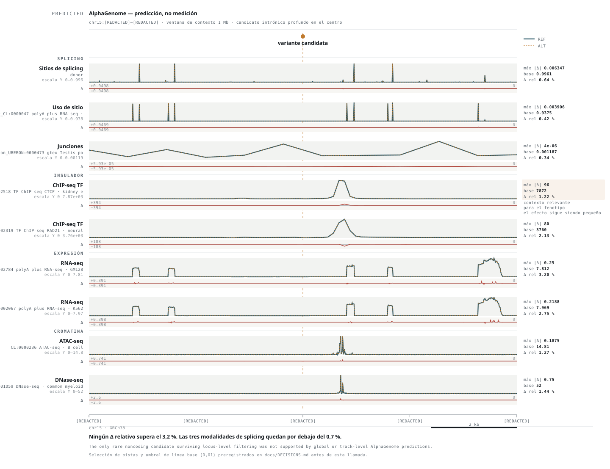

# Candidatos — pasada 2: frecuencia, clínica y función

> **⚠ Saneado conservador**, por decisión del responsable del dato. Este documento no
> contiene coordenadas, rsID, cambios proteicos concretos, profundidades ni genotipos. Ese
> detalle vive en `work/pass2/` (ignorado por Git).
>
> Anotación con el caché de VEP 116, que incluye **gnomAD v4.1** (exomas y genomas),
> **ClinVar**, **dbSNP 156**, SIFT, PolyPhen-2 y MANE. Todo **offline**: ninguna variante
> salió de la máquina.

---

## Corrección importante — un error de la pasada 1

La pasada 1 afirmó que **ninguna** de las dos candidatas de `BUB1B` estaba en dbSNP. **Eso
era falso**, y el método para deducirlo era malo.

Lo deduje de que la **columna `ID` del VCF venía vacía**. Pero esa columna solo está
poblada si el *caller* hizo anotación contra dbSNP — y estar vacía no significa que la
variante sea nueva, solo que **ese pipeline no la anotó**.

Al consultar el caché con `--check_existing`, el resultado cambia por completo:

| Alelo candidato | En dbSNP | En ClinVar |
|---|---|---|
| **Truncante** | **Sí** | **`pathogenic` / `likely_pathogenic`** |
| **Missense** | No | No |

El error **reforzó** el hallazgo en lugar de debilitarlo, pero eso no lo hace menos error:
afirmé novedad a partir de un proxy que no la sostiene. Queda registrado en
`docs/DECISIONS.md`.

**Lección de método:** la columna `ID` de un VCF no es una fuente de novedad. La fuente son
dbSNP, gnomAD y ClinVar consultados explícitamente.

---

## `BUB1B` — los dos candidatos, ahora con evidencia externa

Ambos: **`PASS`**, **heterocigotos**, balance alélico limpio, sobre el transcrito
**MANE Select** y canónico.

### Alelo A — truncante

| | |
|---|---|
| Consecuencia | `stop_gained` |
| Posición en el gen | **exón 17 de 23** |
| gnomAD (máx. poblacional) | **~1 × 10⁻⁴** — muy raro, compatible con alelo recesivo |
| **ClinVar** | **`pathogenic` / `likely_pathogenic`** |
| NMD | **Predicho.** El codón de parada está muy por encima de la última unión exón-exón, así que la regla de los 50–55 nt aplica con holgura |

**No es una variante nueva ni una interpretación nuestra: está clasificada como patogénica
en una base clínica pública.**

### Alelo B — missense

| | |
|---|---|
| Consecuencia | `missense_variant` |
| Posición en el gen | **exón 23 de 23** — el último |
| gnomAD | **Ausente.** Ni en exomas ni en genomas de v4.1 |
| dbSNP / ClinVar | Ausente de ambos. **Novel** |
| Dominio | **Dominio C-terminal tipo quinasa** (`Gene3D:1.10.510.10`, `CDD:cd14029`) — ver corrección abajo |
| SIFT | `deleterious` (0,01) |
| PolyPhen-2 | `probably_damaging` (0,997) |
| NMD | **No aplica.** Al estar en el último exón, escapa a NMD y produce proteína completa |

### La asimetría de NMD es el mecanismo publicado

Esto no es una coincidencia bonita: es exactamente lo que describe la literatura de MVA por
`BUB1B`.

```
                    MEASURED            PREDICTED           EXTERNAL
                    ─────────           ─────────           ────────
Alelo A   truncante, exón 17/23   →   NMD probable    →   ↓ transcrito
Alelo B   missense, exón 23/23    →   escapa NMD      →   ¿estabilidad
          dominio C-terminal          proteína             reducida?
                                      completa
```

> **Nada de esta cadena está medido en este paciente.** Lo medido es la posición y la
> consecuencia. El NMD es **predicho**, no demostrado, y puede además ser **incompleto**.
> La inestabilidad del mutante es una **clase mecanística plausible** establecida en la
> literatura para *sustituciones concretas* — no una propiedad demostrada de ésta.

La baja abundancia global de BubR1 en pacientes bialélicos resulta de **la ausencia de
transcrito del alelo truncante combinada con el alto recambio de la proteína missense**
([Suijkerbuijk et al., PMID 20516114](https://pubmed.ncbi.nlm.nih.gov/20516114/)). Y el
cambio missense en ese grupo cae de forma consistente **en el dominio C-terminal tipo
quinasa o cerca de él** — que es donde cae éste. Sobre por qué ese dominio importa sin que
haya catálisis, ver la corrección de fondo más abajo.

El patrón bialélico canónico —**una missense emparejada con una truncante**— está descrito
desde el trabajo original ([Hanks et al., PMID 15475955](https://pubmed.ncbi.nlm.nih.gov/15475955/)),
que además incluía familias con **rabdomiosarcoma embrionario**, el mismo evento oncológico
del probando.

---

## Los otros HIGH, resueltos por frecuencia

La pasada 1 los dejó «sin evaluar». Con gnomAD se resuelven, y **ninguno sobrevive**:

| Gen | Carril | Frecuencia poblacional máx. | ClinVar | Veredicto |
|---|---|---|---|---|
| `VDR` | Renal | **~0,81** | `benign`, conflicting | Polimorfismo muy común |
| `ATP6V1B1` | Renal | **~0,51** | `benign` | Polimorfismo común |
| `ANAPC1` | MVA | **~0,086** | — | Demasiado común para enfermedad recesiva grave; además la consecuencia caía sobre un transcrito NMD |

**Esto valida la corrección sobre los rsID.** No los mató tener identificador: los mató la
frecuencia. Y simétricamente, el alelo truncante de `BUB1B` **tiene** rsID y es el candidato
más fuerte del proyecto. Tener rsID no dice nada por sí solo.

Es además la confirmación de la predicción #6 del preregistro: sin filtro de frecuencia, el
carril genome-wide es ruido. Tres de cuatro HIGH de panel eran polimorfismos.

---

## Lo que sigue sin poder afirmarse

> **La fase no está resuelta.** *El caller no resuelve la fase entre estas dos variantes.*

**Corrección a la versión anterior**, que decía «ningún análisis sobre estos datos puede
establecer `trans`». Eso era un sobrealcance: antes de declarar imposible la fase con
lecturas cortas hay que intentar un refaseado independiente (WhatsHap, HapCUT2), que puede
extender bloques encadenando SNP heterocigotos más allá de un solo fragmento.

**Así que se midió la cadena** de heterocigotos informativos entre los dos candidatos:

| Tramo | Distancia |
|---|---|
| Candidato A → único heterocigoto intermedio | **6 769 pb** |
| Ese heterocigoto → candidato B | **4 142 pb** |

Solo hay **un** heterocigoto informativo entre ambos; las otras dos variantes del intervalo
son homocigotas y por tanto inútiles para fase. El salto más corto que habría que puentear
es de **4 142 pb**, frente a fragmentos de **~300 pb**: un factor de ~14.

**El refaseado con lecturas cortas no puede conectarlos.** Ahora eso es una medición
documentada, no una suposición.

Formulación permitida:

> *Two candidate variants in the same gene; phase unresolved. A recessive biallelic
> mechanism cannot be claimed unless trans configuration is established or independently
> supported.*

**¿Hay apoyo independiente?** El fenotipo clínico lo aporta en un sentido concreto: si los
dos alelos estuvieran en *cis*, quedaría una copia de `BUB1B` sin ninguna de las dos
variantes. Pero **usar el fenotipo que intentamos explicar como prueba de la configuración
que lo explicaría es un argumento bayesiano, no una demostración.** Se declara como lo que
es y no se presenta como fase resuelta.

---

## El experimento que más reduce la incertidumbre

Por primera vez en el proyecto hay un experimento concreto que convertiría un candidato en
un mecanismo establecido, y son dos vías:

1. **Genotipos parentales.** Una muestra de cada progenitor resuelve la fase de forma
   definitiva. Es la vía barata y estándar.
2. **Secuenciación dirigida de lectura larga** sobre los ~11 kb entre los dos candidatos.
   Resuelve la fase **sin necesidad de los padres**, que es lo relevante si no están
   disponibles.

Esto desplaza la prioridad del proyecto: **pedir esto vale más que cualquier análisis
adicional sobre los datos actuales.**

---

## Consecuencia sobre la rama de dosis residual

`docs/03_ALPHAGENOME_ASSESSMENT.md` §4.1 dejó la rama condicionada a que Track 1 resolviera
a `BUB1B`. **La condición se cumple**, y ahora con evidencia externa en ambos alelos.

La pregunta operativa pasa a ser la del umbral publicado del ~50 % de proteína residual
(brief §3.2). Con un alelo predicho como nulo por NMD y otro produciendo proteína completa
pero con recambio elevado en el dominio quinasa, el escenario es el que la literatura asocia
con abundancia global baja.

> **Sigue prohibido dar un porcentaje.** La salida es una **clase con incertidumbre**
> (`severo` / `intermedio` / `leve`), comparada cualitativamente contra el gradiente
> publicado. No «este niño tiene un 32 %».

---

## Corrección de fondo — BUBR1 es una **pseudoquinasa**

Este documento hablaba de «dominio quinasa» de una forma que sugería pérdida de actividad
catalítica. **Es una lectura equivocada de la biología de BUBR1**, y corregirla mejora la
hipótesis en lugar de debilitarla.

BUBR1 ha divergido de BUB1 y de otras quinasas con modificaciones extensas en sus motivos
catalíticos, **incompatibles con actividad catalítica**. No muestra fosforilación detectable
in vitro, y su **actividad catalítica es prescindible para una segregación cromosómica sin
errores**. Los residuos que en quinasas convencionales interaccionan con el ATP son aquí
**esenciales para la estabilidad conformacional**
([Suijkerbuijk et al., *Curr Biol*, PMID 22698286](https://pubmed.ncbi.nlm.nih.gov/22698286/)).

Eso reformula la pregunta del alelo B:

| Pregunta equivocada | Pregunta correcta |
|---|---|
| ¿La variante destruye la actividad quinasa? | **¿La variante desestabiliza el dominio C-terminal y reduce la cantidad de proteína funcional disponible?** |

**La versión correcta encaja mejor con el mecanismo de MVA**, que es de *abundancia*, no de
catálisis. Y explica por qué las missense de MVA se agrupan en ese dominio sin que la
enfermedad sea un defecto enzimático: lo que rompen es el plegamiento, no la reacción.

Consecuencia operativa: la rama que se activa es **estructural y de estabilidad**
—AlphaFold como andamio, conservación, contactos locales, ΔΔG cuando proceda— no una
evaluación de sitio catalítico.

> **Prohibido** comparar pLDDT del silvestre contra el mutante como evidencia de
> desestabilización. El brief §12 ya documenta que ΔpLDDT correlaciona muy débilmente con
> ΔΔG (PCC ≈ −0,17).

---

## Una conexión que abre Track 2 — dependencia de chaperonas

El mismo trabajo de 2010 hizo un experimento que ahora resulta directamente relevante.

Al **inhibir HSP90**, la abundancia de determinados mutantes missense de BUBR1 **cayó
drásticamente**, mientras que la del silvestre apenas cambió. Bloquear la degradación
proteasomal **evitó parte de esa pérdida**. La conclusión de los autores: esos mutantes
dependen más de la maquinaria de chaperonas para plegarse correctamente
([PMID 20516114](https://pubmed.ncbi.nlm.nih.gov/20516114/)).

```
ALELO TRUNCANTE                    ALELO MISSENSE
      ↓                                  ↓
  NMD predicho                   dominio C-terminal
      ↓                                  ↓
 ↓ transcrito BUBR1            ¿inestabilidad de plegamiento?
      │                                  ↓
      │                        ¿dependencia de chaperonas?
      │                                  │
      └────────────────┬─────────────────┘
                       ↓
              BUBR1 RESIDUAL BAJO
                       ↓
      punto de control del huso / alineamiento
                       ↓
                      MVA
```

### La pregunta de Track 2, formulada con cuidado

> *¿Puede un fármaco aprobado que module proteostasis estabilizar el sistema BUBR1 residual
> o mitigar la carga proteotóxica aguas abajo, **sin** hacer que células cromosómicamente
> inestables sean más permisivas a sobrevivir?*

**Esto NO es una nominación de fármaco.** Tres frenos, todos vigentes:

1. **`HSP90 activator = tratamiento` sería peligrosísimo.** HSP90 sostiene multitud de
   proteínas oncogénicas. En un niño con antecedente de rabdomiosarcoma, empujar en esa
   dirección choca de frente con la oncología — la misma colisión que el brief §10.3 ya
   documenta para arimoclomol.
2. **Hay que demostrar que el mecanismo farmacológico toca la parte de proteostasis que
   necesitamos**, no proteostasis en general.
3. **Los vetos 5–7 de `docs/rescue_evidence_rubric.md` siguen aplicando**, y el paso
   `Try to Kill It` es obligatorio antes de cualquier nominación.

Lo que sí aporta: la rama de proteostasis, que antes flotaba, ahora tiene **una conexión
aguas arriba con el mecanismo causal candidato**. Eso la vuelve falsable en vez de
decorativa.

---

## Estado del proyecto

| Rama | Estado |
|---|---|
| **`BUB1B` como mecanismo causal** | **FUERTE / PROVISIONAL** — mecanismo candidato #1 |
| Dosis residual | **ACTIVADA** |
| Rama estructural / estabilidad | **ACTIVADA** |
| Proteostasis y chaperonas (Track 2) | **ACTIVADA sólo para investigación** |
| AlphaGenome | **CONDICIONAL** — sin trabajo asignado hoy |
| Bartter / fenotipo residual | **DEGRADADA**, no eliminada |
| Carril genome-wide | Vivo, pendiente de reevaluar con frecuencia |
| **Fase** | **NO RESUELTA** |

### Sobre AlphaGenome, dicho sin rodeos

Hoy **no tiene trabajo** en este par. Una missense dentro de un dominio proteico es un
problema de estructura y estabilidad, y forzar AlphaGenome aquí haría el proyecto menos
serio, no más.

Vuelve a primer plano si aparece una variante reguladora o intrónica profunda, si el alelo B
se cae y se activa Hidden Second Allele, o si el carril genome-wide entrega candidatos no
codificantes.

**Y si nunca aparece esa variante, no pasa nada.** El hero pipeline muestra el módulo como
condicional; la presentación final solo enseña los módulos que los datos activaron. Eso da
más credibilidad que enseñar el logo.

---

## Trabajo pendiente en esta fase

1. **Formalizar ambos alelos con evidencia tipo ACMG/ClinGen.** Para la missense: rareza,
   evidencia computacional, dominio, conservación, literatura y encaje fenotípico.
   **`PM3` explícitamente bloqueado** mientras la fase no esté resuelta.
2. **Confirmar el NMD correctamente** — posición exacta respecto a la última unión
   exón-exón. Salida: `NMD predicho`, nunca `expresión cero`.
3. **Interrogar estructuralmente la missense** — AlphaFold humano como andamio,
   conservación, contactos locales, ΔΔG cuando proceda.
4. **Mapearla contra los mutantes de MVA publicados**, para ver si cae cerca de posiciones
   donde cambios conocidos reducen estabilidad o abundancia.
5. **Refaseado independiente cuando haya alineamientos.** Ya se midió que la cadena de
   heterocigotos no lo permite (huecos de 6 769 y 4 142 pb frente a fragmentos de ~300 pb),
   pero se deja ejecutado y documentado en vez de asumido.
6. **Abrir el sprint de Track 2**: abundancia de BUBR1, plegamiento, dependencia de
   chaperonas y proteostasis — seguido **obligatoriamente** de `Try to Kill It` por
   predisposición tumoral.

---

## Interrogatorio funcional del candidato no codificante — negativo



Nueve pistas **preseleccionadas y congeladas antes de la llamada**
(`docs/DECISIONS.md`). REF y ALT comparten escala Y dentro de cada pista; el Δ va en carril
propio, con el cero y los límites de escala impresos.

| Modalidad | Contexto | máx \|Δ\| | Línea base | Δ relativo |
|---|---|---:|---:|---:|
| Sitios de splicing | donor | 0,0063 | 0,996 | **0,64 %** |
| Uso de sitio | neurona | 0,0039 | 0,938 | **0,42 %** |
| Junciones | testículo (GTEx) | 0,0000 | 0,0012 | **0,34 %** |
| ChIP-seq CTCF | **célula epitelial renal** | 96 | 7 872 | **1,22 %** |
| ChIP-seq RAD21 | célula neural | 80 | 3 760 | **2,13 %** |
| RNA-seq | GM12878 | 0,25 | 7,81 | **3,20 %** |
| RNA-seq | K562 | 0,22 | 7,97 | **2,75 %** |
| ATAC-seq | linfocito B | 0,19 | 14,8 | **1,27 %** |
| DNase-seq | progenitor mieloide | 0,75 | 52,0 | **1,44 %** |

**Ningún Δ relativo supera el 3,2 %**, y las tres modalidades de splicing —el mecanismo por
el que un intrónico profundo podría importar— quedan por debajo del 0,7 %.

Las líneas base ahora sí son reales: entre 0,94 y 7 872, gracias al umbral de 0,01 que el
preregistro exigió. En la primera pasada los Δ relativos del 5 % resultaban de dividir entre
líneas base de ~0,0001.

> *The only rare noncoding candidate surviving locus-level filtering was not supported by
> global or track-level AlphaGenome predictions.*

**No** «AlphaGenome demostró que no existe un segundo alelo». La rama **SNV/indel** del
locus queda cerrada; SV y CNV siguen abiertas.
