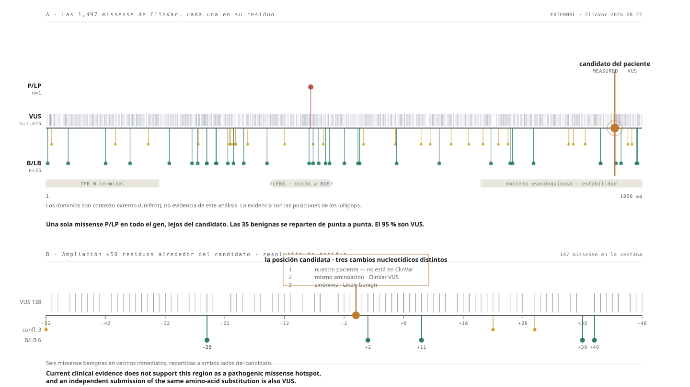

# Bitácora de decisiones

Se escribe **antes** de cada fase, no después. Para cada una: qué se espera encontrar,
qué resultado mataría la hipótesis, y qué se decidió. Si el resultado contradice lo
preregistrado, no se reescribe la predicción — se documenta la sorpresa.

Ver `CONTRIBUTING_RESEARCH.md`, Regla Dura 6 y Flujo de trabajo.

| Fecha | Fase | Qué esperamos | Qué lo mataría | Resultado | Decisión |
|---|---|---|---|---|---|
| 2026-08-29 | Integración | — | — | Master Brief integrado al repositorio; ramas sin datos que las sostengan marcadas como superadas | Ver `research/EXPERIMENT_REGISTRY.md` (el mapa original de lo retirado era un documento de trabajo interno, no versionado) |
| 2026-08-29 | Arquitectura | Que el ranking de AlphaGenome aguantara revisión | Que el umbral del ~50 % resultara ser BubR1-específico y no universal | **Lo era.** Dosis residual pasa a condicional; segundo alelo oculto sube a prioridad general | `docs/04_ARQUITECTURA_MAESTRA.md` |
| 2026-08-29 | Fase 1 — QC de L001 | Reads de 150 bp, R1/R2 balanceados, profundidad en rango 45-60x | Longitud variable (indicaria recorte previo), desbalance R1/R2, calidad baja | **149 bp**, varianza cero en 136 586 642 reads; R1==R2 exacto; 52,5x bruta / ~43x efectiva; 92,9 % ≥ Q30 | Datos aptos para Fase 1. Ver `docs/QC_L001.md` |
| 2026-08-29 | Fase 1 — PCR-free | Que el QC resolviera si la librería es PCR-free | Que el adaptador no discriminara entre kits | **No discrimina.** Tagmentación confirmada, pero `Illumina DNA Prep` y `Illumina DNA PCR-Free` comparten adaptador | Pregunta reformulada para el email: *¿cuál de los dos kits?* |
| 2026-08-29 | Fase 0.2 — cabecera VCF | Ver preregistro de 6 predicciones | Cabecera sin build ni caller declarados | **5 de 6 acertadas.** GRCh38, 1 muestra, sin anotar, `AD` presente, no gVCF. Sentieon Haplotyper; 5 012 204 variantes | Las tres rutas de búsqueda quedan desbloqueadas. Ver `docs/VCF_HEADER.md` |
| 2026-08-29 | Fase 0.2 — fase física | **Predije que NO habría `PS`/`PGT`/`PID`** | Que los campos existieran y con alcance útil | **Fallé en la letra: `PGT`/`PID` existen.** Pero al medir: bloque máximo 288 pb, mediana 7 pb, cero bloques ≥ 300 pb | **El techo `unphased ≠ trans` sigue en pie.** Solo sirve para corregir MNV. No se reescribe §4.2 |
| 2026-08-29 | Fase 1 — censo del VCF | Reparto normal de clases y het/hom en rango | Ratio het/hom deprimido (consanguinidad), o exceso de filtradas | **PASS 94,58 %** (4 740 790); rescate 271 414, dominado por `MQ40`. het/hom 1,61. Balance alélico 78,4 % en 0,40–0,60 | Los dos primeros niveles del funnel quedan medidos. El resto espera anotación |
| 2026-08-29 | Estrategia de carriles | — | — | Se decide **no elegir** entre MVA y renal | Tres carriles en paralelo, con un tercero genome-wide sin panel para evitar anteojeras |
| 2026-08-30 | Fase 2.1 — funnel | 0 o 1 HIGH en panel MVA; 0 en renal | ≥2 HIGH en un gen MVA | **Ambas falladas.** 2 HIGH en MVA (genes distintos) y 2 en renal (ambas `start_lost` con rsID conocido). **`BUB1B` con 1 HIGH + 1 MODERATE, ambas PASS, het, sin rsID** | Ver `docs/FUNNEL_PASS1.md`. La rama de dosis residual pasa a condición cumplida, pendiente de frecuencia |
| 2026-08-30 | Fase 2.2 — pasada 2 | Que la missense pudiera ser polimorfismo común y tumbara la rama | Frecuencia poblacional apreciable en cualquiera de las dos | **Truncante: ClinVar `pathogenic`/`likely_pathogenic`, gnomAD ~1e-4, NMD predicho (exón 17/23). Missense: AUSENTE de gnomAD, novel, dominio quinasa, SIFT deleterious, PolyPhen 0,997, exón 23/23 escapa NMD** | La rama de dosis residual se activa. Ver `docs/CANDIDATES_PASS2.md` |
| 2026-08-30 | `PM1` — error de conteo | Conté «0 P/LP vs 35 B/LB» mezclando todas las consecuencias | — | **31 de esos 35 eran sinónimas.** Solo 4 missense. `PM1` se evalúa sobre la clase comparable | Rehecho solo con missense. **Cambia el mensaje**, no solo el número |
| 2026-08-30 | `PM1` — resultado real | — | — | En **todo** `BUB1B`: **1 sola missense P/LP** de 1 497, y **95 % VUS**. Ningún punto del gen tiene hotspot demostrable | `PM1` no aplica por ausencia de hotspot en cualquier parte, no por señal en contra de este candidato |
| 2026-08-30 | `PS1` / `PM5` | — | — | El mismo cambio de aminoácido existe en ClinVar por otra ruta nucleotídica, pero **VUS**. Ninguna P/LP en el residuo | Ninguno aplica. Un submitter independiente llegó a la misma conclusión que nosotros |
| 2026-08-30 | ClinVar del caché | Que el caché de VEP sirviera para curar | — | El caché lleva **ClinVar 2025-09**; el vigente es **2026-08-22** e incluye dos entradas que el caché no tenía | Para curación se consulta la versión vigente, no el caché |
| 2026-08-30 | `PP3` con REVEL | Umbrales sellados antes de mirar: ≥0,932 Strong · 0,773-0,931 Moderate · 0,644-0,772 Supporting · <0,644 nada | Que cayera por debajo de 0,644 | **REVEL = 0,472.** Por debajo del mínimo. Tampoco alcanza `BP4` (>0,29) | **`PP3` NO SE APLICA.** REVEL es no informativo para esta variante |
| 2026-08-30 | Valor del preregistro | — | — | SIFT `deleterious` 0,01 y PolyPhen 0,997 apuntaban fuerte a patogenicidad; el calibrado dice que no hay evidencia asignable | **Sumarlos habría dado un `PP3` injustificado.** Se ve el tamaño del error evitado |
| 2026-08-30 | Techo de la missense | Que ClinVar pudiera sacarla de VUS | — | Sin `PP3`, el máximo con `PM1`+`PM5` es **5 puntos**, y VUS llega hasta 5 | **Nada salvo fase o función mueve esta variante** |
| 2026-08-30 | Fase 3 — curación ACMG | Que «exón 17/23» bastara para `PVS1` | Que el PTC quedara cerca de la última unión | **Medido: el PTC está a ~750 nt de la última unión exón-exón, umbral 50-55 nt, margen ~14×.** NMD predicho con holgura | `PVS1` candidato con árbol recorrido. Ver `docs/ACMG_CURATION.md` |
| 2026-08-30 | Clasificación provisional | — | — | **Truncante ≈ Likely Pathogenic** (`PVS1` + `PM2_Supporting` = 9 pts). **Missense = VUS** y sigue VUS aunque entre `PP3` | Formulación: *one likely pathogenic truncating allele + one rare missense candidate, phase unresolved* |
| 2026-08-30 | `PM3` | — | — | Bloqueado por decisión, más conservador que ClinGen | Es el criterio que convertiría «dos variantes» en «heterocigosis compuesta» |
| 2026-08-30 | `PP5` | — | — | **No usado.** ClinGen recomienda abandonar `PP5`/`BP6` | La etiqueta ClinVar se desglosa como evidencia externa, no como criterio |
| 2026-08-30 | Mecanismo del alelo B | Hablé de «dominio quinasa» sugiriendo pérdida catalítica | — | **BUBR1 es pseudoquinasa** (PMID 22698286): actividad catalítica prescindible; los residuos que unen ATP en quinasas convencionales son aquí esenciales para **estabilidad conformacional** | La pregunta pasa a ser desestabilización → menos proteína disponible. Encaja mejor con MVA, que es de abundancia |
| 2026-08-30 | Fase — sobrealcance | Escribí «ningún análisis sobre estos datos puede establecer trans» | — | **Sobrealcance.** Se midió la cadena de heterocigotos: solo uno intermedio, huecos de 6 769 y 4 142 pb frente a fragmentos de ~300 pb | El refaseado con lecturas cortas no puede conectarlos. **Ahora es medición, no suposición** |
| 2026-08-30 | Track 2 — chaperonas | — | — | Inhibir HSP90 desploma la abundancia de ciertos mutantes missense de BUBR1, no la del silvestre; bloquear el proteasoma rescata parte (PMID 20516114) | Abre pregunta Track 2 con conexión aguas arriba. **No es nominación de fármaco**: colisión oncológica vigente |
| 2026-08-30 | Error propio | Afirmé que ninguna candidata estaba en dbSNP | — | **Falso.** Lo deduje de la columna `ID` del VCF vacía, que solo indica que el caller no anotó. El truncante sí está, y en ClinVar como patogénico | La columna `ID` no es fuente de novedad. Se consulta dbSNP/gnomAD/ClinVar explícitamente |
| 2026-08-30 | Otros HIGH de panel | Que hicieran falta para descartarlos | — | `VDR` AF~0,81, `ATP6V1B1` AF~0,51, `ANAPC1` AF~0,086. **Ninguno sobrevive** | Confirma la predicción #6: sin frecuencia, el genome-wide es ruido |
| 2026-08-30 | Método de preregistro | — | — | **La predicción #4 estaba mal redactada**: mezclaba «HIGH en el panel» con «HIGH en un gen». Admite dos lecturas | Se registra como fallo de método. Los próximos preregistros fijan la unidad de conteo |
| 2026-08-29 | Panel renal | Que MAGED2 fuera el primer candidato por el eje perinatal | Que el fenotipo MAGED2 fuera transitorio y la nefrocalcinosis persistente | **Es transitorio** (PMID 27120771). Si persiste hoy, MAGED2 baja y suben SLC12A1/KCNJ1/CLCNKB/BSND | `config/panels/nephrocalcinosis.txt` |
| 2026-09-01 | Presentación | Que el lenguaje del repositorio pasara por escrito y revisado por un equipo humano | Que humanizar el texto obligara a suavizar un resultado | 31 ficheros con patrones de escritura de asistente. Se reescribieron 390 guiones largos, 137 flechas usadas como puntuación, 22 marcadores de verificación en símbolo, y las ocho etiquetas de pie idénticas. Ninguna cifra, estado ni conclusión se tocó | Solo lenguaje. La disciplina de declarar el límite de la evidencia se conserva, con un encabezado distinto por notebook para que no se lea como plantilla |

## Pendiente de preregistro

~~- **Fase 0.2**~~ — **preregistrada 2026-08-29, antes de abrir el fichero.** Ver abajo.
- **Fase 1** — auditoría HPO Residual. Tabla de decisión ya preregistrada en el plan §1.3.
- **Fase 3** — predicción de la huella de mosaicismo. Ya preregistrada en el brief §6.4.
~~- **Anotación**~~ — **preregistrada 2026-08-29.** Ver abajo.
- **Hidden Second Allele en `BUB1B`** — **abierta como prioridad tras el debilitamiento de la missense.** Orden: intrónico profundo y región de splicing → promotor y regulador aguas arriba (hay precedente humano publicado) → SV/CNV alrededor del gen → AlphaGenome sobre las no codificantes que sobrevivan a rareza y plausibilidad reguladora.
- **FASE de los dos candidatos de `BUB1B`** — **máxima prioridad del proyecto.** Dos vías: genotipos parentales, o secuenciación dirigida de lectura larga sobre los ~11 kb que los separan (no necesita a los padres). Vale más que cualquier análisis adicional sobre los datos actuales.
- **ROH** — análisis de tramos de homocigosis. El ratio het/hom de 1,61 no muestra consanguinidad grosera, pero es un proxy pobre y MVA es recesiva.
- **Fase 7** — simulación del índice de dispersión contra método estándar de mCA, a fracciones celulares de 1/2/5/10/20 %. Preregistrada en `docs/04_ARQUITECTURA_MAESTRA.md` §2: si pierde, se reporta que perdió y se usa el método estándar.

---

## Preregistro — Fase 0.2, auditoría de la cabecera del VCF

Escrito **antes** de abrir el fichero (301 MB en `Downloads`). Solo cabecera: ninguna
variante del paciente se mira en este paso.

| # | Qué espero | Por qué importa | Qué cambia si me equivoco |
|---|---|---|---|
| 1 | Build **GRCh38** | El brief lo asume y los paneles están en esas coordenadas | Si es GRCh37, hay que remapear los dos paneles y toda coordenada del proyecto |
| 2 | **Una sola muestra** | Sin padres, la fase no se resuelve por trío | Si hubiera más de una, cambia todo el planteamiento del §9.1 |
| 3 | **Sin anotación previa** (VCF crudo del caller) | Determina si la Fase 2.2 empieza de cero | Si trae `CSQ`/`ANN`/`dbNSFP`/gnomAD, la Fase 2.2 se acorta mucho |
| 4 | `FORMAT` con `GT`, `AD`, `DP`, `GQ`, `PL` | `AD` es imprescindible para balance alélico: sostiene heterocigosis compuesta y la rama de mosaicismo | **Sin `AD` se cae la confianza en compound-het y en §6** |
| 5 | **Sin `PS`/`PGT`/`PID`** | Son los campos de fase física | **Si están, la pregunta cis/trans deja de ser irresoluble y pasa a parcialmente resoluble.** Sería el hallazgo de mayor valor de esta fase |
| 6 | No es un gVCF | Un gVCF con `<NON_REF>` necesita parseo distinto | Cambia el pipeline de lectura entero |

**La predicción que más quiero ver fallada es la #5.** Todo el techo que le pusimos al
segundo alelo (`unphased ≠ trans`, `docs/03_ALPHAGENOME_ASSESSMENT.md` §4.2) asume que no
hay fase. Si el caller dejó bloques de fase física, parte de ese techo se levanta.

**Falsificador de la fase entera:** si la cabecera no declara build ni caller, no se puede
confiar en nada aguas abajo y hay que pedirlo al laboratorio antes de seguir.

### Resultado — la sorpresa, documentada sin reescribir la predicción

La predicción #5 **falló en la letra y acertó en el fondo**, y merece quedar registrada así
en lugar de apuntarse como acierto.

Escribí que no habría campos de fase física. Los hay: `PGT` y `PID`. Al verlos, la lectura
inmediata fue que el techo del `unphased ≠ trans` se levantaba en parte. **Se midió el
alcance real antes de escribirlo como hallazgo, y no se levanta:** el bloque de fase más
largo de todo el genoma mide **288 pb** y la mediana son **7 pb**; no hay ni un solo bloque
de 300 pb o más.

Para heterocigosis compuesta eso es inservible — el bloque máximo cubre el 0,44 % de
`BUB1B`. Sirve para una cosa concreta y estrecha: corregir variantes multinucleotídicas,
donde dos SNV en el mismo codón dan un aminoácido distinto según la fase.

**No se reescribe `docs/03_ALPHAGENOME_ASSESSMENT.md` §4.2.** El techo se mantiene.

Nota de validación cruzada: un alcance máximo de 288 pb con reads de 149 pb encaja con
fragmentos de ~300 pb, coherente con la distribución de insertos estimada en el QC de L001
(`docs/QC_L001.md`). Dos medidas independientes que concuerdan.

---

## Preregistro — Fase 2.1, anotación de consecuencia con VEP

Escrito **antes** de ejecutar VEP. Decisión de herramienta: **VEP offline con caché local**,
vía Docker. Modo `--offline --cache`, nunca `--database`: ninguna variante del paciente sale
de la máquina.

### Regla de las dos pasadas

**Pasada 1 — mínima, para construir el funnel.** Solo lo necesario para responder *qué
variante afecta a qué gen y de qué forma*: gen, transcrito, consecuencia, canónico, MANE,
biotipo, exón/intrón, consecuencia codificante, posición proteica, región de splicing,
clase de variante. Se conservan `FILTER`, `GT`, `AD`, `DP`, `GQ`, `PGT`, `PID`.

**Prohibido `--everything` sobre las 5 012 204.** Anotación máxima sobre el genoma completo
produce un fichero inmanejable y ninguna decisión mejor.

**Pasada 2 — solo sobre la shortlist.** gnomAD, ClinVar, CADD, SpliceAI, literatura, y
AlphaGenome únicamente sobre candidatos no codificantes, intrónicos profundos o de splicing
que lo justifiquen.

El orden importa y no es negociable:
`5 M → VEP → shortlist → AlphaGenome`, nunca `5 M → AlphaGenome`.

### Qué espero encontrar

| # | Predicción | Qué la falsaría | Qué cambia si falla |
|---|---|---|---|
| 1 | **~1–2 %** de las 5 M con consecuencia codificante (~50–100 k) | Menos de 20 k o más de 200 k | Un número muy distinto sugiere anotación mal configurada, no biología |
| 2 | La inmensa mayoría intergénicas e intrónicas | — | — |
| 3 | **~10–15 k** variantes codificantes raras tras filtrar por frecuencia | — | Requiere gnomAD, que es pasada 2 |
| 4 | **0 o 1** variantes de alto impacto en el panel MVA | ≥2 de alto impacto en un gen MVA | **Sería el mejor desenlace posible**: heterocigosis compuesta candidata |
| 5 | **0** variantes de alto impacto en el panel renal | ≥1 | Elevaría la rama del fenotipo mixto de condicional a activa |
| 6 | El carril genome-wide producirá **más ruido que señal** sin filtro de frecuencia | — | Confirma que gnomAD es imprescindible en pasada 2 |

**La predicción que más quiero ver fallada es la #4.** Si aparecen dos alelos de alto
impacto en un gen de MVA, el proyecto entero cambia de fase en un día.

**Y la que más me preocupa acertar es la #5 combinada con la #4 en cero:** ningún candidato
claro en ninguno de los dos paneles dejaría el carril genome-wide como única vía, que es el
escenario más lento y donde el sesgo de confirmación es más peligroso.

### Trazabilidad — obligatoria

El VCF original **no se modifica**. VEP produce un derivado nuevo en `work/` (ignorado por
Git) acompañado de un fichero de procedencia con:

```
hash del VCF de entrada
version de VEP
version del cache
ensamblado (GRCh38)
comando exacto
fecha
hash de la salida
```

Sin eso no se puede afirmar delante de un jurado cómo se pasó de 5 012 204 variantes crudas
a las candidatas finales — que es justamente la ventaja de haber recibido un VCF sin anotar.

---

## Preregistro — Hidden Second Allele, locus ampliado de `BUB1B`

Escrito **antes** de extraer nada. Busca SNV/indel en el **locus ampliado**, no solo dentro
de los límites del gen: existe precedente humano de un segundo alelo regulador decenas de kb
aguas arriba, así que restringirse al cuerpo del gen sería conceptualmente incorrecto.

**Ventana:** cuerpo del gen ± ~100 kb. Cubre con margen la distancia del precedente.

**Orden de matanza, del filtro barato al caro:**
`frecuencia → calidad → posición funcional → conservación y regulación → AlphaGenome`

### Predicciones

| # | Predicción | Qué la falsaría | Qué significaría |
|---|---|---|---|
| 1 | ~800–2 000 variantes en el locus ampliado | Menos de 200 | Ventana mal construida |
| 2 | **< 5 %** raras o ausentes de gnomAD tras filtrar | > 20 % | Filtro de frecuencia mal configurado |
| 3 | **0–3 candidatos** llegan a AlphaGenome | > 15 | Los filtros previos no están discriminando |
| 4 | **AlphaGenome dará Δ plano** en todos | Un Δ marcado en splicing o expresión | **Sería el hallazgo del proyecto** |
| 5 | Nada en promotor ni región de splicing canónica | Una rara en promotor o splice-region | Escalada inmediata |

**La predicción que quiero ver fallada es la #4.** Predigo que no encontraremos el segundo
alelo por esta vía, y lo escribo antes para que un negativo sea reportable en lugar de
decepcionante.

**Si la #4 se cumple** (todo plano), el resultado se reporta tal cual —*«se rastreó el
paisaje regulador de `BUB1B` y AlphaGenome no apoya un segundo alelo funcional de tipo
SNV/indel»*— y la rama pasa a SV/CNV.

### Regla sobre el nivel de rescate

`PASS` y filtradas se cuentan **por separado** desde el principio. Una filtrada no vuelve a
ser candidata por estar en el locus: hay que examinar por qué falló.

### Regla sobre SV/CNV, adelantada

Cuando toque: **L001 sirve como piloto para demostrar que el pipeline funciona y encontrar
señal grande, pero no para cerrar un negativo.** El VCF se generó con el dataset completo;
afirmar «no hay segundo alelo estructural» exige profundidad equivalente. Un negativo sobre
un carril no es un negativo.

---

## Resultado — Hidden Second Allele, rama SNV/indel: **NEGATIVA**

| # | Predicción | Resultado | |
|---|---|---|---|
| 1 | 800–2 000 variantes en el locus | **321** | ❌ fallé por lo alto |
| 2 | < 5 % raras tras filtrar | **1,2 %** | ✅ |
| 3 | 0–3 candidatos llegan a AlphaGenome | **1** | ✅ |
| 4 | **AlphaGenome dará Δ plano** | **Δ plano** | ✅ *(quería fallarla)* |
| 5 | Nada en promotor ni splicing canónico | nada | ✅ |

**Un único candidato nuevo** en 270 kb: intrónico profundo en el intrón 20, ausente de
gnomAD, sin rsID, `PASS`, heterocigoto. A >1 kb del borde de exón más cercano.

**AlphaGenome:** ningún delta relativo supera el 3,4 %; las tres modalidades de splicing
por debajo del 1,2 %, con el delta local de junciones en **0,0000**. Control de sanidad
pasado: las medias REF y ALT son no triviales, así que el delta plano es resultado y no
llamada fallida.

> *Se rastreó el paisaje regulador de `BUB1B` en 270 kb y AlphaGenome no apoya un segundo
> alelo funcional de tipo SNV/indel.*

**Límite declarado del análisis:** el resumen agrega 1 617 pistas de ChIP-TF y 667 de RNA
con estadísticos; un efecto fuerte en un solo tejido podría diluirse. El argumento que no
depende de ese promedio es el splicing, cuyo delta local es cero.

Fue la **única transmisión de dato del paciente fuera de la máquina** en todo el proyecto,
prevista en `docs/03_ALPHAGENOME_ASSESSMENT.md` §7.

## CNV grande en `BUB1B`: **sin evidencia**, desde el VCF y sin alinear

| Métrica | Región de `BUB1B` | Genómico |
|---|---|---|
| DP mediana | **44×** | ~40× |
| HET/HOM | **2,89** | 1,61 |

Una deleción en heterocigosis daría pérdida de heterocigosidad y DP a la mitad. Se observa
lo contrario: profundidad normal y **más** heterocigosis que la media.

> **Corrección de formulación.** Escribí «CNV grande descartada». Es demasiado fuerte: la
> profundidad del VCF **no está normalizada para llamar número de copia** y varía por
> mapeo local y contenido GC. Lo defendible es:
>
> > *No evidence for a large heterozygous deletion spanning `BUB1B` from VCF depth and
> > heterozygosity. Smaller CNVs, balanced SVs, insertions and breakpoint-local events
> > remain unresolved.*

**Sigue sin resolverse:** CNV pequeñas que quepan entre variantes (el cuerpo del gen es
pobre en variantes), eventos equilibrados —inversiones, translocaciones— que no cambian
número de copia, inserciones, y todo lo local a un punto de rotura.

## Bloqueo de datos descubierto

**Solo `L001` está en disco: 21 GB, no los 86 GB de los cuatro carriles.** El VCF sí se
generó con el dataset completo, pero los FASTQ de `L002`–`L004` no están aquí.

Consecuencia directa sobre la regla preregistrada: **con un solo carril (~13×) no se puede
cerrar un negativo de SV.** La rama estructural queda **bloqueada por disponibilidad de
datos, no por cómputo**.

---

## Resultado — análisis estructural del candidato missense

| Métrica | Valor | Lectura |
|---|---|---|
| pLDDT local del modelo | **91,1** (media global 63,6) | Región fiable, muy por encima de la media |
| RSA relativa | **16,2 %** | **Enterrado** |
| Vecinos a 5 Å | 10, de los cuales **8 hidrofóbicos**, 4 aromáticos | Núcleo compacto |
| Puentes de H de la cadena lateral | **3, todos al esqueleto** (2,83–2,95 Å) | Grapa la conformación local |

**Predicción: desestabilizante.** El cambio mete una carga positiva y una cadena mucho más
larga en un bolsillo hidrofóbico, y destruye tres puentes con el esqueleto que la geometría
del residuo entrante no puede reproducir.

**No se ejecutó AlphaFold:** el modelo ya existe en AlphaFold DB. Las dos estructuras
experimentales que VEP mapeaba **no cubren el residuo** — solo resuelven hasta ~345.

### Tensión con REVEL, declarada y no resuelta a conveniencia

REVEL dio 0,472 (indeterminado); la estructura apunta a desestabilización. **`PP3` no se
reabre.** Los umbrales estaban preregistrados y REVEL quedó por debajo. Usar el resultado
estructural para reabrirlo sería buscar el predictor que da la respuesta deseada.

**La clasificación no cambia: sigue VUS.** Lo que cambia es que ahora hay una hipótesis
mecanística **medible**: abundancia de BUBR1 reducida. Ese ensayo habilitaría `PS3` y es,
junto con la fase, uno de los dos únicos caminos que mueven esta variante.

**Pendiente:** conservación (falta el alineamiento múltiple, y es el dato que reconciliaría
o no la discrepancia con REVEL) y un ΔΔG cuantitativo. Se ha preferido no dar un número que
no se puede sostener.

---

## Cierre — AlphaGenome por pista, y matices estructurales

### La rama SNV/indel reguladora queda cerrada

Se revisaron las **pistas individuales** para descartar que un efecto específico de tejido
se estuviera diluyendo en el agregado de 1 617 pistas de ChIP-TF y 667 de RNA.

- **El top por cambio relativo es ruido.** Las líneas base locales de esas pistas son
  ~0,0001–0,005; un 5 % sobre cero es división por un número minúsculo, no señal.
- **El top por cambio absoluto** son pistas de CTCF y RAD21, con cambios relativos del
  1,2–2,3 % sobre líneas base de 1 400–7 900. Nada funcionalmente interpretable.
- **Sin coherencia biológica**: los tejidos del top son un surtido disperso (epitelio
  traqueal, ovario, vía biliar, bazo, hígado). No hay señal renal ni hematopoyética.

> *No candidate survived population filtering plus global and track-level AlphaGenome
> interrogation.*
>
> **No** «AlphaGenome demostró que no existe un segundo alelo». Solo que **no apoyó los
> SNV/indel candidatos que encontramos**.

### El análisis geométrico corrige a la baja mi propio argumento estructural

| Argumento | Estado tras el análisis |
|---|---|
| Choque estérico | **Debilitado.** Densidad de 47,1 át./1000 ų, por debajo de núcleo (60–90) |
| Carga enterrada | **Debilitado.** La cáscara donde aterrizaría tiene 131 Ų de SASA: hay salida al solvente |
| **Pérdida de puente aceptor** | **En pie, y rotámero-independiente** |

El punto que sobrevive: la cadena lateral silvestre **acepta** un puente del nitrógeno del
esqueleto de un vecino. El grupo entrante es un amonio y **solo dona**. Ese contacto se
pierde por química, y ningún rotámero puede rescatarlo.

**FoldX está bloqueado por licencia** (registro manual). Se ha preferido no sustituirlo por
otro predictor y dar un ΔΔG no validable.

---

## Preregistro — qué pistas de AlphaGenome se dibujan

Congelado **antes** de repetir la llamada, para que no se puedan elegir las más
favorecedoras después de verlas.

| Bloque | Pistas | Criterio de selección |
|---|---|---|
| Splicing | `splice_sites`, `splice_site_usage`, `splice_junctions` | **Obligatorias las tres.** Son el mecanismo por el que un intrónico profundo podría importar |
| Insulador | **CTCF** y **RAD21** | Fueron los mayores cambios **absolutos** en la primera pasada |
| Expresión | Las **2** pistas de RNA con mayor \|Δ\| local | **Solo si superan un mínimo de señal basal**: `ref_local ≥ 0,01`. Sin ese filtro se seleccionarían pistas de línea base nula, donde un Δ minúsculo da un porcentaje relativo enorme |
| Cromatina | 1 de `ATAC` + 1 de `DNASE`, la de mayor \|Δ\| con el mismo mínimo | Representativas |

**Todas se etiquetan con su tejido o modelo.**

### Reglas de dibujo, también congeladas

1. **REF y ALT comparten exactamente la misma escala Y** dentro de cada pista. Tres
   gráficos con escalas distintas harían parecer grande algo minúsculo.
2. **Δ = ALT − REF con el cero visible**, en su propio carril.
3. Eje genómico real, con la posición del candidato marcada.
4. A la derecha de cada pista: `máx |Δ|`, `línea base`, `Δ relativo`, `tejido`.
5. **`PREDICTED — AlphaGenome`** en grande y en ocre, para que un recorte no se confunda
   con medición experimental.

### Qué se espera

Que REF y ALT se vean **prácticamente idénticos** y el carril Δ **plano en el cero**. Si
así sale, la figura muestra el negativo en vez de pedir que se nos crea.

Si alguna pista mostrara un Δ visible, **se reporta igual** — la selección está congelada
y no admite descartar la que no convenga.

---

## Regla de formato de figuras

Toda figura final existe en tres versiones:

| Fichero | Para qué |
|---|---|
| `figX_nombre.svg` | **Publicación y Markdown.** Es la que se embebe |
| `figX_nombre.png` | Diapositivas y compatibilidad |
| `figX_nombre.html` | Solo si aporta interactividad real |

Y en el Markdown se embebe la imagen, no un enlace:

```markdown

```

**Motivo:** abrir el repositorio en GitHub tiene que enseñar la ciencia directamente, no
una tarjeta bonita ni un enlace a un artifact.

---

## Preregistro — EXP-006, ranking genome-wide sin panel

Escrito **antes** de ejecutar el ranking. Es el experimento que faltaba: hasta ahora
`BUB1B` apareció fuerte **dentro de un panel que elegimos nosotros**, y eso no es lo mismo
que sobrevivir a una búsqueda sin panel.

**Garantía de diseño:** el script de extracción **no menciona ningún gen**. El único filtro
es consecuencia funcional. 13 109 variantes en **6 322 genes** compiten.

### Modelos de herencia que se evalúan

Sin genotipos parentales, *de novo* no es evaluable y no se finge.

| Modelo | Criterio | Nota |
|---|---|---|
| Recesivo homocigoto | `1/1` raro y dañino | El más limpio |
| Recesivo compuesto **candidato** | ≥2 heterocigotos raros y dañinos en el mismo gen | **Fase no resuelta** — se etiqueta siempre |
| Dominante / *de novo* candidato | LoF heterocigoto raro | No distinguible de heredado sin padres |
| Hemicigoto en X | Depende del sexo del probando | Confirmar en la cabecera |

### Predicciones

| # | Predicción | Qué la falsaría |
|---|---|---|
| 1 | Tras rareza (`MAX_AF < 1e-3`) sobrevive **< 5 %** de las 13 109 | > 20 % |
| 2 | **< 40** genes con ≥2 heterocigotos raros y dañinos | > 200 |
| 3 | **Muy pocos** homocigotos raros dañinos, quizá ninguno | Decenas |
| 4 | **`BUB1B` queda entre los 20 primeros** del ranking sin panel | Que no aparezca |
| 5 | Aparecerán genes **sin relación conocida con el fenotipo** en cabeza | — |

**La #4 es la que importa, y hay que decir por adelantado qué significa cada desenlace:**

- **Si `BUB1B` queda arriba** → *no lo encontramos porque lo buscábamos; sobrevivió a una
  búsqueda en la que 6 322 genes podían ganarle.* La historia se refuerza mucho.
- **Si NO queda arriba** → **acabamos de evitar un error**, y eso vale más que confirmarnos.
  Se reporta igual, y `BUB1B` baja de estatus hasta reevaluar.

**Prohibido** ajustar el ranking después de mirarlo para que `BUB1B` suba. Los criterios
quedan aquí escritos.

### Lo que este experimento NO puede hacer

- No resuelve fase: los pares heterocigotos son **candidatos**, no heterocigosis compuesta.
- No evalúa *de novo* sin padres.
- No cubre variantes estructurales — eso es EXP-012, bloqueado.
- No cubre reguladoras ni intrónicas profundas fuera del filtro de consecuencia.

---

## EXP-006b · Baseline externo independiente — PREREGISTRO

**Fecha:** 2026-08-31. **Escrito ANTES de descargar los datos y antes de ver un solo
resultado.**

### Por qué

`BUB1B` queda #1 en los quince análisis del modo B. Ese resultado lo produce **nuestro
propio motor**, con nuestro ranking, nuestra métrica semántica y nuestras decisiones de
filtrado. Un motor puede ser internamente consistente y estar sistemáticamente sesgado.

Un baseline externo es la única comprobación que **no comparte código ni supuestos** con lo
anterior.

### Herramienta

**Exomiser 14.1.0**, datos `2402_hg38` + `2402_phenotype`. Elegido por ser el baseline
reconocido y preregistrable en priorización de variantes con fenotipo HPO.

### Entradas — y qué queda PROHIBIDO pasarle

| Se le da | No se le da |
|---|---|
| El VCF original completo del paciente | Nuestras 142 candidatas |
| GRCh38 | La shortlist de `BUB1B` |
| Sexo del probando: masculino | Nuestras puntuaciones |
| Los 7 términos HPO del documento clínico | Nuestros paneles de genes |
| Su propia base de conocimiento | Cualquier gen candidato nuestro |

**Si se le pasara cualquier cosa de la columna derecha, el baseline dejaría de ser
independiente y no valdría como convergencia.**

### Las dos corridas, y solo dos

| ID | Fenotipo |
|---|---|
| `BASELINE-PRIMARY` | los 7 términos del probando |
| `BASELINE-FH` | los 7 + historia familiar, como sensibilidad |

### Qué se decide con el resultado — escrito ahora

| Resultado | Lectura |
|---|---|
| `BUB1B` alto en el baseline | **Convergencia independiente.** Dos motores sin código común coinciden. |
| `BUB1B` bajo o ausente | **Hallazgo serio contra nuestro pipeline.** Se investiga la discrepancia ANTES de defender nada. No se descarta el baseline por incómodo. |
| Gana otro gen que no habíamos considerado | Entra en el camino crítico como hipótesis competidora. |

**Prohibido** ajustar nuestro ranking después de ver el baseline. Si se cambia algo, se crea
una versión nueva y se reportan las dos.

### Límite de esfuerzo, declarado

El baseline es una comprobación, no un subproyecto. Si la instalación se atasca en problemas
técnicos más allá de la descarga y una configuración directa, se documenta **BLOCKED** y se
sustituye por otro baseline reconocido. **No se dedica el proyecto a hacerlo arrancar.**

Coste conocido de antemano: ~24 GB de descarga, ~100 min. Eso es espera mecánica y no cuenta
como atasco.

### Defecto encontrado en `config/phenotype_v2.yaml` — anotado, NO corregido

Al leer los términos desde la fuente congelada para el baseline, `yaml.safe_load` falla:
el bloque `analyses:` cierra con `total: 15` a la misma indentación que los elementos de la
lista, lo que **no es YAML válido**.

- **No invalida ningún resultado previo.** `src/phenotype/run_mode_b.py` nunca leyó el
  fichero: lleva los términos escritos a mano. Se ha verificado que esa copia coincide
  exactamente con los 7+1 de la fuente.
- **No se corrige el fichero**, porque está congelado. Corregirlo exigiría una v3, y el
  defecto es de sintaxis, no de contenido científico.
- `src/baseline/run_exomiser.py` extrae el bloque que necesita sin parsear el fichero entero.

> **Lo que sí deja al descubierto:** la lista de términos existe **dos veces** —en el YAML
> congelado y a mano en `run_mode_b.py`—. Hoy coinciden. Que coincidan hoy no es una garantía;
> es una comprobación que hay que repetir. La deuda queda registrada.

### Umbral de lectura del baseline — fijado ANTES de ejecutarlo

El preregistro decía «`BUB1B` alto» sin número. Eso permite elegir el criterio después de ver
el resultado, que es exactamente lo que el preregistro existe para impedir. Se fija ahora,
con Exomiser aún descomprimiéndose y sin ninguna salida generada:

| Rango de `BUB1B` en `BASELINE-PRIMARY` | Lectura |
|---|---|
| **Top 10** | **Convergencia independiente.** Es el criterio estándar de rendimiento en priorización con fenotipo. |
| 11–50 | **Convergencia parcial.** Se reporta el rango exacto; no se presenta como confirmación. |
| Fuera del top 50 | **Discrepancia seria.** Se investiga antes de defender nada nuestro. |
| Ausente de la salida | Se comprueba primero si lo filtró por frecuencia, herencia o efecto, y se reporta la causa. |

**Lecturas secundarias, también fijadas ahora:** solapamiento del top-20 entre el baseline y
nuestro `B0_FULL_PROBAND`; y qué genes entran en el top-10 del baseline que nosotros no
habíamos mirado — esos van al camino crítico como hipótesis competidoras, gane quien gane.

**No se cambia el ranking propio después de ver esto.** Si algo hay que cambiar, se crea una
versión nueva y se reportan las dos.

---

## EXP-006 · el cruce de alelos NO estaba conectado — y al conectarlo cambió A0

**Fecha:** 2026-08-31. Descubierto al construir el notebook 03, que es exactamente para lo
que sirve un notebook reproducible.

### El fallo

`src/prioritization/allele_key.py` existía, tenía **17 tests que pasaban**, y estaba
documentado como la corrección del cruce VEP↔VCF. **Ningún módulo del pipeline lo importaba.**
`load()` cruzaba por posición, que es justo lo que ese módulo venía a arreglar.

Consecuencia medida: **433 posiciones HIGH/MODERATE sin genotipo**, 346 de ellas indels, con
**207 anotaciones de impacto HIGH** perdidas en silencio. `BUB1B` no estaba entre las
afectadas.

### La corrección

No se usó `Uploaded_variation`: **este TSV no la tiene** (VEP se corrió con `--fields`
empezando en `Location`). Se reprodujeron las reglas de representación de VEP sobre cada
registro del VCF y se cruza por `(Location, Allele)`. Sin tolerancias ni distancias.

Hizo falta descubrir una convención: esta corrida de VEP escribe las inserciones como
`pos-(pos+1)`, no como la clásica `(pos+1)-pos`. Se emiten ambas formas; no genera falsos
positivos porque **el alelo también tiene que coincidir**.

**Recuperación: 420 de 433 (97 %).** Las HIGH sin cruzar pasan de 207 a 5.

### La sorpresa, documentada sin reescribir la predicción

**`A0_GENETICS` cambió. `BUB1B` pasa del puesto 1 al 4.**

- **Su puntuación NO baja**: sigue en 13,0. No perdió nada.
- Aparecen **tres genes nuevos con 13,5**: `CTU2`, `PEX5`, `SLC22A1`, los tres bajo el modelo
  más limpio —homocigoto recesivo completo—, que puntúa por encima de un compuesto con fase
  no resuelta.
- **`BUB1B` sigue siendo #1 en los otros 14 análisis** y #2 en el baseline externo.

### Auditoría de los tres competidores — hecha antes de interpretar

Los tres tienen la **misma firma**: una deleción homocigota en sitio donador con `MAX_AF`
**ausente**, y consecuencia idéntica `splice_donor_variant,splice_donor_5th_base_variant`.

| Comprobación | Resultado |
|---|---|
| ¿El cruce les asignó el genotipo correcto? | **Sí.** Cada `Location` corresponde exacta y unívocamente a un registro del VCF. No hay desplazamiento |
| ¿Es sistemático que a los indels les falte frecuencia? | **No.** Solo 1,8 % de los indels y 0,2 % del total. Son tres variantes concretas, no un fallo general |
| ¿Los apoya una fuente de frecuencia independiente? | **No.** Ninguno de los tres aparece en la salida de Exomiser, que analizó el mismo VCF con su propia base de frecuencias local. Las dos variantes de `BUB1B` sí, y las marca como contribuyentes |
| ¿Encajan con el fenotipo? | Soporte semántico 0,691 · 0,943 · **0,000** frente a **2,053** de `BUB1B`. `SLC22A1` no tiene ningún modelo mendeliano |
| Contexto delator | En `SLC22A1`, los otros dos alelos del gen tienen frecuencias de 0,79 y 0,99 |

### La decisión: NO se toca la fórmula

La regla congelada trata `MAX_AF` ausente como raro. Tres deleciones se benefician de eso.
Añadir ahora una regla que las degrade sería **ajustar el ranking después de ver que `BUB1B`
bajó**, que es literalmente lo que el preregistro de EXP-006 prohíbe.

**Se reporta `A0` tal y como salió.** La afirmación del proyecto se corrige en todos los
documentos:

> ~~«`BUB1B` es #1 en los 15 análisis, incluido A0 sin fenotipo ni ClinVar»~~
>
> **«`BUB1B` es #1 en 14 de los 15 análisis. En el control genético puro `A0` queda en el
> puesto 4, con la misma puntuación de siempre, por detrás de tres deleciones homocigotas sin
> frecuencia poblacional asignable que ninguna fuente independiente respalda.»**

**Qué haría falta para resolverlo bien:** una consulta de frecuencia poblacional sobre esas
tres deleciones. Requiere transmitir coordenadas del paciente a un servicio externo, que es
condición de parada declarada. Queda como **EXP-021, BLOQUEADO por política de datos**, no por
cómputo.

---

## EXP-015a · Simulación del índice de dispersión — PREREGISTRO

**Fecha:** 2026-08-31. **Escrito antes de implementar la simulación y antes de ver un solo
número.** Preregistro pendiente desde el inicio del proyecto (`docs/04_ARQUITECTURA_MAESTRA.md`
§2, brief §6.3).

### Por qué esta simulación es una compuerta, no un extra

El brief es explícito: el *aneuploid dispersion index* está en **`L1` hasta simularlo y
compararlo contra el método estándar de mCA**. Saltar directamente a aplicarlo sobre el
paciente sería *invention-first*: presentar un estadístico nuevo sin haber demostrado que
aporta algo sobre lo que ya existe.

**Esta simulación no usa ningún dato del paciente.** Es cómputo puro.

### El fenómeno que se simula — la cancelación de BAF

Trisomía de un cromosoma en fracción celular *f*:

| | Clonal (mCA) | Variegado (MVA) |
|---|---|---|
| Qué homólogo se gana | **El mismo** en todas las células | **Aleatorio** e independiente por linaje |
| BAF | 1/(2+f) ≈ 0,5 − f/4 · **señal** | **0,5 exacto · cancelación completa** |
| Cobertura | 2 + f | 2 + f · **sobrevive intacta** |

Y si unos linajes ganan y otros pierden el mismo cromosoma, **también se cancela la
cobertura** (2 + f₁ − f₂).

### Diseño

- Fracciones celulares: **1, 2, 5, 10, 20 %**
- Profundidad: la real del caso, **44×** mediana
- Escenarios: `CLONAL` (un homólogo) · `VARIEGADO` (homólogo aleatorio por linaje) ·
  `NULO` (euploide, para la distribución de fondo)
- Repeticiones: 200 por celda, **semilla fija** (`config/`, semilla 42)
- Estadístico estándar: desviación media de BAF respecto de 0,5 en los sitios heterocigotos
  del cromosoma afectado — el núcleo de lo que explota MoChA
- Estadístico propuesto: **varianza de la desviación log-ratio de cobertura entre cromosomas**
- Métrica de comparación: **potencia a tasa de falsos positivos fijada en 5 %** contra la
  distribución nula

### Predicciones — escritas antes

| # | Predicción | Qué la falsaría |
|---|---|---|
| 1 | En `CLONAL`, el estadístico de BAF detecta desde fracciones bajas | Que no detecte ni al 20 % |
| 2 | En `VARIEGADO`, el estadístico de BAF **colapsa**: potencia próxima al azar a todas las fracciones | Que detecte igual que en clonal — la cancelación no sería real |
| 3 | En `VARIEGADO`, el índice de dispersión de cobertura **conserva potencia** | Que también colapse |
| 4 | El índice de dispersión **no** supera al BAF en el escenario clonal | Que lo superara en ambos — sería sospechoso |

**La #3 es la que decide.** Si el índice de dispersión no conserva potencia donde el BAF se
cancela, **no aporta nada** y se abandona.

> ### ⟵ CORRECCIÓN POSTERIOR · EXP-015c · el preregistro de arriba NO se ha tocado
>
> Todo lo anterior queda tal como se escribió, antes de ver los datos. Lo que sigue es el
> estado **actual**, y contradice en parte cómo se explicó el resultado.
>
> **Afirmación original:** el desplome de potencia del estadístico de BAF **sitio a sitio y
> absoluto** se debe a la cancelación entre linajes.
> **Resultado: FALSADA.** El estadístico es `abs(alt/dp − 0,5)`, un valor absoluto, y es
> **ciego al signo**: la aleatorización de homólogo no puede moverlo. La ablación 2×2 de
> `src/mosaic/ablation_baf.py` —una ablación **diagnóstica post-hoc**, diseñada después de que
> la auditoría encontrara el problema y por tanto **no preregistrada**— no encuentra evidencia
> de efecto de la dirección: 0,520 y 0,505 con la profundidad igualada, que a 200 repeticiones
> es el mismo resultado. Lo que produce el desplome es que el brazo
> aneuploide se simula a mayor profundidad, porque la copia extra sube la cobertura a (2+f)/2 y
> `|BAF−0,5|` encoge con la profundidad. La pista estaba en el propio número: **0,000 está por
> debajo de alpha = 0,05**, y la predicción #2 de arriba había escrito *«potencia próxima al
> azar»*, no cero.
>
> **Lo que sobrevive:** las mezclas balanceadas de homólogos **sí** recentran el BAF agregado
> **con signo** hacia 0,5. Sobre el estadístico con signo la potencia cae de **0,980 a 0,050**
> al mezclar la dirección, y la profundidad no lo mueve. La predicción #2, leída sobre el
> estadístico correcto, se cumple.
>
> **Lo que sigue sin resolver:** si un detector de WGS bulk clínicamente útil puede explotar la
> dispersión residual o una señal con fase en MVA. `EXP-015b` sigue **`UNVALIDATED · PARKED`**.
> El estadístico normalizado por la varianza binomial esperada elimina el confundido *en
> simulación*: elimina la sensibilidad a la profundidad que se observa en el estadístico de
> desviación absoluta. Lo que sostiene la lectura es el patrón conjunto de la ablación, no ese
> estadístico por sí solo, y nada de esto es un detector.
>
> **La profundidad no era un fallo de codificación.** Con una ganancia cromosómica real, más
> copias producen más lecturas. El error fue comparar contra un nulo de otra profundidad un
> estadístico cuya varianza depende de ella. El confundido es entre **dirección de homólogo** y
> **profundidad dependiente del número de copia**.
>
> Detalle completo en `docs/MOSAIC_SIMULATION.md`.

### Regla de decisión, fijada ahora

| Resultado | Qué se hace |
|---|---|
| El índice de dispersión conserva potencia en `VARIEGADO` donde el BAF colapsa | Queda justificado **mecanísticamente**, y sube de `L1` a hipótesis metodológica sostenida por simulación. **Nunca a «enormemente más potente»** |
| No la conserva | **Se reporta que perdió** y se usa únicamente el método estándar. El índice se archiva |

### Lo que esta simulación NO puede hacer

- **No demuestra nada sobre el paciente.** Es un modelo con supuestos.
- **No sustituye a MoChA sobre datos reales**, que sigue necesitando controles procesados con
  pipeline idéntico — y ésos **no existen**, así que la rama aplicada sigue **BLOQUEADA**.
- No modela sesgo de GC, mapabilidad ni sesgo de alelo de referencia, que a 44× son el factor
  limitante real. La potencia simulada será por tanto **optimista** frente a la real.

---

## EXP-021 · Los tres competidores de `A0` — **NEGATIVE**, resuelto localmente

**Fecha:** 2026-08-31. Resuelto **sin transmitir ninguna coordenada del paciente**.

### Cómo se resolvió

Que no aparecieran en la salida de Exomiser **no demostraba nada**: pudo excluirlas por
frecuencia, efecto, herencia o calidad, y cada motivo significa algo distinto. Había que
recuperar el motivo, no inferirlo.

La corrida permisiva completa se pasó del presupuesto de esfuerzo declarado. Se cambió a un
**VCF mínimo con solo esas tres variantes**, procesado por Exomiser en **0,9 s** contra su
base de frecuencias local ya descargada.

### El resultado

| Gen | rsID | Frecuencia poblacional | Homocigotos en gnomAD |
|---|---|---|---|
| `CTU2` | conocido | 62–93 % | **313 150** (NFE exomas) |
| `PEX5` | conocido | 30–66 % | **12 885** (NFE genomas) |
| `SLC22A1` | conocido | 58–78 % | **183 501** (NFE exomas) |

**Son polimorfismos comunes.** Cientos de miles de individuos son homocigotos para ellas.

> **Los rsID concretos no se escriben aquí.** A estas frecuencias no reidentifican a nadie —la
> mayoría de la población los porta—, pero `src/sanitize_scan.py` los marca y **un control que
> uno esquiva argumentando deja de ser un control**. Los identificadores están en
> `work/exomiser/runs/MINI/`, gitignored. Las frecuencias y los recuentos de homocigotos, que
> son el hallazgo, se conservan enteros.
Que este niño lo sea es lo esperado, no un hallazgo.

### La causa raíz, y es la misma de antes

Nuestro `MAX_AF` salió **vacío** para las tres porque **VEP no logró anotar la frecuencia de
esos indels**. Es la misma clase de fallo de representación de indels que hizo fallar el cruce
de alelos: la deleción se representa de una forma en el VCF y de otra en la base de
frecuencias.

La regla congelada trata `MAX_AF` ausente como raro. Con la frecuencia real, ninguna de las
tres habría entrado.

### QC de variante — para que conste que no eran llamadas malas

| Gen | QUAL | FILTER | GT | DP | GQ | AD | Transcrito |
|---|---|---|---|---|---|---|---|
| `PEX5` | 416,7 | PASS | 1/1 | 10 | 37 | 0,10 | MANE Select |
| `CTU2` | 1169,7 | PASS | 1/1 | 27 | 82 | 0,27 | MANE Select |
| `SLC22A1` | 2276,7 | PASS | 1/1 | 52 | 99 | 0,52 | MANE Select |

**Las llamadas son correctas.** El defecto no estaba en el genotipo sino en la anotación de
frecuencia. Es importante distinguirlo: descartarlas como «artefactos de llamada» habría sido
falso.

### Qué se hace con `A0` — y qué NO

**`A0` se reporta tal y como salió: `BUB1B` en el puesto 4.** No se edita.

Lo que se añade es el hecho medido: **los tres genes que lo superan son polimorfismos comunes
con rsID conocido**, así que `BUB1B` es el candidato de mayor puntuación **entre los
creíbles**. Las dos cosas se reportan juntas y el lector saca su conclusión.

**No se tocan los pesos.** Corregir la frecuencia de tres variantes elegidas porque estorban
sería exactamente el sesgo que el preregistro prohíbe.

## Preregistro — `A0-FREQFIX`, análisis de SENSIBILIDAD

**Escrito antes de ejecutarlo.**

Un arreglo legítimo del defecto de anotación **debe aplicarse a TODAS las variantes**, no a
las tres incómodas. Son **33 alelos** en todo el conjunto los que carecen de `MAX_AF`
(0,2 % del total; 1,8 % de los indels).

**Qué se hace:** recuperar la frecuencia de esos 33 desde la base local de Exomiser, y
recalcular `A0` **como análisis de sensibilidad etiquetado**, nunca como sustituto.

| Resultado | Lectura |
|---|---|
| `BUB1B` vuelve al puesto 1 | El defecto de anotación explicaba el cambio. **Se reportan los dos números**: `A0` = 4, `A0-FREQFIX` = 1 |
| `BUB1B` sigue por debajo | Hay competidores reales que no habíamos visto. Se auditan igual que estos tres |

**Prohibido** presentar `A0-FREQFIX` como si fuera `A0`. El preregistro de EXP-006 congeló
`A0`, y `A0` es lo que salió.

### Resultado de `A0-FREQFIX`

| | |
|---|---|
| Alelos sin `MAX_AF` reparados | **22 de 33** (los 11 restantes tampoco están en la base de Exomiser) |
| Criterio de aplicación | **A los 33**, no a una selección |
| `BUB1B` en `A0` **congelado** | **puesto 4** |
| `BUB1B` en `A0-FREQFIX` | **puesto 1** |

> ### PROCEDENCIA — `A0-FREQFIX` NO es una línea de evidencia independiente
>
> La reparación de frecuencias usó **la base local de Exomiser**. Eso significa que
> `A0-FREQFIX` **comparte fuente de frecuencia con el baseline externo** y ya no puede
> contarse como una comprobación independiente de él.
>
> **Prohibido presentar «`A0-FREQFIX` #1» y «Exomiser #2» como dos convergencias
> independientes.** La convergencia externa fuerte se evalúa contra el **pipeline congelado**
> y contra el resto de las líneas —conservación, estructura, modelo de herencia—, no contra
> una sensibilidad que bebe de la misma fuente.

**Los dos números se reportan siempre juntos.** `A0` es el resultado preregistrado y no se
sustituye. `A0-FREQFIX` responde a la pregunta acotada de cuánto de ese resultado lo explicaba
un defecto de anotación conocido: **lo explicaba entero**.

Los tres genes que desplazaban a `BUB1B` desaparecen del top-8 al aplicarles su frecuencia
real. Ninguno era un competidor.

**Deuda técnica registrada:** la anotación de frecuencia de indels con VEP falla en el 1,8 %
de los indels de este conjunto. Una v2 del pipeline debería cruzar frecuencias por identidad
de alelo, igual que ya se hace con el genotipo. No se hace ahora porque cambiaría un
componente congelado a mitad de análisis.

---

## EXP-016b · Puente 7 — cerrado como `UNRESOLVED`, con contraevidencia

**Búsqueda acotada, cerrada.** Se buscó evidencia de que la coinducción **farmacológica** de
HSP reproduzca el rescate obtenido por aumento **genético** en células aneuploides.

| Clase | Encontrado |
|---|---|
| **DIRECT** — aneuploides + coinductor + rescate | **NINGUNA** |
| **NEAR** — coinducción en otro contexto proteotóxico | Sí (E20) — **no se admite como sustituto** |
| **GENETIC** — solo sobreexpresión | Sí — es toda la evidencia del puente 6 |
| **CONTRADICTORY** | **Dos, verificadas (E18, E19)** |

**Cierre:** `UNRESOLVED — no direct pharmacological bridge found`. La búsqueda se detiene aquí
por la regla acotada, no porque se haya agotado la literatura mundial.

### La contradicción interna que esto destapó

`docs/01_MASTER_BRIEF.md` §10.3 y `docs/02_ANALYSIS_PLAN.md` sostenían: *«lo que mantiene la
hipótesis viva es que es coinductor **dependiente de estrés**, no activador constitutivo»*.

Ese argumento **sigue en pie como seguridad** y **ha dejado de ser neutro como eficacia**: la
vía dependiente de estrés es exactamente la que está al 50–60 % en células aneuploides (E19).
El fármaco actuaría a través del nodo averiado.

**Los dos textos originales NO se reescriben.** Se anotaron in situ, igual que se hizo con la
explicación falsada de REVEL. Es la tercera vez que el proyecto falsa una explicación propia y
la conserva anotada; ese patrón es parte del entregable.

### Lo que esto le hace a Track 2

**No mata T2-B. Cambia qué habría que buscar.** Para una célula con inducción de HSR
deficiente, la clase farmacológica adecuada probablemente **no** es un coinductor dependiente
de estrés, sino algo que **puentee** el nodo deficiente.

Y convierte el puente 7 en el **corazón falsable** del proyecto:

> *The central translational uncertainty is whether pharmacological co-induction reproduces the
> rescue obtained by genetic HSP augmentation — in cells whose HSF1-dependent induction is
> itself impaired.*

**Sigue sin haber nominación de fármaco.** La compuerta exige cinco condiciones y hoy ninguna
candidata reúne las cinco, porque los puentes 7 y 8 no están cerrados a favor.


---

## AUDITORÍA TRANSVERSAL · lo que se creía sobre Track 2, y qué lo falsó

**Estas formulaciones estaban en documentos canónicos y se han SUSTITUIDO allí.** Se conservan
aquí, que es donde vive el rastro: un documento que un jurado lee como estado actual no puede
llevar la afirmación vieja y la corrección debajo — eso parece incoherencia, no rigor.

| Lo que se creía | Dónde estaba | Qué lo falsó o estrechó |
|---|---|---|
| *«**Arimoclomol.** La nominación es específica de mecanismo»* | brief §10.1 | **Se nomina una cartera experimental, no un ganador terapéutico.** La compuerta exige cinco condiciones y ninguna candidata las reúne: los puentes 7 y 8 no están cerrados a favor |
| *«muy buena hipótesis farmacológica, no rescate demostrado»* | brief §10.2 | El puente 7 está `UNRESOLVED` **con contraevidencia en otro sistema humano** (E18): la sobreexpresión genética de HSP70 rescató y el coinductor no, sin inducir HSP70 |
| *«Lo que mantiene la hipótesis viva: es coinductor **dependiente de estrés**»* | brief §10.3, plan §306 | La inducción HSF1-dependiente está al **50–60 %** en células aneuploides (E19). El mismo rasgo es **razón** (identifica el nodo) y **pasivo** (hace incierta la amplificación). Es una tensión, no una refutación |
| *«mtDNA-CN del paciente»* | arquitectura, contrato visual | El piloto es un **prototipo con k-meros** sin excluir NUMT. La formulación vigente es *naive mtDNA-equivalent estimate bajo los supuestos del piloto* |
| *«MECHANISTIC CONVERGENCE»* | **figura hero** | El propio brief §5 prohíbe esa frase: con n=1 bulk son dos observaciones compatibles, no una regresión. Vigente: **consistency check** |

**Ninguna de estas ideas era inútil.** Todas eran la mejor lectura con la evidencia de su
momento, y el proyecto las mejoró. Ese recorrido es parte del entregable — **en este documento**.

---

## EXP-023 · Caracterización post-congelación con AlphaGenome: ISM y mapas de contacto

**Fecha:** 2026-09-07. **Estado de la ciencia:** congelada; esta entrada no la reabre.

### Qué se preregistró, y antes de qué

Antes de la primera llamada al modelo se escribió y selló con `sha256` un manifest
(`work/alphagenome/run_manifest.json`, gitignored porque lleva el locus) que fija **todo** lo
que se podría haber elegido después de ver un resultado:

| Parámetro | Valor congelado | Por qué ese y no otro |
|---|---|---|
| Candidato | el mismo de EXP-009, resuelto desde la caché congelada, nunca escrito a mano | es el único que el notebook 04 evaluó; ningún otro se busca |
| Gate de ensamblado | build GRCh38 declarado en `config/paths.yaml`; longitudes de contig del VCF; base REF leída del FASTA GRCh38 local de la caché de VEP; identidad REF/ALT en el VCF | la API acepta un REF sin validar; el gate no |
| ISM | ventana 256 pb, contexto 16 kb, 768 sustituciones sintéticas | la escala del tutorial oficial; sintéticas: sale el locus, no un genotipo |
| Lectura primaria | *splice sites*, `CenterMaskScorer` 2 001 pb, `DIFF_MEAN`, escalar = pista de mayor \|score\| de las 4 | la modalidad que decidió EXP-009; el ancho soportado más pequeño que cubre el vecindario |
| Lectura secundaria | *DNase*, `CenterMaskScorer` 501 pb, `DIFF_MEAN`, pista `CL:0001059` | la pista ya congelada en el bloque suplementario por la regla `base ≥ 0,01` |
| Chequeo de contexto | 100 kb, mismos scorers | se reporta; nunca sustituye al primario |
| Regla de lectura ISM | «concentrada» si el candidato queda en el 5 % superior de posiciones por \|efecto\| | escrita antes de mirar |
| Contactos | 1 Mb, 2 048 pb/bin, biosample **fibroblasto primario de piel** (`CL:0002620`) | el tipo celular de los estudios funcionales de PCS/MVA; no tumoral, no embrionario, no linfoide; elegido de las 28 pistas **antes** de predecir |
| Regla de lectura contactos | «visible» si max \|ALT − REF\| ≥ 5 % del máximo de REF | escrita antes de mirar |
| Semilla | `null` | la inferencia no tiene componente aleatorio; escribir 42 sería decorativo |

**Una re-congelación, declarada.** El primer manifest declaró 102 400 pb para el chequeo de
contexto; el SDK sólo admite 131 072. Se borró y se volvió a sellar con 131 072 **antes** de
cualquier llamada. Nota en `work/alphagenome/run_manifest.NOTA.txt`.

### Qué salió

| Salida | Resultado observado | Lectura permitida | Lectura prohibida | ¿Cambia la ciencia congelada? |
|---|---|---|---|---|
| ISM, primaria (*splice sites*) | candidato en la posición **62 de 256** por \|efecto\|; sustitución **251 de 768**; el máximo de la ventana a **+125 pb** | *no concentrated local ISM sensitivity at the candidate under the pre-specified readout* | «la región no es funcional» · «la variante es benigna» | **NO** |
| ISM, secundaria (*DNase*) | posición **168 de 256**; sustitución **268 de 768**; máximo a **−109 pb** | idem, en la lectura de accesibilidad | «no hay efecto en ningún tejido» | **NO** |
| Chequeo de contexto | r(16 kb, 100 kb) = **0,95** (primaria), **0,98** (secundaria) | la atribución **no** depende del contexto | — | **NO** |
| Contactos, `CL:0002620` | max \|ALT − REF\| = **1,09 %** del máximo de REF (umbral 5 %); matrices 512×512 simétricas, Δ exacto | *no compelling predicted contact effect* | «la cromatina del paciente no cambia» · «no hay bucle enhancer-promotor» | **NO** |
| Robustez, 28 pistas | la predeclarada ocupa el puesto **8 de 28** con el scorer oficial | la elección no fue un valor atípico | usar la distribución para elegir otra pista | **NO** |

Los dos negativos **se publican** (Regla Dura 6): figuras `fig04I_alphagenome_ism` y
`fig04C_alphagenome_contact_maps`, clase `MODEL_OUTPUT`, origen `PREDICTED`, con su ficha en
`PUBLICATION_FIGURE_QA.md`.

### Lo que este bloque NO hace

No sube la VUS, no mueve `A0`, no reabre Track 2, no busca otra variante y no convierte una
predicción en evidencia del paciente. Lenguaje obligatorio: *AlphaGenome predice…*, *bajo la
lectura predeclarada…*. `src/verify.py` (control *AlphaGenome model outputs*) y
`tests/test_alphagenome_model_outputs.py` atan figura → JSON → corrida → manifest, y fallan si
alguien cambia scorer, ontología, ventana o ensamblado sin volver a sellar a propósito.

---

## EXP-024 · Preregistro: calibración del score de AlphaGenome y panel tejido × modalidad

**Fecha:** 2026-09-07, revisado el mismo día tras la primera revisión del mantenedor.
**Estado:** **PREREGISTERED, NOT EXECUTED.** Ninguna variante del null, ningún control y ninguna
celda del panel se ha puntuado. Los sellados anteriores (NULL-A `ed8e1f16…`; v2 `ac572937…`/`4eebb2c2…`/`73c78821…`) quedaron
**superados antes de puntuar nada** y se conservan en `work/alphagenome/calibration/superseded/`.

**Orden acordado:** este preregistro se commitea solo (commit A, sin resultados). Después va el
alineamiento de profundidad completa (EXP-012, EXP-014a-v2). EXP-024 se ejecuta **una sola vez**, en
un commit B, y sólo si tras esos resultados sigue respondiendo una pregunta relevante.

### P0 · aclaración sobre EXP-023, sin reescribirlo

Las dos reglas de lectura de EXP-023 («5 % superior de posiciones» en la ISM; «max |ALT − REF| ≥ 5 %
del máximo de REF» en contactos) son **reglas de decisión internas**, predeclaradas para impedir el
cherry-picking. No son umbrales validados por la literatura ni niveles de significación, y no se
convertirán en un «p < 0,05» implícito. La correlación 16 kb frente a 100 kb (0,95 y 0,98) se
describe como *robust to the two tested sequence-context lengths*, nunca como «descarta un
artefacto de ventana». Los picos de la ISM a −85 y +109/+125 pb se anotan; no hay búsqueda de
motivos ni análisis post hoc.

### Conjuntos sellados, cada uno con su sha256

| Conjunto | Definición | n | sha256 |
|---|---|---|---|
| **NULL-LOCAL** | transiciones sintéticas del **mismo entorno del locus**: a ≤ 5 000 pb del candidato, intrónicas, a ≥ 1 000 pb de cualquier borde de exón (la clase «intrónica profunda» del candidato), fuera de la ventana ISM y de CTRL-POS; seleccionadas sólo con rasgos independientes del modelo; semilla 42 | **100** de 1 901 elegibles | `b02d47b8616031a5…` |
| **NULL-TRANSCRIPT** | transiciones intrónicas profundas de **todo el transcrito** (≥ 1 000 pb de exón, fuera de la ventana ISM); misma familia de regla y misma semilla que NULL-A, pero el pool se calcula ahora de forma uniforme y la muestra **no** es idéntica byte a byte a NULL-A | **300** de 27 062 | `f620a1ca2b1b945a…` |
| **CTRL-POS** | las cuatro posiciones canónicas de splicing de cada intrón (donante +1/+2, aceptor −2/−1), mutadas a su transición | **88** (22 intrones) | `ba39386752df0031…` |
| **PANEL** | seis contextos externos × seis modalidades, scorers recomendados oficiales, 1 Mb | 6 × 6 | `05f5aaa3eb5691fc…` |
| índice del preregistro | contrato de puntuación, familias, estadística y reglas de lectura | — | `e9435538824ce722…` |

**Rasgos del candidato, independientes del modelo:** transición A>G, intrón 20 de 22, a 1 026 pb
del exón más cercano, GC del entorno de 101 pb = 0,26. Anotación de la pasada 1 de VEP sellada:
`intron_variant` de `BUB1B` en el transcrito MANE (intrón 20/22), y `upstream_gene_variant` de un
transcrito vecino de `PAK6`. **`candidate_annotation_class = deep_intronic`** ·
**`NULL-LOCAL annotation_class_match = true`**. La anotación de gen vecino no es una dimensión
emparejada y así consta.

**NULL-LOCAL no es «fully matched», y se dice.** Emparejado: clase de sustitución, intrónico,
intrónico profundo, mismo entorno (≤ 5 kb). No emparejado: distancia exacta al exón (el pool va
de 1 016 a 2 004 pb), lado de la hebra (las 100 posiciones quedan aguas arriba, por geometría del
locus) y GC local (se reporta, no se empareja).

### Sensibilidad, por lectura

| Lectura | Calibración de sensibilidad | Lo que un no-significativo puede decir |
|---|---|---|
| splice (primaria) | **CTRL-POS** | depende de la potencia medida |
| DNase (secundaria) | **UNCALIBRATED FOR SENSITIVITY** (no hay conjunto positivo externo defendible sin curación nueva) | sólo *not unusually extreme under the preregistered null* |
| contacto (global) | **UNCALIBRATED FOR SENSITIVITY** | ídem |

La potencia de CTRL-POS **no se propaga** a DNase ni a contactos.

### Familias

**CONFIRMATORY FAMILY = {splice-primary, DNase-secondary, contact-global}.** Exactamente tres
hipótesis; Benjamini-Hochberg sólo entre ellas, con NULL-LOCAL como null primario y
NULL-TRANSCRIPT reportado al lado. **La matriz tejido × modalidad es PRE-SPECIFIED EXPLORATORY /
DESCRIPTIVE**: sus percentiles por celda son descriptivos; ninguna celda se convierte en «significant»
con el q de la familia de tres; ninguna se elige después de ver los scores.

### Estadística

percentil = 100·#{|S_null| < |S_cand|}/N · p_emp = (1 + #{|S_null| ≥ |S_cand|})/(N+1) ·
z robusto = (S_cand − mediana)/(1,4826·MAD). **MAD degenerado** (MAD = 0 o MAD < 10⁻⁶·max|S_null|):
z = *undefined (degenerate null spread)*, se reporta la fracción de nulls exactamente iguales a 0 y
quedan percentil y p_emp como únicos resúmenes. Potencia = fracción de CTRL-POS con p_emp < 0,05
en splicing.

### Contrato de puntuación idéntico (invariante)

candidato == null == controles en: longitud de contexto (16 kb para las dos lecturas de la ISM de
EXP-023, 1 Mb para contactos y panel), scorer, ontología, tratamiento de hebra, máscara central,
agregación escalar, normalización REF/ALT y manejo de salidas ausentes. Una variante que no cumpla
el contrato exacto (error de la API tras 3 reintentos, NaN, pista ausente) **se excluye bajo esta
regla escrita** y se registra el motivo; si las exclusiones superan el 5 % de un conjunto, la corrida
se marca `INCOMPLETE` y no se interpreta.

### Lecturas obligatorias

| Resultado | Lectura |
|---|---|
| q ≥ 0,05 | *not unusually extreme relative to the preregistered null* |
| q < 0,05 | *unusually extreme relative to the preregistered null*: se registra como **contradicción concreta** para adjudicación; **no cambia por sí sola** clasificación, ranking ni rama |
| potencia(splice) < 0,5 | la lectura de splicing no es sensible en este gen; el resultado del candidato en esa lectura se declara **no informativo** |
| panel | descriptivo: *tissue-restricted* si max \|score\| ≥ 3 × mediana \|score\| en la modalidad; en otro caso *broadly consistent (weak or no predicted effect)* |
| prohibido | *negative*, *benign*, *non-functional*, *no regulatory effect*; y cualquier lectura de percentil, p o z como probabilidad de patogenicidad o evidencia ACMG |

**Techo de interpretación.** EXP-024 calibra la salida de AlphaGenome. No calibra patogenicidad,
no reclasifica la VUS, no demuestra ausencia de segundo alelo, no demuestra que el locus carezca de
función y no convierte contactos predichos en cromatina del paciente. El resultado de AlphaGenome
sigue siendo: *The only rare noncoding candidate surviving locus-level filtering was not supported
by global or track-level AlphaGenome predictions.* EXP-024 sólo puede añadir: *and its
pre-specified model scores were / were not unusually extreme relative to defined computational
null distributions.*

**Panel: contextos externos del modelo.** No patient transcriptome, epigenome, chromatin profile or
cell-specific functional assay is available. Psoas y riñón son *phenotype-motivated contexts*, no
tejidos afectados del paciente; fibroblasto es *literature-motivated MVA functional context*;
CD34+ es *proliferative hematopoietic context*; sangre mononuclear, tejido de origen del WGS si
aplica; hígado, *predeclared unrelated comparator*.

### Jerarquía de figuras (ninguna sube por parecer llamativa)

| Figura | Categoría | Qué es |
|---|---|---|
| `fig04Q_alphagenome_calibration` | **MAIN** diagnóstica del bloque AlphaGenome | ECDF/null + candidato + controles, percentil, p y q |
| `fig04C_alphagenome_contact_maps` + panel E | secundaria / principal mecanística de salida de modelo | A–D intactos; E = `ContactMapScorer` del candidato frente a NULL-LOCAL |
| `fig04T_alphagenome_tissue_matrix` | **SUPPLEMENTARY**, contexto exploratorio preespecificado | seis contextos × seis modalidades, celdas ausentes visibles |
| `fig04L_alphagenome_ism_logo` | **SUPPLEMENTARY** | *ISM-derived local sensitivity logo* desde la matriz ya congelada; nunca «motif» |

Los nueve campos (QUESTION, INPUT, METHOD, RESULT, SUPPORTED CLAIM, FORBIDDEN CLAIM, PROVENANCE,
REPRODUCTION COMMAND, TEST) de cada una se rellenan en `PUBLICATION_FIGURE_QA.md` cuando existan;
una figura que no pueda llenar los nueve no entra.

### Lo que no cambia

No se reabre `BUB1B`, no se reclasifica la VUS, no se toca `A0`, no se busca fármaco, no se cambia
Track 2. La clave de la API no se rota hasta que el mantenedor lo indique.

---

## EXP-012 / EXP-014a-v2 · Preregistro del alineamiento de profundidad completa

**Fecha:** 2026-09-07, revisado tras la segunda revisión del mantenedor. **Estado:** **PREREGISTERED,
NOT EXECUTED.** Los ocho FASTQ de las cuatro lanes están en la máquina replicada; nada se ha
descargado ni alineado. Se ejecuta una vez, con estos parámetros, tras el GO explícito.

### Referencia: dos objetos, con procedencia separada

El VCF del proveedor declara `GCA_000001405.15_GRCh38_no_alt_analysis_set_plus_hs38d1_maskedGRC_exclusions_v2_no_chr`
y sus contigs lo confirman: 1–22, X, Y, M, contigs `_random`, `Un_*_decoy` (hs38d1), `EBV`, sin
prefijo `chr`. Fuente primaria: el conjunto canónico de NCBI
`GCA_000001405.15_GRCh38_no_alt_plus_hs38d1_analysis_set.fna.gz` (md5 publicado
`a056c57649f3c9964c68aead3849bbf8`). **No se enmascara ni se reconstruye la secuencia.**
`GRC_exclusions.bed` no es una instrucción para alterar el FASTA.

| Objeto | Qué es | Procedencia |
|---|---|---|
| `source_reference_fasta` | el FASTA de NCBI **preservado byte a byte** | sha256 y md5 propios; el md5 se compara con el publicado |
| `runtime_reference_fasta` | una **copia** con los identificadores de contig renombrados (`chr1 → 1`, `chrM → M`, `chrEBV → EBV`, `chrUn_*_decoy → Un_*_decoy`) para coincidir con el VCF | sha256 y md5 propios, `.fai` construido por `src/wgs/reference_prepare.py`, mapa explícito de cabeceras, `sequence_content_changed = false` (comprobado con un sha256 por contig de la secuencia en ambos ficheros), `header_names_changed = true` |

*The NCBI source FASTA is preserved byte-for-byte. A separate runtime FASTA changes contig
identifiers only; nucleotide sequence is unchanged.* El runtime **no** se describe como «sin
modificar»: cambia como fichero, no como secuencia, y los dos checksums se registran para que nadie
tenga que preguntar cuál se usó para alinear (el runtime).

### Gates de referencia, antes de alinear una sola lectura (`src/wgs/reference_gate.py`)

| Gate | Regla exacta | Si falla |
|---|---|---|
| 1 | procedencia: md5 del *source* == el publicado por NCBI; `sequence_content_changed = false`; sha256 del *runtime* == el del fichero presente | STOP |
| 2 | **todo contig declarado por el VCF existe en el runtime FASTA**; contigs adicionales del FASTA se permiten **sólo si están predeclarados** (lista `PREDECLARED_EXTRA_CONTIGS`, hoy vacía); cualquier otro extra es fallo | STOP |
| 3 | cada contig del VCF tiene **longitud idéntica** en el runtime | STOP |
| 4 | concordancia REF genoma completo: 20 000 variantes PASS muestreadas de todo el VCF con semilla 42, `reference[pos] == REF` en **todas** | STOP |
| 5 | concordancia REF en BUB1B ± 1 Mb: **todas** las variantes PASS | STOP |
| 6 | decoys hs38d1 y EBV presentes, como espera el VCF | STOP |

*Every VCF-declared contig must exist in the runtime FASTA with identical length. Additional
predeclared reference contigs are permitted.* Contig ausente, longitud distinta o REF distinta =
STOP. Con los seis en PASS el gate se **reporta y se detiene**: el alineamiento no arranca solo,
espera el GO explícito del mantenedor. Es un checkpoint separado: preregistro → referencia
validada → alineamiento.

### Contenedores: tag + digest inmutable + versión reportada

El identificador reproducible es el **digest** (un tag puede cambiar de contenido en el registro).
Resueltos desde el registro sin descargar capas (`src/wgs/container_manifest.py resolve`); la
versión que reporta cada herramienta se registra tras la descarga (`versions`) en
`work/align/containers.json`.

| Herramienta | Registro / repositorio | Tag | Digest linux/amd64 |
|---|---|---|---|
| bwa | `quay.io/biocontainers/bwa` | `0.7.18--he4a0461_0` | `sha256:a8ea7d74457b…` |
| samtools | `quay.io/biocontainers/samtools` | `1.21--h50ea8bc_0` | `sha256:783c6646029a…` |
| manta | `quay.io/biocontainers/manta` | `1.6.0--h9ee0642_2` | `sha256:021aabe5f731…` |
| delly | `quay.io/biocontainers/delly` | `1.3.3--h4d20210_1` | `sha256:67ea846395b2…` |
| cnvpytor | `quay.io/biocontainers/cnvpytor` | `1.3.2--pyhdfd78af_0` | `sha256:614b22c8fc1f…` |
| mosdepth | `quay.io/biocontainers/mosdepth` | `0.3.10--h4e814b3_1` | `sha256:94b54a6a5610…` |
| bedtools | `quay.io/biocontainers/bedtools` | `2.31.1--hf5e1c6e_2` | `sha256:38756b5ac5d0…` |

### Metadata de read group: lo que se lee, y lo que NO se infiere

`SM` sale de la columna 10 del VCF. `PU` es `{flowcell}.{lane}.{índice}`, con el índice mayoritario
de las primeras 2 000 lecturas de cada lane. **`LB` no se infiere del código de índice**: que las
cuatro lanes compartan índice demuestra que se demultiplexaron como la misma **muestra**, no que
vengan de una única preparación de **librería**. Se busca metadata de librería en la cabecera del
VCF y en los nombres de lectura; no existe (el propio brief tiene abierta la pregunta de si la
librería es PCR-free). Por tanto el campo `LB` **se omite** del `@RG`, que la especificación SAM
permite, y se registra *library identity unavailable from supplied metadata*. Consecuencia técnica,
comprobada: `samtools markdup` **no agrupa por `LB`** (a diferencia de Picard MarkDuplicates), así
que omitirlo no altera el marcado global de duplicados.

### Marcado de duplicados: alcance global, y la incertidumbre que eso deja abierta

Sin identidad de librería, el marcado global no es neutro y no se disfraza de neutro:

- si las cuatro lanes son de **una misma** preparación de librería, el marcado global es lo correcto;
- si son **librerías independientes**, el marcado global puede **sobremarcar**, tratando como
  duplicados fragmentos que vienen de moléculas distintas.

Como la identidad de librería **no está disponible**, la ausencia de metadata no se convierte en la
certeza implícita de «una sola librería». Se registra en el manifest, literalmente:

| Campo | Valor |
|---|---|
| `library_preparation_identity` | `unavailable` |
| `duplicate_marking_scope` | `global across all four lanes` |
| `duplicate_marking_assumption` | *lanes treated jointly for duplicate marking because library provenance is unavailable; this may overmark if lanes derive from independent library preparations* |

Y se conservan **los dos objetos**, ambos con su `sha256`: el BAM unido **antes** de marcar y el BAM
final marcado. El pre-markdup no se borra hasta que GO 2B haya terminado, de modo que siempre se
puede volver al objeto anterior a esa decisión. **La fracción de duplicados se interpreta como QC del
pipeline, nunca como una propiedad biológica de la muestra.** El propio manual de `samtools`
advierte que su estimación de tamaño de librería descansa en supuestos que pueden no cumplirse.

**Regla de objeto para GO 2B, para que esto no se convierta en dos pipelines:** *The globally
duplicate-marked BAM is the primary downstream alignment object. The pre-markdup BAM is retained
for technical adjudication only when a critical finding is plausibly sensitive to duplicate
handling.* Los llamadores **no** se ejecutan dos veces, con y sin marcado. Primario: el marcado.
Pre-markdup: recurso forense puntual.

### Orden de etapas por lane, explícito

`bwa mem` → `samtools collate -O` (agrupación por nombre **explícita**, sin asumir nada sobre el
orden de salida del alineador) → `samtools fixmate -m` → *coordinate sort*. Después: `merge` de las
cuatro lanes → `samtools markdup` **global** → `index`.

> **Corrida descartada y reiniciada a propósito, 2026-09-07.** Una primera ejecución llegó a
> completar L001 y 50 min de L002 antes de estas dos correcciones. Aplicarlas a mitad de corrida
> habría dejado lanes con procedencias distintas, así que se descartaron y se reinició la etapa 2
> con el código corregido y **commiteado antes de generar el BAM**. El preflight y el índice se
> conservaron porque no dependen de las correcciones. Sobre el L001 descartado se verificó que el
> 100 % de 2 000 000 de lecturas emparejadas llevaban `MC` y `ms`: `fixmate` había funcionado. El
> `collate` explícito es una **garantía**, no la corrección de un fallo observado. Aquella corrida
> consta como **technical pre-commit trial; excluded from all final analyses**, y no se conserva
> ningún BAM intermedio suyo.

### Alineador

**BWA-MEM 0.7.18 was selected as the short-read aligner because its memory requirements fit the
available system (62 GB host, 32 GB for Docker; the bwa-mem2 human index needs ~86 GB). No
bitwise-identity claim with bwa-mem2 is made.** Contenedor y digest en la tabla anterior.
Parámetros fijados: `-t 22 -K 100000000 -Y`, un read group por lane (`ID={flowcell}.{lane}`,
`PL=ILLUMINA`, `PU={flowcell}.{lane}.{índice}`, `SM` y `LB` = identificador de muestra; flowcell e
identificador viven en `work/`, nunca aquí). Después: `samtools fixmate -m`, `sort`, `markdup`,
`index` (`samtools` 1.21). Sin recorte de lecturas. Nada se ajusta después de mirar resultados.
Duración: **estimación** de 20–35 h en esta máquina, nunca una garantía.

### Gate de almacenamiento (`src/wgs/storage_gate.py`, cifras calculadas desde los FASTQ)

| | GB |
|---|---|
| FASTQ (8, medidos) | 78,9 |
| referencia + índice bwa | 9,7 |
| BAM ordenado pre-markdup (1,4 × FASTQ) | 110,4 |
| temporales de sort (1,0 × FASTQ) | 78,9 |
| BAM final markdup + índice (1,4 × FASTQ) | 110,4 |
| Manta + DELLY + CNVpytor + mosdepth + logs | 40,0 |
| **pico** | **349,3** |
| retenido tras limpieza | 160,1 |
| libre ahora | 1 616,1 |
| exigido (1,5 × pico) | 524,0 |

Temporal: `work/align/tmp`, mismo SSD. Limpieza: temporales de sort al terminar el sort; BAM
pre-markdup tras verificar el final (`samtools quickcheck` + `flagstat`); CRAM y borrado del BAM
sólo cuando Manta, DELLY, CNVpytor, mosdepth y MitoRead hayan terminado y sus salidas estén
hasheadas. Margen: **GO**.

### QC que se mide (no se asume)

Profundidad autosómica mediana y distribución; BUB1B ±50 kb y ±1 Mb; calidad de mapeo; fracción de
duplicados; distribución de tamaño de inserto; profundidad chrX/autosomas y chrY/autosomas;
heterocigosidad de chrX fuera de las PAR. El sexo se reporta sólo como *genomic sex concordance
consistent with the declared XY configuration*, nunca como confirmación de identidad. La
profundidad observada **se verifica**; el ~40× del VCF es la expectativa, no el resultado.

### EXP-012 · alelo estructural oculto: cuatro capas, con papeles distintos

| Capa | Herramienta (contenedor fijado) | Qué es |
|---|---|---|
| SV caller | Manta 1.6.0 | split reads + pares discordantes, genoma completo |
| SV caller ortogonal | DELLY 1.3.3 | segundo llamador independiente, genoma completo |
| CNV por profundidad | CNVpytor 1.3.2 | segmentación de número de copia (read depth, corrección GC), muestra única |
| Cobertura / QC | mosdepth 0.3.10 | **profundidad cruda y local; no es un llamador de CNV** |
| Adjudicación | revisión reproducible del locus | soporte a nivel de lectura sólo de los candidatos que sobrevivan |

Interrogación primaria de BUB1B ±1 Mb tras las llamadas genoma completo: extracción de todo evento
que interseque exones, intrones o región reguladora extendida, con split reads, pares discordantes y
profundidad normalizada. **Techo del negativo:** *No supported structural or copy-number second
allele was detected by the specified short-read WGS workflow; classes poorly accessible to short
reads remain unresolved.* Prohibido: *structural second allele excluded*.

### Fase

**No se ejecuta WhatsHap para unir los dos alelos principales.** Distancia 10 911 pb; el mayor hueco
entre heterocigotos puente es 6 769 pb; los fragmentos cortos miden ~400–500 pb. Se congela:
*Current short-read WGS cannot establish trans; parental DNA or a long-molecule phasing assay is
required.* `unphased ≠ trans` permanece.

### EXP-014a-v2 · MitoRead con alineamiento

*NUMT-aware mtDNA:nuclear coverage estimate*: profundidad de chrM con lecturas MAPQ ≥ 30 (y sin
filtro, para ver la diferencia), denominador autosómico robusto (mediana) y sensibilidad a
denominadores alternativos por cromosoma, bootstrap por ventanas de chrM si es viable. Wording
máximo: *NUMT-aware filtering / reduction of likely nuclear-mitochondrial mappings*; prohibido
«NUMTs excluded». Sigue siendo un *orthogonal WGS readout*, no prueba de disfunción mitocondrial, y
lleva el caveat de composición celular y plaquetas.

### Deuda técnica declarada durante la corrida

**Gate de sexo del GO 2A: FAIL preregistrado, adjudicado post hoc, no bloqueante.**
La regla exigía `chrY/autosoma > 0,25` sobre el contig completo y dio **0,170**, así que **falló y
se conserva como fallida**. El umbral **no se ha cambiado** después de ver el resultado. Registro
literal, fechado 2026-09-09:

```text
sex_check_preregistered = FAIL
sex_check_adjudication  = XY-consistent
sex_check_blocking      = false
reason:
  The preregistered whole-chrY/autosome threshold was misspecified because
  the denominator included large masked/unmappable portions of chrY.
  The threshold was not changed after observing the result.
support:
  chrX/autosome                     = 0.512
  chrX non-PAR heterozygosity       = 0.0127
  chrY covered-bases depth          = 22.8x
  chrX covered-bases depth          = 22.4x
  autosomal covered-bases depth     ≈ 44.4x
  chrY fraction of contig covered   = 31.1 %
future_rule:
  For future samples, define a callable-region or predefined Y-region metric
  before looking at sample results. Do not calibrate a new threshold from this patient.
```

**`EXEC-DEF-003` · un script en ejecución fue modificado.**
*`run_callers.sh` fue modificado mientras seguía en ejecución. Un script activo no debe mutarse,
porque el proceso puede consumir contenido diferente al que existía al momento de su lanzamiento.
Tras mosdepth, la corrida encontró la versión modificada y terminó con `unbound variable`. No hubo
daño científico ni pérdida de outputs: los tres artefactos de mosdepth conservan sus hashes sellados
y ningún caller posterior arrancó. Regla: detener primero, editar después y relanzar únicamente
desde código versionado.*

Regla adicional para esta fase: **desde que Manta arranque, ningún fichero ejecutable del GO 2B se
vuelve a editar hasta el STOP.** Una mejora se anota como deuda para la próxima corrida; un fallo
real se para primero y se adjudica.

**`PROV-AMD-001` · la procedencia de una etapa **en curso** no era legible, y la revalidación del
preflight se afirmaba en vez de comprobarse.** Enmienda fechada 2026-09-09, aplicada **antes** de que
arranque el primer llamador y por tanto antes de que empiece la congelación de ficheros ejecutables.

Dos cosas, ambas de procedencia y ninguna de ciencia:

1. `set_status` sólo escribía estados **terminales**. Mientras una etapa corría no existía ningún
   registro suyo, así que una etapa en vuelo era indistinguible de una que nunca se intentó, y el
   commit bajo el que se estaba ejecutando sólo aparecía al acabar. Se añade `RUNNING`, que **no es
   un quinto estado**: es el estado transitorio que se escribe antes de lanzar la herramienta y que
   uno de los cuatro terminales sobrescribe al terminar. El fichero de estado gana una cuarta columna
   con el commit de la etapa. Una etapa que quede en `RUNNING` señala una corrida interrumpida, y sus
   dependientes la ven como no-`SUCCESS`, que es el comportamiento correcto.

2. El arrastre escribía `preflight_revalidated_under_controlflow_commit = true` **sin comprobarlo**.
   En una reanudación el preflight se saltaba por su marcador `.done`, de modo que el campo habría
   afirmado una revalidación que no ocurrió bajo el commit nuevo. Ahora el preflight **se repite
   siempre que cambia el commit del control de flujo** —cuesta leer la cabecera del BAM— y el campo se
   **deriva** de comparar el commit que la etapa 0 dejó escrito con el del control de flujo. Si no
   coinciden, el arrastre devuelve el código 3 y la corrida aborta, en vez de reutilizar salidas sobre
   una base no revalidada.

3. Una etapa que quedara en `RUNNING` se repetía, porque el marcador `.done` sólo se escribe al
   terminar bien, pero **la interrupción no se registraba en ninguna parte**: el resumen final no
   distinguiría una etapa rehecha tras un corte de una que corrió una sola vez. Al relanzar, el
   orquestador barre los estados, anota cada etapa en `RUNNING` en `status/interrupted.tsv` con el
   commit bajo el que estaba corriendo, y **sólo después** el flujo normal decide si se repite. Si
   aparece la contradicción de un `.done` junto a un `RUNNING`, el marcador se retira: una etapa que
   nunca escribió estado terminal no puede saltarse. No se crea ningún estado terminal nuevo para
   esto, y el resumen marca esas etapas con `previous_execution_interrupted`.

Verificado en las tres ramas del arrastre antes de relanzar: sin commit registrado → aborta; sellado
bajo otro commit → aborta; sellado bajo el commit actual → `PASS` con `preflight_commit` igual al del
control de flujo. El barrido de interrupciones se probó aparte: etapa en `RUNNING` con `.done`
contradictorio → registrada y marcador retirado; etapa en `RUNNING` sin commit → registrada como
`sin registro de commit`; etapa en `SUCCESS` → intacta. *Un campo de procedencia que se escribe sin comprobarse es peor que no tenerlo, porque la
auditoría lo lee como evidencia.*

**`QC-DEF-002` · un paso de QC fallaba en silencio y escribía un fichero vacío.**
La profundidad en la región de BUB1B no se calculó en la corrida del GO 2A: la mediana se pedía con
`asort()`, una extensión de GNU awk que el `mawk` del contenedor no tiene, y además el fichero de
regiones llevaba fin de línea de Windows, cuyo retorno de carro entraba dentro de la coordenada. El
paso devolvía un fichero **vacío sin fallar**, y sólo se detectó porque el campo apareció vacío en el
resumen final. **Corregido:** la mediana se calcula en Python y la etapa **aborta con ALTO** si el
fichero sale vacío. Clasificación del mantenedor: **`reporting/QC implementation defect; alignment unaffected`**. No se repite el alineamiento: el fallo estaba en el cálculo y el reporte de la profundidad regional, no en bwa, ni en el BAM, ni en el marcado de duplicados, y las cifras corregidas (45,31× en ±50 kb, 45,77× en ±1 Mb) se obtuvieron sobre **el mismo BAM**. *Un paso de QC que falla en silencio es peor que uno que no existe, porque el
resumen parece completo.*

**`QC-OPT-001` · el QC por grupo de lectura recorre el BAM entero varias veces.**
*Per-read-group QC currently performs multiple full BAM scans. Future runs should derive per-RG
statistics in a single traversal, e.g. `samtools stats --split RG` or equivalent validated one-pass
aggregation.*

Medido en esta corrida: cada recorrido completo del BAM de 60 GB tarda **1 h 6 min**, y el QC pide
un recuento por cada uno de los cuatro grupos de lectura, así que son cuatro recorridos donde
bastaría uno. El coste es de horas, no de ciencia: **ninguna métrica ni criterio cambia**.

La causa no es el disco. Medido durante la etapa: lectura de 14 MB/s con **latencia de 0,11 ms** en
un SSD NVMe, CPU al 7 % (≈ 1 hilo de 24) y 48 GB de RAM libres. El límite está en decodificar los
bloques BGZF, filtrar y contar cada registro, no en el hardware.

Verificado en el contenedor fijado (`samtools 1.21`): existen `-S, --split <tag>` y
`-P, --split-prefix <str>` en `samtools stats`, que producen estadísticas separadas por etiqueta en
**una sola pasada**. Nota sobre `-@`: la ayuda de 1.21 lo describe igual en `stats` y en `view`
(*number of additional threads*), así que **no se asume** que añadir hilos acelere un recuento
concreto; eso se mediría antes de fijarlo.

**No se corrige a mitad de corrida.** Cancelar con el recuento global y tres de las cuatro lanes ya
hechos, para ganar una hora en la cuarta, es exactamente la optimización que llega tarde. Se aplica
en la siguiente ejecución.

**`EXEC-DEF-004`, `EXEC-DEF-005`, `EXEC-DEF-006` y `PROV-GAP-9` · remediación única del GO 2B, adjudicada tras el STOP.**
Fechada 2026-09-10. Integra sólo lo adjudicado por el mantenedor tras tres scratches técnicos sin datos del
paciente. Los `FAILED` históricos de la corrida bajo `47d24da` **no se reescriben**: el rerun es una ejecución
nueva bajo un SHA nuevo, y cualquier estado terminal o subestado anterior se archiva en `<etapa>.history` y
`<etapa>.sub.history` antes de sobrescribirse.

*Etapa 4, CNVpytor (`EXEC-DEF-004`).* La imagen fijada no trae los recursos de GC y máscara y devuelve código 0
cuando faltan. Los siete ficheros que el paquete exige se congelaron desde el commit upstream `3adc56fc…`
(etiqueta v1.3.2), verificados por bytes y blob de git contra la etiqueta, y se montan **sólo lectura** sobre el
`data/` del paquete. Un gate (`src/wgs/remediation_gates.py stage4`) comprueba que la imagen local resuelve al digest fijado y
el sha256 de los siete ficheros contra `src/wgs/remediation_manifest.json` antes de correr nada; la imagen se
ejecuta por digest, no por etiqueta. El arranque se comprueba en **positivo**: `cnvpytor -rg_info` tiene que
devolver código 0 y listar hg38 con GC y máscara disponibles (la salida conocida del scratch); cualquier otro
código o salida deja la etapa `FAILED` antes de `-rd`. La etapa exige fichero de llamadas no vacío, porque el
código de salida de la herramienta no es fiable, y archiva en `work/callers/attempts/` las salidas de un intento
anterior antes de correr.

*Etapa 5b, xTea (`EXEC-DEF-005`).* Cinco defectos del orquestador (sin `-x null`, sin `--xtea`, biblioteca
inexistente, `bam_list.txt` sin identificador de muestra, y una etapa que sólo preparaba y nunca ejecutaba) y
dos de la imagen fijada: no trae `deepforest`, que `x_TEA_main.py` importa incondicionalmente y usa en el paso de
genotipado de las tres familias (alcanzabilidad demostrada con un sentinel), y su `sort` es BusyBox, sin el tipo
de orden `V` que `--gVCF` necesita. Entorno corregido **A'**, derivado del digest original con el código de xTea y
el modelo DF21 byte a byte iguales: `scikit-learn 1.0.1` (la versión que el propio `param.pkl` del modelo declara),
`deep-forest 0.1.6` (versión compatible seleccionada técnicamente; el modelo no conserva la suya), `joblib`,
`threadpoolctl`, y GNU `sort` 8.30 de `coreutils 8.30-3` de Debian buster (`.deb` y binario fijados por sha256,
cero bibliotecas extranjeras). Validado con un fixture sintético de chr21 completo: A' es byte a byte idéntico a
A en los 24 artefactos anteriores a `--gVCF`, produce gVCF válidos en L1, Alu y SVA con la inserción sintética
recuperada y `caller-GT 1/1`, y dos corridas son byte a byte idénticas. La etapa comprueba el **ImageID completo**
de A' (`sha256:42da6df7…`), la biblioteca (`rep_lib_annotation` en el commit `20c7e9fb…`, LFS `oid` coincidente:
12 ficheros de anotación y los 15 índices bwa de los consensos, por sha256) y GENCODE v33, ejecuta de verdad
`run_xTEA_pipeline.sh` por familia con su código de salida capturado, y declara éxito sólo con el terminal
científico: genotipado completado, `--gVCF` completado en el fichero de nombre fijo que `x_TEA_main.py` escribe
(`<BAM sin extensión>_<LINE1|ALU|SVA>.vcf`, único `.vcf` de la familia) y que bcftools parsea. Un código de
salida distinto de 0 sólo se admite si lo explica exclusivamente el paso `--igv --bamsnap` (opción inexistente
en 0.1.9: error de `optparse` después del paso `--gVCF`, sin ningún `Traceback`); queda como subestado
`SKIPPED_UNSUPPORTED_IN_XTEA_0.1.9` y no bloquea. Cualquier otro error deja la familia `FAILED` aunque existan
ficheros. Los contigs de GENCODE
llevan `chr` y la referencia no; `-g` sólo anota tras el filtrado y el código normaliza: no cambia llamadas.

*Etapa 5a, SCRAMble (`EXEC-DEF-006`).* El escritor de VCF aborta si una inserción cae en `POS = 0`. Parche
versionado en `src/wgs/patches/`: cuarentena de coordenadas inválidas con motivo (`POS_LT_1`,
`CONTIG_NOT_IN_REFERENCE`, `POS_GT_CONTIG_LENGTH`), sin imputar ni borrar en silencio, recuento siempre escrito;
identidad byte a byte de los registros válidos frente al original; montado sólo lectura sobre el fichero de la
imagen, cuyo digest no cambia y por el que se ejecuta. El gate comprueba, antes de montar, que la imagen local
resuelve a ese digest, que el `make.vcf.R` original dentro de ella tiene el sha256 esperado (observado en la
imagen, no sólo anotado) y que el parche versionado tiene el suyo; el sha256 del fichero montado que SCRAMble
vio queda en el log y se exige igual al del parche. Éxito = VCF no vacío que bcftools parsea, `scramble_MEIs.txt`
presente y recuento de rechazos entero ≥ 0. Como el parche anexa y suma, las salidas de un intento anterior se
archivan antes de correr.

*Huecos de procedencia.* La etapa 9 escribe su propio fichero de estado (`PROV-GAP-9`) y el resumen se escribe en dos
pasadas, la segunda una vez fijado `9 = SUCCESS`, para que no se lea a sí mismo como `RUNNING`; el preflight se
repite también al reanudar tras una interrupción; el orquestador aborta si el árbol de trabajo no está limpio,
decidido por el código de salida del gate (que exige código 0 de `git status` y de `git rev-parse` y un `HEAD`
válido), porque el commit registrado sólo es verdad si es el código que corre. El techo de afirmación de la rama SV habla del
**cuerpo del gen**, no del "locus", y sólo menciona número de copia si CNVpytor corrió con éxito; los genotipos de
llamadores se escriben siempre como `caller-GT`.

Evidencia de los scratches y de la corrida del STOP: `work/callers/stop_2026-09-09/` (fuera del repositorio);
especificación y adjudicaciones en la bitácora del mantenedor.

**`EXEC-OOM-001` · agotamiento de memoria del entorno en la etapa 4 del rerun bajo `ffb3c09`; amendment operacional.**
Fechada 2026-09-11. En el rerun dirigido bajo `ffb3c09`, `cnvpytor -rd` pasó ambos gates técnicos (recursos 7/7 por sha256 e
imagen por digest; arranque positivo con `-rg_info`), abrió el BAM, detectó hg38 y leyó los 2 580 contigs, y fue matado por el
kernel de la VM de Docker al empezar a guardar: eventos `oom` y `die exitCode=137` a las 22:26:27Z, sin traceback ni línea de error
de CNVpytor. La VM tenía 30,17 GiB (configuración por defecto de WSL2 sin `.wslconfig`; host de 61,62 GiB). Adjudicación del líder:
`OPERATIONAL_RESOURCE_EXHAUSTION`, mecanismo Docker OOM; sin error interno del llamador, sin evidencia de corrupción de entrada,
sin contaminación entre intentos (el parcial del intento interrumpido por corte de luz quedó archivado en `attempts/`, y su
`RD SUCCESS` es evidencia técnica de que el paso puede completar, **no** se reutiliza). La rama de número de copia queda
`NOT INTERPRETABLE` mientras `RD = FAILED` y `BAF = SKIPPED_DEPENDENCY`.

*Tres capas separadas.* **Literatura** (PMID 34817058, PMID 39018173): CNVpytor basa el análisis de CNV/CNA en RD y utiliza BAF como
señal complementaria; ambos tipos de datos y sus intermedios se almacenan en `.pytor`. **Adjudicación de este proyecto, no una
conclusión publicada:** dado que RD terminó `FAILED` y BAF quedó `SKIPPED_DEPENDENCY`, la rama preregistrada de número de copia
permanece `NOT INTERPRETABLE`. **De ingeniería local:** el OOM con código 137, la VM de unos 30 GiB y el objetivo de unos 48 GiB pertenecen
exclusivamente a la remediación de esta máquina. La literatura no fija ningún umbral de RAM; `48GB` es un objetivo local de
remediación derivado de EXEC-OOM-001 y de la capacidad del host, no un requisito publicado de CNVpytor, ni un mínimo empírico,
ni un parámetro científico. `47 GiB` es solo un suelo operacional tolerante a la contabilidad de la VM.

*Amendment, solo entorno operacional.* Entradas científicas, imagen de CNVpytor por digest, BAM, índice, referencia, los siete
recursos en solo lectura, el comando y el paralelismo de `-rd` (8 procesos, valor por defecto de la herramienta) **no cambian**. En el host,
el mantenedor fija `[wsl2] memory=48GB` en `~/.wslconfig`, con `wsl --shutdown` y reinicio de Docker; el fichero no se
commitea: el repositorio registra solo la línea relevante, la memoria efectiva observada y la procedencia de la decisión
(`src/wgs/remediation_manifest.json`, bloque `cnvpytor_stage4.memory_remediation`). Un gate previo a la etapa 4
(`src/wgs/remediation_gates.py stage4_memory`, dentro del módulo existente) exige objetivo configurado `48GB`, `MemTotal` efectivo
de Docker ≥ 47 GiB registrado en bytes y GiB, ningún otro contenedor en marcha e imagen por digest, y escribe
`status/4.memory.gate.json`; después corren los gates de recursos y de arranque ya existentes. Disciplina si vuelve a haber OOM:
la etapa escribe `FAILED`, no se baja `-j`, no se sube más la memoria, no se rescata el RD de intentos previos; se preserva todo y
se readjudica. El rerun científico es solo la etapa 4, desde cero (`sample.pytor` nuevo, sin reutilizar `calls_rd` ni
`calls_combined`); si termina `SUCCESS`, la etapa 9 se regenera únicamente como resumen y procedencia, lo que no es un rerun de
llamador ni reabre la rama MEI, que queda `FINAL FOR GO2B`.

**`GO 2B · SCIENCE FINAL` · cierre de la interrogación estructural del WGS de lecturas cortas.** Fechada 2026-09-11, emitida por el
revisor científico tras adjudicar cada rama. Código de ejecución final `5b66f58` (etapa 4 rehecha tras `EXEC-OOM-001`); rama MEI
producida bajo `ffb3c09`; etapas 1, 2, 3, 6, 7 y 8 bajo `47d24da`. Todas las etapas del GO 2B en `SUCCESS`.

```text
GO2B execution                    FINAL · PASS
stage 4 RD + BAF                  FINAL · PASS
MEI branch                        FINAL
CNV primary branch                FINAL
AE1 gene context                  FINAL
AE2 population lookup             NOT EXECUTED (data policy)
AE3 BUB1B read-level assay        FINAL · PASS
AE4 raw CNV inventory rule        FINAL

BUB1B CNV overlap (RD+BAF)        none emitted
BUB1B MEI overlap (xTea/SCRAMble) none emitted
BUB1B short-read breakpoint assay descriptive metrics reported; no inferential threshold; complex insertion NOT excluded

biallelic model                   hypothesis-level; phase unresolved; missense pathogenicity unresolved
diagnostic claim                  NOT established by GO2B alone
mosaic fraction estimate          NOT made
cytogenetic MVA claim             NOT made
therapeutic claim                 NOT made
```

*Significado.* Se cerraron correctamente las clases de evidencia que se decidió interrogar; no significa "caso resuelto". En BUB1B,
CNVpytor no emitió una CNV solapante, xTea y SCRAMble no emitieron una MEI solapante y AE3 no ofrece una prueba inferencial de punto
de ruptura; ninguno de esos resultados convierte la ausencia de señal en lecturas cortas en exclusión de una alteración compleja
(Kawakami et al. 2024, PMID 38102195: una inserción intrónica Alu/SVA de 3 kb en BUB1B no detectada por genoma corto y resuelta con
RNA-seq y lecturas largas).

*Frases máximas aprobadas.* CNV: *CNVpytor did not emit an RD+BAF CNV overlapping the BUB1B gene body.* MEI: *No xTea or SCRAMble MEI
call overlapped the BUB1B gene body.* AE3: *The preregistered short-read breakpoint metrics for the BUB1B body and equal-length flanks
are reported side by side; no inferential excess/no-excess threshold was defined, and complex insertion is not excluded.* AE1, grupo
40,56 Mb: *Breakpoints overlap exonic and intronic regions of CBX3; another partner overlaps an exon of CBX3P9, which GENCODE annotates
as a processed pseudogene. This establishes gene-associated breakpoint context but does not establish a retrocopy or
processed-pseudogene insertion architecture.* Los 49 registros RD+BAF son *genome-wide raw caller inventory, not individually
adjudicated alternative diagnoses*. Los genotipos de llamadores se escriben siempre como `caller-GT`.

*AE2.* `NOT EXECUTED (data policy)`: la puerta exigía confirmación escrita de que las condiciones del conjunto de datos permiten enviar
coordenadas individuales a una base externa, y esa confirmación no forma parte del expediente. No es un resultado negativo de gnomAD,
no dice nada sobre frecuencia poblacional y no invalida GO 2B. Con autorización explícita podría ejecutarse como análisis exploratorio
posterior al FINAL, conservando su preregistro, sin reabrir el freeze científico salvo decisión expresa.

*Artefactos y hashes.* Los reportes y JSON con datos derivados del paciente se conservan fuera del repositorio por política de datos;
sus sha256 y tamaños quedan congelados en `docs/go2b_final_artifacts.sha256.json` (22 documentos, 13 ficheros de datos, incluido el BAM
`6388cd66…`). Preregistros previos a mirar datos: métricas CNV (`CNV_METRICS_PREREG.md`), lookups AE (`AE_PREREG_LOOKUPS.md`).

*Reapertura.* GO 2B no se reabre salvo nueva evidencia, un bug reproducible o un cambio explícitamente versionado del protocolo.

### Lo que se devuelve antes de interpretar

Manifest del alineamiento; hashes, versiones y referencia; QC completo; resumen de llamadas SV/CNV
sin sobreinterpretar; QC de MitoRead; y qué ramas pasan de BLOCKED a EXECUTED y cuáles siguen
abiertas. Nada del alineamiento ni de los intermedios genómicos entra en el repositorio. No se
modifica Track 1, la clasificación de variantes ni Track 2 hasta que esos resultados se adjudiquen.

---

## v5 · Alcance científico del WGS de profundidad completa: qué clases de variación se interrogan y qué significará cada resultado

**Fecha:** 2026-09-07, tras la tercera revisión del mantenedor. **Estado:** **PREREGISTERED, NOT
EXECUTED.** Ésta es la **última ampliación del preregistro antes de ejecutar**: después de v5 no se
añaden ramas nuevas salvo que aparezca evidencia nueva. v4 respondía «¿podemos reproducir
exactamente el pipeline?»; v5 responde «¿estamos interrogando las clases correctas de variación y
sabemos de antemano qué significará cada resultado?».

### 1 · CNVpytor = análisis bidimensional RD + BAF

`CNVpytor` no se limita a profundidad: combina profundidad de lectura (RD) con la frecuencia del
alelo B (BAF) de los SNP heterocigotos, y puede señalar desequilibrio alélico y LOH neutra en copia.
Salidas preespecificadas: RD normalizada, distribución de BAF, estado de copia (CN), desequilibrio
alélico, y LOH neutra en copia si el soporte lo permite. Interrogación primaria: BUB1B ± 1 Mb.
La pila de evidencia en el locus queda: RD normalizada + BAF de SNP heterocigotos + breakpoints de
Manta + breakpoints de DELLY + estado de CNVpytor.

### 2 · Rama de inserciones de elementos móviles (MEI)

Los retroelementos intrónicos son una clase mendeliana conocida que el SV calling estándar puede
no ver y que puede ser, literalmente, el alelo que falta en una enfermedad recesiva. No decirlo
sería dejar una clase fuera de «search for hidden second allele» sin declararlo.
Herramientas fijadas por digest (tabla al final): **xTea 0.1.9** como llamador primario para WGS
Illumina y **SCRAMble 1.0.2** como llamador ortogonal por clusters de lecturas recortadas; sus
recursos (bibliotecas de repeticiones) se descargan con el GO y se registran con hash.
Alcance, en este orden: genoma completo → locus extendido de BUB1B → genes de MVA y segregación
cromosómica → genes del fenotipo residual. Contrato de adjudicación: *Caller concordance increases technical support but is not required for
candidate retention. Discordant MEI calls are adjudicated using caller-specific QC, split/discordant-read
evidence and local alignment inspection.* Los dos llamadores se usan sólo si pasan sus gates de
compatibilidad de entrada y build. **Un negativo combinado NO excluye todas las inserciones
complejas**; algunas sólo se resuelven con análisis específico o lecturas largas.

### 3 · Adjudicación basada en lecturas de los dos alelos prioritarios de BUB1B

Con el BAM, los dos candidatos dejan de depender sólo del VCF del proveedor. Para cada uno se
preregistran: DP, AD de referencia y alterno, balance alélico, MAPQ, calidad de base, soporte
directo/reverso, recorte blando (soft clipping) y complejidad local (repeticiones e indels
cercanos). Un segundo llamador de variantes pequeñas (`bcftools` 1.21, mpileup/call) se ejecuta
sobre el mismo BAM y se etiqueta **`TECHNICAL REPLICATION FROM THE SAME READS`**, nunca evidencia
independiente. Frase máxima si sobreviven: *Both prioritized BUB1B variants were independently
recovered from the reconstructed full-depth alignment and survived read-level QC.* Si uno no
sobrevive, se reporta igual y con la misma visibilidad.

### 4 · Comprobación explícita del alelo regulador histórico de BUB1B

En PCS/MVA ya ocurrió lo que este caso tiene: un solo alelo de BUB1B visible y, más tarde, una
variante intergénica ~44 kb aguas arriba que reducía BUB1B y reproducía PCS/MVA experimentalmente
(Ochiai H et al., *Proc Natl Acad Sci USA* 2014;111(4):1461-6, **PMID 24344301**, verificado en
esta sesión vía NCBI E-utilities el 2026-09-07). **No se escribe aquí ninguna coordenada GRCh38**:
durante la ejecución se recupera el build y la coordenada original del artículo, se documenta el
liftover si hace falta, se comprueba REF y sólo entonces se clasifica. Fila preregistrada, fuera del filtro genoma completo: la coordenada exacta se toma del
texto del artículo en el momento de ejecutar, se convierte a GRCh38 con liftover documentado, y se
interroga (a) la variante publicada y (b) toda variante rara, SV o MEI en la misma región
reguladora aguas arriba (ventana ±50 kb del inicio del gen), con estados permitidos:
**`PRESENT / ABSENT / TECHNICALLY UNRESOLVED`** (este último si la cobertura MAPQ ≥ 20 en la región
es < 20×).

### 5 · Integridad de la muestra y del alineamiento

El QC del BAM incluye: concordancia de genotipos BAM↔VCF (`bcftools` sobre 20 000 sitios PASS
muestreados con semilla 42), estimación de contaminación (`VerifyBamID2` 2.0.3), tasa de mapeo,
fracción de pares propiamente apareados, fracción de duplicados, distribución de tamaño de
inserto, **los cuatro read groups esperados**, uniformidad de cobertura autosómica, profundidad
X/autosomas e Y/autosomas, heterocigosidad de chrX fuera de las PAR. **Claim máximo:** *The
reconstructed alignment is technically concordant with the supplied variant dataset.* No es prueba
de identidad.

### 6 · Expansiones de repeticiones (P1, nunca P0)

`ExpansionHunter` 5.0.0 sobre su catálogo de loci patogénicos establecidos como **cribado**, pero
**sólo se interpreta el locus con conexión fenotípica preregistrada**: `DMPK`. *DMPK is retained as a
phenotype-driven P1 repeat-expansion screen because congenital/childhood DM1 can include hypotonia and
muscle weakness; this is a residual/second-diagnosis screen, not an MVA-causal hypothesis.* Atrofia
muscular y problemas de crecimiento por sí solos no hacen plausible la DM1: por eso es cribado P1. `CNBP` se excluye
a propósito: la DM2 no tiene formas congénitas ni de inicio infantil, y «atrofia muscular» sola es
una conexión demasiado ancha. No se añade ningún otro locus salvo que, **antes de ejecutar**, exista
un término HPO o antecedente clínico específico que lo justifique. Cualquier otra expansión es
incidental, no se reinterpreta y no reabre nada. Toda llamada positiva requiere
QC e inspección visual reproducible y se considera *screening evidence*. Sitio en la jerarquía:
fenotipo residual / segundo diagnóstico.

### 7 · Gate de escalado a lecturas largas, congelado ahora y no después de un negativo

*If no supported second structural/regulatory allele is detected by short-read WGS, phase remains
unresolved, and BUB1B remains the leading causal hypothesis, long-molecule phasing / long-read
sequencing becomes the highest-value next genomic experiment.*

### 8 · Techo de MitoRead

*Without CBC/platelet/cell-composition data, the result is a cell-composition-unadjusted
WGS-derived blood mtDNA:nuclear ratio.* Con hemograma se puede ajustar e interpretar algo mejor.
Nunca: *mitochondrial dysfunction demonstrated*.

### 9 · Niveles de priorización genoma completo, fijados antes de llamar

| Tier | Alcance |
|---|---|
| 1 | locus extendido de BUB1B |
| 2 | genes establecidos de MVA y segregación cromosómica |
| 3 | genes del fenotipo residual / segundo diagnóstico |
| 4 | SV/CNV/MEI de alto impacto genoma completo |

**Ningún evento de Tier 4 sube a candidato causal sólo por rareza.**

### 10 · Figura preregistrada: BUB1B locus evidence stack

`fig04R_bub1b_locus_evidence_stack`, clase `DATA`, origen `MEASURED+DERIVED`: sobre **el mismo eje
genómico**, estructura del gen y contexto regulador, candidatos SNV/indel, RD normalizada, estado de
CNVpytor, BAF, pares discordantes, split reads, llamadas de Manta, de DELLY y de MEI. Se genera
**sólo** desde los datos ejecutados, nunca desde un mockup; si no aparece ningún evento se publica
como evidencia negativa/suplementaria. Su ficha QA rellena los nueve campos o no entra.

### Contenedores añadidos en v5 (tag + digest inmutable; versión reportada tras el pull)

| Herramienta | Repositorio | Tag | Digest linux/amd64 |
|---|---|---|---|
| bcftools | `quay.io/biocontainers/bcftools` | `1.21--h8b25389_0` | `sha256:969314d56b91…` |
| verifybamid2 | `quay.io/biocontainers/verifybamid2` | `2.0.3--hc004090_0` | `sha256:7f8b271e644c…` |
| expansionhunter | `quay.io/biocontainers/expansionhunter` | `5.0.0--hf366f20_1` | `sha256:a3a227b4c765…` |
| xtea | `quay.io/biocontainers/xtea` | `0.1.9--hdfd78af_0` | `sha256:0855c844a4e6…` |
| scramble | `quay.io/biocontainers/scramble` | `1.0.2--hec16e2b_0` | `sha256:68d1452fa2ca…` |

### Condición de parada

Tras v5 se commitea el preregistro completo, todavía sin descargas, sin alineamiento y sin puntuar
EXP-024. Con el GO: descarga de referencia y contenedores → `reference_prepare` → seis gates →
STOP y reporte → GO explícito del alineamiento. No se añaden ramas nuevas salvo evidencia nueva. **Este commit cierra el preregistro científico del
WGS de lecturas cortas**: a partir de aquí no se agregan herramientas, genes, llamadores, scores ni
figuras porque aparezca otro artículo interesante. La siguiente fase es ejecución.

---

## EXP-028 · Generación frente a selección (SIM-GvS) — PREREGISTRO

**Fecha:** 2026-09-29. **Escrito antes de escribir el código y antes de ver un solo número.**
GO en dos etapas: este preregistro se commitea primero; la ejecución exige un GO posterior a ese
commit y se hace exactamente como queda escrito aquí.

**Esta simulación no usa ningún dato del paciente.** No reabre GO 2B ni toca ningún artefacto
congelado.

### Pregunta

¿Pueden dos procesos distintos producir la misma foto final de un tejido muestreado?
(i) un error cromosómico que se **genera poco** y no tiene coste, y (ii) un error que se **genera
mucho** pero cuyas células se **eliminan**. Y, si la foto final no los separa, ¿qué medición sí?

Formaliza el límite escrito en `reports/TRACK1_REPORT.md` §7b («Blood is one view of the mosaic»)
y extiende la lógica de EXP-015a: de «el método es ciego» a «la foto final es ambigua».

### Modelo, congelado

- Población de tamaño fijo **N = 10 000** células, **T = 60** generaciones, a partir de N
  células euploides (k = 2).
- Estado de cada célula: número de copias **k** de un único cromosoma de interés. Estados viables:
  **k ∈ {1, 2, 3, 4}**.
- **Aptitud, exacta:** w(2) = 1; **w(1) = w(3) = w(4) = 1 − s**. Monosomía, trisomía y tetrasomía
  pagan el mismo coste: simplificación declarada.
- **Una generación, en este orden:**
  1. **División.** Cada una de las N células completa una mitosis y aporta una hija. Con
     probabilidad **g** la mitosis es errónea y la hija recibe k + 1 o k − 1 con probabilidad ½
     cada uno; si no, recibe k. La hermana recíproca no se sigue (aproximación declarada).
  2. **Inviabilidad.** Una hija con k = 0 o k = 5 muere y se elimina. No hay truncamiento: no se
     reasigna a k = 1 ni a k = 4.
  3. **Selección.** La generación siguiente son N extracciones con reemplazo entre las hijas
     viables, con probabilidad proporcional a w(k).
- Escenarios:
  - **S1:** g₁ = 0,001; s = 0.
  - **S2:** g₂ = 0,01; s = s\*, calibrado como se indica abajo.
- Las tasas son **ilustrativas**. No se afirma ningún valor específico de MVA ni de ningún
  cromosoma. Worrall et al. 2018 (10.1016/j.celrep.2018.05.047) motiva que la generación no sea
  uniforme, pero se midió con daño del huso inducido, no con deficiencia de BUBR1.

### Calibración de s\*, congelada y separada de la evaluación

- **Conjunto de calibración:** 400 réplicas de S1 y 400 de S2 por evaluación, **semilla 1000**,
  con los mismos números aleatorios en cada evaluación (números aleatorios comunes), para que la
  función objetivo sea suave en s. Este conjunto no se reutiliza nunca en la evaluación.
- **Objetivo:** D(s) = media_S2(fracción aneuploide en T; s) − media_S1(fracción aneuploide en T).
- **Método:** bisección sobre **s ∈ [0, 1]**, suponiendo D decreciente en s. Antes de bisecar se
  comprueba que D(0) > 0 y D(1) < 0.
- **Tolerancia:** |D(s\*)| < 0,05 × DE_S1, donde DE_S1 es la desviación estándar de la fracción en T
  entre las réplicas de S1 del conjunto de calibración.
- **Máximo:** 40 iteraciones.
- **Si no hay solución** (D(0) ≤ 0, D(1) ≥ 0 o no se alcanza la tolerancia en 40 iteraciones), el
  experimento se detiene: ver compuerta de calibración.
- s\* y el valor final de D se registran antes de generar ningún dato de evaluación.

### Compuerta de calibración (no es una predicción científica)

**Pasa** si la calibración encuentra s\* dentro de la tolerancia. **Si falla, no se toca nada
hasta que funcione:** se reporta que EXP-028 no pudo construir dos procesos comparables bajo este
modelo, y se detiene. Una versión nueva se preregistraría aparte como EXP-028b.

### Evaluación, congelada

- **Conjunto de evaluación:** 200 réplicas por escenario, **semilla 42**, independientes de la
  calibración.
- **(a) Foto final:** fracción aneuploide (k ≠ 2) en T = 60.
- **(b) Trayectoria:** fracción aneuploide en **t = 5, 10, 20 y 40**. Se calcula **un AUC por punto
  temporal**, sin combinar los puntos en una puntuación. t = 60 no forma parte de (b), porque es (a).
- **(c) Errores nuevos por mitosis completada** en la última generación: número de mitosis
  erróneas en el paso 1 dividido por N, las mitosis completadas, **antes** de los pasos 2 y 3. Así
  la inviabilidad y la selección no alteran la tasa observada.
- Separabilidad entre S1 y S2: **AUC de Mann–Whitney** entre las 200 réplicas de cada escenario.
  «No separa»: AUC en [0,35; 0,65]. «Separa»: AUC ≥ 0,90 o ≤ 0,10. Valores intermedios se
  reportan como «no concluyente».

### Predicciones, escritas antes (sobre el conjunto de evaluación)

| # | Predicción | Qué la falsaría |
|---|---|---|
| 1 | (a) **no separa** S1 de S2 | AUC de (a) fuera de [0,35; 0,65] |
| 2 | (b) **separa** en al menos uno de t = 5, 10 o 20 | Ninguno de esos tres puntos con AUC ≥ 0,90 o ≤ 0,10 |
| 3 | (c) **separa** | AUC de (c) entre 0,10 y 0,90 |

La predicción 3 es **validación de constructo**, no un hallazgo biológico: g difiere diez veces
por diseño. Lo que demuestra es que observar directamente el proceso que genera los errores
resuelve la ambigüedad que la foto final no resuelve.

**Si falla la predicción 1** con la compuerta de calibración superada, se reporta tal cual: la foto
final separa los procesos en este modelo, y la tesis de no identificabilidad no se sostiene aquí.
**No se retoca el modelo, la calibración ni los umbrales hasta que «funcione».**

**Si falla la predicción 2**, se reporta que la trayectoria muestreada no basta en este modelo; no
se añaden puntos temporales a posteriori.

### Prior art y límites del modelo

- **Frontera de prior art.** Separar la tasa de mis-segregación de la selección de cariotipos no
  es nuevo. Lynch et al. 2022 (eLife, 10.7554/eLife.69799) infieren tasas de mis-segregación
  teniendo en cuenta la selección contra células aneuploides, que reduce la diversidad
  observable; Xiang et al. 2024 (Sci Rep, 10.1038/s41598-024-67842-9) infieren a la vez tasas de
  aparición de alteraciones y coeficientes de selección a partir de datos de secuenciación de ADN.
  **EXP-028 es una demostración pedagógica mínima de este problema de identificabilidad, aplicada a
  la pregunta de MVA, no un método de inferencia nuevo.** Schukken y Foijer 2018
  (BioEssays 40(1), 10.1002/bies.201700147) recuerdan que la CIN es el proceso y la aneuploidía el resultado.
- **Tiempo fijo.** El modelo evalúa en T = 60 y bajo un modelo de selección declarado. La foto
  observada depende también del tiempo transcurrido y de la forma de la selección.
- **Estacionariedad.** g y s son fijos e independientes por diseño. En la biología real la
  mis-segregación, las respuestas de estrés, la muerte celular y la adaptación pueden acoplarse:
  clones aneuploides adaptados reducen su propia CIN (Hintzen et al. 2024, 10.1038/s44319-024-00252-0);
  una mis-segregación puede activar p53/p21 a través de la mecánica nuclear (Hervé et al. 2025,
  10.1038/s41556-024-01565-x); y en progenitores neurales deficientes en BubR1 hay defectos de
  segregación, daño del ADN y apoptosis dependiente e independiente de p53 (Sterling et al. 2023,
  10.3389/fcell.2023.1282182). EXP-028 no modela la retroalimentación de la selección sobre la
  generación de errores futuros.
- **Compresión de estado.** Células con el mismo k se tratan como equivalentes. No se representan
  micronúcleos, daño del ADN, reordenamientos estructurales, arresto o senescencia, estado del
  checkpoint ni la ruta por la que se llegó a k.
- **Linaje único.** Se sigue una sola hija por mitosis (aproximación de muestreo de linaje de
  tipo Wright–Fisher). Una mis-segregación real produce destinos correlacionados en las dos hijas;
  el modelo rompe esa correlación. No es un modelo de la biología celular de MVA.

### Techo de afirmación

`SIMULATION` / `SIMULATED`. **A tiempo fijo y bajo el modelo de selección declarado, una foto final
puede no distinguir la generación de la selección.** No es una afirmación universal. No dice nada
sobre las tasas, los tejidos ni los cariotipos de este niño, y no es evidencia de selección en su
sangre.

### Artefactos previstos

`src/mosaic/sim_gvs.py` (código), `work/mosaic/sim_gvs.json` (salida, con sha256 registrado al
ejecutar), `figures/pub/fig13_generation_selection.svg` con su ficha en
`PUBLICATION_FIGURE_QA.md`, y una sección en `notebooks/06_MOSAIC_AND_MITOREAD.ipynb`.

## EXP-029 · A4: caracterización específica del alelo para readthrough — PREREGISTRO

**Estado: PREREGISTERED, NOT EXECUTED** (2026-09-29). Nada del alelo del caso se ha calculado.
Preregistro v3 tras tres revisiones del líder. A4 caracteriza el alelo; **no nomina ningún
fármaco** y no sustituye a A5 (si el producto truncado exacto resulta suficientemente funcional,
el readthrough no es el cuello de botella).

### Dos preguntas que no se fusionan

- **A4a · Soporte del contexto:** cuán permisivo es el contexto del codón de parada del caso,
  frente a una distribución de referencia fija y en una condición fija.
- **A4b · Consecuencia en el producto:** qué producto(s) de longitud completa insertaría el
  readthrough en esa posición.

La salida es una matriz A4a × A4b, sin etiqueta global única.

### Fuente primaria

Mangkalaphiban et al. 2024, Nat Commun 15:2486, PMID 38509072,
[10.1038/s41467-024-46703-z](https://doi.org/10.1038/s41467-024-46703-z). Modelos random forest
entrenados por tratamiento sobre ribosome profiling de HEK293T; solo el modelo de G418 predijo el
readthrough medido de reporteros PTC de CFTR. Código y datos: github.com/Jacobson-Lab/AG_readthrough,
Zenodo [10.5281/zenodo.10698037](https://doi.org/10.5281/zenodo.10698037).

### Entradas (fijas)

Referencia GRCh38 congelada y transcrito canónico de ACMG_CURATION (Ensembl 116). **Ventana −9 a
+9 nt** alrededor del codón de parada (tres codones a cada lado), igual que el reportero validado.
El codón de parada del caso es UGA, fijado en ACMG_CURATION.

### A4a

- **Modelo primario:** el modelo **«Assay» entrenado en G418** de los autores, es decir su modelo
  Reducido **sin longitud del 3′-UTR** (Suppl. Fig. 7a; rindió algo peor que el Full, sin
  diferencia significativa). Conjunto de variables tal como lo publican y lo liberan en su código,
  sin editar. Si el código no expone ese modelo, solo puede reconstruirse con su código, sus datos
  y esa definición publicada; si no, A4a = UNSCORABLE. Nombre de la salida: **«G418-conditioned
  context score (Assay model)»**, nunca «propensión intrínseca».
- **Sensibilidad:** el modelo Full de G418 solo si todas sus variables pueden aportarse
  exactamente como las definen los autores; si no, no se ejecuta. Nunca reemplaza al primario. El
  modelo sin tratamiento no se usa. **Sin sustituto de la longitud del 3′-UTR y sin tope de clase.**
- **Denominador:** los mRNA con readthrough detectable cuyo codón de parada normal es el mismo que
  el del caso, en los datos procesados de los autores para la misma condición. Percentil =
  fracción con puntuación predicha estrictamente menor, más la mitad de los empates.
- **Clases:** HIGHER (tercio superior), INTERMEDIATE (tercio medio), LOWER (tercio inferior),
  **UNSCORABLE / UNRESOLVED** (modelo, datos o variables no disponibles o no aplicables). No poder
  puntuar nunca se reporta como LOWER ni como evidencia biológica.
- **Incertidumbre:** si el modelo no da incertidumbre por predicción, se dice y se reporta su
  rendimiento global publicado; no se inventan intervalos. Se declara el sesgo de detección y
  expresión del conjunto de entrenamiento.

### A4b

- **Inserciones candidatas para UGA, fijadas desde fuentes verificadas en PubMed:** arginina,
  triptófano, cisteína. Pawlicka et al. 2024, PMID 39563734
  ([10.3389/fgene.2024.1407375](https://doi.org/10.3389/fgene.2024.1407375)): células humanas con
  gentamicina, R/W/C, R la más abundante. Chen et al. 2023, PMID 37014818
  ([10.1152/ajplung.00038.2023](https://doi.org/10.1152/ajplung.00038.2023)): un PTC de CFTR dio
  solo W y otro C/R/W; la mezcla depende del contexto y no se ordena. Apoyo: Roy et al. 2015,
  PMID 25733896 ([10.1073/pnas.1424127112](https://doi.org/10.1073/pnas.1424127112), levadura);
  Zhang et al. 2024, PMID 38342339 ([10.1016/j.xphs.2024.02.006](https://doi.org/10.1016/j.xphs.2024.02.006), CHO).
- **Primera clasificación por producto:** WT RESIDUE RESTORED o NON-WT FULL-LENGTH PRODUCT. Para
  productos no-WT, **FUNCTION UNKNOWN** salvo evidencia experimental independiente. Conservación y
  modelo AlphaFold (pLDDT/PAE) son solo anotaciones de confianza del modelo; nunca deciden si una
  sustitución se tolera.

### Techos y saneado

Solo in silico: no se afirma ningún compuesto, concentración ni transferencia de tejido. El
repositorio muestra clases y percentiles, no el contexto de secuencia, coordenadas ni números de
residuo; el detalle queda en `work/`.

### Antes de ejecutar

Descargar el código y los datos de los autores es una descarga: se declara el tamaño y se pide
permiso al usuario antes de traerlos. Orden posterior: A4 → EXP-027 fase 1 → A1/A2 (GO de
paciente) → A3 residual (solo si su sensibilidad es cuantificable).

### Enmienda 1 (2026-09-30) · Reconstrucción del modelo Assay

**Estado: PREREGISTERED, NOT EXECUTED.** Escrita antes de instalar R, antes de construir ninguna
variable del alelo y antes de cargar el caso en ningún modelo. Sustituye únicamente a la cláusula
«modelo Assay»; el resto de EXP-029 no cambia.

**Lo que se comprobó por inspección estática del archivo v1.0.0** (sin ejecutar nada):

- El archivo **no contiene un modelo Assay ajustado.** Contiene los datos de entrenamiento de
  G418_500 (`allAG_merged.Rdata`, `feature_file_wangen_elife_2020.Rdata` y la función `prep`), el
  conjunto de variables publicado del Assay (`rf_all_model_features_used.txt`: 21 variables
  biológicas más 2 de control aleatorio = 23), los ajustes de `rfFit` y el NRMSE del Assay por
  pliegue (`rf_all_model_metrics_G418_500.txt`).
- Límites del paquete, conocidos antes de cualquier ejecución: **(i)** el script, la semilla y el
  orden del generador aleatorio con que se entrenó el Assay **no están publicados**; el único script
  publicado entrena los modelos Full, con `set.seed(5490)` una sola vez y un único `lapply` sobre
  todas las muestras en el orden de `allAG_merged`. **(ii)** `rfFit` tal como se publica usa
  variables libres (`samp`, `i`, `all.rfFit`, `samp_list`) que no se definen en ningún script y
  devuelve una lista, mientras que el `allAG_rf_reg` publicado guarda un objeto `train` por
  muestra: la función publicada no es el código exacto que produjo los modelos publicados.
  **(iii)** Los archivos `.Rdata` fueron guardados por **R 4.2.0**. **(iv)** Los Methods del paper
  dicen que los modelos adicionales de la Suppl. Fig. 7, entre ellos el Assay, usaron «los mismos
  parámetros, salvo que `mtry` se dejó en su valor por defecto»: la rejilla de `mtry` de los modelos
  Full **no** es la del Assay. La `rfFit` publicada tiene `mtry_ = 9` como argumento por defecto,
  pero no se toma como autoridad (regla 1).

**Reglas congeladas**

1. **Modelo.** Regresión sobre `log_rte` (log2 de la eficiencia de readthrough), muestra
   **G418_500**, no el clasificador alto/bajo. Datos: salida de `prep(cds_rpkm_cutoff = 5,
   utr3_rpkm_cutoff = 0.5, group_param = "none", utr3_region = "ext")`. Variables: las 23
   marcadas TRUE para «Assay» en `rf_all_model_features_used.txt`. Ajuste: regresión,
   `caret::train(method = "rf")`, `trainControl(method = "cv", number = 5)`, `ntree = 100`,
   `metric = "RMSE"`, `importance = TRUE`, sin variables ficticias y con **`mtry` fijo, sin rejilla
   ni optimización**, como dice el paper para los modelos de la Suppl. Fig. 7. **`mtry = 7`**,
   preregistrado como el valor por defecto estándar de `randomForest` para regresión con 23
   variables predictoras, `floor(p/3) = floor(23/3)`. Las otras lecturas de «por defecto», el `mtry_ =
   9` de la `rfFit` publicada y la rejilla automática de `caret`, **no se ejecutan, tampoco como
   sensibilidad**. El 9 se descarta porque esa `rfFit` está incompleta y sus otros valores por
   defecto (`ntree_ = 500`, `met = "Rsquared"`) contradicen los Methods: no puede ser autoridad
   para `mtry` y no serlo para el resto. Se usa un `tuneGrid` de una sola casilla; la rejilla
   `seq(1, p, 10)` de los modelos Full **no** se usa para el Assay. Ningún hiperparámetro ni paso de
   preprocesado puede optimizarse contra el caso.
2. **Envoltorio mecánico.** Solo se define lo que la función publicada deja sin definir
   (`samp`, `i`, `all.rfFit`, `samp_list`); no cambia ningún parámetro del modelo. Se guarda y se
   publica junto al script.
3. **Semilla y una sola reconstrucción.** `5490` es la **semilla de reconstrucción preregistrada**,
   elegida porque es la única semilla de entrenamiento de modelos de regresión que el código
   publicado de los autores hace pública; **la semilla original del Assay se desconoce.**
   `set.seed(5490)` inmediatamente antes de ajustar el Assay de G418_500. Se hace **una sola
   reconstrucción**: no se prueba otra semilla, otro orden ni otra lectura de `mtry`, ni el 9.
4. **Comprobaciones de nivel 0 (solo datos publicados, sin el caso).**
   **(a) Entorno:** se vuelve a ejecutar el script de los autores para el modelo **Full** (`prep`
   más el envoltorio, `lapply` completo en el orden de `allAG_merged`, semilla 5490) y la **media**
   del NRMSE de los cinco pliegues de G418_500 debe quedar a ≤ 0,0005 de la publicada
   (0,1018075279907178, `rf_reg_nrmse_meansd.txt`). La coincidencia pliegue a pliegue con los cinco
   valores publicados (0,102437124775918; 0,104038441308863; 0,103127591083519;
   0,0993287509724889; 0,1001057318128) se registra como dato informativo, no como condición.
   **(b) Constructor de variables:** el código que construye las
   variables del caso, con las definiciones de `prepare_data.R` (`nt_m01–m09` = 9 nt aguas arriba del
   codón de parada; `nt_p04–p12` = 9 nt aguas abajo; `aa_m01`, `aa_m02` = residuos de los dos codones
   inmediatamente aguas arriba; `stop_codon`), debe reproducir exactamente las variables guardadas de
   los reporteros de CFTR publicados (`CFTR_PTCs_mRNA_features.csv`). **Desenlaces decididos ahora:**
   si 0(a) falla en E1, se permite E2; **si 0(a) falla también en E2, A4a = UNSCORABLE**, sin tercer
   entorno y sin decidir después de ver dos fallos. Si 0(b) falla, es un error mecánico de nuestra
   implementación, no una conclusión biológica: puede depurarse y repetirse la prueba **mientras el
   caso no se haya construido nunca**, dejando registrado cada cambio. A4b continúa en todos los
   casos. Las comprobaciones de nivel 0 detectan un entorno o un flujo roto; no demuestran que el
   Assay esté bien reconstruido. Nunca se sustituye una versión en silencio.
5. **Puerta de fidelidad del Assay (antes de desbloquear el caso).** Se compara el resumen que los
   propios autores calculan para sus modelos: la **media del NRMSE de los cinco pliegues**
   (`RMSE / (max(y) − min(y))` sobre la salida de entrenamiento, como en su script). La media
   publicada del Assay es **0,1035609822940164** (sd 0,002358), a partir de los cinco valores por
   pliegue del archivo de datos fuente (0,103334960338437; 0,101034634677196; 0,105081457829398;
   0,106701229796072; 0,101652628828979).
   **Precisión que se exige.** El texto del paper no da ningún NRMSE numérico del Assay; solo el
   archivo de datos fuente lo publica, a doble precisión, y exigir identidad numérica no es razonable
   porque la semilla y el orden de entrenamiento del Assay no están documentados. Se fija la
   concordancia a aproximadamente **tres decimales**, expresada como banda y no como redondeo (el
   redondeo es inestable junto al límite): la reconstrucción **pasa si `|media reconstruida −
   0,1035609823| ≤ 0,0005`**. La banda de ±0,0005 es una **tolerancia operativa de reconstrucción
   fijada ex ante**; es sustancialmente menor que la variabilidad observada entre pliegues (sd
   0,0024) y que la diferencia publicada entre las medias del Full y del Assay (0,1036 − 0,1018 =
   0,0018). **No es un intervalo de confianza y no establece que los bosques ajustados sean
   idénticos.** Los cinco valores por pliegue se registran como dato informativo. Pasar la puerta
   certifica el nivel de rendimiento publicado, no los mismos árboles. **Si no pasa, A4a = UNSCORABLE:** sin ajuste, sin otra
   semilla, sin otro orden, sin otra lectura de `mtry` y sin reinterpretar la regla después.
   UNSCORABLE es un desenlace legítimo, no un fallo, y A4b se ejecuta igualmente.
6. **Variables de control aleatorio.** `random_num` y `random_factor` son controles negativos
   artificiales, no biología. Cada predicción se marginaliza sobre la rejilla publicada completa:
   `random_num` 1–100 × `random_factor` {A, C, G, T} (T, como en los datos publicados; es el U del
   ARN) = **400 combinaciones**, y se toma la media aritmética. El **mismo procedimiento** se aplica
   al caso y a **cada** contexto UGA de referencia.
7. **Puntuación de referencia fuera de bolsa.** Un modelo predice mejor sus propias filas de
   entrenamiento que una fila nueva, y eso sesgaría el percentil del caso hacia el centro. Por eso
   cada fila de referencia (contextos UGA de G418_500, «TGA» en la codificación de los autores) se
   puntúa con el promedio de los árboles en cuyo remuestreo **no** entró esa fila, marginalizado
   sobre las 400 combinaciones. Requiere un reajuste adicional con `keep.inbag = TRUE`, los mismos
   ajustes y la misma semilla, que se documenta como reconstrucción adicional. Solo se acepta si se
   verifica que **(i)** la matriz `inbag` tiene una fila por observación y una columna por árbol y
   cada columna suma el tamaño del remuestreo, **(ii)** el vector de predicciones fuera de bolsa
   coincide exactamente con el del modelo de la puerta, y **(iii)** cada fila de referencia se
   puntúa únicamente con los árboles cuya cuenta `inbag` para esa fila es 0. Si no puede
   verificarse, se detiene y decide el líder antes de puntuar el caso; no se improvisa una
   alternativa ni se degrada en silencio a puntuación dentro de muestra.
8. **Variables del caso.** Secuencia del transcrito canónico (Ensembl 116, ACMG_CURATION) con el
   alelo alterno aplicado, construida con el constructor validado en el nivel 0(b).
9. **Orden de desbloqueo.** Entorno aprobado e instalado → nivel 0(a) y 0(b) → reconstrucción del
   Assay y puerta de fidelidad → verificación fuera de bolsa → solo entonces se puntúa el caso, **una
   sola vez**, con el script y la orden exacta guardados antes. Se registran resultado, avisos y toda
   desviación. Si el código de los autores obliga a cambiar una regla preregistrada, se detiene y no
   se corrige sobre la marcha después de ver una puntuación.
10. **Procedencia.** Los archivos originales quedan intactos y de solo lectura. El modelo
    reconstruido, el script, el envoltorio, `sessionInfo()`, la semilla, las versiones de paquetes,
    los hashes y las métricas de fidelidad se guardan como derivados reproducibles en
    `work/external/ag_readthrough/derived/`. El repositorio recibe solo el resumen y los hashes.
11. **Entornos preregistrados, en orden.** **E1** = R 4.2.0 con caret 6.0-92, randomForest 4.7-1,
    data.table 1.14.2, dplyr 1.0.8 y seqinr 4.2-8 (versiones que el README da para R 4.2, la misma R
    que guardó los `.Rdata`). **E2** = R 3.6.3 con caret 6.0-86 y randomForest 4.6-14 (versiones que
    el README da para el clúster; la subversión 3.6.x exacta no se publica). El Assay se reconstruye
    **en el primer entorno que supere el nivel 0(a)**, que es una prueba sin el caso; E2 solo se
    usa si E1 falla 0(a), con su propio GO de entorno; si E2 también falla, A4a = UNSCORABLE, y no
    hay un tercer entorno sin una nueva enmienda. Los paquetes dependientes salen de un instantáneo fechado de CRAN y sus versiones se
    registran. R y los paquetes se instalan solo tras un GO de entorno separado que lista versión
    por versión. Si un entorno no puede instalarse razonablemente, se documenta y se decide antes de
    ejecutar; no se sustituyen versiones en silencio.

**A4b no depende de nada de esto** y puede ejecutarse aunque A4a sea UNSCORABLE.

### Enmienda 2 (2026-09-30) · Equivalencia numérica de la verificación fuera de bolsa

**Estado: PREREGISTERED, NOT EXECUTED sobre el caso.** Escrita **antes** de construir ninguna
variable del alelo del caso y **antes** de puntuar el caso en ningún modelo. El valor discrepante
que motiva esta enmienda se conoció ejecutando las comprobaciones de nivel 0 y la verificación fuera
de bolsa **solo sobre datos publicados**; **no se ha mirado ningún resultado biológico del caso**.
Esta enmienda **solo** aclara cómo se operacionaliza la cláusula «coincide exactamente» del punto 7
(ii) de la Enmienda 1. No cambia ningún parámetro del modelo, semilla, árbol, variable, valor del
caso ni umbral científico.

**Motivo.** El punto 7(ii) exigía que el vector de predicciones fuera de bolsa del reajuste con
`keep.inbag = TRUE` «coincida exactamente» con el del modelo de la puerta de fidelidad. Al
ejecutar la verificación (solo datos publicados) la discrepancia máxima observada fue
**`1.3322676295501878e-15`**, distinta de cero. No es evidencia de un modelo distinto: el reajuste
conserva **exactamente** la misma media CV (`0.103917142989295`, idéntica con y sin `keep.inbag`),
la máscara OOB es la misma (checks 1 y 3 en verde) y las predicciones se reconstruyen del **mismo
bosque** y las **mismas hojas**. La diferencia proviene únicamente de que dos rutas de acumulación
IEEE-754 (la acumulación interna en C de `randomForest` durante el crecimiento del bosque, frente a
`predict(..., predict.all=TRUE)` seguido de `rowSums(...)/n_oob`) no son asociativas y difieren en
los últimos bits. Exigir identidad bit-a-bit entre dos rutas de suma independientes en doble
precisión no es una exigencia computacional sensata.

**Terminología (registro honesto).** El valor observado es **`1.3322676295501878e-15`**. **No** se
describe como «0 exacto» ni, de forma definitiva, como «6 ULP»: es **6 × el epsilon de máquina de
doble precisión** (`.Machine$double.eps = 2.220446e-16`), pero el número de ULP depende del exponente
local de cada número y no se afirma sin calcularlo por elemento. Esa precisión no cambia la
conclusión, pero se escribe bien.

**Regla congelada (equivalencia numérica fuera de bolsa).** Para el punto 7(ii), «coincide
exactamente» se operacionaliza como **equivalencia numérica** de predicciones de doble precisión
acumuladas de forma independiente **a partir del mismo bosque ajustado, la misma máscara de árboles
OOB y las mismas predicciones por árbol**. Se acepta si y solo si:

```
max(abs(oob_refit - oob_gate_model)) <= 16 * .Machine$double.eps * max(1, max(abs(oob_gate_model)))
```

Esta tolerancia es **exclusivamente** para el orden de acumulación en punto flotante y **no** es una
tolerancia de rendimiento del modelo. Se elige la forma `epsilon × escala` (ligada al error de
representación numérica) y **no** un valor como `1e-8`, que sería enorme frente al fenómeno que se
valida. Ningún parámetro del modelo, semilla, árbol, variable, valor del caso ni umbral científico
puede cambiar al amparo de esta enmienda.

**Verificación ex ante (solo datos publicados, antes del caso).** Con el modelo de la puerta ya
guardado: `max(abs(oob_gate_model)) = 5.02463955213363`, de modo que la tolerancia es
`16 × 2.220446e-16 × 5.02463955213363 = 1.785111e-14`. El valor observado
`1.3322676295501878e-15 ≤ 1.785111e-14` → **la verificación fuera de bolsa PASA** bajo esta regla.
Se hace constar de forma explícita que **el valor observado se conoció antes de puntuar el caso**:
no se acomoda una regla después de ver si el caso sale más alto o más bajo; se corrige una
definición computacional antes de mirar el resultado biológico.

**Sin regla OOD nueva.** Se retira toda mención a declarar el caso UNSCORABLE por «caer fuera del
dominio del modelo». No se calcula ninguna distancia OOD ni se fija ningún umbral post-hoc tras
conocer la secuencia. Se usan **solo** las reglas preregistradas congeladas. La **única** vía a
UNSCORABLE por motivo mecánico es que `predict()` no pueda evaluar el contexto porque aparezca un
**nivel de factor imposible o no visto en entrenamiento**, lo que se documenta como imposibilidad
mecánica del predictor, no como métrica de dominio. Si `predict()` corre, se reporta el número.

**Tras sellar y commitear esta enmienda: GO A4a + A4b**, una sola vez, con las reglas congeladas
(constructor validado en 0(b); Assay congelado, `mtry = 7`, semilla 5490, marginalización de 400
estados; percentil contra la referencia UGA OOB marginalizada; A4b para R/W/C sin trasladar
proporciones de otros sistemas), sin retocar nada después de ver el score.

### Resultado EXP-029 (EXECUTED · 2026-09-30)

Ejecutado una sola vez tras pushear el commit de procedencia `b572c71` (reglas congeladas,
anteriores al scoring). El preregistro original y sus techos se conservan sin reescribir.

- **A4a:** SCORABLE · **LOWER** · percentile **19.09%** using the preregistered percentile formula
  (`n_less=394`, `n_equal=0`, `n_ref=2064` UGA contexts) under the G418-conditioned Assay model.
- **A4b:** the three preregistered UGA products supported by external experimental systems (R/W/C)
  are **NON-WT FULL-LENGTH · FUNCTION UNKNOWN**; none restores WT.
- E1; 0(a), 0(b), Assay fidelity and OOB gates PASS; Amendments 1–2 apply. Raw score, sequence
  context and case-specific locus details remain in `work/` only.

Son **dos ejes adversos separados** (no «independientes»): ambos nacen del mismo PTC y del mismo
problema de readthrough. El modelo A4a es **G418-conditioned, no específico de azitromicina**; A4c
(disponibilidad de mRNA mutante) y A5 (función real del producto) siguen sin medir. Esto **debilita
computacionalmente** la hipótesis de readthrough dirigido al alelo, **sin eliminar** el brazo de
azitromicina. No contradice el modelo publicado (Mangkalaphiban: el contexto extendido modula el
readthrough y los modelos G418-trained predicen PTCs humanos; no convierte G418 en proxy universal
de otro compuesto).

## EXP-027 · A1–A3: desequilibrio alélico coherente por haplotipo (BAF faseado / lógica tipo mCA)

**Estado: PREREGISTERED, NOT EXECUTED.** Escrito antes de cualquier análisis del alelo o del
haplotipo del paciente.

### Procedencia (hueco corregido)

La definición de EXP-027 existía en el registro de investigación previo pero **no llegó al
repositorio versionado**: en DECISIONS solo había quedado el orden de ejecución
`A4 → EXP-027 fase 1 → A1/A2 → A3 residual`, y el registro no tenía fila EXP-027. Se recupera aquí
como preregistro. **No es EXP-011b** (ensayo de abundancia/recambio de BUBR1, que sigue `PARKED`):
EXP-027 es validación de un **método de desequilibrio alélico específico de haplotipo**.

### Phase 1 — validación de método PRE-PACIENTE (solo datos sintéticos/públicos)

**Pregunta metodológica.** ¿Podemos detectar, con parámetros congelados y **sin ver todavía al
paciente**, un desequilibrio alélico **coherente** a lo largo de loci heterocigotos contiguos, y
distinguirlo de fluctuación aleatoria, profundidad y sesgo de mapeo/referencia?

**Endpoint primario.** Desequilibrio alélico **phase-coherent** a lo largo de loci heterocigotos
contiguos, **sin una llamada superpuesta que cambie el número de copia**. **CN-LOH no es el endpoint
primario**: si una señal resulta compatible con CN-LOH, es **clasificación secundaria**, no el
objetivo de diseño del estadístico.

Esto es un **contrato ejecutable**: todo lo de abajo queda congelado **antes** de ejecutar el
benchmark y antes de mirar al paciente. Las versiones exactas de herramientas y los IDs de muestra
públicos se fijan en `config/` en el mismo commit que ejecute, pero el diseño (estadístico, fase,
benchmark, puerta, A2) no se toca después de ver ningún número.

**(1) Estadístico y convención de signo (congelado).**
- Het informativo = SNP germinal `0/1`, `FILTER=PASS`, `DP ≥ 20`, `GQ ≥ 30`, MAF poblacional ≥ 1 %,
  **y confiablemente faseado** (ver (2)).
- Por het *i*, orientado al alelo del **haplotipo H1** del bloque de fase: `b_i = n_{H1,i} / (n_{H1,i}+n_{H2,i})`,
  desviación `δ_i = b_i − 0.5`. El signo lo fija el haplotipo (H1 vs H2), de modo que «coherente»
  significa `δ_i` del mismo signo a lo largo de hets contiguos del mismo bloque de fase.
- Ventana **fija W = 2 Mb**, paso 0.5 Mb; una ventana se evalúa solo si cae **dentro de un único
  bloque de fase (PS)** y contiene **≥ Hmin = 50** hets informativos. Una ventana que cruza un
  *phase switch* se parte en el switch; hets de bloques `PS` distintos **nunca** se combinan.
- Estadístico de ventana `T = Σ_i δ_i / sqrt(Σ_i 0.25/n_i)` (suma de desviaciones firmadas
  estandarizada; `0.25/n_i` = varianza de `b_i` bajo `p = 0.5`).
- Significación por **null empírico de fase aleatorizada** (como Loh 2018): `B = 10 000`
  permutaciones, cada una invierte el signo de cada `δ_i` con prob 0.5; `p = (1 + #{|T_perm| ≥
  |T_obs|})/(B+1)`. Corrección Benjamini–Hochberg entre ventanas.

**(2) Fase: fuente y manejo de incertidumbre (congelado).** La fase **física** del caso es inservible
para esto (bloque máximo 288 pb, mediana 7 pb; ver Fase 0.2). Por tanto:
- **Primaria: fase estadística con panel de referencia** (SHAPEIT5; versión y panel público
  —p. ej. 1000G 30× / HGDP, GRCh38— fijados en `config/`), que da fase de largo alcance. La fase
  read-backed (WhatsHap, versión en `config/`) solo sirve de QC/andamiaje dentro de bloques, nunca
  como fase de largo alcance.
- Un het es «confiablemente faseado» solo dentro de un bloque con **PP ≥ 0.9** (o el criterio de
  switch-error del propio método); los hets por debajo del umbral o en bloques unitarios se
  **excluyen**.
- **Regla A2 (congelada):** si el alelo candidato de BUB1B **no puede enlazarse con confianza** al
  haplotipo de los marcadores (no está en un bloque de fase confiable que abarque los marcadores),
  **A2 = UNSCORABLE / UNRESOLVED** — nunca asignado por intuición.

**(3) Benchmark numérico (congelado).** Sustrato: **WGS público real** (1000G 30×, conjunto fijo de
**N = 20** muestras no emparentadas, IDs en `config/`) que arrastra sesgo real de mapeo/referencia,
**downsampleado a la profundidad mediana del caso, 44×**. Spike-ins de desequilibrio por remuestreo
de lecturas a `δ ∈ {0.00, 0.02, 0.05, 0.10, 0.15, 0.20}` sobre regiones fijas de 2 Mb; **R = 100
réplicas por (muestra × δ)**, semilla **42** (declarada en `config/`). Nulls: **(a)** regiones reales
con `δ = 0` (captura sesgo de mapeo/referencia que un binomial limpio no reproduce) y **(b)** el null
de fase aleatorizada por ventana. Parámetros fijados antes de ejecutar: W = 2 Mb, paso 0.5 Mb,
Hmin = 50, DP ≥ 20, GQ ≥ 30, MAF ≥ 1 %, B = 10 000, semilla 42.

**(4) Puerta PASS/FAIL de Phase 1 (congelada).** Umbral de significación `α = 0.05` (p de fase
aleatorizada, BH entre ventanas). **FPR:** la tasa de falsos positivos sobre ventanas null reales
(`δ = 0`) debe ser **≤ 0.05** a `α = 0.05` (la calibración se sostiene bajo sesgo real). **Límite de
detección:** el menor `δ` con sensibilidad **≥ 0.80** a (W = 2 Mb, Hmin = 50, 44×). **Phase 1 PASA
si y solo si** FPR ≤ 0.05 **y** límite de detección ≤ **δ\* = 0.10**. Si FALLA, el método **no se usa
en el paciente** y se documenta como límite metodológico (no un resultado del niño).

**(5) A2 determinista (congelado, sin disyunción).** Modelo **beta-binomial** de los conteos del
alelo alterno por het, con sobredispersión `ρ` estimada en **regiones null depth-matched**
(hets genome-wide lejos de BUB1B, mismos bins de profundidad). Es el **único** modelo; el null
empírico depth-matched es su conjunto de calibración, **no** una alternativa. Prueba por alelo: BAF
faseado del alelo candidato frente a la expectativa beta-binomial a profundidad emparejada.

**Conclusiones permitidas (las únicas), con umbrales congelados.**
- **`NO EVIDENCE`:** p (BH) ≥ 0.05 **o** |efecto| por debajo del límite de detección `δ*`.
- **`SUGGESTIVE`:** p (BH) < 0.05 pero |efecto| < `δ*` (significación detectable, efecto
  sub-umbral), **o** la ventana pasa pero la prueba por alelo de A2 no es significativa.
- **`CONSISTENT WITH HAPLOTYPE-SPECIFIC ALLELIC IMBALANCE`:** p (BH) < 0.05 **y** |efecto| ≥ `δ*`
  **y** (para A2) la prueba beta-binomial del alelo candidato es significativa tras depth-matching.

**Prohibido:** «selección», «rescate», «clon resistente/resiliente», «el organismo eliminó células
malas», «esta copia de BUB1B está siendo favorecida», o cualquier fracción de linaje. Los SNP
germinales heterocigotos son **marcadores de homólogos, no de linajes celulares**.

### Después de que Phase 1 pase (preguntas del paciente, bloqueadas hasta entonces)

- **A1:** aplicar el estadístico congelado al **BUB1B / chr15** (firmado, faseado): ¿hay
  desequilibrio coherente?
- **A2:** por cada alelo candidato, prueba **beta-binomial depth-matched** frente a los hets vecinos
  faseados; **UNSCORABLE** si el alelo no se enlaza con confianza al haplotipo de los marcadores (2).
- **A3:** **RESERVED / SEPARATE PREREGISTRATION REQUIRED.** La búsqueda residual de eventos
  pequeños/mosaic-compatibles **aún no está preregistrada**; no se ejecuta bajo EXP-027 hasta tener
  su propio preregistro.

**No se inspecciona A1/A2 del paciente hasta que Phase 1 esté congelado y pase.**

### Techos

- Aun si A1 es positivo, **no identifica automáticamente cuál de los dos alelos BUB1B está en el
  homólogo favorecido**, salvo que podamos conectarlo/fasearlo físicamente con los marcadores
  informativos.
- «Homólogo sobrerrepresentado en sangre» es **descripción**; generación, selección y muestreo
  permanecen confundidos (coherente con EXP-028 / el límite generación-vs-selección).
- Solo sangre: un WGS bulk tiene techo de detección.

### Literatura (verificada en sesión vía PubMed)

- Loh et al. 2018, *Nature* 559:350-355, PMID 29995854
  ([10.1038/s41586-018-0321-x](https://doi.org/10.1038/s41586-018-0321-x)): 8.342 mCAs en sangre de
  151.202 participantes de UK Biobank con técnicas computacionales **basadas en fase**: no era
  «mirar BAF» a secas, sino **BAF faseado + HMM + null empírico por aleatorización de fase** para
  controlar falsos positivos — precedente fuerte que respalda la arquitectura (1)–(4) de arriba. Pero
  es una cohorte masiva de genotipado con fase de largo alcance, que **no valida automáticamente un
  único WGS pediátrico** (de ahí Phase 1).
- Loh et al. 2020, *Nature* 584:136-141, PMID 32581363
  ([10.1038/s41586-020-2430-6](https://doi.org/10.1038/s41586-020-2430-6)): CN-LOH puede sustituir
  un segmento por su homólogo y cambiar qué alelos quedan representados en clones hematopoyéticos —
  respalda que una señal haplotípica puede ser informativa, pero **no autoriza llamar
  selección/rescate/clon** en este niño desde un bulk WGS.

### Enmienda 1 de EXP-027 (2026-09-30) · corrección técnica PRE-EJECUCIÓN

**Estado: PREREGISTERED, NOT EXECUTED.** Escrita **antes** de descargar ningún dato y antes de correr
ningún benchmark de Phase 1 (cero resultados de Phase 1 vistos). Corrige tres defectos del contrato
`88edd7d` detectados al contrastarlo con PubMed. **No cambia** el propósito, el endpoint, la
separación pre-paciente/paciente, los techos ni el bloqueo de A1/A2.

**(C1) Imposibilidad física `30× → 44×` — corregida.** El recurso 1000G high-coverage está
secuenciado a **30X** (Byrska-Bishop 2022, *Cell* 185:3426-3440, PMID 36055201,
[10.1016/j.cell.2022.08.004](https://doi.org/10.1016/j.cell.2022.08.004)). Downsamplear solo **baja**
profundidad; no se puede «downsamplear 30× a 44×», y remuestrear/duplicar lecturas para fabricar 44×
replicaría moléculas y errores, no equivale a secuenciación real 44×. Se **retira** la cláusula
«downsampleado a 44×» y el gate «LOD ≤ δ\*=0.10 at 44×». Resolución de profundidad, elegida por
**disponibilidad de recurso en la auditoría (C3)**, no por ningún benchmark:
- **Opción por defecto (preferida):** usar 1000G a su profundidad **real ~30×** y redefinir la puerta
  como **validada a ~30×**; la frase correcta es «validated at ~30×; applied to a higher-depth (~44×)
  sample», **sin asumir** que la sensibilidad solo puede mejorar a más profundidad — se **reporta la
  diferencia de profundidad**, no se infiere monotonía.
- **Alternativa:** solo si la auditoría identifica un recurso público genuinamente **≥44×**, se
  reduce a 44× y se valida a 44×.

**(C2) Benchmark: 20 no emparentados → 20 hijos de trios completos (ground truth mendeliano).** Con
individuos no emparentados no se puede demostrar que el **signo haplotípico** es correcto, porque la
propia fase estadística que queremos validar define H1/H2 (circularidad). SHAPEIT5 validó la fase
contra verdad por herencia en duos/trios, midiendo switch-error (Hofmeister 2023, *Nat Genet*
55:1243-1249, PMID 37386248, [10.1038/s41588-023-01415-w](https://doi.org/10.1038/s41588-023-01415-w)).
El recurso 1000G high-coverage trae **602 trios completos**. Diseño corregido: **20 hijos de trios
completos**; los padres construyen el ground-truth mendeliano; al evaluar el método **se ocultan los
padres** y se fasea al hijo como si no los tuviera; se compara la fase inferida con la mendeliana; los
spike-ins se hacen sobre haplotipos cuya orientación se conoce **independientemente**. Esto elimina la
circularidad del signo.

**(C3) Auditoría pre-ejecución de la interfaz/salida de SHAPEIT5 (confianza en variantes comunes).**
La métrica de confianza de fase de SHAPEIT5 está descrita para **variantes raras** (MAF < 0.1 %;
umbral > 0.99 para raras), mientras que nuestros hets informativos son **comunes** (MAF ≥ 1 %).
SHAPEIT5 **sí** fasea los comunes (es su primer paso), pero **no se asume** que exista un `PP`
comparable por SNP común ni que `PP ≥ 0.9` aplique tal cual. Se **suspende** la cláusula `PP ≥ 0.9`
del contrato hasta una auditoría —antes de cualquier benchmark— de **qué escribe realmente SHAPEIT5
en el VCF para este flujo** (`PS`, confianza, bloques, campos por SNP común). El criterio de
«het confiablemente faseado» para marcadores comunes se **redefine tras esa auditoría**, por
disponibilidad de campos, no tras ver ningún resultado. El gate no se diseña alrededor de campos que
la salida no produzca de esa forma.

**(C4) Reducción de coste antes de descargar.** Antes de bajar genomas completos (potencialmente TB),
se diseña si basta con **slices por región / CRAM + genotipos públicos + panel de fase** para probar
ventanas de 2 Mb, reduciendo la descarga a algo manejable. La descarga requiere **permiso explícito
del usuario con tamaño declarado**; nada se baja bajo esta enmienda.

**A3** sigue **RESERVED / requiere preregistro aparte**; no se ejecuta bajo EXP-027. **No se descarga
ni se ejecuta Phase 1** hasta que: (i) esta enmienda esté commiteada, (ii) la auditoría C3 esté hecha,
(iii) se fije la resolución de profundidad C1, y (iv) haya GO de descarga del usuario con tamaño.

### Enmienda 2 de EXP-027 (2026-10-01) · especificación final PRE-EJECUCIÓN

**Estado: PREREGISTERED, NOT EXECUTED.** Escrita **antes** de descargar nada y antes de correr ningún
benchmark (cero resultados vistos). Cierra todos los defectos de pre-ejecución restantes. **Tras esta
enmienda, el diseño del método queda CONGELADO:** la auditoría C3 solo resuelve **hechos mecánicos**
de SHAPEIT5 (qué campos escribe, qué modo acepta, qué buffer necesita); **nunca** se reoptimiza el
método según cómo salga el benchmark. Ninguno de estos defectos ha contaminado un resultado: Phase 1
sigue sin ejecutarse.

**M1 · leave-family-out (completa C2).** Para cada hijo del benchmark, **ambos padres y cualquier
familiar de primer grado se excluyen del panel de referencia/conditioning** usado para fasear a ese
hijo. Los genotipos parentales mendelianos se usan **solo** para construir la fase ground-truth
**después** de la inferencia, nunca como entrada de fase. Si un panel público preconstruido no puede
eliminar esos familiares, **ese panel no es elegible** para el benchmark de trios: se usa un panel
independiente o se construye uno leave-family-out.

**M2 · puerta a profundidad real (completa C1).** Bajo la ruta por defecto 1000G, Phase 1 conserva el
requisito preregistrado **`FPR ≤ 0.05` y `LOD ≤ δ*=0.10`**, **evaluado a la profundidad real del
recurso high-coverage 1000G (~30×)**, reportando la profundidad real por muestra. `δ*=0.10` no cambia;
solo se mueve la condición de 44× a la profundidad que de verdad existe.

**D1 · sin oracle phase-switch.** Una ventana solo puede partirse por **límites que la herramienta
reporte realmente** (`PS`/chunk/bloque inferido, si existen). Los switch errors verdaderos son
**desconocidos en el paciente** y deben absorberse en la validación end-to-end; no hay «oracle split»
por una verdad que en el niño no tenemos.

**D2 · 1000G LCL = null técnico, no null biológico.** El recurso 1000G high-coverage proviene de
**líneas linfoblastoides (LCL)** y arrastra artefactos somáticos de propagación celular (aneuploidía
de cromosomas sexuales ~0.94 %, CNVs mosaico subcromosómicos en autosomas; Byrska-Bishop 2022, PMID
36055201). Por tanto `δ=0` de 1000G es **null técnico de datos reales + benchmark de fase**, no un
null biológico universal de desequilibrio mosaico. Se **excluyen** ventanas con CNV/SV/anomalías
conocidas y se deja explícito que **LCL ≠ sangre**: el FPR biológico no queda validado universalmente.

**D3 · algoritmo de spike-in, separado por propósito.** Los dos propósitos no comparten manipulación:
- **FPR técnico:** datos reales **intactos** (sin manipular el BAM).
- **Potencia:** spike-in **a nivel de conteos**, manteniendo **fijo el `n_i` observado por sitio** y
  modificando únicamente la probabilidad H1/H2 (sorteo binomial/beta-binomial a profundidad fija).
  **No** se añaden/quitan lecturas del BAM (evita convertir «potencia de BAF» en «potencia por
  profundidad/duplicación», el confundido de EXP-015).

**D4 · familia de pruebas múltiples congelada.** Primaria confirmatoria **A1 = una única ventana de
2 Mb centrada en BUB1B** (familia de tamaño 1 → máxima potencia, sin carga de multiplicidad
genome-wide). Secundaria preespecificada: el conjunto de ventanas de chr15. **Cualquier scan
genome-wide es exploratorio separado**, fuera de la familia BH primaria. `B = 10 000` da p mínima
~`1e-4`, suficiente para la familia primaria; para familias mayores se sube `B` hasta `min p < α/m`.
La familia se fija **antes** del benchmark.

**D5 · métrica de calidad de fase con consecuencia decisional.** Phase 1 **debe reportar**
obligatoriamente el **switch-error rate (SER) de SNP comunes** y la **degradación de potencia** usando
fase inferida vs fase mendeliana. Existe una **regla de decisión**: un SER por encima de un umbral
vuelve **A1/A2 no utilizables**. El valor numérico del umbral se fija tras C3 (cuando sepamos qué
reporta SHAPEIT5), pero **antes del benchmark**; la existencia de la regla no espera a C3.

**D6 · A2 (candidato raro) separado de A1 (marcadores comunes).** SHAPEIT5 fasea mal los singletons
(~35 % switch error; confidence fijado en 0.5; los autores los excluyeron del análisis de compound
heterozygotes; Hofmeister 2023, PMID 37386248). Por eso: **A1 puede PASAR aunque A2 sea UNSCORABLE.**
Para A2, si el alelo candidato es **singleton/ultra-raro** y no obtiene evidencia de fase
suficientemente fuerte, se declara **`UNSCORABLE / UNRESOLVED`**; nunca se hereda la confianza de los
SNP comunes por proximidad.

**S1 · los 20 hijos, por regla determinista.** Selección **estratificada entre las superpoblaciones**
de 1000G (AFR/AMR/EAS/EUR/SAS), determinista por **semilla 42 / hash del ID de muestra**, solo de
**trios completos**; los IDs se registran en `config/` **antes** del benchmark. Nunca «los 20 que
salgan mejor».

**S2 · las regiones de 2 Mb, selladas.** Coordenadas públicas fijas (o selección por seed/hash)
registradas en `config/` antes del benchmark, **excluyendo** regiones con CNV/SV conocidos (liga a D2).

**S3 · slice con buffer (completa C4).** La ventana de análisis de 2 Mb **no** es la entrada de fase:
SHAPEIT5 fasea en **chunks solapados de varios Mb** (~4.5 Mb en UKB; Hofmeister 2023). Cada slice
lleva **flancos/buffer** (tamaño según la auditoría C3) y **solo se evalúa el centro de 2 Mb**.

**S4 · extractor único de conteos.** `n_H1`/`n_H2` salen de **un único extractor de conteos sobre
BAM/CRAM**, el mismo para 1000G y para el caso, con filtros **MAPQ/baseQ/flags idénticos**, fijados en
`config/`. No se mezclan extractores (p. ej. AD de GATK vs AD de Sentieon).

**Registro — estado actual limpio.** La celda de estado del `EXPERIMENT_REGISTRY.md` muestra la
**regla efectiva**; las cláusulas inválidas previas («30× → 44×» y el `PP≥0.9` provisional) se marcan
**SUPERSEDED BY AMENDMENT 1/2**. `DECISIONS.md` conserva la historia completa; el registro no debe
leerse como contradictorio.

**STOP de diseño.** Tras Amendment 2 no se hacen más enmiendas de método. No se descarga ni se ejecuta
Phase 1 hasta que: (i) Amendment 2 esté commiteada, (ii) C3 (hechos mecánicos de SHAPEIT5) esté hecha,
(iii) `config/` fije IDs de los 20 trios, coordenadas de regiones, extractor de conteos, ruta de
profundidad, buffer de slice, familia BH, `B` y umbral de SER, y (iv) haya GO de descarga del usuario
con tamaño declarado.

### Enmienda 3 de EXP-027 (2026-10-01) · FINAL de pre-ejecución, tras la auditoría C3

**Estado: PREREGISTERED, NOT EXECUTED.** Escrita **antes** de descargar ningún dato de 1000G y antes de
ejecutar ningún benchmark (cero resultados de Phase 1). **Reconocimiento:** el «STOP de diseño» de
Amendment 2 fue **prematuro**: dejó abiertas decisiones de diseño (umbral SER, disyunción del spike-in,
denominadores, fuga del propio objetivo) que una auditoría mecánica no puede decidir. Esta enmienda las
cierra todas. **Tras ella, STOP real:** solo se permite (i) materializar `config/` (IDs, coordenadas,
mapa, catálogos), (ii) comprobar hashes/IDs/tamaños, y (iii) ejecutar exactamente lo congelado. **No
habrá Amendment 4** por detalles nuevos: cualquier problema que aparezca al ejecutar se registra como
**desviación documentada**, no como rediseño.

**C3 — hechos mecánicos verificados (SHAPEIT5).** Auditoría con datos 100 % sintéticos (semilla 42; sin
paciente, sin 1000G); artefactos en `work/exp027/c3_shapeit5/` con manifest.
- **Procedencia.** `github.com/odelaneau/shapeit5` está **deshabilitado por GitHub Staff** y la web de
  documentación da 404 (docs solo vía Wayback). Artefacto autoritativo: imagen
  `quay.io/biocontainers/shapeit5@sha256:cf3c988c2da4beda759f03300f767495944e25984a7dfa042f806c3113c6e450`
  (tag `5.1.1--h34261f4_2`); banner literal del binario: `Version : 5.1.1 / commit = 5.1.1 / release =
  2025-02-19` (no existe `--version`); sha256 de binarios: `phase_common 15e054eb…4066`,
  `phase_rare 34a6a4c9…f6e6`, `ligate f20242d3…3845`, `switch 322aec56…bc22` (completos en el manifest).
  Existe otro build de la misma versión (`5.1.1--hb60d31d_0`) que **no** se usa.
- `phase_common` escribe **solo `GT`**: **ni `PS` ni `PP`**. `PP` solo existe en salidas de `phase_rare`,
  para hets raros; los **singletons reciben `PP = 0.5`** (fijo); `--score-singletons` es experimental y
  **no se usa**. Los sitios ausentes de `--reference` no los fasea `phase_common`. **`phase_rare` no tiene
  `--reference`**: las raras del paciente solo pueden fasearse en **fase conjunta** con una cohorte.
- `SHAPEIT5_switch -P` con genotipos de trio **no faseados** calcula el SER **solo sobre hets
  mendelianamente informativos**. `ligate` **no da error sin solape** (concatena sin alinear la fase).
  `phase_rare` devuelve **exit 0 ante argumentos inválidos** → se validan los ficheros de salida, nunca
  el código de salida. Semilla por defecto `15052011` → `--seed 42` explícito siempre.

**Literatura verificada en sesión** (Hofmeister 2023, *Nat Genet* 55:1243-1249, PMID 37386248,
[10.1038/s41588-023-01415-w](https://doi.org/10.1038/s41588-023-01415-w), texto completo): comunes de
scaffold = **MAF ≥ 0.1 %**, raras (< 0.1 %) sobre el scaffold; singletons con modelo propio (IBD más
corto), **SER 35.1–36.6 %** en WGS, confianza **0.5** «as phasing confidence cannot be computed», y
**excluidos** del análisis de compound heterozygotes; confianza ≥ 0.99 controla el SER ~2 % en WGS;
validación fasando **solo a los hijos** y usando los padres solo para la verdad; WGS en chunks de
~4.5 Mb con **buffers solapados de 250 kb**.

**Reglas congeladas (sustituyen a las cláusulas correspondientes del contrato y de Amendments 1–2):**

1. **leave-target-and-family-out.** El hijo evaluado **y** sus padres y familiares de primer grado
   quedan fuera de cualquier panel de referencia/conditioning. En fase conjunta el objetivo puede ser la
   muestra inferida, pero **nunca** reaparece como haplotipo de referencia externo. `--pedigree` **nunca**
   se pasa en la inferencia.
2. **Verdad mendeliana.** SER solo sobre pares sucesivos de hets cuya fase parental sea **mendelianamente
   resoluble**; inconsistencias mendelianas, de novo putativos y configuraciones parentales ambiguas
   **no** entran en el denominador. Implementación: `SHAPEIT5_switch -P` con genotipos de trio no
   faseados.
3. **Sin `PP` ni `PS` para comunes.** Se retira `PP ≥ 0.9` en comunes y la cláusula «una ventana dentro
   de un único `PS`»: la fase es continua por cromosoma (chunks ligados), las ventanas **no** se parten y
   los switch errors se absorben en la validación end-to-end (sustituye a D1).
4. **MAF de scaffold ≠ MAF analítico.** La entrada de fase **no** se filtra a 1 %: scaffold = MAF ≥ 0.1 %
   (`phase_common`), raras < 0.1 % y singletons con `phase_rare`. Los marcadores analíticos de A1 son el
   subconjunto MAF ≥ 1 % de la salida faseada.
5. **Chunks y buffer.** **250 kb de buffer solapado por lado**; `ligate` debe mostrar solape real
   (`L_isec > 0` en el log), si no el conjunto de chunks es inválido. La ventana de análisis de 2 Mb
   **nunca** cruza una unión no ligada.
6. **Mapa genético.** Un mapa GRCh38 exacto, fijado por **ruta + sha256** en `config/`. **Prohibido** el
   valor por defecto (1 cM/Mb): sin mapa, la ejecución falla.
7. **Spike-in: solo beta-binomial.** `ρ` se estima en un **pool de calibración separado** de las ventanas
   de evaluación, emparejado por bins de profundidad y fijado **antes** de evaluar. `p = 0.5 ± δ` sobre el
   **haplotipo paterno verdadero** (mendeliano). Signo `+δ`/`−δ` repartido 50/50 por hash determinista
   (`SHA256("42:sign:"+sample_id+":"+window_id)`, paridad del último byte). Prueba bilateral sobre `|T|`.
8. **APR, no FPR.** La tasa sobre ventanas `δ = 0` se llama **apparent positive rate in screened
   technical-null windows (APR)**. Puerta operativa APR ≤ 0.05; no es un FPR biológico (LCL ≠ sangre;
   Byrska-Bishop 2022, PMID 36055201).
9. **Ventanas: 50 por hijo, las mismas para los 20.** La **ventana #1 es la ventana pública exacta de
   2 Mb centrada en BUB1B** (el locus donde después se aplicará A1). Las otras 49 se eligen entre tiles
   autosómicos de 2 Mb ordenados por `SHA256("42:"+chr+":"+start)` ascendente. Exclusión por solape
   ≥ 1 pb con: SV/CNV del callset de 1000G high-coverage de ese trio, duplicaciones segmentarias GRCh38 y
   ENCODE blacklist v2 (versiones y sha256 en `config/`). Una ventana no elegible para un hijo se **retira
   para ese hijo, sin reemplazo**; el denominador real (pares hijo×ventana) se reporta.
10. **Puertas de PASS de Phase 1** (todas obligatorias, evaluadas a la profundidad real ~30×):
    (a) **APR ≤ 0.05**; (b) **sensibilidad a δ = 0.10 con fase inferida ≥ 0.80** (LOD ≤ δ\* = 0.10);
    (c) **retención de potencia ≥ 90 %** de la sensibilidad obtenida con fase mendeliana en las mismas
    ventanas y spike-ins; (d) **SER de comunes ≤ 2 %** (techo operativo predeclarado, **no** un umbral
    publicado). Se **retira** `SER* = 0.5/(Hmin−1)`. Reporte obligatorio por superpoblación; **veto** si
    algún estrato tiene SER de comunes > 4 % o sensibilidad a δ = 0.10 < 0.80.
11. **Familia de pruebas.** Primaria (m = 1, ventana BUB1B): **p empírica directa, sin BH**. Secundaria
    (ventanas de chr15): BH.
12. **CNV en la ventana primaria.** Si una llamada soportada **que cambia el número de copia** (callers
    CNV congelados de GO2B) solapa ≥ 1 pb la ventana primaria, **A1 queda NOT EVALUABLE / UNSCORABLE**
    bajo su endpoint original: **no** se enmascara la parte incómoda para mantenerlo vivo. Un patrón
    copy-neutral compatible con CN-LOH queda solo como clasificación secundaria.
13. **A2.** Un candidato singleton en el conjunto de fase conjunta es **técnicamente asignable por el
    modelo de singletons, pero UNSCORABLE para A2 bajo la regla de confianza congelada** (`PP = 0.5` por
    construcción; SER ~35 %), salvo evidencia de fase ortogonal (no disponible: fase física ≤ 288 pb, sin
    padres). Un candidato raro no-singleton exige **`PP ≥ 0.99`**. A1 puede PASAR aunque A2 sea
    UNSCORABLE.
14. **Selección de los 20 hijos.** 4 por superpoblación (AFR/AMR/EAS/EUR/SAS); elegible = hijo de trio
    completo con ambos padres secuenciados en 1000G high-coverage; orden por `SHA256("42:"+sample_id)`
    (hex ascendente); se toman los 4 primeros elegibles. Si un estrato tiene menos de 4, se toman todos y
    se reporta.

**STOP real de diseño.** Siguen sin cumplirse para ejecutar: commit de esta enmienda, `config/`
materializado (IDs, coordenadas, mapa, catálogos, extractor, hashes) y GO de descarga del usuario con
tamaño declarado. NO-GO a descargar 1000G y a ejecutar Phase 1 hasta entonces.

### Enmienda 4 de EXP-027 (2026-10-01) · cierre científico mínimo PRE-DATO

**Estado: PREREGISTERED, NOT EXECUTED.** Escrita antes de descargar ningún dato de 1000G y antes de
inspeccionar ningún dato de benchmark.

**Regla de rediseño (sustituye a «No habrá Amendment 4» de Amendment 3).** Esa frase era demasiado
rígida. La regla correcta es: **no se rediseña nada después de inspeccionar el primer dato del
benchmark.** Antes de cualquier dato, un defecto detectado se corrige con una enmienda transparente: el
preregistro existe para impedir la adaptación al resultado, no para conservar un error conocido. Desde la
primera inspección de datos de benchmark, cualquier problema es una **desviación documentada**, no un
rediseño.

1. **Cohorte de conditioning (exacta).** `C` = las **2.504 muestras no emparentadas de 1000G fase 3**
   (Byrska-Bishop 2022, PMID 36055201), **menos** cualquier muestra con relación de primer grado con el
   objetivo según el pedigrí del recurso high-coverage (lista de IDs y pedigrí fijados por sha256 en
   `config/`). Se fasea **conjuntamente** `C ∪ {objetivo}` desde genotipos **no faseados**, en el mismo
   slice: `phase_common` sin `--reference` externo y sin `--pedigree`; `phase_rare` sobre la misma
   entrada y su scaffold. **El paciente usa la misma `C`** (2.504; no emparentado con ninguna), de modo
   que benchmark (`C` ≈ 2.502) y caso comparten el tamaño de cohorte, del que depende la precisión de
   fase (Hofmeister 2023, PMID 37386248).

2. **A2 (sustituye a la regla 13 de Amendment 3).** A2 = **UNSCORABLE / UNRESOLVED** en este proyecto,
   incluso si A1 pasa, salvo que aparezca evidencia de fase ortogonal independiente que conecte
   directamente el alelo candidato con el haplotipo de marcadores. Se acepta como evidencia ortogonal:
   genotipos parentales informativos o secuenciación física de largo alcance que abarque la conexión
   necesaria. La fase estadística de `phase_rare`, incluido `PP`, no es suficiente por sí sola para
   adjudicar A2. (Queda SUPERSEDED el «`PP ≥ 0.99` para raros no-singleton»; A1 es la única lectura del
   paciente adjudicable con el WGS de sangre actual.)

3. **Extractor de conteos (exacto).** `bcftools mpileup` de
   `quay.io/biocontainers/bcftools@sha256:969314d56b9131683917cc5801734891a9af130daf7a0fb902b7707060b06027`
   (1.21), **idéntico** para los CRAM de 1000G y el BAM del caso: `-q 20 -Q 20`,
   `--ff UNMAP,SECONDARY,QCFAIL,DUP,SUPPLEMENTARY`, detección de solape de mates **activada** (sin `-x`),
   `-d 10000`, `-a FORMAT/AD`, `-R` = sitios analíticos de A1 (hets MAF ≥ 1 % de la salida faseada),
   `-f` = la referencia exacta con la que se alineó cada dataset (sha256 en `config/`). `n_H1`/`n_H2` =
   recuentos AD de cada alelo, orientados por el haplotipo; las lecturas que no apoyan ninguno de los dos
   alelos se descartan; un sitio entra solo si `n_i = n_H1 + n_H2 ≥ 20`.

4. **`ρ` del spike-in (exacto).** Pool de calibración **por hijo** = las **20 tiles elegibles
   siguientes** en el orden por hash de la regla 9 de Amendment 3 (disjuntas de las 50 de evaluación),
   con datos reales intactos (δ = 0). Hets analíticos en bins de `n_i`: `[20,30)`, `[30,40)`, `[40,60)`,
   `[60,∞)`. Por bin, momentos con `n_i` heterogéneo:
   `ρ̂ = max(0, (mean_i[(b_i − 0.5)²·n_i/0.25] − 1) / (mean_i[n_i] − 1))`.
   Bin con < 200 hets → `ρ̂` agrupado del hijo; si el hijo tiene < 200 hets en total → `ρ̂` agrupado de
   los 20 pools de calibración. `ρ` se fija antes de evaluar y **nunca** se reestima en ventanas de
   evaluación.

5. **Retícula y ventana BUB1B (exactas).** Tiles autosómicas GRCh38
   `[k·2 000 000 + 1, (k+1)·2 000 000]`, `k = 0, 1, …`, enteras dentro del cromosoma y sin solapar la
   pista de gaps/centrómeros (fijada por sha256 en `config/`); las tiles que solapan la ventana #1 **no**
   son elegibles. **Ventana #1 = `chr15:39,191,079–41,191,078`** (2 Mb, base 1 inclusiva), centrada en el
   punto medio (`40,191,079`) del gen BUB1B `ENSG00000156970.12` en GENCODE v33
   (`chr15:40,161,023–[REDACTED]`; `gencode.v33.annotation.gff3.gz`, sha256
   `8dd700b452cea75aeba52c9d85e0a40e77cb810cd9bfcb99684b1ac5b9d44e36`). Coordenadas de anotación pública,
   no del paciente.

6. **Hashes completos de SHAPEIT5** (sustituyen a los abreviados de Amendment 3), imagen
   `quay.io/biocontainers/shapeit5@sha256:cf3c988c2da4beda759f03300f767495944e25984a7dfa042f806c3113c6e450`:
   `SHAPEIT5_phase_common 15e054eb6fd1891e31f1c78c246f853f8bb6eb19846c01f205ec76ec55bb4066`,
   `SHAPEIT5_phase_rare 34a6a4c91d683347d05b4e9b79ae6abd8250bc7ca10d9b2fc5a109753f07f6e6`,
   `SHAPEIT5_ligate f20242d3b06e17df106bc3323e483b2fb68163bf75d3c4a9e756097014103845`,
   `SHAPEIT5_switch 322aec56a507b1546eafa3e0bde89b08bada70a5864d4f8a1f10c4f031a5bc22`.

**Separado de esta enmienda (commit de reproducibilidad, no científico):** versionar fuera de `work/`
el generador sintético y los comandos exactos de C3 y su manifest, crear `config/exp027_*`, y arreglar
las referencias a documentos de trabajo no versionados. **Después:** ejecutor `src/exp027/` probado solo
con datos sintéticos de juguete → commit → verificación en clon limpio → tamaño exacto de descarga para
el GO del usuario. NO-GO a descargar 1000G y a ejecutar Phase 1 hasta entonces.

### Enmienda 5 de EXP-027 (2026-10-01) · cierre de ambigüedades PRE-DATO

**Estado: PREREGISTERED, NOT EXECUTED.** Amendment 4 se acepta como estado previo a los datos. Esta
enmienda cierra ambigüedades del texto **sin haber descargado ni inspeccionado ningún dato de
benchmark**. Las reglas 1, 2, 3 y 5 vienen de la revisión del líder; la 4 es una ambigüedad
preexistente detectada al redactar la regla 3 y se declara como tal.

1. **`C_target` explícito (precisa la regla 1 de Amendment 4).** Para cada hijo del benchmark,
   `C_target = Phase3_2504 \ ({target} ∪ familiares_primer_grado(target))`, y se fasea
   `C_target ∪ {target}`. El texto anterior («2.504 menos familiares de primer grado») no excluía al
   propio objetivo si este pertenecía a los 2.504. **Paciente:** `C = Phase3_2504` completa (no pertenece
   a ella ni está emparentado con nadie de ella).

2. **Verdad de potencia restringida a hets mendelianamente resolubles (precisa la regla 7 de Amendment
   3).** La «orientación paterna verdadera» solo existe en hets del hijo con fase **mendelianamente
   resoluble**. En la evaluación de **potencia y retención de potencia**, el conjunto de hets analíticos
   de cada ventana se restringe a esos hets; el spike-in ±δ se aplica sobre el alelo paterno verdadero de
   esos hets; los hets no resolubles quedan **fuera** tanto del cálculo con fase inferida como del cálculo
   con fase mendeliana (mismo conjunto de hets en la comparación). `Hmin = 50` se aplica a ese conjunto
   restringido. El **APR** (datos reales intactos, δ = 0) usa el conjunto analítico completo, igual que A1
   en el paciente. Se reporta la fracción resoluble por hijo. Como la potencia se mide sobre un
   subconjunto de los hets que A1 usará en el paciente, la estimación es **conservadora**; se declara, no
   se corrige.

3. **Puerta específica del locus BUB1B (además de la regla 10 de Amendment 3).** Phase 1 solo PASA para
   A1 si la ventana #1 (`chr15:39,191,079–41,191,078`):
   (a) es **evaluable** (elegible tras las exclusiones y con ≥ `Hmin` hets analíticos mendelianamente
   resolubles) en **≥ 15 de los 20 hijos** y en **≥ 4 de las 5 superpoblaciones**; y
   (b) a δ = 0.10, agregando hijos elegibles y réplicas: **sensibilidad con fase inferida ≥ 0.80** y
   **retención de potencia ≥ 90 %** frente a la fase mendeliana.
   (c) El APR en la ventana #1 (una prueba por hijo elegible, n ≤ 20) se **reporta descriptivamente**, sin
   puerta: n demasiado pequeño para estimar 5 %.
   Si falla (a) o (b), **A1 no se aplica al paciente** aunque las puertas globales pasen: el rendimiento
   global no puede ocultar un fallo del locus.

4. **Reparto exacto de réplicas (ambigüedad preexistente).** «R = 100 réplicas por (muestra × δ)» queda
   así: ventana #1 (BUB1B): **R = 100 por (hijo × δ)**; cada una de las otras 49 ventanas: **R = 2 por
   (hijo × ventana × δ)** (98 por hijo × δ fuera de BUB1B). Rejilla δ ∈ {0.00, 0.02, 0.05, 0.10, 0.15,
   0.20} sin cambios; las réplicas con δ = 0.00 son un control null **sintético** (remuestreo de conteos
   con p = 0.5), distinto del APR (datos reales intactos). Semilla de cada sorteo:
   `int(SHA256("42:draw:"+child+":"+window+":"+δ+":"+rep)[:16], 16)`. Motivo, declarado antes de
   cualquier dato: estimación precisa en el locus para la regla 3 con un coste acotado (`B = 10 000`
   permutaciones por evaluación).

5. **Fallback de `ρ` exacto (sustituye al fallback de la regla 4 de Amendment 4).** `ρ(hijo, bin)` si el
   pool de calibración de ese hijo tiene ≥ 200 hets en ese bin; si no, `ρ_global(bin)`, con la misma
   fórmula, sobre **todos los loci de calibración de los 20 hijos** en ese bin; si `ρ_global(bin)` tiene
   < 200 hets, `ρ_global(todos)` sobre todos los loci de calibración de los 20 hijos y todos los bins.
   Nunca se usan ventanas de evaluación.

Siguiente paso, sin cambios: commit de reproducibilidad → ejecutor probado solo con sintéticos de
juguete → verificación en clon limpio → tamaño exacto de descarga para el GO del usuario. NO-GO a
descargar 1000G y a ejecutar Phase 1 hasta entonces.

### Enmienda 6 de EXP-027 (2026-10-01) · ajustes mínimos PRE-DATO

**Estado: PREREGISTERED, NOT EXECUTED.** Amendment 5 se acepta. Sin descargar ni inspeccionar ningún
dato de benchmark. Cuatro puntos de la revisión del líder y una extensión de consistencia declarada.
Tras esto no se buscan deliberadamente parámetros científicos nuevos.

1. **Signo del spike-in (sustituye a la regla de signo de la regla 7 de Amendment 3).** Para cada
   `(hijo × ventana × δ > 0)`, las réplicas con índice `rep` **par** reciben `+δ` y las de índice
   **impar** `−δ`: exactamente **R/2 y R/2** (R es par: 100 en BUB1B, 2 en las otras 49). La semilla de
   sorteo `SHA256("42:draw:"+…+rep)` de la regla 4 de Amendment 5 no cambia y sirve solo como semilla. La
   regla anterior (paridad de `SHA256("42:sign:"+sample_id+":"+window_id)`) no incluía `rep`, de modo que
   todas las réplicas de un hijo×ventana recibían el mismo signo, y no garantizaba 50/50.

2. **Centinela técnico de BUB1B (sustituye a la regla 3(c) de Amendment 5).** Entre los `n_e` hijos
   elegibles, se cuentan los positivos en la ventana BUB1B con **datos intactos** (`p_emp < 0.05`) y se
   aplica un **test binomial exacto unilateral** contra `p0 = 0.05`. Si hay exceso significativo
   (`P(X ≥ k_obs) < 0.05`), **BUB1B technical-null FAIL → A1 NOT EVALUABLE**, sea cual sea la potencia.
   Es un **centinela técnico operativo**, no un FPR biológico. Recuentos críticos, calculados del
   binomial sin ningún dato: `n_e` = 15–16 → veto con ≥ 3 positivos; `n_e` = 17–20 → veto con ≥ 4. (Con
   `n_e` < 15, A1 ya falla por la regla 3(a) de Amendment 5.)

3. **Sin afirmación de conservadurismo (corrige la regla 2 de Amendment 5).** Se retira «la estimación
   es conservadora». Redacción congelada: **la potencia se valida sobre el subconjunto de verdad
   mendelianamente resoluble; no se asume su transferencia al conjunto analítico completo de hets.** Esos
   loci pueden no ser una muestra aleatoria del conjunto completo.

4. **Estimador de la puerta BUB1B (precisa la regla 3(b) de Amendment 5).** Sensibilidad **por hijo** =
   fracción detectada de sus R = 100 réplicas a δ = 0.10 (ambos signos); después, **media con peso igual
   entre los hijos elegibles**. Retención = esa media con fase inferida / la misma media con fase
   mendeliana, con la misma ponderación. Cada hijo es una unidad; sus réplicas son Monte Carlo, no
   individuos.

**Extensión de consistencia (declarada, no pedida explícitamente):** las puertas **globales** de
sensibilidad y retención (regla 10 de Amendment 3) usan la misma jerarquía, para que ninguna ventana ni
ningún hijo pese por su número de réplicas: por hijo, media con peso igual de sus ventanas elegibles (cada
ventana = fracción detectada entre sus réplicas); después, media con peso igual entre hijos. El SER
global es la media con peso igual de los SER por hijo; el veto por estrato usa la misma media dentro del
estrato.

Siguiente paso, sin cambios de diseño: commit de reproducibilidad → ejecutor probado solo con sintéticos
de juguete → verificación en clon limpio → tamaño exacto de descarga para el GO del usuario. NO-GO a
descargar 1000G y a ejecutar Phase 1 hasta entonces.

### Nota PRE-DATO de EXP-027 (2026-10-01) · riesgo conocido de switch errors (no es enmienda)

**No cambia ninguna regla.** Registra, **antes de cualquier dato**, un riesgo identificado en una
segunda verificación independiente de las citas, para que un posible fallo por esta causa no se lea
como sorpresa a posteriori.

- **Literatura.** Byrska-Bishop 2022 (PMID 36055201, texto completo), bajo su workflow de fase
  (SHAPEIT-duohmm, **con corrección por pedigrí**), reporta un SER autosómico medio de 0.09 % en hijos y
  0.22 % en padres; para muestras no emparentadas el propio paper da **dos cifras**: **0.79 %** en
  Resultados y **~0.89 %** en Métodos (discrepancia interna; se registran ambas). Estos valores se
  registran **únicamente** como evidencia de que el riesgo de switch error no es despreciable; **no** se
  extrapolan a un número esperado de switches por ventana de 2 Mb (el SER se define por pares
  consecutivos de hets y depende de la distancia entre sitios) ni al rendimiento de SHAPEIT5 en EXP-027.
  Loh 2018 (PMID 29995854, texto completo) documentó que los switch errors eran una limitación central de
  los enfoques basados en fase anteriores («roughly every megabase») y los modeló explícitamente con un
  HMM; es contexto metodológico, no una tasa predicha para nuestro pipeline.
- **Relevancia para EXP-027.** El objetivo se fasea como muestra **no emparentada y sin pedigrí**. El
  estadístico `T` es una suma con signo que **no modela switches**; EXP-027 **no** incorpora corrección
  adicional.
- **Qué lo adjudica.** La puerta preregistrada de **retención de potencia ≥ 90 %** frente a la fase
  mendeliana (regla 10 de Amendment 3; regla 3 de Amendment 5) adjudica empíricamente si los switches
  comprometen el método. El techo de SER ≤ 2 % por sí solo no lo haría.
- **Decisión del usuario (2026-10-01): no se rediseña.** El diseño se ejecuta tal como está congelado.
  Un FAIL de Phase 1 por esta causa es un **resultado negativo anticipado** y se reporta como tal.
- **Segunda verificación de citas (esta sesión).** Confirmado en texto completo: Loh 2018 (HMM de tres
  estados sobre |ΔBAF| en hets, BAF faseado, null empírico con fase aleatorizada); Byrska-Bishop 2022
  (3.202 muestras LCL, aneuploidía de alosomas en el 0.94 %, CNVs mosaico subcromosómicos, 2.504
  originales + 698 emparentados = 602 trios, 30X); Hofmeister 2023 (PMID 37386248; scaffold MAF ≥ 0.1 %,
  buffers de 250 kb, singletons SER 35.1–36.6 % y confianza 0.5). Umbrales del centinela binomial
  recalculados de forma independiente: coinciden.
- **Corrección de procedencia (2026-10-01).** La primera versión de esta nota (commit `5763448`) citaba
  solo «0.79 %» y extrapolaba «al menos un switch, probablemente varios, por ventana de 2 Mb». Se
  corrige: el paper da 0.79 % y ~0.89 % en secciones distintas, y la extrapolación por ventana no está
  respaldada y se retira. No cambia ninguna regla.

**Frontera de diseño.** Tras esta corrección **no se buscan deliberadamente nuevos defectos científicos
de EXP-027** antes de ejecutar Phase 1. Lo único pendiente es: commit de reproducibilidad → ejecutor →
tests con sintéticos → tag `exp027-prebenchmark-freeze` → tamaño de descarga → GO del usuario →
ejecución, **aceptando el resultado aunque falle**. Si Phase 1 falla porque los switches destruyen la
retención de potencia, ese es el resultado científico del benchmark (el estadístico no es
suficientemente robusto en esta configuración), no un problema que arreglar.

### Enmienda 7 de EXP-027 (2026-10-01) · centinela de calibración APR, PRE-DATO

**Estado: PREREGISTERED, NOT EXECUTED.** Sin descargar ni inspeccionar ningún dato de benchmark. No
se buscó: apareció al probar el ejecutor con datos sintéticos de juguete, que es para lo que existen.

**Defecto.** La regla «APR ≤ 0.05» (regla 10(a) de Amendment 3) exige que la APR estimada quede por
debajo de su propia esperanza. Con un método perfectamente calibrado (tasa real 0.05 bajo el null de
fase aleatorizada con `B = 10 000`), la probabilidad de pasar es 0.647 con N = 60 pares y **≈ 0.54**
con N ≈ 900–1 000: el benchmark podía fallar por azar siendo correcto. En el toy, con fase perfecta y
datos sin desequilibrio, salió APR = 6/60 = 0.10 y el global dio FAIL solo por APR.

**Regla nueva (sustituye a «APR ≤ 0.05»).** `K` = pares hijo × ventana intactos con `p_emp < 0.05`;
`N` = pares hijo × ventana intactos evaluables. Test binomial exacto unilateral, `H0: p = 0.05`,
`H1: p > 0.05`. La puerta FALLA solo si `p_binom < 0.05`. No hay porcentaje fijo: el umbral sale de N
(N = 60 → veto desde K ≥ 7; N = 900 → K ≥ 57; N = 1 000 → K ≥ 63; 6/60 da `P(X ≥ 6) = 0.0787`, sin
exceso). Se reportan siempre `K`, `N`, la APR observada y `p_binom`. Es un **centinela operativo de
calibración**, no un FPR biológico: el binomial presupone independencia aproximada entre pares. La
corrección `(1 + b)/(B + 1)` del p empírico ya congelada trata la permutación como una distribución nula
discreta exacta (Phipson & Smyth 2010, PMID 21044043,
[10.2202/1544-6115.1585](https://doi.org/10.2202/1544-6115.1585)).

**Decisiones del ejecutor confirmadas por el líder** (detalle en `config/exp027_benchmark.yaml`,
`executor_decisions`): semillas de permutación separadas para datos intactos
(`SHA256("42:perm:OBS:"+child+":"+window_id)`) y spike-in
(`SHA256("42:perm:SPIKE:"+child+":"+window_id+":"+δ+":"+rep)`); clases de A1 por especificidad
(p ≥ 0.05 → NO_EVIDENCE; p < 0.05 y |δ̂| < 0.10 → SUGGESTIVE; p < 0.05 y |δ̂| ≥ 0.10 → CONSISTENT);
puerta de SER sobre marcadores analíticos MAF ≥ 1 %, con el SER del scaffold solo descriptivo; APR
sobre pares hijo × ventana; una superpoblación es evaluable para BUB1B con ≥ 1 hijo evaluable, y se
reporta el n por superpoblación; **AC, AN y MAF se calculan solo en la cohorte de conditioning** antes
de añadir al objetivo (benchmark: `C_target`; paciente: los 2.504), para que el propio individuo no
decida qué marcadores entran.

Tras esta enmienda no hay más decisiones científicas: el siguiente artefacto es el commit del ejecutor.


### Enmienda 8 de EXP-027 (2026-10-04) · máscaras de sitio en lugar de exclusión de ventana · POST-FREEZE / PRE-PHASE1

**Estado: PREREGISTERED, NOT EXECUTED.** Posterior al tag `exp027-prebenchmark-freeze` (que no se mueve
ni se borra) y anterior a cualquier medida de Phase 1. **GO-B no ha empezado.**

**Por qué existe (bloqueo del contrato, no resultado negativo).** Al materializar solo los recursos
auxiliares de GO-A (pistas, callset SV, índices, mapa, referencia; commit `e50d0df`), sin descargar
genotipos ni CRAM y sin calcular BAF, SER, `T`, p ni A1, la regla congelada «excluir la ventana entera
por cualquier solape ≥ 1 pb» resultó operacionalmente degenerada:

- las duplicaciones segmentarias tocan 1 263 de las 1 428 tiles de 2 Mb (quedan 87 elegibles globales);
- la ventana BUB1B tiene ~12 kb de duplicación segmentaria (~0,61 %, 8 entradas) y quedaba excluida
  para todos los hijos, con lo que la puerta del locus fallaba por construcción;
- cada trío lleva 11 800–14 900 registros SV (sobre todo DEL de ~300 pb e inserciones), de modo que los
  20 hijos quedaban con **0 ventanas** de evaluación.

Esto no mide el método: impide medirlo. Se corrige antes del primer dato, sin porcentaje arbitrario.

**Reglas nuevas** (sustituyen a la exclusión por solape de Amendment 3 r9 y a las decisiones de
implementación de ventanas y calibración del 2026-10-01):

1. **Selección de ventanas.** Solo gaps/centrómeros eliminan una tile completa, por solape ≥ 1 pb con
   su núcleo de 2 Mb. Las tiles que solapan la ventana BUB1B siguen fuera de las 49 aleatorias.
2. **Duplicaciones segmentarias y ENCODE blacklist v2** ya no eliminan ventanas: son **máscaras de sitio**.
   Un marcador se enmascara si su span VCF `[POS, POS + len(REF) − 1]` interseca la pista.
3. **Fase.** Del input específico de cada objetivo se retiran los sitios dentro de gaps/centrómeros,
   duplicaciones segmentarias, blacklist y SV copy-changing del hijo. Sin padding nuevo.
4. **SV del hijo.** Solo los eventos copy-changing (`DEL`, `DUP`, `CNV`, o copy number explícitamente
   distinto del diploide según el callset) enmascaran sus intervalos en APR, A1-benchmark, potencia y
   calibración. `INS`/`INV`/`BND` copy-neutral no invalidan la ventana ni enmascaran un intervalo.
5. **SV del padre o la madre.** Los copy-changing parentales se excluyen **solo** del conjunto de verdad
   mendeliana, potencia y SER. No afectan a APR ni a `ρ` del hijo.
6. **`Hmin = 50` después de todas las máscaras.** Con < 50 hets en el conjunto correspondiente, ese
   hijo × ventana es `NOT_EVALUABLE`. Sin sustitución de ventanas y sin umbral porcentual.
7. **Calibración.** Las 20 tiles globales siguientes en el mismo orden hash tras las 49 de evaluación,
   **las mismas para los 20 hijos**; ya no se saltan por SV. Cada hijo aplica dentro sus máscaras de sitio.
8. **SER.** Puerta analítica (MAF ≥ 1 %) sobre el conjunto mendelianamente resoluble tras las máscaras
   globales y las copy-changing de hijo y padres; el SER del scaffold (MAF ≥ 0,1 %) sigue descriptivo,
   con las mismas máscaras.
9. **Paciente / A1, sin cambios.** Cualquier CNV copy-changing del paciente que solape una ventana de A1
   la deja `NOT_EVALUABLE`. No se convierte en máscara para «salvar» al paciente.
10. **Auditoría.** Por hijo × ventana se reportan `n_before`, `n_mask_segdup`, `n_mask_blacklist`,
    `n_mask_child_copychange`, `n_mask_parent_copychange_truth`, `n_after_intact`, `n_after_truth` y,
    como descriptiva, la fracción de bases enmascarada. **Ninguna fracción se usa como puerta.**

**Sin cambios:** semillas, `T`, `B = 10 000`, APR de Amendment 7, `ρ`, rejilla de δ, ponderación por hijo,
sensibilidad 0,80, retención 0,90, SER global 0,02, veto de estrato, centinela BUB1B, efecto y clases de
A1, A2.

**Respaldo y límite.** GA4GH recomienda estratificar y restringir por contexto genómico difícil en lugar
de tratar regiones enteras como equivalentes por un solape mínimo (Krusche et al. 2019, PMID 30858580,
[10.1038/s41587-019-0054-x](https://doi.org/10.1038/s41587-019-0054-x)); Loh et al. 2018 formulan la
señal por fase a nivel de heterocigotos individuales (PMID 29995854,
[10.1038/s41586-018-0321-x](https://doi.org/10.1038/s41586-018-0321-x)). Ninguno prescribe esta regla
exacta: **Amendment 8 es una decisión metodológica nuestra**.

**Secuencia:** este commit documental → implementación y tests → validación en clon limpio con Docker →
tag anotado nuevo `exp027-prephase1-freeze-a8` → `plan.py` sobre los recursos GO-A → presupuesto exacto →
GO-B solo si ≤ 170 GB y sin incompatibilidad nueva (slices brutos con SHA256 antes del BCF reducido) →
Phase 1 una sola vez, aceptando PASS/FAIL sin rediseñar.

#### Clarificación de implementación de Amendment 8 (2026-10-04) · regla A de portador copy-changing

No es Amendment 9: no cambia la intención de A8 («enmascarar SV copy-changing realmente presentes en esa
muestra»), solo fija qué campo del callset define «presente». La primera implementación dejaba que
estimaciones de profundidad (`RD_CN` de GATK-SV, `CN` de svtools) convirtieran en portadoras a muestras
que el callset integrado había genotipado como no portadoras: ~21 400 máscaras por hijo frente a
~5 600 con el genotipo (HG02234). Byrska-Bishop et al. 2022 (PMID 36055201,
[10.1016/j.cell.2022.08.004](https://doi.org/10.1016/j.cell.2022.08.004)) describen el callset como
ensemble genotipado; su Tabla 1 («Average # variants per sample») da 4 232 DEL, 1 207 DUP y 425 mCNV
(~5 864 copy-changing) de 9 679 SV por muestra. *Corrección de procedencia:* una versión previa de esta
nota decía que el desglose no se pudo verificar; el texto que devuelve el servidor de PubMed omite las
tablas, y la Tabla 1 se comprobó después en la página de PMC (PMC9439720).

- `DEL` y `DUP` (con subtipos): máscara solo si el GT integrado porta el alelo alternativo.
- `mCNV` (`SVTYPE=CNV`): CN discreto genotipado de la muestra; máscara si `CN ≠ 2`.
- `CPX`: solo si el GT lo porta, y solo sus componentes `DEL_`/`DUP_` de `CPX_INTERVALS`; un CPX sin
  componente de pérdida/ganancia no enmascara.
- `INS`, `INV`, `BND`/`CTX`: copy-neutral, nunca máscara de intervalo.
- `RD_CN` y demás estimaciones de profundidad **no** convierten una muestra no portadora en portadora; se
  cuentan solo como descriptivo (`n_child_aux_only_descriptive`).
- Padres: misma definición; su máscara solo entra en verdad mendeliana, potencia y SER (A8 r5).

Secuencia antes de Phase 1: terminar GO-B y verificar SHA256/CRC de las piezas → derivar los BCF reducidos
conservando los brutos → ejecutor real multi-ventana y multi-hijo → toy/fixture, clon limpio y `verify` →
tag anotado `exp027-phase1-execution-freeze` (A8 + regla A + descargador + derivación + ejecutor + tests)
→ Phase 1 una sola vez. El coste medido (~300 h de CPU, ~15 h de reloj en 24 CPU) es planificación, no
motivo para reducir 20 × 50.

### EXEC-DEF-PH1-001 (2026-10-05) · fallo determinista en una etapa no puntuable · intento ABORTED_TECHNICAL

**No es Amendment 9 y no se maquilla.** El primer intento de Phase 1 bajo el tag
`exp027-phase1-execution-freeze` (commit `bba7e1e`, `RUN_MANIFEST.json` y 163 trabajos terminados
conservados en `work/exp027/phase1`) queda **`ABORTED_TECHNICAL`**. No había resultado global: se paró
antes de evaluar nada.

**Qué pasó.** ~36 % de los trabajos de ventana (93 de ~260) fallaban dentro de `SHAPEIT5_phase_rare`
(5.1.1) con `Assertion '!isnan(GRvar_genotypes[vr][tidx].prob)' failed` en `phaseLiAndStephens`, sin
escribir salida. Reproducido en una copia: lo provocan los **genotipos ausentes (`./.`) en variantes
raras**; sin esos registros (2 695 de 92 333) `phase_rare` termina. Los multialélicos no intervienen.
El ejecutor no lo mostraba: guardaba la excepción y habría seguido ~2 días para abortar al final, con
`phase1_run.err` vacío. **Ese fallo de registro fue nuestro** y se corrige aquí.

**Decisión del líder (A′).** Phase 1 **no ejecuta `phase_rare`**: la fase termina tras
`phase_common → ligate` y el scaffold común (MAF ≥ 0,1 %) es la salida faseada. Todo lo que decide
Phase 1 vive en ese estrato (marcadores analíticos MAF ≥ 1 %, SER decisional, APR, potencia,
retención); A2 sigue `UNSCORABLE / UNRESOLVED`. SHAPEIT5 separa explícitamente las dos etapas
(Hofmeister et al. 2023, PMID 37386248, [10.1038/s41588-023-01415-w](https://doi.org/10.1038/s41588-023-01415-w)).
Se descarta filtrar raras con ausentes para salvar `phase_rare`: sería una selección post-freeze sobre un
conjunto que Phase 1 no usa. `phase_rare` sigue en el código para una futura pregunta de raras.

**Comprobación.** En una ventana fallida, `phase_rare` sobre la entrada sin ausentes dejó idénticos bit a
bit los GT de los 23 443 sitios del scaffold en las 2 504 muestras. `src/exp027/validate_r2.py` lo exige
antes del freeze r2 sobre ventanas reales: 5 que fallaban deben completar; en 4 que habían completado, el
resultado nuevo debe ser idéntico al viejo (filas de `WindowSites`, recuentos de SER, auditoría) y los GT
del scaffold deben ser invariantes a `phase_rare`.

**Registro sin silencio.** Cada trabajo escribe `job.log` (comando, código de salida, duración, cola de
stderr); el ejecutor escribe `progress.log` sin búfer y `status.json` en cada trabajo; la primera
excepción cancela lo pendiente, mata los contenedores del run (etiqueta Docker propia), escribe
`FAILED_JOB.json` y termina con error; cualquier otro fallo deja `FAILED_RUN.json`.

**Ejecución r2.** Run completo desde cero en `work/exp027/phase1_r2` (no se reutilizan los 163
resultados), nuevo commit y tag anotado `exp027-phase1-execution-freeze-r2`, que la barrera exige. El
`RUN_MANIFEST.json` registra `supersedes_execution_tag`, `previous_attempt_status: ABORTED_TECHNICAL`,
`rare_phasing_in_phase1: false`, la razón y la prueba de invariancia. Mismos 16 workers; ningún
parámetro científico cambia.

**Endurecimiento antes de r2 (defectos operacionales, ninguno científico).**

- *Bug de `keep` descubierto por tests.* Al añadir la opción de conservar intermedios, el parámetro
  `keep` de `window_job` quedaba tapado por la variable local `keep` (conjunto de sitios de
  `window_audit`), así que la limpieza nunca se ejecutaba. Lo detectó la prueba de juguete con Docker
  antes de cualquier ejecución real; renombrado a `keep_intermediates`.
- *Parada solo del propio run.* Los contenedores llevan la etiqueta única `exp027_run=exp027-r2-<id>` y la
  parada mata solo los que la tienen; `FAILED_JOB.json`, `status.json` y `FAILED_RUN.json` se escriben de
  forma atómica (temporal + `os.replace`), solo se registra el primer fallo de cada run, un
  `FAILED_JOB.json` previo nunca se sobrescribe y se anotan los trabajos en curso en ese momento.
- *Lista explícita de fallos del intento abortado.* `work/exp027/phase1/ABORTED_FAILED_WINDOWS.json`:
  101 trabajos con scaffold y sin salida de `phase_rare`, de los que 97 son fallos confirmados y 4 pudieron
  quedar interrumpidos por la parada (scaffold escrito en los 20 min previos); la validación usa solo los 97.

**Intentos de validación, conservados y sin mezclar con el veredicto.** (1)
`VALIDATION_attempt1_flawed_gt_check.json`: las 5 ventanas fallidas completaron y las 4 completadas dieron
resultado idéntico, pero el comprobador de GT casaba por posición y no por `CHROM:POS:REF:ALT`, de modo
que contaba como diferencias los registros raros que comparten posición con el scaffold: **defecto del
comprobador, no evidencia contra A′**. (2) Detenido sin veredicto al endurecer el ejecutor (la validación
debe correr sobre el código exacto del commit). (3) Detenido al arrancar: la selección dependía de
intermedios que se habían movido a `_para_borrar`. La validación definitiva registra el SHA256 de cada
módulo de `src/exp027` en `VALIDATION.json`.

**Limpieza.** Los intermedios reproducibles (BCF de cohorte, entradas conjuntas y fases parciales) y los
directorios de prueba se mueven a `work/exp027/_para_borrar/` para que el usuario los borre; la evidencia
(`result.json`, `job.log`, `RUN_MANIFEST.json`, listas y JSON de validación) se conserva.

**Validación definitiva de A′: PASS** (`work/exp027/validation_r2/VALIDATION.json`, con el SHA256 de cada
módulo de `src/exp027`, idéntico al código del commit r2). Las 5 ventanas antes fallidas (5 hijos y 5
ventanas distintos) completan sin `phase_rare` (1 068–2 245 filas). En las 4 antes completadas, el resultado
nuevo es idéntico al del intento abortado en filas de `WindowSites`, recuentos de SER analítico y de
scaffold, y auditoría; y los GT del scaffold son idénticos por registro `CHROM:POS:REF:ALT` en todas las
muestras antes y después de `phase_rare` (24 105–33 298 registros por ventana; los 24–69 registros raros que
comparten posición se informan aparte). Igualdad de filas y auditoría implica entrada puntuable idéntica byte
a byte; la puntuación es determinista, así que no se calcularon `T` ni `p`.

**Nota de ejecución r2 (2026-10-06, sin cambio de método ni de código).** La auditoría por ventana
(`n_not_in_phased_output`) muestra que ~16 % de los heterocigotos que cumplen el filtro analítico (MAF de
`C_target` ≥ 1 %, PASS, GQ ≥ 30, 0/1 en el hijo) no aparecen en la salida faseada. Comprobado en una ventana
(HG01261, chr10:2–4 Mb): son **registros multialélicos** (2 831 bialélicos + 606 multialélicos = 3 437,
frente a 3 433 candidatos del run). `bcftools +fill-tags` da para ellos una MAF de un solo valor, así que
entran como candidatos, pero SHAPEIT5 no fasea multialélicos y nunca llegan a `WindowSites`. Es el
comportamiento del código congelado desde el freeze (idéntico en el intento abortado y en la validación de
A′): **el conjunto analítico efectivo es bialélico**. Se registra para que la auditoría se lea bien; no se
corrige durante el run ni se rediseña.

**Los 20 hijos del benchmark de Phase 1 (r2).** Tríos públicos de 1000 Genomes high-coverage (no son
datos del paciente), elegidos antes de ver ningún dato con la regla congelada: 4 por superpoblación,
orden `SHA256("42:" + ID)` ascendente entre los 602 tríos completos elegibles; `plan.py` los
re-deriva de los metadatos públicos y falla si no coinciden. `C_target` = 2 504 de fase 3 menos el hijo y
sus familiares de primer grado.

| Superpoblación | Hijo | Padre | Madre | n `C_target` |
|---|---|---|---|---:|
| AFR | HG03248 | HG03246 | HG03247 | 2502 |
| AFR | HG01959 | HG01986 | HG01958 | 2502 |
| AFR | HG01916 | HG01914 | HG01915 | 2502 |
| AFR | NA20279 | NA20278 | NA20282 | 2502 |
| AMR | HG01261 | HG01259 | HG01260 | 2502 |
| AMR | HG02303 | HG02302 | HG02301 | 2503 |
| AMR | HG01106 | HG01104 | HG01105 | 2502 |
| AMR | HG01993 | HG01991 | HG01992 | 2502 |
| EAS | HG00408 | HG00406 | HG00407 | 2502 |
| EAS | HG02074 | HG02076 | HG02075 | 2502 |
| EAS | HG00420 | HG00418 | HG00419 | 2503 |
| EAS | HG00477 | HG00475 | HG00476 | 2502 |
| EUR | HG02234 | HG02233 | HG02232 | 2502 |
| EUR | HG01677 | HG01678 | HG01676 | 2502 |
| EUR | NA10842 | NA11917 | NA11918 | 2503 |
| EUR | NA10865 | NA11891 | NA11892 | 2503 |
| SAS | HG04204 | HG03679 | HG03642 | 2502 |
| SAS | HG03707 | HG03705 | HG03706 | 2502 |
| SAS | HG03617 | HG03615 | HG03616 | 2502 |
| SAS | HG03909 | HG03908 | HG03907 | 2502 |

**Ejecución Phase 1 r2 iniciada (anclaje de procedencia; el resultado se añadirá al terminar).**

- Código: tag `exp027-phase1-execution-freeze-r2` → commit `7e20047f3dec4b62f6496ed264d928eae3b0f549`; worktree limpio en ese commit.
- Inicio: 2026-10-06T02:06:10+00:00; 16 workers; etiqueta Docker `exp027-r2-636bdeef1da8`; B = 10000; δ = [0.0, 0.02, 0.05, 0.1, 0.15, 0.2].
- Diseño: 20 hijos × (50 ventanas de evaluación + 20 tiles de calibración) = 1400 trabajos; BUB1B es la ventana de evaluación #1.
- Plan: `work/exp027/plan_execution/plan_windows.json` sha256 `e3731d525b1980026a5700f2fe8772a02eee6d363fa69e376cdd4b8bfa7c1c80` (50 + 20 ventanas, re-derivables con `plan.py`; las coordenadas no se copian aquí porque el escáner de privacidad trata los intervalos genómicos como patrón sensible).
- Entradas GO-B: `MANIFEST_goB.json` sha256 `c967c572853dc54dcf12784a80c374d343ca8bf909c3f42e3cc0240f22a02468` (110 piezas brutas) y `MANIFEST_goB_derived.json` sha256 `483867c29987a7898dc1f3af59a3997ae26ba8ae32a645e0fa5a119238405717` (90 derivados); GO-A: `MANIFEST.json` sha256 `3bc2b403f3fc47e374cd4bf8604c1266504533266f779029d6ec8f1db7471f4e` (59 recursos).
- `RUN_MANIFEST.json` (r2) sha256 `29f70878257130af25ce98a506b42f095f14e6344af7515658a42671d3bb9557`; registra además la supersesión del intento `exp027-phase1-execution-freeze` (ABORTED_TECHNICAL) y `rare_phasing_in_phase1: false`.
- Seguimiento sin fallos silenciosos: `progress.log`, `status.json` y `job.log` por trabajo en `work/exp027/phase1_r2/`.
