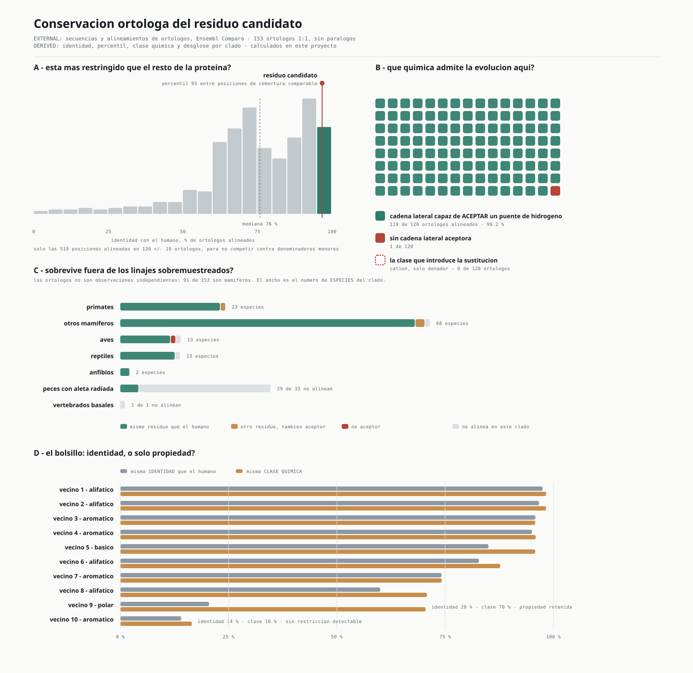

# EXP-011 · Conservación ortóloga del residuo candidato

> **`EXTERNAL`** — las secuencias y los alineamientos de ortólogos vienen de Ensembl Compara.
> **`DERIVED`** — la identidad, el percentil, la conservación química y el desglose por clado
> se calculan en este proyecto.
>
> **NO es `MEASURED`.** Esa etiqueta se reserva a observaciones directas sobre los datos del
> caso. Aquí no se ha medido nada del paciente. Y no es evidencia funcional.
>
> Saneado: sin número de residuo ni identidad de aminoácidos. El detalle numérico vive en
> `work/conservation/` (gitignored).
>
> **Origen ejecutable:** `src/structure/ortholog_conservation.py` → `src/make_fig7.py`.
> La cadena reproduce desde cero, incluida la descarga, y se ha verificado que el fichero
> descargado de nuevo es idéntico byte a byte.

## La pregunta, y la que NO se responde

**Se responde:** ¿está la posición candidata bajo restricción evolutiva, y de qué tipo?

**No se responde:** si la variante es patogénica. La regla estaba congelada en
`docs/STRUCTURAL_MISSENSE.md` antes de mirar: la conservación **pertenece a la historia
mecanística, no a la clasificación**. `PP3` tuvo su turno preregistrado con REVEL y volvió
indeterminado. Reabrirlo ahora con otro dato sería elegir el predictor que gusta.

## Método, y por qué cada decisión

| Decisión | Motivo |
|---|---|
| **Solo ortólogos 1:1** (153 de 238 homologías) | `BUB1` y `BUB1B` comparten el dominio pseudoquinasa. Mezclar parálogos mide conservación de familia, no de ortólogo. |
| **Columnas recalculadas por homología** | Ensembl devuelve alineamientos **por pares**, cada uno con su propio patrón de huecos en la secuencia fuente. Reutilizar las columnas de una homología en las demás produce números sin sentido. |
| **Los huecos se excluyen del denominador** | Un hueco es «no alineable aquí», no «residuo distinto». Contarlo como discrepancia rebajaba la identidad del 96,7 % al 75,8 %. |
| **Línea base interna obligatoria** | Un porcentaje de identidad suelto es ininterpretable. Se calculan las 1 050 posiciones y se sitúa la candidata en el percentil de esa distribución. |
| **Percentil solo contra COBERTURA COMPARABLE** | Una posición alineada en 120 especies y otra sostenida por 65 no son la misma medida. El percentil primario se calcula únicamente contra las 519 posiciones alineadas en 120 ± 10 ortólogos. |
| **Desglose por clado** | Los 120 ortólogos alineados **no son 120 observaciones independientes**: 91 de 153 son mamíferos. Un agregado alto puede estar sostenido por un solo linaje sobremuestreado. |

**Validación independiente del mapeo.** Los diez vecinos que el análisis estructural
identificó a <5 Å coinciden **uno a uno**, en identidad de aminoácido, con la secuencia
canónica que Ensembl usó como fuente. Estructura y alineamiento se numeran igual; no hay
desfase.

## Resultado

### La posición está entre las más restringidas de su propia proteína

| | |
|---|---|
| Identidad con el humano | **96,7 %** de los ortólogos alineados |
| Mediana de la proteína entera | 74,8 % |
| Percentil contra las 1 049 posiciones | 90 |
| **Percentil contra cobertura comparable (519 posiciones, 120 ± 10 ortólogos)** | **93** |

La comparación con la propia proteína es lo que da sentido al número: BUB1B tiene regiones
desordenadas poco conservadas, y aun así la posición candidata queda en el decil superior.

**Restringir a cobertura comparable no infla el resultado, lo corrige al alza:** el percentil
pasa de 90 a 93. Las posiciones peor cubiertas tienden a ser *menos* conservadas, así que
dejarlas competir estaba, si acaso, penalizando a la candidata. Se reporta el percentil
comparable como primario porque es el defendible, no porque sea el mayor.

### La restricción es química antes que de identidad

De los ortólogos alineados, **119 de 120 conservan una cadena lateral capaz de ACEPTAR un
puente de hidrógeno**. Los pocos cambios observados sustituyen una amida por otros grupos
que también aceptan.

**La clase química que introduce la sustitución del paciente —un catión que solo puede
donar— no aparece en ningún ortólogo: 0 de 120.**

Eso conecta directamente con lo único del análisis estructural que no dependía del rotámero:
el residuo silvestre **acepta** un puente del esqueleto, y el entrante no puede aceptarlo por
química. La evolución no ha muestreado esa clase en esta posición.

> **Cuidado con la fuerza de esta frase.** «No observado en 120 ortólogos» es una ausencia en
> una muestra, no una prueba de intolerancia. Y la capacidad aceptora se infiere de la
> **química de la cadena lateral**, no de un puente de hidrógeno medido en la estructura de
> cada especie: no se ha inspeccionado ninguna estructura ortóloga.

### Sobrevive fuera de los linajes sobremuestreados — con un límite

Ensembl muestrea mamíferos mucho más densamente que el resto: **91 de 153 ortólogos** son
mamíferos. El agregado `119/120` podría estar sostenido solo por ese bloque, así que se
desglosa.

| Clado | Especies | Alinean | No alinean | Capacidad aceptora |
|---|---|---|---|---|
| Primates | 23 | 23 | 0 | **100 %** |
| Otros mamíferos | 68 | 67 | 1 | **100 %** |
| Aves | 13 | 12 | 1 | 92 % |
| Reptiles | 13 | 12 | 1 | **100 %** |
| Anfibios | 2 | 2 | 0 | **100 %** |
| Peces con aleta radiada | 33 | **4** | **29** | 100 % |
| Vertebrados basales | 1 | 0 | 1 | — |

**Fuera de mamíferos: 30 ortólogos alineados en 4 clados, 29 con capacidad aceptora (96,7 %).**
La clase catiónica que introduce la sustitución **no aparece en ningún clado**.

> **El límite, dicho sin suavizar.** En peces con aleta radiada **solo alinean 4 de 33**. La
> divergencia vertebrada más profunda está representada por un puñado de secuencias, y los
> vertebrados basales por ninguna. La afirmación defendible es *«conservado en mamíferos,
> aves, reptiles y anfibios, y en los pocos peces donde la región alinea»*, no *«conservado
> en todos los vertebrados»*.
>
> Y el número de observaciones **efectivamente independientes** no es 120: son del orden de
> **cinco o seis observaciones a nivel de clado**. El `119/120` describe la muestra; no es un
> recuento de evidencias independientes.

### El bolsillo se comporta de tres maneras distintas

El panel D separa identidad de clase química, y aparecen tres regímenes:

| Régimen | Lectura |
|---|---|
| Identidad **y** clase altas (5 vecinos) | Núcleo genuinamente invariante. |
| Identidad baja, **clase alta** (1 vecino polar: 20 % identidad, 71 % clase) | **El caso más informativo**: la restricción actúa sobre la propiedad, no sobre la identidad. |
| Identidad **y** clase bajas (1 vecino aromático: 14 % / 17 %) | **Sin restricción detectable.** En la mayoría de vertebrados ese anillo aromático está sustituido por una cadena alifática. |

> **Esto corrige a la baja el documento estructural.** Allí se describió el entorno como
> «hidrofóbico y aromático, con cuatro anillos». Con los ortólogos delante: **dos de los
> cuatro aromáticos son robustos, uno es intermedio y el cuarto no está conservado ni en
> identidad ni en clase**. El carácter *hidrofóbico* del bolsillo se sostiene; la *jaula
> aromática de cuatro anillos* es en buena parte una descripción de la proteína humana, no
> de un rasgo conservado en vertebrados.

## Sesgo declarado: quién no alinea

33 de los 153 ortólogos no alinean en la posición candidata, y **la caída no es aleatoria**:

| | Alinean (120) | Con hueco (33) |
|---|---|---|
| Identidad global media | 74,5 % | **47,0 %** |
| Con <50 % de identidad global | 19 | **30** |

**El denominador no es una muestra aleatoria de vertebrados**: el alineamiento se cae
preferentemente en las especies lejanas.

Lo que impide que eso invalide el resultado es que **19 ortólogos con <50 % de identidad
global sí alinean**, y entre ellos la posición se mantiene hasta el 27,8 % de identidad
global —un anuro—, pasando por peces gar, bichires y *Xenopus*. En proteínas que apenas
comparten un tercio de su secuencia con la humana, esa posición sigue siendo la misma.

## La sorpresa: esto falsa mi propia explicación de REVEL

`docs/STRUCTURAL_MISSENSE.md` ofrecía una explicación para la discrepancia entre REVEL
(0,472, indeterminado) y el análisis estructural:

> *«Un residuo puede ser estructuralmente crítico en el plegamiento y aun así no estar
> profundamente conservado.»*

**Ese argumento ya no se sostiene.** La posición está en el percentil 90 de su propia
proteína y su química está conservada al 99,2 %. La explicación que yo había escrito para
reconciliar REVEL con la estructura era la de un residuo poco conservado, y el residuo **sí**
está conservado.

Conforme a la regla del proyecto —*documenta la sorpresa, no reescribas la predicción*— se
registra así:

- La discrepancia con REVEL **queda sin explicar**, y es ahora **más llamativa**, no menos.
- La segunda mitad de aquella explicación (mala representación de dominios pseudoquinasa en
  los conjuntos de entrenamiento) **sigue viva pero sin verificar**: es una hipótesis sobre
  el predictor, no un resultado.
- **`PP3` sigue sin aplicarse.** El umbral estaba preregistrado y REVEL quedó por debajo. La
  conservación no lo reabre.

## El siguiente experimento de esta rama

La conservación y la estructura estática han dado lo que podían dar. **Ninguna de las dos
puede resolver la incertidumbre que queda**, que es si la sustitución altera la cantidad o la
vida media de la proteína.

> **Siguiente mejor experimento:** un ensayo de **abundancia y recambio de BUBR1 específico de
> variante** — silvestre frente a la variante candidata, midiendo nivel en estado estacionario
> y vida media. Con perturbación de las rutas de degradación **solo si la primera medida
> muestra una diferencia que lo justifique**; añadirla antes sería asumir el mecanismo que se
> quiere probar.

**Qué decidiría:**

| Resultado | Lectura |
|---|---|
| Abundancia o vida media claramente reducidas frente al silvestre | La hipótesis de dosis pasa de estructural a funcional (`L3`) |
| Sin diferencia reproducible | La rama missense **muere como hipótesis de dosis**, igual que se aceptó REVEL indeterminado |

Esto **no lo ejecuta este proyecto**. Se registra porque cada rama debe terminar diciendo qué
experimento reduciría más la incertidumbre.

## Cierre

| | |
|---|---|
| **Estado** | **SURVIVES** — con la robustez filogenética hecha |
| Qué sostiene | La posición está bajo restricción evolutiva medible, y la restricción recae sobre la propiedad química exacta que la sustitución elimina. |
| Qué NO sostiene | Que la variante sea patogénica; que el bolsillo sea una jaula aromática conservada; que haya 120 evidencias independientes; conservación en vertebrados basales; ninguna evidencia funcional. |
| Efecto en ACMG | **Ninguno.** El candidato sigue siendo **VUS**. |
| Qué lo falsaría | Un ΔΔG explícito próximo a cero con repeticiones convergentes; o un ortólogo funcional con catión en esa posición. |
| Siguiente computacional | Modelado explícito de estabilidad — **bloqueado** por la licencia de FoldX. |
| Siguiente experimental | Ensayo de abundancia y recambio de BUBR1 específico de variante (arriba). |

## Nivel de evidencia

`L2` — apoyo ortogonal. Es una medida independiente sobre datos externos que concuerda con
la hipótesis estructural, generada por un método que no comparte entradas con ella.
No es `L3`: no hay ensayo funcional.
