# MOSAIC RESCUE scientific atlas

The plots requested during the project, linked to the artifacts that exist. Images open at
full size; they are code outputs, not AI-generated images. Cover illustrations are outside
this atlas.

## 1 · Local mutagenesis: ISM

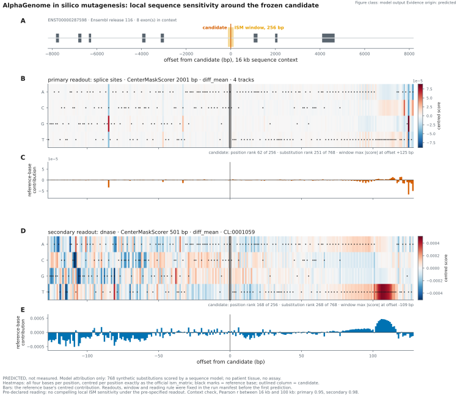

**MODEL_OUTPUT / PREDICTED.** 768 alternative substitutions; every value in the frozen window
is shown. Reference contributions are drawn as heights: they are not base frequencies or
evolutionary conservation. The candidate does not become a hotspot by being marked. The region
is not cropped to hide the most sensitive position.

[Code](../src/figures/fig04_ism.py) · local sources `work/alphagenome/ism/` ·
[notebook](../notebooks/04_HIDDEN_SECOND_ALLELE.ipynb).

## 2 · Chromatin contacts: REF, ALT and difference

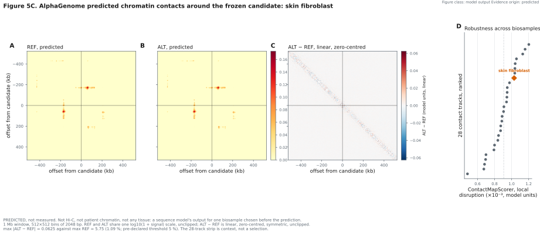

**MODEL_OUTPUT / PREDICTED.** 512 × 512-bin matrices. REF/ALT share `log10(1 + signal)` and
limits; ALT−REF is linear and centred on zero. The difference has its own, labelled scale:
intense colours there do not imply a large relative effect. This is model output, not the
patient's Hi-C. The existing characterisation does not complete the EXP-024 calibration.

[Code](../src/figures/fig04_contacts.py) · local sources `work/alphagenome/contacts/`.

## 3 · Genomic tracks: where the prediction happens

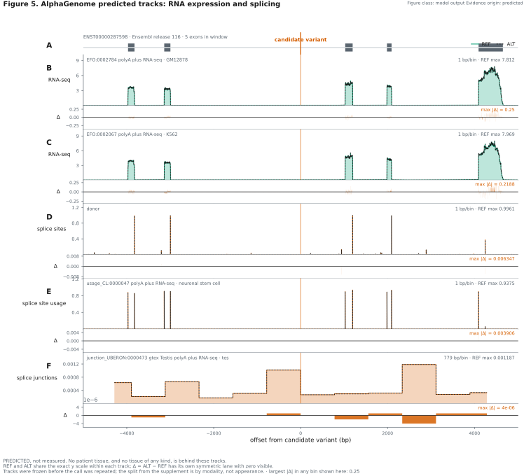

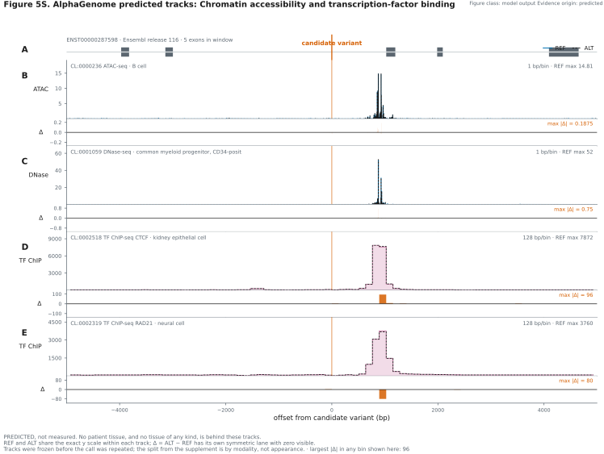

**MODEL_OUTPUT / PREDICTED.** Modalities and their differences stay aligned. They do not
represent RNA, accessibility or protein binding measured in this child.
[Code](../src/figures/fig04_tracks.py).

## 4 · From the gene to its structural context

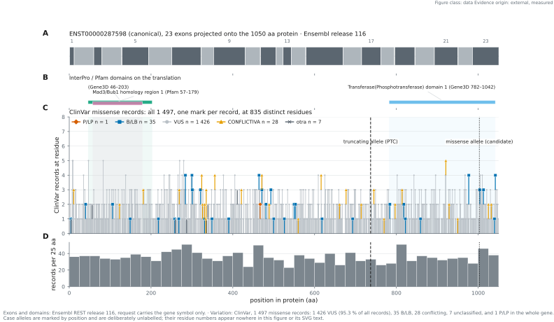

**DATA / EXTERNAL + MEASURED.** The browser places the curation within the gene; the ClinVar
set is the snapshot used in the analysis, not an updated query. [Code](../src/figures/fig02_browser.py).

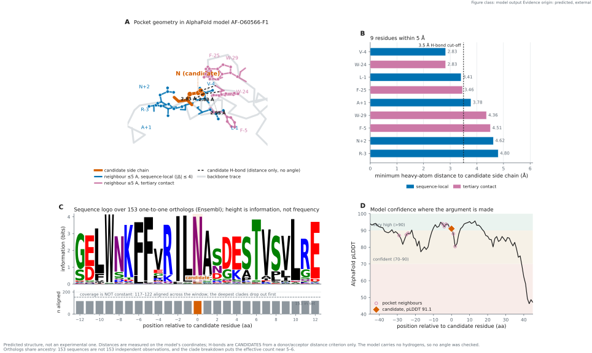

**MODEL_OUTPUT / PREDICTED + EXTERNAL.** Model geometry and conservation have different
provenance. A candidate geometric interaction does not demonstrate loss of function or
destabilisation. [Code](../src/figures/fig03_pocket.py).

## 5 · Mosaicism: what was observed and what was simulated

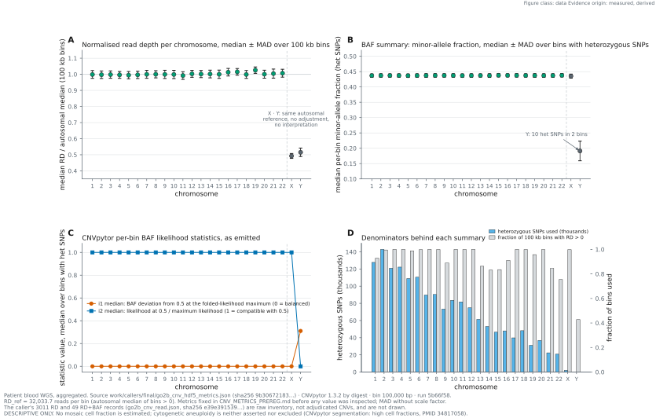

**DATA / MEASURED + DERIVED.** Aggregated RD and BAF, with explicit denominators. It does not
measure which alterations coexist within a cell, or how many clones exist.

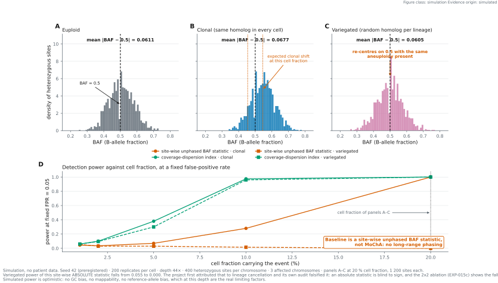

**SIMULATION / SIMULATED.** Three scenarios with a fixed seed and comparable scales. They are
not the child's cells. The caption keeps the falsification: the fall of the absolute statistic,
first attributed to cancellation, turned out to be depth-driven; cancellation does affect the
signed statistic. The comparator does not reproduce MoChA.
[Code](../src/figures/fig06_baf.py).

## 6 · Residual phenotype and the rescue evidence map

### The test that corrected our initial BAF explanation

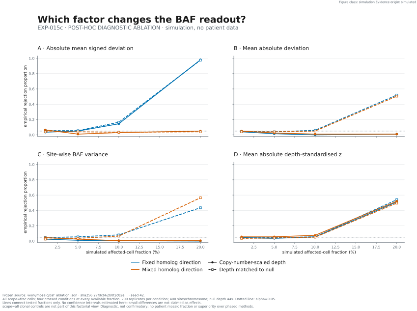

**SIMULATION / SIMULATED · POST-HOC.** Homolog direction × depth; the same scale for all
rejection proportions. The view contains every `scope=frac` factorial arm, not the additional
`scope=all` clonal controls. [Renderer with input hash](../src/figures/fig12_ablation.py).
This new figure visualises the existing run; it is not a new validation.

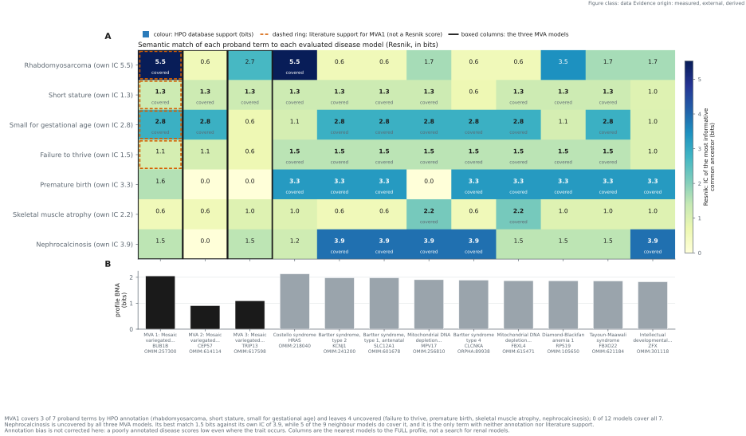

**DATA / MEASURED + EXTERNAL + DERIVED.** Semantic similarity shows which traits are least
well explained; the row-aligned verdicts derive from two checks (HPO annotation in the MVA1
model, and the published MVA1 series). A residual trait does not by itself assign a second
diagnosis.
[Code](../src/figures/fig05_hpo.py).

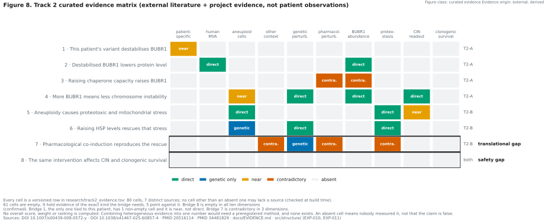

**CURATED_EVIDENCE / EXTERNAL + DERIVED.** Eight bridges by ten dimensions, with no total
score. Empty cells describe the bounded search. No quantitative safety or efficacy axes are
invented to make an attractive bubble chart.
[Code](../src/figures/fig07_evidence.py) · [source table](../research/track2_evidence.tsv).

## What the original concept could and could not deliver

| Requested in the early discussions | Supported deliverable today | Limit / missing data |
|---|---|---|
| ISM / sensitive regions | Full matrix and reference contributions | Model attribution, not a functional assay |
| Chromatin contact maps | REF/ALT/Δ and biosample context | Not the patient's Hi-C |
| Variants → functional effect | Genome browser, tracks, structure and conservation | Phase and missense function unresolved |
| Chromosomal mosaic | Measured RD/BAF + explicit simulation | No observed cell × chromosome matrix |
| Subpopulations / resistant cells | No invented cell atlas is presented | Requires cell-level data and state/viability measures |
| Rescue map | Evidence matrix and experimental portfolio | No measured efficacy/safety coordinates for the drugs |
| Rescue counterfactuals | Proposed experiments and falsifiers | No validated causal model that predicts individual rescue |

## Provenance and reproduction

Every plot has its card in [PUBLICATION_FIGURE_QA](../PUBLICATION_FIGURE_QA.md). The scripts
read the frozen artifacts without querying AlphaGenome again. Local data stay outside Git under
the project rules.

```bash
python src/figures/fig04_ism.py
python src/figures/fig04_contacts.py
python src/figures/fig06_baf.py
python src/verify.py
```

`scientific-visualization` guides the separation of classes, comparable scales and provenance.
The methodological reference and the external sources are in [STORYBOARD](STORYBOARD.md). No
cell atlas is claimed.
