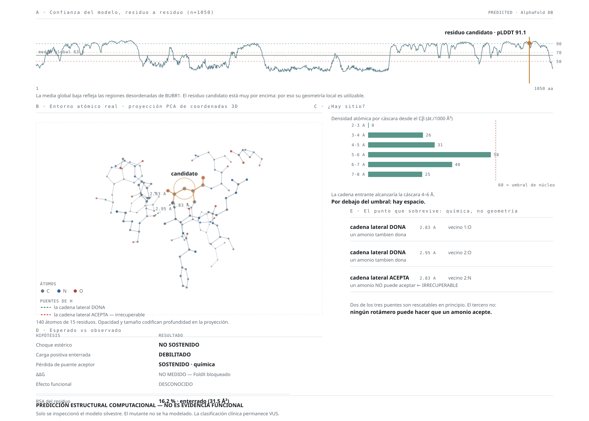

# Análisis estructural del candidato missense

> **PREDICCIÓN ESTRUCTURAL COMPUTACIONAL — NO ES EVIDENCIA FUNCIONAL.**
>
> Saneado: sin coordenadas, número de residuo ni identidad de aminoácidos. Detalle en
> `work/struct/`.

## Qué estructura se usó, y por qué importa

VEP mapeó el candidato a dos estructuras experimentales del PDB y al modelo de AlphaFold DB.
Se descargaron las tres y **se comprobó la cobertura antes de usarlas**:

| Estructura | Cadena de BUBR1 | ¿Cubre el residuo candidato? |
|---|---|---|
| PDB experimental 1 | 18–308 | **No** |
| PDB experimental 2 | 19–345 | **No** |
| AlphaFold DB (`AF-O60566-F1`) | 1–1050 | **Sí** |

**Las dos estructuras experimentales solo resuelven el extremo N-terminal.** Son complejos
APC/C donde el dominio C-terminal de BUBR1 no está resuelto. Para este residuo **la única
estructura disponible es un modelo predicho**, y eso hay que declararlo: es predicción sobre
predicción.

**No se ejecutó AlphaFold.** El modelo ya existe en AlphaFold DB. Correrlo habría gastado
GPU para reproducir algo descargable.

## Confianza local del modelo

| | pLDDT |
|---|---|
| Residuo candidato | **91,1** |
| Ventana ±10 residuos | 91,5 (mín 80,4 · máx 95,3) |
| Media de toda la proteína | 63,6 |

La media global baja refleja las regiones desordenadas de BUBR1. **Pero la región del
candidato está en confianza muy alta (>90)**, muy por encima de la media de la proteína.

Eso es lo que legitima el análisis: en una región de pLDDT bajo, medir enterramiento o
contactos no significaría nada.

> **Uso permitido de pLDDT:** evaluar si el modelo es fiable en esa posición.
> **Uso prohibido:** comparar pLDDT del silvestre contra el mutante como evidencia de
> desestabilización (brief §12: ΔpLDDT correlaciona muy débilmente con ΔΔG, PCC ≈ −0,17).

## Resultado

*Coordenadas atómicas reales proyectadas por PCA, con los tres puentes de hidrógeno y sus
distancias medidas. Perfil de pLDDT de los 1050 residuos.*

### El residuo está enterrado

| | |
|---|---|
| SASA absoluta | 31,5 Ų |
| **RSA relativa** | **16,2 %** |

Por debajo del 20 % convencional para «enterrado».

### En un bolsillo hidrofóbico y aromático

**10 residuos a menos de 5 Å, de los cuales 8 son hidrofóbicos y solo 1 cargado.** Entre los
vecinos hay **cuatro aromáticos** (dos triptófanos y dos fenilalaninas), formando un núcleo
compacto.

### Y hace tres puentes de hidrógeno con el esqueleto

La cadena lateral del residuo silvestre establece **tres enlaces con átomos del esqueleto
peptídico de residuos vecinos**, todos entre 2,83 y 2,95 Å. No es un residuo decorativo:
está grapando la conformación local.

## Qué se puede afirmar del cambio — y qué no

> ### ⚠ Corrección: solo se inspeccionó el modelo SILVESTRE
>
> La primera versión de este documento concluía *«predicción: desestabilizante»* y afirmaba
> que el residuo entrante «no puede reproducir» los puentes de hidrógeno. **Eso es un salto
> injustificado:** todo lo medido —enterramiento, vecinos, puentes— se midió sobre la
> estructura silvestre. **El mutante no se ha modelado.**
>
> Formulación defendible con lo que hay hoy:
>
> > *The candidate residue is buried in a high-confidence AlphaFold region and participates
> > in a dense local interaction network. Substitution by lysine is **structurally concerning**
> > and motivates explicit stability modeling; **destabilization has not yet been
> > demonstrated**.*

Lo que **sí** sostiene la evidencia actual:

1. El residuo está **enterrado** (RSA 16,2 %) en una región de alta confianza del modelo.
2. Su entorno es **hidrofóbico y aromático** (8 de 10 vecinos, cuatro anillos aromáticos).
3. Su cadena lateral participa en una **red densa de tres puentes con el esqueleto**.
4. La sustitución introduce un residuo **más largo y con carga positiva**.

Los puntos 1–3 son mediciones. El punto 4 es un hecho del código genético. **La conclusión
de que eso desestabiliza es una inferencia que hay que modelar, no asumir.**

## Análisis geométrico del mutante — y qué debilita

Sin ΔΔG, pero respondiendo las preguntas concretas: ¿cabe la cadena entrante? ¿queda la
carga enterrada? ¿se pueden rescatar los puentes?

### 1. Sí hay sitio. Esto **debilita** el argumento estérico

La cadena lateral entrante es mucho más larga (CB→extremo ~5 Å frente a ~2,4 Å). La cáscara
de 4–6 Å desde el CB es donde aterrizaría ese extremo:

| | |
|---|---|
| Átomos ajenos en la cáscara | 30 |
| **Densidad** | **47,1 átomos / 1000 ų** |
| Referencia de núcleo globular | 60–90 |
| SASA sumada de la cáscara | 131,2 Ų |

**Está por debajo de la densidad de núcleo, y hay salida parcial al solvente.**

> **Esto corrige a la baja mi propio análisis anterior.** El residuo está enterrado
> (RSA 16,2 %), pero **el espacio hacia el que se extendería la cadena entrante no está
> densamente empaquetado y tiene acceso a solvente**. Los argumentos de choque estérico y
> de carga enterrada son **más débiles** de lo que sugería el número de enterramiento por
> sí solo.

### 2. Lo que sí es sólido, y no depende del rotámero

De los tres puentes de hidrógeno, la asimetría química importa:

| Contacto | Papel del residuo silvestre | ¿Rescatable? |
|---|---|---|
| Cadena lateral → esqueleto de vecino 1 | **dona** | En principio sí |
| Cadena lateral → esqueleto de vecino 2 | **dona** | En principio sí |
| **Cadena lateral ← esqueleto de vecino 2** | **ACEPTA** | **No. Por química** |

El tercero es el punto fuerte del análisis: el oxígeno de la amida del residuo silvestre
**acepta** un puente del nitrógeno del esqueleto. El grupo entrante es un **amonio: solo
puede donar, nunca aceptar**.

**Ese contacto se pierde por química, no por geometría** — y por tanto **ningún rotámero
puede rescatarlo**. Es el único elemento del análisis que no depende de cómo se acomode la
cadena.

### Conclusión del bloque geométrico

> El argumento estérico y el de carga enterrada quedan **debilitados**: hay espacio y hay
> solvente. Lo que queda en pie es la **pérdida rotámero-independiente de un puente de
> hidrógeno aceptor con el esqueleto**, en una región de alta confianza del modelo.
>
> Eso sigue justificando un cálculo explícito de estabilidad. **No lo sustituye.**

## El siguiente experimento computacional está definido

**Modelado explícito de estabilidad**, no otro predictor de patogenicidad. Sobre el modelo
de AlphaFold:

| Paso | Qué produce |
|---|---|
| Reparación de la estructura | Geometría optimizada de partida |
| Construcción del mutante, **≥5 repeticiones** | Comprobación de convergencia |
| ΔΔG medio y **dispersión entre corridas** | Magnitud con incertidumbre, no un número suelto |
| Van der Waals y choques estéricos | Si la cadena entrante cabe |
| Puentes de H perdidos y ganados | Si la lisina rescata alguno |
| Término electrostático | Coste real de la carga enterrada |
| Empaquetamiento local y geometría silvestre vs mutante | Comparación directa |

Si el ΔΔG sale claramente positivo y **consistente entre repeticiones**, entonces sí se
puede escribir *computationally predicted destabilization* — sin tocar ACMG.

**Si sale prácticamente neutro, se acepta igual que se aceptó REVEL 0,472** y la missense
pierde otro apoyo. Ese es el trato.

No requiere GPU.

> **Bloqueo:** FoldX requiere licencia académica con registro manual en `foldxsuite.crg.eu`
> y el binario no es descargable de forma automatizada. **Hace falta que el responsable del
> proyecto se registre y coloque el binario**; en cuanto esté, el análisis corre en minutos.
>
> Se ha preferido **no sustituirlo por otro predictor cualquiera** y dar un ΔΔG que no se
> puede validar. El análisis geométrico de arriba es lo que se sostiene sin él.

## La tensión con REVEL, declarada

**REVEL dio 0,472 — indeterminado.** El análisis estructural apunta a desestabilización.
Discrepan, y hay que decirlo en vez de elegir el que gusta más.

Explicación plausible: REVEL es un conjunto entrenado sobre variantes clasificadas y pesa
mucho la conservación evolutiva. Un residuo puede ser estructuralmente crítico en el
plegamiento y aun así no estar profundamente conservado. Además, la representación de
dominios pseudoquinasa en los conjuntos de entrenamiento es pobre.

> **Esto NO revierte la decisión de `PP3`.** Los umbrales estaban preregistrados y REVEL
> quedó por debajo. Usar el resultado estructural para reabrir `PP3` sería exactamente
> buscar el predictor que da la respuesta deseada. **La tabla ACMG no cambia.**

## Qué cambia y qué no

**No cambia:**
- La clasificación del candidato missense sigue siendo **VUS**.
- No hay `PP3`, no hay `PM1`, no hay `PS1`, no hay `PM5`.
- `PM3` sigue bloqueado. La fase sigue sin resolver.

**Sí cambia:** ahora hay una **hipótesis mecanística concreta y medible**, en lugar de una
intuición. Y es falsable con un experimento definido:

> Si el residuo enterrado que grapa el núcleo local se sustituye por uno cargado y largo, la
> abundancia de BUBR1 debería estar reducida. **Se mide.** Ensayo de estabilidad o
> abundancia proteica variante-específico → habilitaría `PS3`.

Ese ensayo es, junto con la fase, uno de los dos únicos caminos que pueden mover esta
variante de VUS.

## Conservación — qué preguntará y qué NO

Falta el alineamiento de ortólogos. Pero hay que fijar de antemano **qué se le permite
concluir**, porque es fácil convertirlo en una segunda oportunidad encubierta para `PP3`.

> **La conservación pertenece a la historia mecanística, no a la clasificación.** REVEL ya
> tuvo su turno preregistrado y quedó indeterminado. Acumular herramientas correlacionadas
> hasta que una dé el resultado deseado es exactamente lo que ClinGen desaconseja.

Además hay una sutileza específica de este gen: el trabajo que estableció que BUBR1 es
pseudoquinasa muestra que la región sufrió **degeneración evolutiva** de los motivos
catalíticos entre vertebrados. Lo que quedó bajo restricción funcional fue la **estabilidad
conformacional**, no la catálisis.

| Resultado | Qué se puede decir |
|---|---|
| Residuo muy conservado | Fortalece la plausibilidad estructural |
| Residuo poco conservado | Debilita la idea de restricción en **ese** residuo — **pero no demuestra tolerancia estructural** |
| Residuo variable, **arquitectura del bolsillo conservada** | El más interesante: restricción sobre la propiedad, no sobre la identidad |

**Diseño:** ortólogos reales de `BUB1B`, no parálogos `BUB1` mezclados. Humano → primates →
mamíferos → aves → reptiles → anfibios → peces. Se mira identidad exacta, conservación
química, conservación de los vecinos del bolsillo, puntuación por residuo, y un logo de
secuencia de ~20–30 aa alrededor de la posición.

Ese logo puede ser un panel de la Figura 4.

**ΔΔG cuantitativo.** El análisis actual es de descriptores estructurales, no un cálculo de
energía libre. Un ΔΔG con FoldX o equivalente, repetido varias veces, daría una magnitud.
Se ha preferido no dar un número que no se puede sostener antes que dar uno falso.
