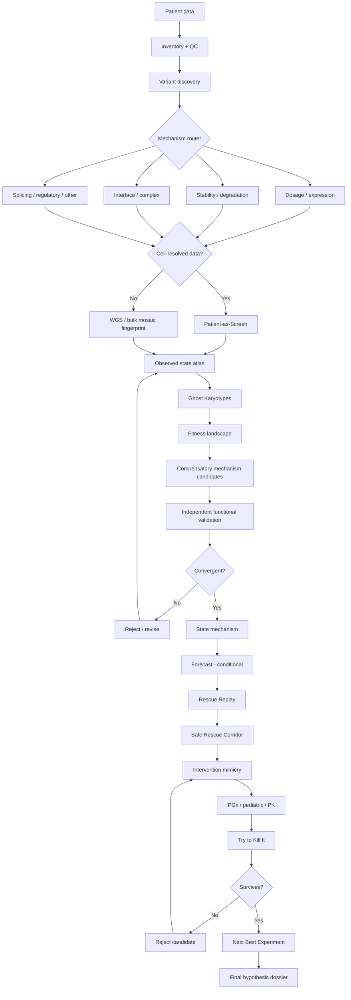
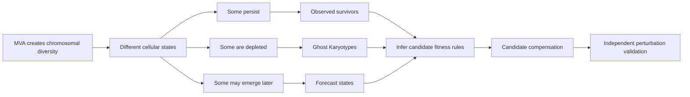
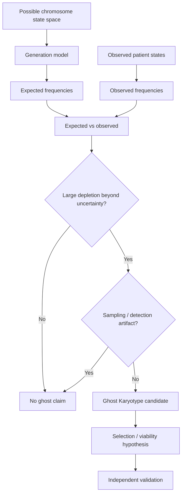
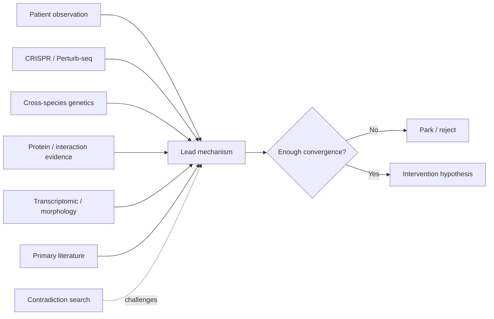
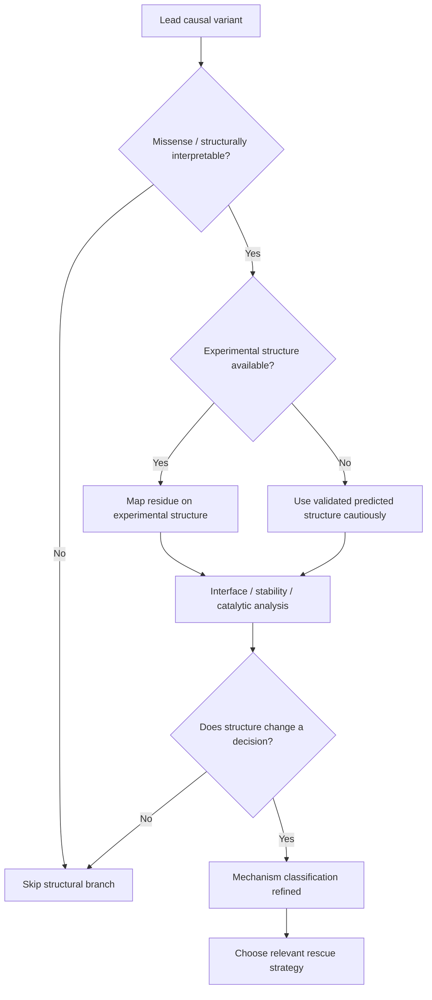
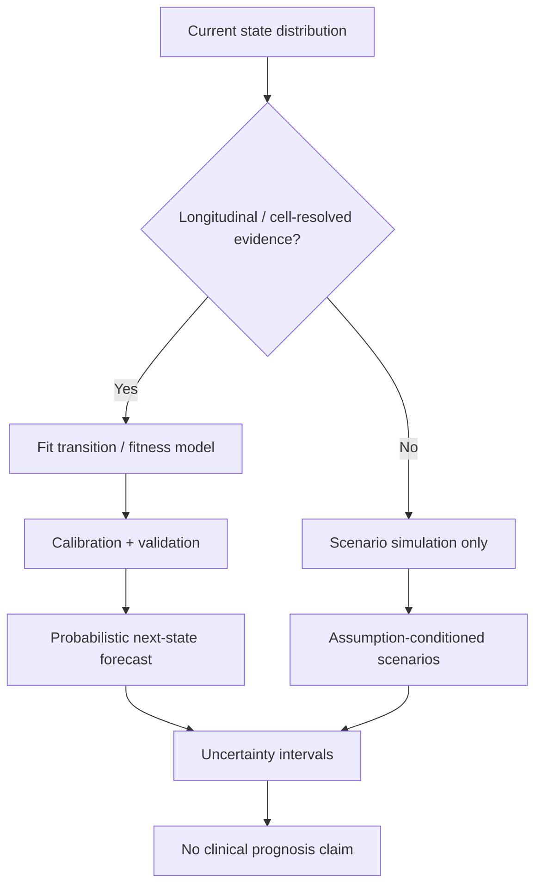
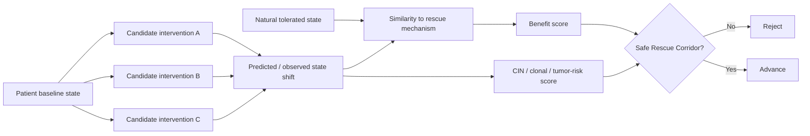
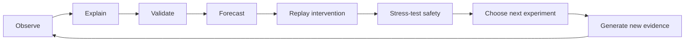
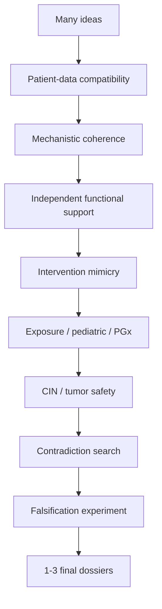

# MOSAIC RESCUE — Visual Diagrams

GitHub renders these Mermaid diagrams directly.

## 1. End-to-end architecture

## 2. Patient-as-Screen logic

## 3. Ghost Karyotype logic

## 4. Evidence convergence

## 5. Structural branch

## 6. Forecasting logic

## 7. Rescue Replay and Safe Rescue Corridor

## 8. Closed-loop discovery

## 9. Final hypothesis funnel

