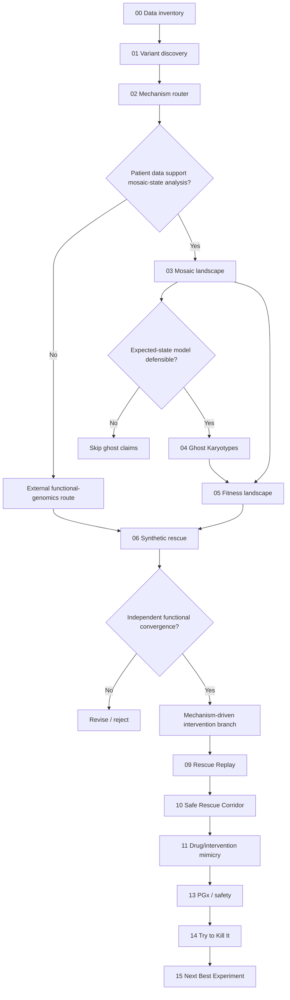

# MOSAIC RESCUE — Notebook Guide

> ⚠️ **SUPERADO.** El inventario real del dataset (`docs/01_MASTER_BRIEF.md` §1) invalida
> las ramas que este documento describe: no hay RNA-seq, single-cell, longitudinal ni
> cariotipo celular. Ver `docs/00_ESTADO_Y_OBSOLESCENCIA.md`. Se conserva como registro.

---

The notebooks are the reproducible scientific record of the project. They are **not** a sequence that must all run. Each later notebook is activated only if the data and mechanism justify it.

## Required notebook structure

Every notebook should contain these sections in order:

1. **Biological question**
2. **Hypothesis ID(s)**
3. **Inputs and provenance**
4. **Data QC**
5. **Assumptions**
6. **Method**
7. **Primary result**
8. **Primary scientific visualization**
9. **Robustness / uncertainty analysis**
10. **Alternative explanations**
11. **Contradictory evidence**
12. **Evidence-level update (L0-L5)**
13. **Falsification criterion**
14. **Next Best Experiment**

## Visual rule

Each major notebook should produce at least:

- one QC/diagnostic figure,
- one primary scientific figure,
- one uncertainty/robustness figure.

Interactive visualizations are useful for exploration, but important results should also export a stable static figure under `figures/`.

## Activation sequence

| Notebook | Purpose | Activation gate |
|---|---|---|
| `00_data_inventory.ipynb` | Inventory every hackathon file/modality | Always — first notebook |
| `01_variant_discovery.ipynb` | Track 1 causal variant prioritization | VCF/genomic data available |
| `02_mechanism_router.ipynb` | Classify molecular failure mode | Lead variant(s) exist |
| `03_mosaic_landscape.ipynb` | Build patient mosaic state map | Cell-resolved or sufficiently informative WGS data |
| `04_ghost_karyotypes.ipynb` | Expected-vs-observed negative-space analysis | Explicit null/generation model possible |
| `05_fitness_landscape.ipynb` | Infer relative persistence/selection landscape | State frequencies/transition evidence sufficient |
| `06_synthetic_rescue.ipynb` | Functional-genomics compensation search | Candidate patient mechanism/state identified |
| `07_cell_competition.ipynb` | Test relative cellular-fitness ecology | Appropriate cell-state evidence / external support |
| `08_mosaic_forecast.ipynb` | Forecast plausible cellular states | Longitudinal/cell-resolved calibration; otherwise scenario mode only |
| `09_rescue_replay.ipynb` | Counterfactual intervention trajectories | Validated compensatory mechanism exists |
| `10_safe_rescue_corridor.ipynb` | Benefit-vs-evolutionary-risk analysis | Candidate interventions exist |
| `11_drug_mimicry.ipynb` | Mechanism-driven intervention nomination | Independent rescue validation passed |
| `12_structural_mechanism.ipynb` | Structure-guided mechanism refinement | Variant is structurally informative and changes a decision |
| `13_pgx_safety.ipynb` | PGx / pediatric / exposure context | Specific candidate(s) exist |
| `14_try_to_kill_hypothesis.ipynb` | Adversarial falsification / contradictions | Lead hypothesis exists |
| `15_next_best_experiment.ipynb` | Rank experiments that reduce uncertainty | Competing hypotheses remain |

## Branch logic

## Data inventory notebook — exact first objective

`00_data_inventory.ipynb` must answer:

- exact file names,
- formats,
- genome build,
- sample/tissue source,
- patient vs family samples,
- VCF vs BAM/CRAM availability,
- single-cell availability,
- bulk RNA availability,
- longitudinal timepoints,
- clinical karyotype/cytogenetic ground truth,
- phenotype/HPO metadata,
- any proteomic, imaging, fibroblast, iPSC or organoid material,
- access/data-handling restrictions.

The final cell should print a **Branch Activation Matrix** stating which later notebooks are:

- `ACTIVE`
- `CONDITIONAL`
- `BLOCKED`
- `NOT APPLICABLE`

## Reproducibility rule

A figure that cannot be regenerated from documented inputs and code does not belong in the final scientific claim chain.

## Claim boundary

Notebooks may generate computational/preclinical hypotheses. They must not present model output as a diagnosis, clinical prognosis, prescription, or cure.