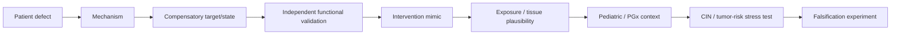

# MOSAIC RESCUE — Research Protocol

This document defines the minimum scientific standard for every agent, notebook, hypothesis, figure, and candidate intervention in this repository.

## 1. First principle

A result is not valuable because it is surprising. It is valuable if it is:

1. reproducible,
2. biologically coherent,
3. independently supported,
4. explicit about uncertainty,
5. falsifiable,
6. useful for deciding what to test next.

## 2. Evidence record required for every claim

Every non-trivial claim must record:

| Field | Required |
|---|---|
| Claim ID | Yes |
| Exact claim | Yes |
| Evidence level L0-L5 | Yes |
| Source type | Yes |
| Primary source / dataset | Yes |
| Direct or inferred? | Yes |
| Relevant disease/model context | Yes |
| Data modality | Yes |
| Supporting observation | Yes |
| Contradictory evidence searched? | Yes |
| Strongest contradiction | Yes |
| Alternative explanation | Yes |
| Reproducible analysis / code path | If computational |
| Falsification criterion | Yes |
| Decision affected | Yes |

## 3. Evidence levels

- **L0 — Speculation:** mechanistically conceivable, no direct support.
- **L1 — Associative:** correlation, co-occurrence, observational enrichment, descriptive pattern.
- **L2 — Orthogonal support:** independent dataset/method supports the same direction.
- **L3 — Functional:** perturbation changes the phenotype/mechanism in the predicted direction.
- **L4 — Replicated functional:** convergent functional evidence across models or assays.
- **L5 — Clinically established:** established human evidence. Use only when truly justified.

### Advancement rule

A candidate mechanism cannot be called a **validated rescue mechanism** below L3.

A candidate drug cannot be called a **strong therapeutic hypothesis** unless:

- the disease mechanism is independently supported,
- the drug-to-mechanism link is experimentally grounded,
- a relevant safety review is complete,
- an explicit falsification experiment is proposed.

## 4. Source priority

Preferred order:

1. primary peer-reviewed experimental paper,
2. primary consortium dataset / official database,
3. systematic review / expert consensus,
4. curated database,
5. preprint,
6. secondary review,
7. model-generated inference.

A review can guide discovery, but key mechanistic claims should be traced back to primary evidence where possible.

## 5. Required contradiction search

For every exciting hypothesis, agents must deliberately search for:

- failed replication,
- opposite-direction results,
- tissue or model dependence,
- dosage dependence,
- developmental-stage dependence,
- cancer-specific artifacts,
- technical confounding,
- pharmacologic exposure mismatch,
- pediatric limitations,
- tumor/CIN/proliferation concerns.

Findings go to `research/contradictions.md` even if they weaken our favorite idea.

## 6. Patient-specific evidence gate

No patient-specific claim may be made unless the required data modality is confirmed.

### Single-cell branch

Allowed questions if appropriate cell-resolved data exist:

- inferred or measured karyotype distribution,
- cell-state association with chromosomal state,
- lineage-specific persistence,
- stress signatures by state,
- candidate cell-competition patterns.

Mandatory caveats:

- CNV inference from expression is not direct cytogenetics,
- expression-derived CNV can create circularity,
- sampling and survival bias matter,
- clinical karyotype should be used as ground truth where available.

### WGS/BAM/CRAM branch

Potential outputs:

- mosaic allele-fraction evidence,
- copy-number imbalance,
- B-allele-frequency patterns,
- read-depth support,
- tissue-level mosaic fingerprint.

Do not infer cell-level state/phenotype coupling from bulk DNA alone.

### VCF-only branch

Use for:

- causal variant prioritization,
- inheritance and genotype reasoning,
- consequence and splicing prioritization,
- pharmacogenomic variants where justified.

Patient-as-Screen becomes an external-functional-genomics hypothesis rather than a direct within-patient cellular analysis.

## 7. Variant mechanism router

Every prioritized causal variant must be classified into one or more plausible mechanism classes:

- dosage / loss of expression,
- protein instability / degradation,
- protein-complex interface disruption,
- catalytic/activity loss,
- splice alteration,
- regulatory alteration,
- dominant-negative or gain-of-function if evidence supports it,
- unresolved.

The class determines the next method. Tools must follow the biological question, not the reverse.

## 8. Structural modeling rule

AlphaFold / AlphaFold 3 / FoldX / Rosetta / molecular modeling are **conditional decision tools**.

They may be used to ask:

- is a residue at a known interface?
- could a missense variant plausibly destabilize a fold or interface?
- does the variant affect a known catalytic/interaction region?
- does the proposed mechanism suggest stability rescue or interface rescue?

They may **not** be used to claim:

- clinical pathogenicity from structure alone,
- mutation effect from naive WT-vs-mutant pLDDT comparison,
- binding affinity or drug efficacy without validated methods and controls,
- causal rescue solely from a predicted structure.

Experimental structures are preferred where available.

## 9. Ghost Karyotype gate

A missing state is not automatically selected against.

Before calling a state a **Ghost Karyotype**, distinguish:

- probability of being generated,
- probability of being sampled,
- technical detectability,
- viability/selection.

The strongest version requires an explicit expected-state model and uncertainty interval.

## 10. Fitness / forecast gate

Forecasting is allowed only as **model-based cellular-state forecasting**, never as clinical prognosis.

A forecasting result must include:

- input states,
- transition assumptions,
- calibration dataset,
- uncertainty,
- held-out or external validation where possible,
- failure cases.

If longitudinal/cell-resolved data are unavailable, label outputs as **scenario simulation under assumptions**, not patient-specific prediction.

## 11. Synthetic rescue gate

A rescue candidate should ideally satisfy at least two independent routes, for example:

- patient-state association + CRISPR evidence,
- cross-species suppressor + human perturbation evidence,
- dosage relationship + pathway perturbation,
- patient signal + independent morphological/transcriptomic reversal.

DepMap evidence must be labeled cancer-derived and context-limited.

## 12. Drug / intervention nomination gate

Never start from a drug list.

Required chain:

For every candidate verify:

- regulatory/approval status,
- exact molecular mechanism,
- whether the required direction of modulation is supported,
- target/tissue exposure plausibility,
- pediatric precedent if relevant,
- known proliferation/apoptosis/CIN effects,
- tumor-risk concerns,
- drug-gene PGx guidance if applicable.

## 13. Safe Rescue Corridor

The optimization target is **not maximum cell survival**.

A candidate is more attractive when it improves the desired molecular/cellular phenotype while not increasing:

- chromosome missegregation,
- CIN,
- abnormal clonal fitness,
- proliferation escape,
- apoptosis resistance,
- tumor-like adaptation.

## 14. Falsification standard

Every hypothesis must contain at least one experiment/result that would make us abandon or substantially downgrade it.

Examples:

- candidate suppressor perturbation fails to rescue missegregation,
- proposed rescue improves stress but increases CIN,
- patient-state enrichment disappears after correcting for generation probability,
- structural effect is absent in experimental/validated models,
- drug does not achieve the required pathway modulation at plausible exposure.

## 15. Notebook reproducibility standard

Every notebook should contain, in order:

1. Biological question
2. Hypothesis ID(s)
3. Inputs and provenance
4. QC
5. Assumptions
6. Method
7. Primary result
8. Scientific visualization
9. Sensitivity / robustness test
10. Contradiction / alternative explanation
11. Evidence-level update
12. What would falsify the result
13. Next best experiment

## 16. Definition of a winning final dossier

A final hypothesis dossier should be understandable as one causal story:

**variant → mechanism → patient-specific observation → compensatory mechanism → independent functional evidence → intervention mimic → safety → uncertainty → falsification experiment**

Anything that cannot fit this chain is supporting material, not the headline result.
