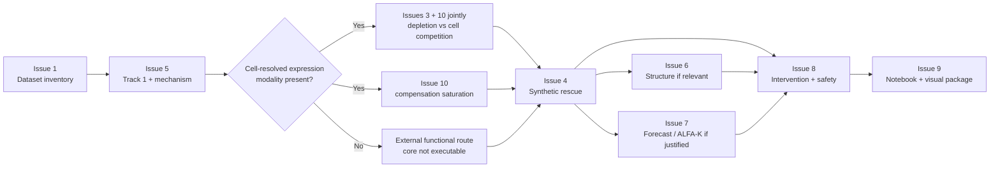

# MOSAIC RESCUE — Research Status Board

This is the coordination page for parallel work. Update it when an issue produces a meaningful report or a decision gate changes.

## Current critical path

> **#2 is not on the critical path.** The Patient-as-Screen audit rejected its strong form; its
> surviving contribution is the cross-tissue design constraint now folded into #3 + #10.

## Open streams

| # | Stream | Priority | Blocking? | Expected output |
|---|---|---:|---|---|
| [#1](https://github.com/Manceb0/mosaic-rescue/issues/1) | Exact dataset inventory | P0 | **Yes** | Confirmed modalities + branch activation |
| [#5](https://github.com/Manceb0/mosaic-rescue/issues/5) | Track 1 causal variant + mechanism router | P0 | Yes for downstream mechanism | Gene universe + ranking + router |
| [#2](https://github.com/Manceb0/mosaic-rescue/issues/2) | Patient-as-Screen / natural rescue precedent | P1 | No | Precedent + falsifiable definition |
| [#3](https://github.com/Manceb0/mosaic-rescue/issues/3) | Ghost Karyotypes + fitness landscape | P1 | Data-dependent | Null model + ghost definition |
| [#4](https://github.com/Manceb0/mosaic-rescue/issues/4) | Synthetic rescue / functional validation | P1 | Yes before intervention nomination | Rescue evidence rubric |
| [#6](https://github.com/Manceb0/mosaic-rescue/issues/6) | Structural / AlphaFold branch | P2 | Conditional | Decision tree + allowed claims |
| [#7](https://github.com/Manceb0/mosaic-rescue/issues/7) | Forecast / counterfactual / next experiment | P2 | Conditional | Validated forecast or scenario framework |
| [#8](https://github.com/Manceb0/mosaic-rescue/issues/8) | Intervention mimicry + Safe Rescue Corridor | P2 | Yes before final dossier | Candidate gate + safety rules |
| [#9](https://github.com/Manceb0/mosaic-rescue/issues/9) | Notebook scaffold + scientific visuals | P1/P2 | No | Reproducible notebooks + figures |
| [#10](https://github.com/Manceb0/mosaic-rescue/issues/10) | Aneuploid stress transfer — mPOS / proteostasis / cell competition | **P0** | Coupled to #3 | Saturation-threshold spec + competing-explanation test |

### Scope decisions (2026-08-28)

- **ALFA-K belongs to #7**, not #3. Both claimed it; #3 now consumes #7's verdict. ALFA-K is a forecasting method needing ≥4 longitudinal timepoints, not a null model for negative space.
- **#10 and #3 are assessed jointly.** Cell competition is a competing explanation for the entire depletion signal, not a parallel topic.

## Evidence promotion board

Use these states for every major hypothesis:

`IDEA → L0 → L1 → L2 → L3 → L4 → FINALIST`

A hypothesis can also move to:

`PARKED` or `REJECTED`.

### Minimum promotion rules

- **L1:** a measurable patient/external association exists.
- **L2:** at least one orthogonal evidence route agrees.
- **L3:** a functional perturbation supports the mechanism.
- **FINALIST:** mechanism + patient relevance + independent evidence + intervention plausibility + safety review + falsification experiment.

## Current hypothesis status

Updated 2026-08-28 after three independent agent audits (`research/agent_findings/`).

| Hypothesis | Status | Why |
|---|---|---|
| **Compensation saturation** *(new — candidate core)* | **PURSUE** | Does compensatory capacity saturate as per-cell chromosome burden rises? Needs no T0 control and no generation null model, so it survives the objections that killed the two below. Anchored on Amponsah 2025 (PMID 40527892): HSF1/HSP27/HSP90α rescue trisomy 13 and 3 but **not** tetrasomy 5 |
| Patient-as-Screen | **REJECT** strong form · **CONDITIONAL** reformulated | MVA is a pooled screen sequenced only at endpoint — no T0/input-library control, so "depleted" and "never generated" are indistinguishable. Survives only as a generation-normalized isogenic selection test |
| Ghost Karyotypes | **REJECT** literal form · **CONDITIONAL** as chromosome × tissue | Underdetermined: 44 observations, ~176 unknowns. Depletions below ~5× unidentifiable at any N. Defensible only as a cross-tissue difference-in-differences |
| Fitness Landscape | **PARK** on patient data | Requires state/transition evidence the dataset is unlikely to contain |
| Synthetic Rescue | **CONDITIONAL** | Gated on an expression/proteomic modality existing, plus axis-level (never pair-level) cross-species transfer. See `docs/rescue_evidence_rubric.md` |
| Mosaic Forecast / ALFA-K | **PARK** on patient data · **CONDITIONAL** as external demo | Needs ≥4 longitudinal timepoints. Authors state fitness estimates for deleterious CNAs are biased upwards — structurally blind in the ghost region |
| Rescue Replay | Conditional | Requires a validated compensatory mechanism first |
| Safe Rescue Corridor | **Promoted from framework to prediction** | The honest output of the reformulated method points at clonal selection in the tumour-risk direction. Safety is now something the method predicts, not a disclaimer appended to it |
| Structural rescue | Conditional | Activates only for structurally informative causal variants |

### Candidates already rejected under the rescue rubric

**TRIP13 ↔ p31^comet** and **bubR1 ↔ polo** — real, documented, correct pathway, and both suppress by weakening the spindle checkpoint *further* in a tumour-predisposition disease. Failed veto criteria 6 and 7 on first pass.

## Next team checkpoint

Do not debate the final drug yet.

Item 4 below is **done** — the three audits are in `research/agent_findings/`. Remaining:

1. confirmed dataset modalities *(#1 — now the single question that decides whether the core is executable)*,
2. a reproducible Track 1 candidate shortlist,
3. a mechanism-router classification,
4. ~~independent-agent reports for Patient-as-Screen, Ghost Karyotypes, and Synthetic Rescue~~ ✅ 2026-08-28.

### What the audits changed

All three agents rejected their own hypothesis in its strong form and converged independently on the same three findings:

- **p53 is the axis, and it poisons cancer-derived evidence.** DepMap's reference panel is p53-crippled by Cas9 selection, so it has already solved aneuploidy tolerance — the phenotype we want to study.
- **The variable that matters is tissue × chromosome**, not chromosome alone.
- **Nothing runs without a cell-resolved modality.** This is open question #4, unresolved, gated behind #1.

### Track 2 gap

"Track 2" appears nowhere else in this repository. The whole Rescue Replay / drug mimicry apparatus is not yet anchored to the Track 2 requirement that the final intervention be an **approved drug**. A mechanistic discovery that is not an approved drug may remain a biological mechanism or validation axis — it must not silently become the Track 2 submission.
