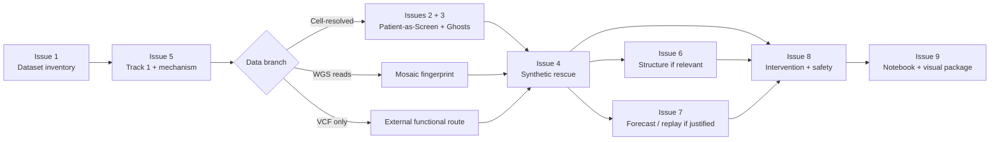

# MOSAIC RESCUE — Research Status Board

This is the coordination page for parallel work. Update it when an issue produces a meaningful report or a decision gate changes.

## Current critical path

## Open streams

| # | Stream | Priority | Blocking? | Expected output |
|---|---|---:|---|---|
| [#1](https://github.com/Manceb0/mosaic-rescue/issues/1) | Exact dataset inventory | P0 | **Yes** | Confirmed modalities + branch activation |
| [#5](https://github.com/Manceb0/mosaic-rescue/issues/5) | Track 1 causal variant + mechanism router | P0 | Yes for downstream mechanism | Gene universe + ranking + router |
| [#2](https://github.com/Manceb0/mosaic-rescue/issues/2) | Patient-as-Screen / natural rescue precedent | P1 | No | Precedent + falsifiable definition |
| [#3](https://github.com/Manceb0/mosaic-rescue/issues/3) | Ghost Karyotypes + fitness landscape | P1 | Data-dependent | Null model + ghost definition |
| [#4](https://github.com/Manceb0/mosaic-rescue/issues/4) | Synthetic rescue / functional validation | P1 | Yes before intervention nomination | Rescue evidence rubric |
| [#6](https://github.com/Manceb0/mosaic-rescue/issues/6) | Structural / AlphaFold branch | P2 | Conditional | Decision tree + allowed claims |
| [#7](https://github.com/Manceb0/mosaic-rescue/issues/7) | Forecast / counterfactual / next experiment | P2 | Conditional | Validated forecast or scenario framework |
| [#8](https://github.com/Manceb0/mosaic-rescue/issues/8) | Intervention mimicry + Safe Rescue Corridor | P2 | Yes before final dossier | Candidate gate + safety rules |
| [#9](https://github.com/Manceb0/mosaic-rescue/issues/9) | Notebook scaffold + scientific visuals | P1/P2 | No | Reproducible notebooks + figures |

## Evidence promotion board

Use these states for every major hypothesis:

`IDEA → L0 → L1 → L2 → L3 → L4 → FINALIST`

A hypothesis can also move to:

`PARKED` or `REJECTED`.

### Minimum promotion rules

- **L1:** a measurable patient/external association exists.
- **L2:** at least one orthogonal evidence route agrees.
- **L3:** a functional perturbation supports the mechanism.
- **FINALIST:** mechanism + patient relevance + independent evidence + intervention plausibility + safety review + falsification experiment.

## Current hypothesis status

| Hypothesis | Current status | Why |
|---|---|---|
| Patient-as-Screen | L0/L1 concept | Strong rationale; direct patient evidence depends on dataset modality |
| Ghost Karyotypes | L0 | Needs explicit generation/null model and patient state data |
| Fitness Landscape | L0 | Needs sufficient state/transition evidence and calibration |
| Synthetic Rescue | Framework | External functional evidence route must be populated after lead mechanism |
| Mosaic Forecast | Conditional | Direct version requires suitable longitudinal/cell-resolved data |
| Rescue Replay | Conditional | Requires validated compensatory state/mechanism first |
| Safe Rescue Corridor | Framework | Metrics become concrete only after candidate mechanism/intervention |
| Structural rescue | Conditional | Activates only for structurally informative causal variants |

## Next team checkpoint

Do not debate the final drug yet.

The next checkpoint occurs when we have:

1. confirmed dataset modalities,
2. a reproducible Track 1 candidate shortlist,
3. a mechanism-router classification,
4. independent-agent reports for Patient-as-Screen, Ghost Karyotypes, and Synthetic Rescue.

At that point we choose the **single strongest discovery path** and park the rest as secondary branches.
