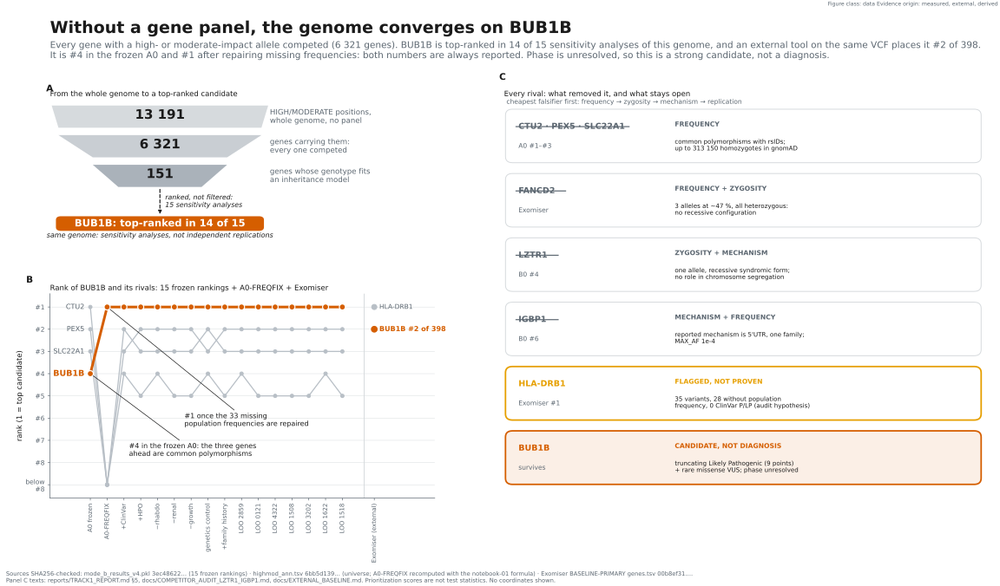
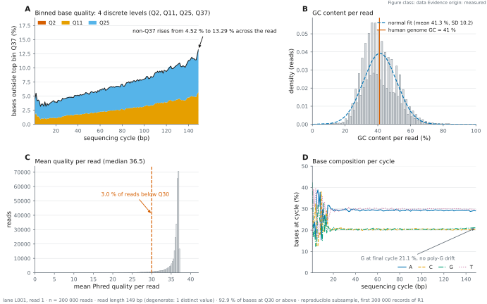
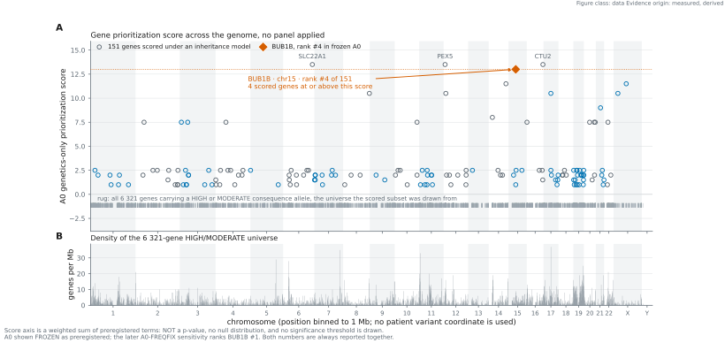
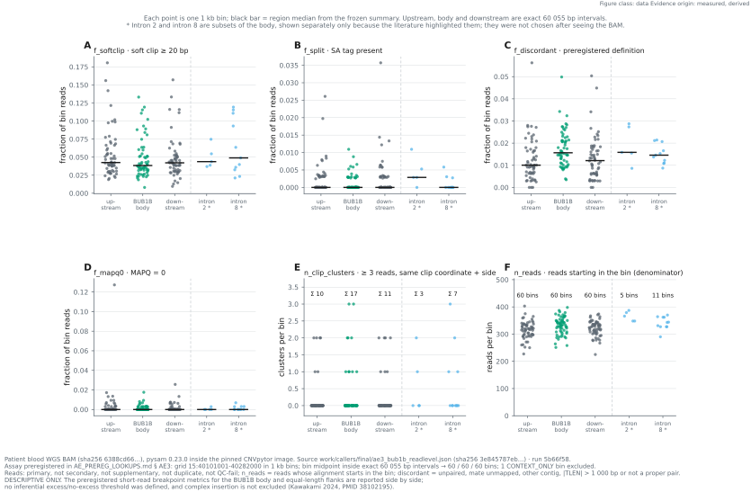
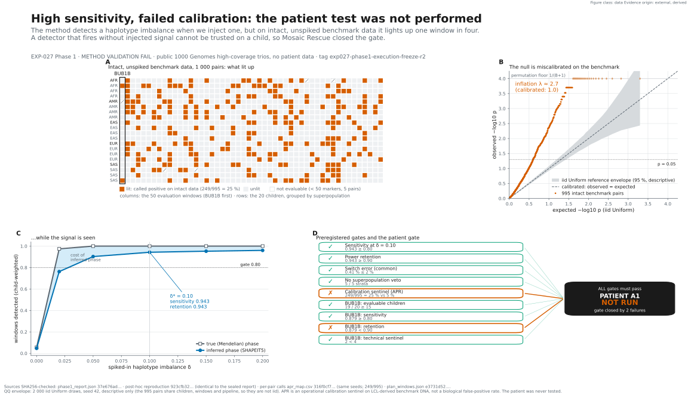

# MOSAIC RESCUE: Track 1 report

**Variant identification in one paediatric genome with suspected mosaic variegated aneuploidy**

Rare Disease, Real Kid: MVA Hackathon 2026

Repository: <https://github.com/Manceb0/mosaic-rescue>


## 1. Summary

**Panel-free genome-wide analysis converged on `BUB1B` as the leading causal hypothesis.**
Among 6 321 genes carrying HIGH/MODERATE-impact alleles, with no gene panel and no gene-level
prior, `BUB1B` (MVA1, OMIM 257300) ranked first in 14 of 15 sensitivity analyses. The frozen,
preregistered genetics-only ranking `A0` placed it **#4**, because three common polymorphisms
with rsIDs lacked attached frequency annotations. The documented sensitivity analysis
`A0-FREQFIX` repairs those 33 alleles and restores `BUB1B` to **#1**. Both numbers are reported
together, always, and `A0` is never rewritten. An externally written method, Exomiser, run on
the same VCF, ranks `BUB1B` **#2 of 398** genes. These are robustness checks on the same
genome, not independent biological replications. Exomiser's #1, `HLA-DRB1`, is kept as an
unresolved audit flag, not a demonstrated alternative (§5).



*Figure 1. Data figure. Without a gene panel, BUB1B is top-ranked in 14 of 15 sensitivity analyses of the same genome and Exomiser places it #2 of 398 (same VCF). It is #4 in the frozen A0 and #1 in A0-FREQFIX. Both are reported. Strong candidate, not a diagnosis. Drawn by `src/figures/fig14_track1_convergence.py` from the project's analysis outputs, with source hashes checked before drawing.*


The genotype is mechanistically coherent with MVA1: one truncating allele, research-curated
Likely Pathogenic, plus one rare missense VUS, both on the MANE transcript, a configuration
reported in biallelic `BUB1B`-associated MVA ([Hanks et al. 2004](https://doi.org/10.1038/ng1449)).

The recorded phenotype mostly fits or stays open. Of seven recorded traits, three are
annotated in the MVA1 disease model, one more is supported by a published 31-case MVA1
literature compilation (Pavone et al. 2022, PMID 35804254) only through a broader growth
phenotype, two cannot be judged because the compilation does not quantify them, and
**nephrocalcinosis is the one trait supported by neither check**: it is not annotated in any MVA
model and was not reported in that compilation, which records only generic renal dysfunction
(12.9 %). The compilation is a literature review, not a homogeneous cohort: its own index case
carries a single heterozygous `BUB1B` VUS. A residual trait keeps a mixed diagnosis open. It does not establish
one ([audit](../docs/PHENOTYPE_RESIDUAL_AUDIT.md)).

**Phase remains unresolved. Therefore this is a strong causal hypothesis, not a diagnosis.** No
parental samples were provided, and the two alleles are separated by a gap 13.8× the
sequencing fragment length, so read-backed phasing cannot reach. `PM3` is therefore blocked and
the biallelic configuration is a candidate, not a demonstrated finding. The correct
description is *candidate compound heterozygosity with phase unresolved*, and nothing stronger.
The missense remains a VUS: no functional assay of this allele exists.

A research secondary/incidental candidate is also reported: a heterozygous nonsense
variant in `LZTR1`, ClinVar pathogenic/likely pathogenic. It is not proposed as the cause of
this phenotype, and it is not presented as a returnable clinical finding: it would require
independent clinical confirmation and appropriate return-of-results handling before it meant
anything to anyone.

Taken together, `BUB1B` is the best-supported explanation this genome can offer, found
without a gene panel, and its candidate genotype matches a reported biallelic pattern of MVA
type 1. It is a strong hypothesis, not a diagnosis. Four things remain unproven,
and each needs a new observation rather than more computation: the phase of the two alleles,
the function of the missense, the safety of any rescue, and whether the method works on other
patients. §7b states the conclusions and the experiment that decides each question.


*Figure 2. From sequence to a testable mechanism. Variant evidence and the recorded phenotype point to BUB1B, model predictions are compared, and a proposed functional assay would support or refute the mechanism. Conceptual schematic drawn with AI image generation and checked against this report. It shows no measured data.*

## 2. Data and its limits, established before analysis

One biological sample of blood WGS: four sequencing lanes, eight paired-end FASTQ files,
the provider VCF and a subsequently reconstructed full-depth BAM. All lanes belong to
the same sample. GRCh38 is the reference assembly, not a second participant.
The initial QC notebook sampled lane 1. The later GO 2A/GO 2B work uses the full alignment.

Read quality was assessed before any variant was examined: invariant 149 bp read length, GC
41.3 % against the genome's 41 %, 92.9 % of bases at Q30 or better, and no poly-G drift.
The data are fit for the question.



*Figure 3. Data figure. Reads are fit for use: 149 bp invariant, GC 41.3 % against the genome's 41 %, 92.9 % of bases at Q30+, and quality degrades from 4.52 % to 13.29 % non-Q37. Drawn by `src/figures/fig00_qc.py` from the project's analysis outputs, with source hashes checked before drawing.*


What does not exist, and what each absence blocks:

| Missing | Consequence |
|---|---|
| Parental genotypes | Phase unresolved. `PM3` blocked |
| RNA-seq | No measured expression or splicing evidence for the case |
| Protein / functional assays | Missense effect and residual function remain unmeasured |
| Single-cell or longitudinal data | Cell-resolved mosaicism and forecasting not attempted |
| Clinical karyotype | No ground truth for any mosaicism signature |
| Contemporaneous blood count | Mitochondrial readout uninterpretable |

The earlier "five of sixteen branches" count described the pre-alignment state. The BAM
blocker has since been resolved. Missing family and functional data still limit the causal
claim. The current per-question inventory is in [the visual guide](../docs/STORYBOARD.md).

## 3. Method


*Figure 4. The research route. One case feeds variant, read and phenotype evidence into a causal hypothesis, while simulation sets method limits and external evidence feeds the rescue hypotheses and their safety criteria. Conceptual schematic drawn with AI image generation and checked against this report. It shows no measured data.*

No panel was used for the primary search. Choosing a panel first and finding `BUB1B` in it
would have been confirmation bias, and the project's own rules forbid it. The pipeline
extracted 13 191 positions carrying 13 216 alleles of HIGH and MODERATE consequence across
6 321 genes, and scored them on genotype configuration, rarity, consequence severity,
transcript status and quality, with no gene-level prior.

Fifteen ranking analyses were run, differing in whether phenotype and ClinVar were used:

| Analysis | What it uses | `BUB1B` |
|---|---|---|
| `A0_GENETICS` (frozen, preregistered) | genetics only | **#4** |
| `A0-FREQFIX` (later sensitivity) | genetics only, 33 frequency annotations repaired | **#1** |
| `A1_GENETICS_CLINVAR` | + ClinVar | #1 |
| `B0_FULL_PROBAND` | + HPO phenotype (Resnik / Best Match Average) | #1 |
| 11 further leave-one-out and ablation analyses | varies | #1 in 14 of 15 overall |


*Figure 5. Why BUB1B rose to the top. The frozen A0 placed it fourth, the frequency audit repaired 33 annotations, A0-FREQFIX placed it first, and Exomiser on the same VCF placed it second of 398. Method agreement on the same data is not biological replication. Conceptual schematic drawn with AI image generation and checked against this report. It shows no measured data.*

An external baseline was run on the same VCF. Exomiser, a method this project did not
write, places `BUB1B` #2 of 398 distinct genes, autosomal-recessive model, in both runs.
Agreement between an in-house score and an independently written tool is worth more than
either alone, but it is methodological agreement on the same genotypes, not independent
biological evidence. Its #1, `HLA-DRB1`, is kept as an open audit flag (see the competitor
table).



*Figure 6. Data figure. BUB1B competes against a 6,321-gene universe and ranks #4 in the frozen A0. The y axis is a prioritization score, not a p-value. Drawn by `src/figures/fig01_manhattan.py` from the project's analysis outputs, with source hashes checked before drawing.*

Phenotype handling used seven HPO terms from the clinical document, plus one family-history
term kept on a separate channel so it cannot contaminate the primary result. A frozen polarity
rule applies: only documented terms count as positive. Anything unmentioned is UNKNOWN,
never negative. Semantic similarity uses Resnik information content in bits with Best Match
Average aggregation.


*Figure 7. Data figure. Among seven recorded traits, nephrocalcinosis is the one with neither HPO annotation nor MVA1 literature support, while Bartter-type models do cover it. Two traits cannot be judged (PARKED, not negative). Drawn by `src/figures/fig05_hpo.py` from the project's analysis outputs, with source hashes checked before drawing.*

## 4. Curation of the two alleles

Research-grade ACMG/AMP curation, Bayesian points.

**Truncating allele**: `PVS1` (nonsense on the MANE transcript, NMD-predicted),
`PM2_Supporting` (rare). 9 points, which is Likely Pathogenic.

**Missense allele**: remains VUS. Three criteria were considered and rejected with the
data in front of us:

- **`PM1` does not apply.** The intuition that the residue sits in a hot domain does not
  survive the data: 1 497 ClinVar missense records across `BUB1B`, 95.3 % of them VUS, and a
  single P/LP. There is no demonstrable hotspot anywhere in the gene.
- **`PM3` is blocked** by unresolved phase.
- **`PS3` needs a functional assay** that does not exist for this variant.

Orthologous conservation does support concern: the position sits in the 90th percentile of its
own protein, the chemical property is conserved in 99.2 % of 120 orthologs, and the class of
substitution introduced appears in none of them. This does not change the ACMG call, and
it is reported as mechanism, not as evidence of pathogenicity.


*Figure 8. Model output, predicted, not measured. The candidate side chain anchors a pocket of 9 residues with 3 candidate H-bonds, at pLDDT 91 and in a column carrying 4.04 of 4.32 possible bits. Drawn by `src/figures/fig03_pocket.py` from the project's analysis outputs, with source hashes checked before drawing.*

According to PubMed, the first
families with BUB1B-associated MVA carried truncating and missense mutations ([Hanks et al. 2004](https://doi.org/10.1038/ng1449)), and
human MVA1 cases are either biallelic, typically one missense plus one nonsense allele, or
monoallelic combined with variants that lower wild-type BUBR1 ([Wijshake et al. 2012](https://doi.org/10.1371/journal.pgen.1003138)). The candidate pair
therefore matches the expected pattern. That raises the prior plausibility of the hypothesis,
but it does not replace phase or functional evidence for these particular alleles.


*Figure 9. Two variants and two unresolved questions. Phase decides whether the pair can be recessive, and the missense still needs functional testing. Phase alone does not resolve the VUS. Conceptual schematic drawn with AI image generation and checked against this report. It shows no measured data.*

## 5. Competing hypotheses, all audited

The value of a panel-free search is that it surfaces competitors. Every gene that outranked or
closely approached `BUB1B` was audited, cheapest falsifier first: frequency first, then
zygosity, mechanism and replication.

| Competitor | Where it appeared | Verdict |
|---|---|---|
| `CTU2`, `PEX5`, `SLC22A1` | `A0` #1–#3 | **NEGATIVE**: common polymorphisms with rsIDs, up to 313 150 homozygotes in gnomAD |
| `FANCD2` | Exomiser #6 | **NEGATIVE**: three alleles at ~47 % population frequency, all heterozygous, no recessive configuration possible |
| `LZTR1` | `B0` #4 | **NEGATIVE as a cause of MVA**: the syndromic form is recessive and only one allele is present. Heterozygous LoF causes adult-onset schwannomatosis, and `LZTR1` has no established role in chromosome segregation |
| `IGBP1` | `B0` #6 | **NEGATIVE**: the only reported disease mechanism is 5'UTR disruption of translation initiation, not coding missense. The association rests on a single family. And `MAX_AF` 1 × 10⁻⁴ is strongly inconsistent with an ultra-rare, penetrant, causal model. The verdict rests on all three together, not on the frequency argument alone |
| `HLA-DRB1` | Exomiser #1 (external baseline) | **UNRESOLVED, audit flag, not eliminated**: 35 variants, 28 without population frequency, 0 ClinVar P/LP (`docs/EXTERNAL_BASELINE.md`). That pattern *suggests* mapping or representation complexity in a polymorphic region. Nothing here tests it. Not a demonstrated alternative diagnosis, and not rejected |

`FANCD2` deserves a note: it is the Fanconi anaemia pathway, which overlaps MVA in both
phenotype and mechanism. It was the most uncomfortable competitor and was audited rather than
avoided.

## 6. Research secondary / incidental candidate

The proband carries a heterozygous nonsense variant in `LZTR1` on the MANE transcript:
high quality (DP 48, GQ 99, allele balance 0.50, PASS), rare (`MAX_AF` 3 × 10⁻⁵), and
classified pathogenic/likely pathogenic in ClinVar. It is not an artefact.

It does not explain the reported phenotype, for the reasons in §5. It is submitted with
`finding_type = secondary` and a low `epcr` because it is real and the submission format has a
field for this. The hackathon rules state that secondary and incidental findings are
welcome and do not penalise the automated Track 1 score.

**It is a research candidate, not a returnable clinical result.** Calling it a "secondary
finding" without that qualifier would imply a clinical status it has not earned. Independent
confirmation by an orthogonal method, clinical interpretation and any return-of-results
decision belong to the clinical team, and this project makes no clinical recommendation. It is
also kept out of the main MVA narrative: it would distract from `BUB1B` and open a
separate and much larger clinical conversation.

## 7. The second-allele problem and the completed short-read analysis


*Figure 10. A bounded search for a hidden second allele. Each negative holds within its scope, and a complex insertion is not excluded. RNA-seq and targeted long reads are proposed. Conceptual schematic drawn with AI image generation and checked against this report. It shows no measured data.*

The full-depth BAM made read-based structural analysis possible. This is a technical
extension of the same biological sample, not an independent biological replication.
GO 2B reached its frozen final state on 11 September 2026. The decision record in
`docs/DECISIONS.md` supersedes older descriptions of this work as awaiting alignment.

| Evidence class | Frozen finding | What it cannot establish |
|---|---|---|
| CNVpytor RD+BAF | No emitted CNV overlaps the BUB1B gene body | Exclusion of every structural lesion or cell-level aneuploidy |
| xTea / SCRAMble MEI | No emitted MEI call overlaps the gene body | Exclusion of a complex intronic insertion |
| AE3 read-level assay | Body and equal-length flanks reported side by side | An excess/no-excess claim: no inferential threshold was defined |
| AE1 partner context | Gene-associated breakpoint context for alternative local calls | A proven retrocopy or processed-pseudogene insertion architecture |
| AE2 population lookup | NOT EXECUTED (data policy) | A negative population lookup or a rarity conclusion |

The caller's genome-wide inventory is not a set of adjudicated alternative diagnoses.
Closing the operational stages also does not by itself establish a result for every
preregistered subquestion. The frozen local `REPORTE_GO2B_STOP_CIENCIA.md`
(hash verified against `docs/go2b_final_artifacts.sha256.json`) reports recovery of
both prioritized alleles in the reconstructed reads (technical replication), a negative
DMPK expansion screen within its short-read scope, and an aligned MitoRead ratio
without cell-composition adjustment or matched controls. These do not resolve phase,
prove mitochondrial dysfunction or exclude every repeat disorder. The historical
regulatory locus still requires its own output-level reconciliation.

The technical figures are [chromosome RD/BAF](../figures/pub/fig09_cnvpytor_chromosome_rd_baf.svg)
and [read-level metrics](../figures/pub/fig10_bub1b_readlevel_assay.svg). The MEI/SV
adjudication map is an internal working figure: it carries case-specific positions and is
not linked from this report.

The regulatory SNV/indel branch remains negative within the evaluated scope. Existing
AlphaGenome ISM/contact figures are EXP-023 model outputs. EXP-024, the separate null and
positive-control calibration, remains preregistered and not executed.


*Figure 11. Data figure. Chromosome-level RD and BAF of the patient's blood WGS, descriptive only: autosomal medians in a narrow band, uniform aggregated BAF. No mosaic fraction is estimated and no aneuploidy is asserted or excluded. Drawn by `src/figures/fig09_cnv_chromosomes.py` from the project's analysis outputs, with source hashes checked before drawing.*



*Figure 12. Data figure. Short-read breakpoint metrics for the BUB1B body and two equal-length flanks, side by side. No inferential excess/no-excess threshold was defined, and a complex insertion is not excluded. Drawn by `src/figures/fig10_bub1b_readlevel.py` from the project's analysis outputs, with source hashes checked before drawing.*


*Figure 13. Model output, predicted, not measured. ALT tracks REF across every frozen prediction. Splicing, the modality that decided the hypothesis, shows neither gain nor loss of a site. Drawn by `src/figures/fig04_tracks.py` from the project's analysis outputs, with source hashes checked before drawing.*

The missing second allele has a history in this disease. In seven families with PCS
syndrome, only one BUB1B mutation per family was found in coding sequence, while transcript and
protein levels were reduced ([Matsuura et al. 2006](https://doi.org/10.1002/ajmg.a.31069)). Later cases located the hidden allele outside the exons:
an intronic Alu insertion together with a promoter-region variant ([Kato et al. 2017](https://doi.org/10.1038/hgv.2017.21)), and a 3 kb Alu/SVA
intronic insertion that short-read genome sequencing missed and RNA-seq plus targeted long reads
found ([Kawakami et al. 2024](https://doi.org/10.1038/s10038-023-01211-8)). This case sits at the same frontier. Short-read structural analysis narrowed the
space. It could not close it.

External precedent supports preserving the short-read limitation: another BUB1B case
required RNA-seq and targeted long reads to reveal an intronic insertion and aberrant
splicing. It does not show that this case has the same lesion.
[PubMed 38102195](https://pubmed.ncbi.nlm.nih.gov/38102195/),
[DOI 10.1038/s10038-023-01211-8](https://doi.org/10.1038/s10038-023-01211-8).

## 7a. What would falsify this, and the next experiment

- Parental genotypes or long-molecule phasing showing both alleles in *cis*. This
  would overturn this two-allele recessive explanation, not exclude every BUB1B mechanism.
- A variant-specific BUBR1 abundance/turnover assay showing no reduction would weaken
  the instability route. A checkpoint/segregation assay is also needed to assess other
  functional defects. Normal abundance alone does not establish benignity.
- An independently supported structural or copy-number variant at another locus explaining
  the phenotype more economically. The raw caller inventory has not established one.
- A second `LZTR1` allele found by a method this pipeline cannot run, which would reopen
  recessive Noonan syndrome.


*Figure 14. Choose the experiment that changes the decision. Each open question with its measurement and the decision it informs. Proposed measurements, not completed results. Conceptual schematic drawn with AI image generation and checked against this report. It shows no measured data.*

Priority is phase for the causal pair, followed by variant-specific functional evidence.
RNA-seq and targeted long reads remain routes for a hidden allele if that question persists.
None of these assays is represented as already performed in this case.

## 7b. Conclusions

What this work establishes, from most to least certain:

1. **The data answer the question they can answer.** One blood genome, high-quality reads,
   a reconstructed full-depth alignment and technical recovery of both prioritised alleles.
2. **`BUB1B` is the best-supported explanation in this genome.** It competed against 6 321
   genes without a panel. It is #4 in the frozen ranking only because three common
   polymorphisms lacked frequency annotations. With those repaired it is #1, and it is #1 in
   14 of 15 sensitivity analyses of the same genome (not independent replications). An
   external method on the same VCF (Exomiser) places it #2 of 398. Every in-house competitor
   that outranked it in the frozen A0 was falsified by frequency or genotype configuration.
   The external Exomiser baseline ranks HLA-DRB1 first. It remains an unresolved audit flag
   rather than a demonstrated alternative diagnosis.
3. **The candidate genotype matches a reported biallelic MVA1 pattern**: a truncating allele,
   research-curated as likely pathogenic, and a missense VUS ([Hanks et al. 2004](https://doi.org/10.1038/ng1449), [Wijshake et al. 2012](https://doi.org/10.1371/journal.pgen.1003138)).
4. **The structural search narrowed the second-allele question without closing it.** No
   copy-number or mobile-element call overlaps the gene body, and no alternative local
   structural signal explains the case. A complex intronic insertion, the lesion that has
   hidden second alleles before ([Matsuura et al. 2006](https://doi.org/10.1002/ajmg.a.31069), [Kato et al. 2017](https://doi.org/10.1038/hgv.2017.21), [Kawakami et al. 2024](https://doi.org/10.1038/s10038-023-01211-8)), is not excluded.
5. **Our own method was challenged and corrected.** The initial explanation of the BAF signal
   was falsified by a post-hoc ablation and is reported as such.

What it does not establish: a diagnosis, a biallelic configuration, the effect of the
missense, a mosaic cell fraction, a working rescue, or that the method generalises.

When a secondary method failed validation, it was not used on the child. EXP-027
asked whether haplotype-specific allelic imbalance could read a mosaic signal from blood. Before
touching the patient, it was validated on 20 public 1000 Genomes trios under a frozen contract.
It detected injected imbalance well (sensitivity 0.943) but fired on 249 of 995 intact,
unspiked benchmark pairs against a nominal 5 %, and BUB1B-locus retention was 0.879, below
0.90. Method validation failed, so the patient test was not performed: this is not a
patient-negative result ([forensic record](../docs/EXP027_PHASE1_RESULT.md)).



*Figure 15. Data figure. High sensitivity (0.943 at δ = 0.10), failed calibration (APR 249/995 = 25.0 % vs 5 % nominal): method validation FAIL, so the patient-level A1 test was not performed. Drawn by `src/figures/fig13_exp027_phase1.py` from the project's analysis outputs, with source hashes checked before drawing.*

Blood is one view of the mosaic, not the mosaic. The chromosome picture in any sample
reflects three things at once: which errors cell division produces, which of the resulting
cells persist, and which tissue and method were used to look. Bulk blood sequencing cannot
separate them. In a *Bub1b* hypomorphic mouse, regenerating tissues such as the haematopoietic
system were largely euploid while non-regenerating tissues were highly aneuploid, consistent
with selection against aneuploid cells ([Pfau et al. 2016](https://doi.org/10.1101/gad.278820.116)).
In patients with MVA, cultured lymphocytes and buccal-cell FISH gave different pictures, with
more trisomies in the first and more losses than gains in the second
([García-Castillo et al. 2008](https://doi.org/10.1002/ajmg.a.32315), those patients carried no
detected *BUB1B* mutation). And our own simulation (EXP-015a) shows that variegated gains of
either homolog can leave the bulk allelic balance near 0.5. A quiet blood genome is therefore
not evidence that the child's other tissues are chromosomally quiet.

Four questions remain that only new observations can answer:

| Open question | Why no further computation on this genome can answer it | Next observation that changes a decision | If the result goes one way | If it goes the other way |
|---|---|---|---|---|
| **1. Phase** | One sample and no parents. The two alleles lie 13.8× the fragment length apart, beyond read-backed phasing | Parental genotyping at both sites, or targeted long-read phasing of the child | **Trans:** the truncating and missense alleles sit on opposite copies, matching a reported biallelic MVA1 pattern. The missense still needs functional evidence | **Cis:** this pair cannot be the recessive explanation, and the hidden-allele search becomes the primary question |
| **2. Missense function** | The missense is a VUS. 95.3 % of ClinVar missense in the gene are VUS and there is no hotspot. Conservation and structure are predictions | Variant expressed in isogenic cells: BUBR1 abundance and turnover, kinetochore localisation, checkpoint arrest, segregation errors, with wild-type and known MVA-allele controls | Disease-relevant defect detected: a reproducible abnormality in a preregistered BUBR1 readout provides functional support for pathogenicity. Published work links a >50 % loss of BUBR1 expression or activity to PCS ([Matsuura et al. 2006](https://doi.org/10.1002/ajmg.a.31069)) | No defect across the preregistered readouts: the current pair is weakened, and a hidden allele or another gene becomes more likely. This does not exclude functions or cellular contexts the assay does not represent |
| **3. Safe rescue** | Our bounded search found no compound tested in a system relevant to this allele. All rescue evidence is external | Isogenic assay measuring target engagement, chromosome segregation errors and clonogenic survival together, with a genetic positive control | Fewer new segregation errors per completed mitosis at matched proliferation, without extra clonogenic survival of unstable cells: the arm advances to further preclinical work | More survival of unstable cells: **veto**, even if another readout improves |
| **4. Generality of the method** | Only one patient was analysed, and the rules were built on this case | An external validation study, to be preregistered: the frozen pipeline run unchanged on previously solved cases with known causal genes, blinded to the answer | The known genes rank within a top-k threshold set before the run: evidence that the procedure transfers | They do not: the contribution is the audit trail, not the ranking |

Phase comes first, because it is the first branching observation and decides whether this pair
can be the explanation at all. Then the missense assay, whose controls follow published MVA-cell work
([Suijkerbuijk et al. 2010](https://doi.org/10.1158/0008-5472.CAN-09-4319)). RNA-seq and targeted long reads are needed only if phase is *cis* or function is normal.
The rescue assay is designed now, but it is only worth running on a confirmed mechanism.

For a clinical team, this is a research hypothesis with a clear next test,
not a result to act on. The report makes explicit which inference rests on which evidence and
which observation would overturn it.

## 8. Submission file

`mosaic-rescue_panelfree-genomewide.csv`, generated by `src/submission/track1_csv.py` and checked by
`src/submission/validate_track1.py` (official columns and order, `PROBAND01`, GRCh38 `chrN`
coordinates, every REF allele matched against the local GRCh38 FASTA, `epcr` in (0, 1],
`finding_type`) before any of the six submissions is used.

The CSV is not in the repository. The required format carries chromosome,
position, reference and alternate alleles and the proband identifier for a living minor. The
project's first hard rule forbids committing that, even temporarily. The
generator lives in the repository. The file it writes lands in a gitignored directory and is
uploaded by hand. The method is auditable without anyone seeing a coordinate.

Two rows are submitted. Up to ten are allowed, and padding the file with the already-audited
competitors would have been hedging against our own analysis.

`epcr` values are declared subjective probabilities, not model output. Their full
justification is in `EPCR_RATIONALE` inside the generator. `BUB1B` is set at 0.75 rather than
higher because the phase is unresolved, the missense is still a VUS, and the short-read
structural search, while negative for CNV and MEI calls over the gene body, cannot exclude a
complex intronic insertion. They are not calibrated probabilities. Only their order and the
primary/secondary split carry meaning.

Track 1 closes as *ranked predictions CSV + evidence report*. The
pending items in §7b are biological validations (phase, missense function), not missing parts
of the submission.

## 9. Reproducibility

```bash
pip install -r requirements.txt
python src/verify.py
```

`verify.py` runs without any patient data: unit tests, module imports (discovered, not
hand-listed), published figure counts recomputed from the executed notebooks, both Track 2
matrices, the privacy scanner and the superseded-claim auditor.

Figures regenerate from `src/figures/` and are deterministic: fixed `svg.hashsalt` and no
embedded date, so a re-render produces byte-identical SVGs. The environment moved from
matplotlib 3.7.2, which has no CPython 3.12 wheel on any platform and so could not be
installed by anyone else, to matplotlib 3.8.4. The nine publication figures that
existed at that point were then
re-rendered and compared pixel by pixel against the originals: 0 differing pixels, maximum
channel deviation 0.

One caveat: the privacy scanner reads its list of case-specific forbidden values from a
gitignored file. Elsewhere it still checks structural patterns (coordinates, HGVS, genotypes,
local paths) but not the case values, and it says which of the two it did on every run.

## 10. AI use disclosure

Required by the submission rules.

| | |
|---|---|
| **Provider** | Anthropic |
| **Interface** | Claude Code |
| **Model** | Claude Opus family (including Claude Opus 5.5) |
| **Plan / tier** | Claude Pro (consumer plan) |
| **Data-handling setting** | Model-training on user content **disabled** in the account settings |

**What the assistant did:** wrote and refactored the analysis code, figure modules and
notebooks, drafted documentation, performed literature searches (PubMed), audited the
repository for internal inconsistencies and stale numbers, and built and validated the submission
files. All variant calls, rankings and curation decisions are produced by the code in this
repository, and the final choices were reviewed by the team.

**What it did not do:** it did not choose the final therapeutic candidate, and it did not
commit or push to the repository. The project's operating rules define explicit stop
conditions, and the choice of therapeutic candidate is one of them. Those decisions are the
maintainer's.

**Second provider: OpenAI, for illustrations only.**

| | |
|---|---|
| **Provider** | OpenAI |
| **Interface** | ChatGPT, image generation |
| **Plan / tier** | ChatGPT Plus (consumer plan) |
| **Data-handling setting** | Model-training on user content **disabled** in the account settings |
| **Use** | The conceptual editorial diagrams (`docs/assets/mosaic-*.png`). No patient data was provided. Each image was reviewed against the reports before use and is captioned as an AI-generated schematic (`docs/assets/EDITORIAL_CAPTIONS.md`). Quantitative evidence stays in the code-generated figures |

**Patient data and external services.** The assistant reviewed local project documents,
user-supplied figures and selected tool outputs, under the account settings above. This is
not a claim of zero disclosure to an AI provider: derived results were visible to the
assistant during the work. Raw WGS files are processed by local code and kept out of
version control. The earlier project record also documents an
external service that received patient-derived values:
AlphaGenome, which was given a variant shortlist, never the VCF. It runs in an isolated
virtual environment so that no ordinary run of this repository can reach it, its outputs are
cached, and the call is not repeated on a normal build. This is documented in
`docs/03_ALPHAGENOME_ASSESSMENT.md`.

## 11. Acknowledgements and data citation

This work was carried out for the Rare Disease, Real Kid: MVA Hackathon 2026, organised by
Sage Bionetworks, the MVA Society, Hugging Face, BEACON, AWS and
Anthropic.

> **Dataset citation: to be completed before submission.** The rules require the hackathon
> dataset to be cited using the reference provided on the hackathon Synapse page. That
> reference was not retrieved in this session and is therefore not transcribed here, per the
> project's rule against writing unverified identifiers.

**Dataset provenance.** The hackathon dataset is distributed through the Synapse project [`syn76251147`](https://www.synapse.org/Synapse:syn76251147/wiki/642892). The formal citation is not reproduced here: it is not visible on the public page without an authenticated session, and this project does not write a reference it has not read. It must be copied verbatim from the authorised session before submission.

**Privacy.** This report omits variant coordinates, HGVS strings, genotypes and sample
identifiers. Some internal technical figures elsewhere in the private repository contain
case-specific locus information. A privacy scan alone does not authorize public release.
No attempt was made to locate the family.

## 12. Licence

Documentation, notebooks and figures: CC BY 4.0. Code: dual-licensed MIT OR CC BY 4.0, so
that the whole submission is available under CC BY as the rules require, while code reuse gets
a licence built for software. See `LICENSE` and `LICENSE-DOCS`.

<!-- methods-form:start -->

## Appendix. Methods description (official hackathon form)

Answers to the organisers' methods-description template, reproduced here because the submission accepts a single report file.

**Team name**

mosaic-rescue

**Model number (fill out this form once per model/approach submitted; up to 6)**

Model 1 of 1, panel-free genome-wide ranking with audited competitors (predictions file: mosaic-rescue_panelfree-genomewide.csv).

**Please describe your model/approach in detail.**

Panel-free, genome-wide prioritisation of one paediatric blood WGS (GRCh38), built to avoid confirmation bias: no gene panel and no gene-level prior. (1) QC of the reads (149 bp, 92.9 % bases ≥Q30, GC 41.3 %). (2) Annotation of the provider VCF with Ensembl VEP 116.1 offline (cache 116_GRCh38, gnomAD v4.1, MANE). (3) Extraction of all HIGH/MODERATE alleles: 13 191 positions carrying 13 216 alleles in 6 321 genes. (4) A frozen, preregistered genetics-only score (A0) combining genotype configuration per gene (including two heterozygous alleles in the same gene), rarity, consequence severity, transcript status and call quality. Fifteen ranking analyses were run in total, adding ClinVar and/or the HPO phenotype (7 terms, Resnik information content with Best-Match-Average, unmentioned features treated as unknown, never negative) and leave-one-out/ablation variants. (5) An external baseline (Exomiser 14.1.0), independently written and run on the same VCF, which gives methodological, not biological, independence. (6) Every gene that outranked or approached the leader was audited, cheapest falsifier first (frequency first, then zygosity, mechanism and replication). (7) Research ACMG/AMP curation (Bayesian points) of the leading alleles. (8) Short-read structural search on the reconstructed full-depth BAM for a hidden second allele (CNVpytor RD+BAF, xTea and SCRAMble MEI, Manta/DELLY breakpoints, read-level assay). Result: candidate compound-heterozygous BUB1B (MVA1, OMIM 257300), truncating allele (Likely Pathogenic, research curation) + missense (VUS). The frozen A0 ranks it #4 because three common polymorphisms lacked frequency annotation. The later sensitivity A0-FREQFIX (33 annotations repaired) ranks it #1. It is #1 in 14 of 15 analyses and Exomiser ranks it #2 of 398 genes (AR). Both numbers are always reported. Phase is unresolved (no parental samples, the alleles are 13.8× the fragment length apart), so the biallelic configuration is a candidate, not demonstrated.

**(required) If commercially-available Generative AI was used, record the provider, the plan or tier, and the relevant setting in your methods description. A line is enough, for example, "Anthropic API, Claude Sonnet, commercial terms, no training on customer content."**

Anthropic, Claude Pro (consumer plan), used through Claude Code with Claude Opus models. Model-training on user content disabled in the account settings. Used for code, documentation and literature search. Rankings and curation are produced by the repository's code and reviewed by the team. OpenAI, ChatGPT Plus (consumer plan), image generation for the conceptual editorial diagrams only. Model-training on user content disabled. No patient data provided.

**Please state whether the submission file is the automated output of your computational approach (preferred), or if it has undergone downstream manual review and curation.**

Hybrid. The rows (coordinates and alleles read directly from the VCF, proband ID, notes) are written automatically by src/submission/track1_csv.py and checked by src/submission/validate_track1.py (format, GRCh38 REF alleles). The number of rows, the primary/secondary labels and the epcr values are team decisions made after manual review, and are documented in code (EPCR_RATIONALE).

**Please describe any downstream manual review in detail.**

(a) Competitor audits: CTU2, PEX5, SLC22A1 (A0 #1–#3) are common polymorphisms with rsIDs (up to 313 150 gnomAD homozygotes): negative. FANCD2 (three alleles at ~47 % frequency, all heterozygous): negative. LZTR1 (single allele, recessive syndromic form): negative as a cause of MVA. IGBP1 (reported mechanism is 5'UTR, single family, MAX_AF 1e-4): negative. HLA-DRB1 (Exomiser #1, 35 variants, 28 without population frequency, 0 ClinVar P/LP): unresolved audit flag, not eliminated. (b) Research ACMG/AMP curation: truncating allele PVS1 + PM2_Supporting = Likely Pathogenic. Missense stays VUS (PM1 rejected: 1 497 ClinVar missense in BUB1B, 95.3 % VUS, one P/LP, PM3 blocked by unresolved phase, no PS3 assay). (c) epcr values are declared subjective probabilities, not calibrated model output: BUB1B pair 0.75 (held below higher values because phase is unresolved, the missense is a VUS and a complex intronic insertion is not excluded), and LZTR1 0.05. (d) We deliberately submit 2 rows, not 10: padding with competitors our own audits rejected would be hedging against the analysis.

**Please state whether your approach only used publicly available data (preferred) or if proprietary data was also used. If proprietary data were used, where possible, please also include a submission based only on publicly available data.**

Only publicly available reference data and software, plus the challenge dataset provided by the hackathon (proband WGS and clinical phenotype). No proprietary data.

**Please describe any public data used in detail (e.g., reference panels, population databases, literature).**

GRCh38 reference. Ensembl VEP 116.1 offline cache 116_GRCh38 (gnomAD v4.1 exomes+genomes, MANE Select transcripts). ClinVar (VEP-cache release 2025-09 and full release 2026-08-22). Human Phenotype Ontology (hp.obo) for Resnik/BMA similarity. Exomiser 14.1.0 with data 2402_hg38 + 2402_phenotype (external baseline). GENCODE v33 for structural-call context. CNVpytor, xTea, SCRAMble, Manta, DELLY (open-source SV/MEI callers). AlphaGenome model predictions, used only post hoc to characterise one hidden-allele candidate (EXP-023, negative under a pre-registered readout) and not in the ranking. Peer-reviewed literature via PubMed (e.g. Hanks 2004, Matsuura 2006, Wijshake 2012, Kato 2017, Kawakami 2024).

**Please describe any proprietary data used in detail.**

None.

**Is your approach able to output proposed pairs of compound heterozygous candidate variants, or only single candidate variants?**

Yes. The score evaluates genotype configurations per gene, so two heterozygous alleles in the same gene are scored and output as a pair (chrom_2 … alt_2). The method does not resolve phase: without parental genotypes, and with alleles beyond read-backed phasing distance, pairs are reported as candidate compound heterozygous, phase unresolved.

**How did you handle secondary or incidental findings, if any? (See the finding_type column in your submission.)**

One research secondary/incidental row: a heterozygous nonsense variant in LZTR1 (MANE transcript, ClinVar P/LP, high-quality call, MAX_AF 3e-5), finding_type = secondary, epcr 0.05. It is not proposed as the cause of the phenotype (recessive syndromic form needs two alleles, heterozygous LoF is associated with adult-onset schwannomatosis, not variegated aneuploidy). It is flagged as a research candidate, not a returnable clinical result: it needs independent confirmation and appropriate return-of-results handling by the clinical team.

**Please provide an estimate of run time and cost for your approach (if possible).**

Ranking pipeline on a single 16 GB-RAM workstation: VEP annotation of ~4.9 M variants takes hours (27 GB cache, run once). The 15 ranking analyses take ~1.6 s and the full notebook ~7 s with caching. Exomiser baseline ~1 min 25 s (4 GB RAM) after a one-time 24 GB data download (~44 min). Full-depth alignment and SV/MEI calling add several hours of compute (not benchmarked). No commercial software licences are required.

**Provide a method abstract (up to 500 words). Please include strengths and limitations of your method as well as methodological detail.**

MOSAIC RESCUE Track 1 asks which variants in one paediatric blood genome best explain suspected mosaic variegated aneuploidy (MVA), and what would falsify the answer. We ran a panel-free, genome-wide search to avoid designing the analysis backwards from a favourite gene. All HIGH/MODERATE alleles (13 216 in 6 321 genes, VEP 116.1, gnomAD v4.1, MANE) were scored by a frozen, preregistered genetics-only formula over genotype configuration, rarity, consequence, transcript status and quality, then re-ranked in 15 analyses that add ClinVar and/or the HPO phenotype (Resnik/BMA, unmentioned features are unknown, never negative). An externally written tool (Exomiser 14.1.0) was run on the same VCF.

Result: candidate compound-heterozygous BUB1B (MVA1), a truncating allele curated Likely Pathogenic plus a missense VUS, matching a reported biallelic MVA1 pattern. It is #1 in 14 of 15 sensitivity analyses of the same genome and #2 of 398 genes in Exomiser, an external method run on the same VCF. We report, rather than hide, that the frozen ranking placed it #4: the three genes above it were common polymorphisms lacking frequency annotation, and repairing 33 annotations (A0-FREQFIX) returns BUB1B to #1. Every in-house competitor that approached it (CTU2, PEX5, SLC22A1, FANCD2, LZTR1, IGBP1) was falsified for a stated reason (frequency, zygosity or mechanism). Exomiser ranks HLA-DRB1 first. It remains an unresolved audit flag, not a demonstrated alternative diagnosis. A heterozygous LZTR1 nonsense variant is reported as a research secondary finding only.

Strengths: no panel or gene prior. Preregistered decision rules and negative results reported (the frozen ranking is never rewritten). External baseline agreement. Explicit competitor audits. A short-read structural search for the hidden second allele (no CNV or MEI call overlaps the gene body). Deterministic, reproducible code with hash-checked inputs and a privacy scanner, so the method is auditable without exposing patient coordinates.

Limitations: phase is unresolved (no parents, alleles too far apart for read-backed phasing), so biallelism is a candidate. The missense has no functional assay. Short reads cannot exclude a complex intronic insertion, the lesion that has hidden second BUB1B alleles before. Epcr values are declared subjective probabilities, not calibrated. Rules were developed on one patient and generality is untested. Decisive next observations: parental genotyping or long-read phasing, then a variant-specific BUBR1 abundance/checkpoint assay.

<!-- methods-form:end -->
