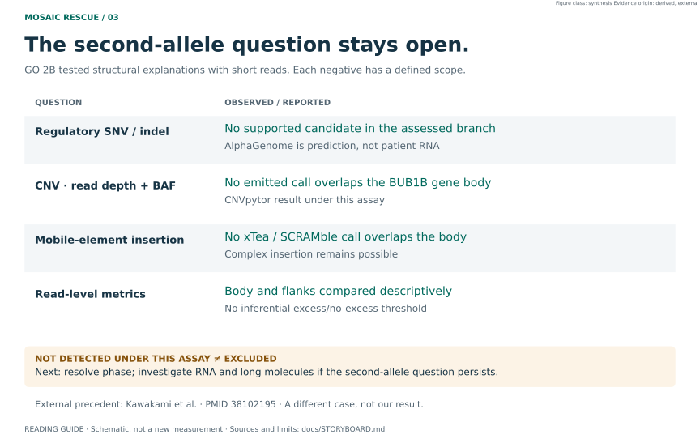
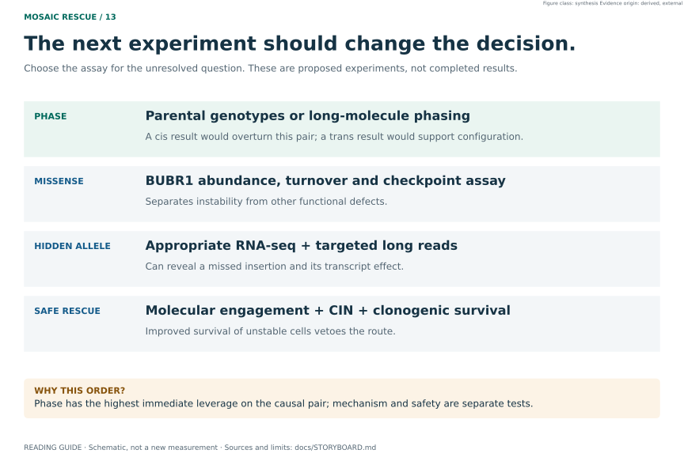

# MOSAIC RESCUE — Track 1 report

**Variant identification in one paediatric genome with suspected mosaic variegated aneuploidy**

Rare Disease, Real Kid: MVA Hackathon 2026
Repository: <https://github.com/Manceb0/mosaic-rescue>

---

## 1 · Summary

A panel-free, genome-wide search over the proband's WGS nominates **candidate compound-heterozygous
`BUB1B`** (MVA1, OMIM 257300) as the leading causal hypothesis: a truncating allele plus a
missense allele, both rare, both on the MANE transcript.

Two things are reported that a submission optimised for appearances would omit.

**First, the frozen ranking does not put `BUB1B` first.** The preregistered genetics-only
ranking `A0` places it **#4**. Three genes scored above it. Auditing them showed all three
were common polymorphisms with rsIDs whose frequency the annotation had failed to attach. A
later sensitivity analysis, `A0-FREQFIX`, repairs those 33 alleles and returns `BUB1B` to
**#1**. Both numbers are reported together, always. `A0` is never rewritten.

**Second, the phase is unresolved.** No parental samples were provided, and the two alleles
are separated by a gap 13.8× the sequencing fragment length, so read-backed phasing cannot
reach. `PM3` is therefore blocked and the biallelic configuration is a **candidate**, not a
demonstrated finding. The correct description is *candidate compound heterozygosity with
phase unresolved*, and nothing stronger.

A **research secondary/incidental candidate** is also reported: a heterozygous nonsense
variant in `LZTR1`, ClinVar pathogenic/likely pathogenic. It is not proposed as the cause of
this phenotype, and it is **not** presented as a returnable clinical finding: it would require
independent clinical confirmation and appropriate return-of-results handling before it meant
anything to anyone.

**Bottom line.** `BUB1B` is the best-supported explanation this genome can offer, and its
candidate genotype, one truncating allele plus one missense, is the canonical configuration of
MVA type 1 ([Hanks et al. 2004](https://doi.org/10.1038/ng1449)). It is a strong hypothesis, not a diagnosis. Four things remain unproven,
and each needs a new observation rather than more computation: the phase of the two alleles,
the function of the missense, the safety of any rescue, and whether the method works on other
patients. §7b states the conclusions and the experiment that decides each question.

## 2 · Data and its limits, established before analysis

One biological sample of blood WGS: four sequencing lanes, eight paired-end FASTQ files,
the provider VCF and a subsequently reconstructed full-depth BAM. All lanes belong to
the same sample. GRCh38 is the reference assembly, not a second participant.
The initial QC notebook sampled lane 1; the later GO 2A/GO 2B work uses the full alignment.

Read quality was assessed before any variant was examined: invariant 149 bp read length, GC
41.3 % against the genome's 41 %, **92.9 % of bases at Q30 or better**, and no poly-G drift.
The data are fit for the question.

What does **not** exist, and what each absence blocks:

| Missing | Consequence |
|---|---|
| Parental genotypes | Phase unresolved; `PM3` blocked |
| RNA-seq | No measured expression or splicing evidence for the case |
| Protein / functional assays | Missense effect and residual function remain unmeasured |
| Single-cell or longitudinal data | Cell-resolved mosaicism and forecasting not attempted |
| Clinical karyotype | No ground truth for any mosaicism signature |
| Contemporaneous blood count | Mitochondrial readout uninterpretable |

The earlier "five of sixteen branches" count described the pre-alignment state. The BAM
blocker has since been resolved. Missing family and functional data still limit the causal
claim; the current per-question inventory is in [the visual guide](../docs/STORYBOARD.md).

## 3 · Method

**No panel was used for the primary search.** Choosing a panel first and finding `BUB1B` in it
would have been confirmation bias, and the project's own rules forbid it. The pipeline
extracted **13 191 positions → 13 216 alleles** of HIGH and MODERATE consequence across
**6 321 genes**, and scored them on genotype configuration, rarity, consequence severity,
transcript status and quality, with no gene-level prior.

Fifteen ranking analyses were run, differing in whether phenotype and ClinVar were used:

| Analysis | What it uses | `BUB1B` |
|---|---|---|
| `A0_GENETICS` (frozen, preregistered) | genetics only | **#4** |
| `A0-FREQFIX` (later sensitivity) | genetics only, 33 frequency annotations repaired | **#1** |
| `A1_GENETICS_CLINVAR` | + ClinVar | #1 |
| `B0_FULL_PROBAND` | + HPO phenotype (Resnik / Best Match Average) | #1 |
| 11 further leave-one-out and ablation analyses | varies | #1 in 14 of 15 overall |

**An independent external baseline was run on the same VCF.** Exomiser, a method this project
did not write, places `BUB1B` **#2 of 398 distinct genes**, autosomal-recessive model, in both
runs. Agreement between an in-house score and an independent tool is worth more than either
alone.

**Phenotype handling.** Seven HPO terms from the clinical document, plus one family-history
term kept on a separate channel so it cannot contaminate the primary result. A frozen polarity
rule applies: **only documented terms count as positive; anything unmentioned is UNKNOWN,
never negative.** Semantic similarity uses Resnik information content in bits with Best Match
Average aggregation.

## 4 · Curation of the two alleles

Research-grade ACMG/AMP curation, Bayesian points.

**Truncating allele** — `PVS1` (nonsense on the MANE transcript, NMD-predicted),
`PM2_Supporting` (rare). **9 points → Likely Pathogenic.**

**Missense allele** — remains **VUS**. Three criteria were considered and rejected with the
data in front of us:

- **`PM1` does not apply.** The intuition that the residue sits in a hot domain does not
  survive the data: **1 497 ClinVar missense records across `BUB1B`, 95.3 % of them VUS, and a
  single P/LP.** There is no demonstrable hotspot anywhere in the gene.
- **`PM3` is blocked** by unresolved phase.
- **`PS3` needs a functional assay** that does not exist for this variant.

Orthologous conservation does support concern: the position sits in the 90th percentile of its
own protein, the chemical property is conserved in 99.2 % of 120 orthologs, and the class of
substitution introduced appears in none of them. **This does not change the ACMG call**, and
it is reported as mechanism, not as evidence of pathogenicity.

**What the literature says about this configuration.** According to PubMed, the first
families with BUB1B-associated MVA carried truncating and missense mutations ([Hanks et al. 2004](https://doi.org/10.1038/ng1449)), and
human MVA1 cases are either biallelic, typically one missense plus one nonsense allele, or
monoallelic combined with variants that lower wild-type BUBR1 ([Wijshake et al. 2012](https://doi.org/10.1371/journal.pgen.1003138)). The candidate pair
therefore matches the expected pattern. That raises the prior plausibility of the hypothesis;
it does not replace phase or functional evidence for these particular alleles.

## 5 · Competing hypotheses, all audited

The value of a panel-free search is that it surfaces competitors. Every gene that outranked or
closely approached `BUB1B` was audited, cheapest falsifier first: **frequency → zygosity →
mechanism → replication.**

| Competitor | Where it appeared | Verdict |
|---|---|---|
| `CTU2`, `PEX5`, `SLC22A1` | `A0` #1–#3 | **NEGATIVE** — common polymorphisms with rsIDs, up to 313 150 homozygotes in gnomAD |
| `FANCD2` | Exomiser #6 | **NEGATIVE** — three alleles at ~47 % population frequency, all heterozygous, no recessive configuration possible |
| `LZTR1` | `B0` #4 | **NEGATIVE as a cause of MVA** — the syndromic form is recessive and only one allele is present; heterozygous LoF causes adult-onset schwannomatosis, and `LZTR1` has no established role in chromosome segregation |
| `IGBP1` | `B0` #6 | **NEGATIVE** — the only reported disease mechanism is 5'UTR disruption of translation initiation, not coding missense; the association rests on a single family; and `MAX_AF` 1 × 10⁻⁴ is strongly inconsistent with an ultra-rare, penetrant, causal model. The verdict rests on all three together, not on the frequency argument alone |

`FANCD2` deserves a note: it is the Fanconi anaemia pathway, which overlaps MVA in **both**
phenotype and mechanism. It was the most uncomfortable competitor and was audited rather than
avoided.

## 6 · Research secondary / incidental candidate

The proband carries a **heterozygous nonsense variant in `LZTR1`** on the MANE transcript:
high quality (DP 48, GQ 99, allele balance 0.50, PASS), rare (`MAX_AF` 3 × 10⁻⁵), and
classified **pathogenic/likely pathogenic in ClinVar**. It is not an artefact.

It does not explain the reported phenotype, for the reasons in §5. It is submitted with
`finding_type = secondary` and a low `epcr` because it is real and the submission format has a
field for exactly this; the hackathon rules state that secondary and incidental findings are
welcome and do not penalise the automated Track 1 score.

**It is a research candidate, not a returnable clinical result.** Calling it a "secondary
finding" without that qualifier would imply a clinical status it has not earned. Independent
confirmation by an orthogonal method, clinical interpretation and any return-of-results
decision belong to the clinical team, and this project makes no clinical recommendation. It is
also deliberately kept out of the main MVA narrative: it would distract from `BUB1B` and open a
separate and much larger clinical conversation.

## 7 · The second-allele problem and the completed short-read analysis



The full-depth BAM made read-based structural analysis possible. This is a technical
extension of the same biological sample, not an independent biological replication.
GO 2B reached its frozen final state on 11 September 2026; the decision record in
`docs/DECISIONS.md` supersedes older descriptions of this work as awaiting alignment.

| Evidence class | Frozen finding | What it cannot establish |
|---|---|---|
| CNVpytor RD+BAF | No emitted CNV overlaps the BUB1B gene body | Exclusion of every structural lesion or cell-level aneuploidy |
| xTea / SCRAMble MEI | No emitted MEI call overlaps the gene body | Exclusion of a complex intronic insertion |
| AE3 read-level assay | Body and equal-length flanks reported side by side | An excess/no-excess claim: no inferential threshold was defined |
| AE1 partner context | Gene-associated breakpoint context for alternative local calls | A proven retrocopy or processed-pseudogene insertion architecture |
| AE2 population lookup | NOT EXECUTED (data policy) | A negative population lookup or a rarity conclusion |

The caller's genome-wide inventory is not a set of adjudicated alternative diagnoses.
Closing the operational stages also does not by itself establish a result for every
preregistered subquestion. The frozen local `REPORTE_GO2B_STOP_CIENCIA.md`
(hash verified against `docs/go2b_final_artifacts.sha256.json`) reports recovery of
both prioritized alleles in the reconstructed reads (technical replication), a negative
DMPK expansion screen within its short-read scope, and an aligned MitoRead ratio
without cell-composition adjustment or matched controls. These do not resolve phase,
prove mitochondrial dysfunction or exclude every repeat disorder. The historical
regulatory locus still requires its own output-level reconciliation.

The technical figures are [chromosome RD/BAF](../figures/pub/fig09_cnvpytor_chromosome_rd_baf.svg),
[read-level metrics](../figures/pub/fig10_bub1b_readlevel_assay.svg), and the internal
[MEI/SV map](../figures/pub/fig11_mei_sv_adjudication_map.svg). The latter includes
case-specific positions and is not a public presentation asset.

The regulatory SNV/indel branch remains negative within the evaluated scope. Existing
AlphaGenome ISM/contact figures are EXP-023 model outputs. EXP-024, the separate null and
positive-control calibration, remains preregistered and not executed.

**The missing second allele has a history in this disease.** In seven families with PCS
syndrome, only one BUB1B mutation per family was found in coding sequence, while transcript and
protein levels were reduced ([Matsuura et al. 2006](https://doi.org/10.1002/ajmg.a.31069)). Later cases located the hidden allele outside the exons:
an intronic Alu insertion together with a promoter-region variant ([Kato et al. 2017](https://doi.org/10.1038/hgv.2017.21)), and a 3 kb Alu/SVA
intronic insertion that short-read genome sequencing missed and RNA-seq plus targeted long reads
found ([Kawakami et al. 2024](https://doi.org/10.1038/s10038-023-01211-8)). This case sits at the same frontier. Short-read structural analysis narrowed the
space; it could not close it.

External precedent supports preserving the short-read limitation: another BUB1B case
required RNA-seq and targeted long reads to reveal an intronic insertion and aberrant
splicing. It does not show that this case has the same lesion.
[PubMed 38102195](https://pubmed.ncbi.nlm.nih.gov/38102195/),
[DOI 10.1038/s10038-023-01211-8](https://doi.org/10.1038/s10038-023-01211-8).

## 7a · What would falsify this, and the next experiment

- **Parental genotypes or long-molecule phasing showing both alleles in *cis*.** This
  would overturn this two-allele recessive explanation, not exclude every BUB1B mechanism.
- A variant-specific **BUBR1 abundance/turnover assay** showing no reduction would weaken
  the instability route. A checkpoint/segregation assay is also needed to assess other
  functional defects; normal abundance alone does not establish benignity.
- An independently supported structural or copy-number variant at another locus explaining
  the phenotype more economically; the raw caller inventory has not established one.
- A second `LZTR1` allele found by a method this pipeline cannot run, which would reopen
  recessive Noonan syndrome.



Priority is phase for the causal pair, followed by variant-specific functional evidence.
RNA-seq and targeted long reads remain routes for a hidden allele if that question persists.
None of these assays is represented as already performed in this case.

## 7b · Conclusions

**What this work establishes, from most to least certain.**

1. **The data answer the question they can answer.** One blood genome, high-quality reads,
   a reconstructed full-depth alignment and technical recovery of both prioritised alleles.
2. **`BUB1B` is the best-supported explanation in this genome.** It competed against 6 321
   genes without a panel. It is #4 in the frozen ranking only because three common
   polymorphisms lacked frequency annotations; with those repaired it is #1, and it is #1 in
   14 of 15 analyses. An independent method on the same VCF places it #2 of 398. Every
   competitor that approached it was audited and rejected for a stated reason.
3. **The candidate genotype is the canonical MVA1 configuration**: a truncating allele,
   research-curated as likely pathogenic, and a missense VUS ([Hanks et al. 2004](https://doi.org/10.1038/ng1449); [Wijshake et al. 2012](https://doi.org/10.1371/journal.pgen.1003138)).
4. **The structural search narrowed the second-allele question without closing it.** No
   copy-number or mobile-element call overlaps the gene body, and no alternative local
   structural signal explains the case. A complex intronic insertion, the lesion that has
   hidden second alleles before ([Matsuura et al. 2006](https://doi.org/10.1002/ajmg.a.31069); [Kato et al. 2017](https://doi.org/10.1038/hgv.2017.21); [Kawakami et al. 2024](https://doi.org/10.1038/s10038-023-01211-8)), is not excluded.
5. **Our own method was challenged and corrected.** The initial explanation of the BAF signal
   was falsified by a post-hoc ablation and is reported as such.

**What it does not establish.** A diagnosis, a biallelic configuration, the effect of the
missense, a mosaic cell fraction, a working rescue, or that the method generalises.

**The four questions only new observations can answer.**

| Open question | Why no further computation on this genome can answer it | Decisive observation | If the result goes one way | If it goes the other way |
|---|---|---|---|---|
| **1 · Phase** | One sample, no parents; the two alleles lie 13.8× the fragment length apart, beyond read-backed phasing | Parental genotyping at both sites, or targeted long-read phasing of the child | **Trans:** the canonical biallelic MVA1 configuration is present; the missense still needs functional evidence | **Cis:** this pair cannot be the recessive explanation; the hidden-allele search becomes the primary question |
| **2 · Missense function** | The missense is a VUS; 95.3 % of ClinVar missense in the gene are VUS and there is no hotspot; conservation and structure are predictions | Variant expressed in isogenic cells: BUBR1 abundance and turnover, kinetochore localisation, checkpoint arrest, segregation errors, with wild-type and known MVA-allele controls | Reduced abundance or checkpoint failure: functional support for pathogenicity; published work links a >50 % loss of BUBR1 expression or activity to PCS ([Matsuura et al. 2006](https://doi.org/10.1002/ajmg.a.31069)) | Normal on every readout: the pair is weakened; a hidden allele or another gene becomes more likely |
| **3 · Safe rescue** | No compound has been tested in any system relevant to this allele; all rescue evidence is external | Isogenic assay measuring target engagement, chromosome segregation errors and clonogenic survival **together**, with a genetic positive control | Fewer segregation errors without extra survival of unstable cells: the arm advances to further preclinical work | More survival of unstable cells: **veto**, even if another readout improves |
| **4 · Generality of the method** | Only one patient was analysed; rules were built on this case | Run the frozen pipeline, unchanged, on previously solved cases with known causal genes, blinded to the answer | The known genes rank at the top: evidence that the procedure transfers | They do not: the contribution is the audit trail, not the ranking |

**Priority.** Phase first: it is the cheapest observation and it decides whether this pair can
be the explanation at all. Then the missense assay, whose controls follow published MVA-cell work
([Suijkerbuijk et al. 2010](https://doi.org/10.1158/0008-5472.CAN-09-4319)). RNA-seq and targeted long reads are needed only if phase is *cis* or function is normal.
The rescue assay is designed now, but it is only worth running on a confirmed mechanism.

**What we would tell a clinical team.** This is a research hypothesis with a clear next test,
not a result to act on. The report makes explicit which inference rests on which evidence and
which observation would overturn it.

## 8 · Submission file

`work/submission/track1_predictions.csv`, generated by `src/submission/track1_csv.py`.

**The CSV is not in the repository, deliberately.** The required format carries chromosome,
position, reference and alternate alleles and the proband identifier for a living minor. That
is precisely what the project's first hard rule forbids committing, even temporarily. The
generator lives in the repository; the file it writes lands in a gitignored directory and is
uploaded by hand. The method is auditable without anyone seeing a coordinate.

Two rows are submitted. Up to ten are allowed, and padding the file with the already-audited
competitors would have been hedging against our own analysis.

`epcr` values are **declared subjective probabilities, not model output**. Their full
justification is in `EPCR_RATIONALE` inside the generator. `BUB1B` is set at 0.75 rather than
higher because the phase is unresolved, the missense is still a VUS, and SV/CNV at the locus
has not been excluded.

## 9 · Reproducibility

```bash
pip install -r requirements.txt
python src/verify.py
```

`verify.py` runs without any patient data: unit tests, module imports (discovered, not
hand-listed), published figure counts recomputed from the executed notebooks, both Track 2
matrices, the privacy scanner and the superseded-claim auditor.

Figures regenerate from `src/figures/` and are **deterministic**: fixed `svg.hashsalt` and no
embedded date, so a re-render produces byte-identical SVGs. The environment moved from
matplotlib 3.7.2, which has no CPython 3.12 wheel on any platform and so could not be
installed by anyone else, to **matplotlib 3.8.4**; the nine publication figures that
existed at that point were then
re-rendered and compared pixel by pixel against the originals: **0 differing pixels, maximum
channel deviation 0.**

One honest caveat: the privacy scanner reads its list of case-specific forbidden values from a
gitignored file. Elsewhere it still checks structural patterns (coordinates, HGVS, genotypes,
local paths) but not the case values, and it says which of the two it did on every run.

## 10 · AI use disclosure

Required by the submission rules.

| | |
|---|---|
| **Provider** | Anthropic (earlier recorded work); OpenAI (current visual integration) |
| **Interface** | Claude Code; Codex desktop |
| **Model** | Earlier record: Claude Opus 5, to be checked by maintainer; current session: GPT-6 |
| **Plan / tier** | *To be completed by the maintainer* |
| **Data-handling setting** | *To be completed by the maintainer* |

**What the assistant did:** wrote and refactored the analysis code, figure modules and
notebooks; drafted documentation; performed literature searches; audited the repository for
internal inconsistencies and stale numbers.

**What it did not do:** it did not choose the final therapeutic candidate, and it did not
commit or push to the repository. The project's operating rules define explicit stop
conditions, and the choice of therapeutic candidate is one of them; those decisions are the
maintainer's.

**Patient data and external services.** The assistant reviewed local project documents,
user-supplied figures and selected tool outputs. This is not a claim of zero disclosure to
an AI provider; account data-handling settings require maintainer verification. Raw WGS
files are kept out of version control. The earlier project record also documents an
external service that received patient-derived values:
**AlphaGenome**, which was given a variant shortlist, never the VCF. It runs in an isolated
virtual environment so that no ordinary run of this repository can reach it, its outputs are
cached, and the call is not repeated on a normal build. This is documented in
`docs/03_ALPHAGENOME_ASSESSMENT.md`.

> **Note on the two blank fields.** The plan or tier and the account's data-handling
> configuration are properties of the maintainer's own account. They are deliberately left blank
> rather than guessed: this project's rules forbid writing an unverified fact, and an invented
> compliance statement would be worse than an incomplete one. **They must be filled in before
> submission.**

## 11 · Acknowledgements and data citation

This work was carried out for the Rare Disease, Real Kid: MVA Hackathon 2026, organised by
**Sage Bionetworks**, the **MVA Society**, **Hugging Face**, **BEACON**, **AWS** and
**Anthropic**.

> **Dataset citation: to be completed before submission.** The rules require the hackathon
> dataset to be cited using the reference provided on the hackathon Synapse page. That
> reference was not retrieved in this session and is therefore not transcribed here, per the
> project's rule against writing unverified identifiers.

**Dataset provenance.** The hackathon dataset is distributed through the Synapse project [`syn76251147`](https://www.synapse.org/Synapse:syn76251147/wiki/642892). The **formal citation is not reproduced here**: it is not visible on the public page without an authenticated session, and this project does not write a reference it has not read. It must be copied verbatim from the authorised session before submission.

**Privacy.** This report omits variant coordinates, HGVS strings, genotypes and sample
identifiers. Some internal technical figures elsewhere in the private repository contain
case-specific locus information; a privacy scan alone does not authorize public release.
No attempt was made to locate the family.

## 12 · Licence

Documentation, notebooks and figures: CC BY 4.0. Code: dual-licensed **MIT OR CC BY 4.0**, so
that the whole submission is available under CC BY as the rules require, while code reuse gets
a licence built for software. See `LICENSE` and `LICENSE-DOCS`.
